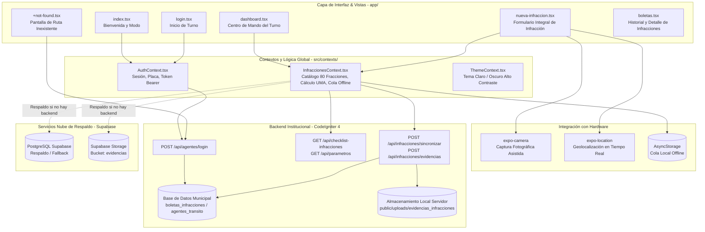
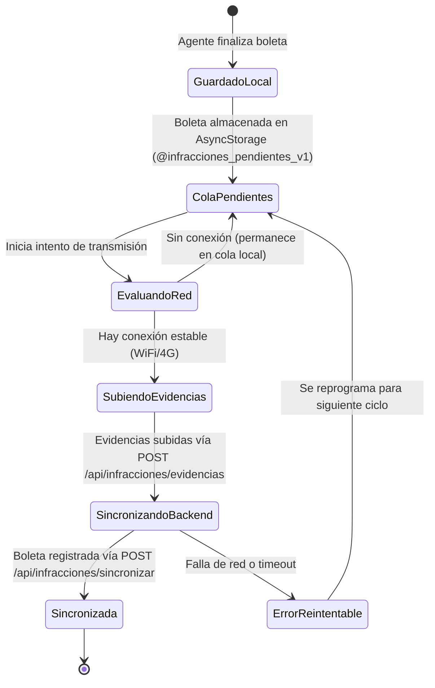

# Sistema Integral de Ventanilla Única de Movilidad y Transporte de Uriangato
## Documentación Técnica Exhaustiva de la App Móvil para Agentes de Tránsito

**Gobierno Municipal de Uriangato, Guanajuato**  
**Dirección de Movilidad y Transporte**  
**Versión de la App Móvil:** 2.5.0  
**Stack Principal:** React Native 0.86 | Expo SDK 57 | TypeScript | Expo Router | Supabase JS SDK  
**Directorio en Repositorio:** `mobile/agentes-transito/`  
**Fecha de Actualización:** Octubre 2026  

---

## 1. Visión y Propósito Operativo de la App Móvil

La **App Móvil de Agentes de Tránsito** es una herramienta digital de campo diseñada para dotar a los oficiales de la Dirección de Movilidad y Transporte de Uriangato de una plataforma ágil, segura y legalmente robusta para el levantamiento de infracciones viales en la vía pública.

La aplicación resuelve de raíz las problemáticas históricas del levantamiento manual en papel:
* **Elimina errores de tabulador y cálculo:** Automatiza el cálculo de multas con base en la Unidad de Medida y Actualización (UMA) vigente de Uriangato.
* **Aporte de Evidencia Inobjetable:** Obliga y asiste en la captura de fotografías georreferenciadas con coordenadas GPS de alta precisión en el momento exacto de los hechos.
* **Operatividad Continua (Offline-First):** Funciona al 100% de sus capacidades aún en zonas sin cobertura celular ni señal de datos móviles, sincronizando automáticamente con el sistema central al recuperar conectividad.
* **Trazabilidad y Transparencia:** Genera folios únicos inalterables y registra la identidad del oficial emisor, hora, ubicación y garantías retenidas.

---

## 2. Arquitectura Tecnológica y Estructura del Proyecto



---

## 3. Estructura de Carpetas del Módulo Móvil

```
mobile/agentes-transito/
├── app/                          # Enrutamiento basado en archivos (Expo Router)
│   ├── _layout.tsx               # Layout raíz: proveedores de contexto (Theme, Auth, Infracciones)
│   ├── index.tsx                 # Pantalla inicial de bienvenida y verificación de estado
│   ├── login.tsx                 # Inicio de turno del oficial (placa y contraseña)
│   ├── +not-found.tsx            # Ruta no declarada; los agentes no se autorregistran
│   ├── dashboard.tsx             # Panel de mando: turno activo, métricas y botón de nueva infracción
│   ├── nueva-infraccion.tsx      # Formulario de captura: cámara, GPS, catálogo y garantías
│   └── boletas.tsx               # Historial de infracciones con filtros y visor de evidencias
├── assets/                       # Logotipos institucionales, iconos y fuentes tipográficas
├── src/                          # Lógica de negocio modularizada
│   ├── api/                      # Clientes HTTP y llamadas de autenticación
│   │   ├── agents.ts             # Registro y validación contra API CodeIgniter 4
│   │   ├── auth.ts               # Autenticación de agentes
│   │   └── client.ts             # Cliente fetch normalizado con manejo seguro de URLs
│   ├── components/               # Componentes visuales reutilizables
│   │   └── ThemeToggle.tsx       # Botón de alternancia de tema Claro / Oscuro
│   ├── constants/                # Constantes globales y variables de entorno
│   │   ├── config.ts             # Resolución dinámica de API_BASE_URL (Web vs Nativo)
│   │   ├── defaultCatalog.ts     # Catálogo normativo base precargado para uso offline
│   │   └── theme.ts              # Paletas de color optimizadas para alto contraste
│   ├── contexts/                 # Contextos de React para estado global
│   │   ├── AuthContext.tsx       # Manejo de sesión y almacenamiento seguro de credenciales
│   │   ├── InfraccionesContext.tsx # Motor de cálculo, persistencia local y sincronización
│   │   └── ThemeContext.tsx      # Gestión de temas Claro/Oscuro
│   ├── services/                 # Integración con APIs externas y Supabase
│   │   └── supabase.ts           # Cliente Supabase JS, subida de fotos y persistencia
│   └── types/                    # Definiciones TypeScript de datos
│       └── infraccion.ts         # Tipos: BoletaInfraccion, InfraccionCatalogo, GarantiaRetenida
├── app.json                      # Configuración de Expo (nombre, bundleId, permisos)
├── package.json                  # Dependencias de npm y scripts de compilación
└── tsconfig.json                 # Configuración del compilador de TypeScript
```

---

## 4. Pantallas y Experiencia de Usuario (UI/UX) al Detalle

### 4.1. `app/index.tsx` (Bienvenida y Selección de Modo)
* **Propósito:** Punto de entrada accesible.
* **Componentes:**
  * Escudo oficial de Movilidad y Transporte Uriangato.
  * Selector de tema (Claro / Oscuro) en la barra superior.
  * Botones de acción rápida: "Iniciar Turno" y "Registrar Oficial".
  * Detección reactiva de sesión: si el agente ya tiene sesión activa guardada, navega directamente a `dashboard.tsx`.

### 4.2. `app/login.tsx` (Inicio de Turno)
* **Propósito:** Identificación del agente en vía pública.
* **Campos:**
  * Número de Placa / Credencial (formato automático en mayúsculas, ej. `AGT-102`, `AGT-204`).
  * Contraseña / PIN con botón para alternar visibilidad.
* **Validación:**
  * Validación local previa de longitud y caracteres.
  * Consulta prioritaria contra la API del backend institucional (`POST /api/agentes/login`) validando contra la tabla `agentes_transito` con hash BCrypt y entrega de Bearer token.
  * En éxito, persiste el estado de sesión en `AsyncStorage` (`@agente_sesion_activa_v1`) y redirige a `dashboard.tsx`.

### 4.3. `app/+not-found.tsx` (Ruta Inexistente) y `app/perfil.tsx`

* **`+not-found.tsx`:** pantalla de cierre para cualquier ruta no declarada del enrutador por archivos de Expo Router. Existe porque el enrutador de Expo **no admite `+unmatched.tsx`** con los símbolos que genera `createRootNavigator`; la convención correcta es `+not-found.tsx`. Ofrece enlace explícito de regreso al turno.
* **`perfil.tsx`:** identidad del oficial en turno —placa, nombre, sector y cierre de sesión— leídos de la sesión local, sin consulta nueva al backend.

> **Decisión de seguridad documentada (y corrección a esta guía):** la app **no tiene pantalla de autorregistro**. Los agentes de tránsito tienen capacidad de sanción, por lo que solo el administrador los da de alta desde el panel (`/admin/app-transito`, ruta `app-transito/agentes/guardar`). El endpoint `POST /api/agentes/registro` y la pantalla `registro.tsx` que describían versiones anteriores de este documento **ya no existen** en el código ni en `app/Config/Routes.php`; el registro público quedó restringido a ciudadanos.

### 4.4. `app/dashboard.tsx` (Centro de Mando de Turno)
* **Propósito:** Pantalla principal durante la jornada de trabajo del oficial.
* **Módulos Visuales:**
  * **Tarjeta de Oficial:** Fotografía/Avatar, Nombre del Agente, Placa activa y Sector de patrullaje.
  * **Botón Primario Destacado:** `+ Levantar Nueva Infracción` con diseño amplio y accesible para operación rápida a una mano.
  * **Resumen de Turno:**
    * Infracciones levantadas en el turno actual.
    * Infracciones pendientes de sincronización (con badge de alerta amarilla/naranja si existen boletas en cola).
  * **Botón de Sincronización Manual:** Fuerza la transmisión inmediata al backend municipal (`/api/infracciones/sincronizar` y `/api/infracciones/evidencias`) al tener cobertura.
  * **Acceso a Historial:** Botón para navegar a la lista de boletas del turno.

### 4.5. `app/nueva-infraccion.tsx` (Formulario Integral de Infracción)
* **Propósito:** Registro estructurado de la falta cometida, conductor, vehículo, evidencias y garantías.
* **Flujo Paso a Paso:**
  1. **Folio y Geolocalización Automática:**
     * Al entrar, la app solicita geolocalización de alta precisión a `expo-location`.
     * Genera automáticamente el folio único bajo el estándar: `BOLETA-URI-{AÑO}-{PLACA}-{TIMESTAMP}`.
     * Muestra la latitud, longitud y dirección aproximada en tiempo real.
  2. **Datos del Infractor y Vehículo:**
     * Nombre del conductor o indicación de "Ausente / No presente".
     * Placa vehicular, Marca, Modelo, Color, Tipo (Particular / Servicio Público / Carga / Motocicleta) y Número de Serie (VIN).
  3. **Captura Fotográfica de Evidencias (Cámara Integrada):**
     * Toma 1: Fotografía legible de la placa vehicular.
     * Toma 2: Fotografía del contexto o hecho vial (señal omitida, cajón prohibido, choque, etc.).
     * Toma 3: Fotografía de la garantía retenida o vehículo montado en plataforma de grúa.
     * Previsualización instantánea con opción de recaptura.
  4. **Selección de Faltas del Reglamento (Catálogo Oficial de 80 Fracciones):**
     * Catálogo completo extraído del Reglamento de Movilidad y Transporte del Municipio de Uriangato, dividido en 15 categorías:
       * Licencias y Permisos para Conducir (1.1 - 1.4)
       * Placas, Tarjeta de Circulación y Calcomanías (2.1 - 2.5)
       * Cinturón de Seguridad y Sistemas de Retención (3.1 - 3.3)
       * Dispositivos Móviles y Distractores (4.1 - 4.2)
       * Casco Protector en Motocicletas y Ciclistas (5.1 - 5.5)
       * Luces y Dispositivos de Seguridad en Vehículos (6.1 - 6.7)
       * Estado Físico y Emocional del Conductor / Alcoholímetro (7.1 - 7.5)
       * Límites de Velocidad (8.1 - 8.3)
       * Preferencia de Paso y Maniobras de Conducción (9.1 - 9.10)
       * Estacionamiento en Vía Pública (10.1 - 10.10)
       * Normas Específicas para Motocicletas (11.1 - 11.5)
       * Transporte Público de Pasajeros y Urbano (12.1 - 12.6)
       * Transporte de Carga y Sustancias Peligrosas (13.1 - 13.5)
       * Protección al Peatón, Discapacidad y Ciclistas (14.1 - 14.5)
       * Orden, Seguridad Vial y Hechos de Tránsito (15.1 - 15.5)
     * Selección múltiple simultánea con cálculo automático del importe total en UMA y en pesos mexicanos ($ MXN).
  5. **Garantías Retenidas:**
     * Selección de garantía asegurada: Placa vehicular, Licencia de conducir, Tarjeta de circulación o Vehículo remitido a pensión/corralón.
     * En caso de remisión con grúa, campos adicionales para Empresa de Grúa, Número de Grúa y Número de Inventario.
  6. **Observaciones del Agente:**
     * Campo de texto libre para asentar detalles relevantes del operativo.
  7. **Guardado y Transmisión:**
     * Guarda la boleta de manera inmediata en la cola local de `AsyncStorage` con estado `pendiente`.
     * Si hay internet activo, inicia inmediatamente la subida de evidencias (`POST /api/infracciones/evidencias`) y la sincronización con el backend municipal (`POST /api/infracciones/sincronizar`), actualizando el estado local a `sincronizada`.

### 4.6. `app/boletas.tsx` (Historial y Consulta de Infracciones)
* **Propósito:** Auditoría y verificación de boletas emitidas por el oficial.
* **Funcionalidades:**
  * Pestañas de filtrado: "Todas", "Sincronizadas" (verde), "Pendientes" (amarillo) y "Con Error" (rojo).
  * Tarjetas de resumen con folio, placas del vehículo, fecha/hora y monto estimado.
  * Modal detallado al pulsar una boleta: desglose de motivos sancionados, coordenadas del hecho, garantías y galería de fotografías tomadas.

---

## 5. Arquitectura Offline-First y Manejo de Conectividad

La app utiliza una estrategia rigurosa de persistencia local para asegurar que **ninguna infracción se pierda** por falta de cobertura en campo:



### Llaves de Almacenamiento en `AsyncStorage`:
* `@infracciones_pendientes_v1`: Arreglo de objetos `BoletaInfraccion` pendientes de sincronizar o con error.
* `@infracciones_historico_v1`: Registro histórico de las últimas 50 boletas sincronizadas para consulta rápida del oficial.
* `@catalogo_infracciones_cache_v1`: Copia local del catálogo de infracciones tipificadas para permitir su búsqueda sin internet.
* `@parametros_app_cache_v1`: Valor de la UMA vigente, versión de app y configuración de obligatoriedad de fotografías.
* `@agente_sesion_activa_v1`: Datos de la sesión activa del oficial (placa, nombre, token y fecha de inicio de turno).

---

## 6. Sincronización con Backend Municipal y Soporte Híbrido

### 6.1. Transmisión al Backend Municipal (CodeIgniter 4)
El servicio `src/services/supabase.ts` (capa de sincronización) se comunica prioritariamente con el API REST municipal:
1. **Envío de Boletas:** Ejecuta `POST /api/infracciones/sincronizar` enviando el payload JSON completo con folio, placa, infracciones cometidas, garantías retenidas y cálculo en UMA.
2. **Subida de Evidencias:** Ejecuta `POST /api/infracciones/evidencias` mediante `FormData` (`multipart/form-data`) almacenando los archivos en el servidor de ventanilla única (`public/uploads/evidencias_infracciones/`).
3. **Respaldo en la Nube:** Si el backend municipal no estuviese disponible y las llaves de Supabase se encuentran configuradas en el entorno, el servicio ejecuta de forma transparente el respaldo en la tabla `boletas_infracciones` y bucket `evidencias` de Supabase.

### 6.2. Carga y Almacenamiento de Fotografías de Evidencia
Las fotos capturadas con `CameraView` se suben prioritariamente al endpoint `POST /api/infracciones/evidencias` del servidor municipal y se guardan localmente en:
* Servidor CI4: `public/uploads/evidencias_infracciones/{FOLIO}_{TIPO_FOTO}_{TIMESTAMP}.jpg`
* En caso de respaldo Supabase: bucket `evidencias/{AÑO}/{MES}/{FOLIO}_{TIPO_FOTO}_{TIMESTAMP}.jpg`
* Las rutas de acceso o URLs generadas se asocian en el arreglo `fotos_urls` de la boleta.

---

## 7. Compilación, Empaquetado y Despliegue Multiplataforma

### 7.1. Compilación Web SPA para Servidor Municipal (`/public/agentes/`)
La app móvil se compila como una Single Page Application (SPA) para estar disponible en los navegadores móviles o computadoras de base:
```bash
cd mobile/agentes-transito
npm install --legacy-peer-deps
npx expo export --platform web --output-dir ../../public/agentes --clear
```
Esta exportación genera el bundle estático en `public/agentes/`, servido por el script `scripts/vercel-install.sh` y enrutado por `vercel.json`.

### 7.2. Compilación de APK Nativo para Dispositivos Android (EAS Build)
Para generar el archivo ejecutable (`.apk`) para los teléfonos de los agentes de tránsito:
```bash
cd mobile/agentes-transito
# Iniciar sesión en EAS CLI
npx eas login

# Compilación de APK de desarrollo o producción
npx eas build -p android --profile preview
```
El archivo `.apk` resultante se instala directamente en los dispositivos de campo de la Dirección de Tránsito.

---

## 8. Verificación de Funcionamiento y Pruebas

1. **Ejecución del Entorno de Desarrollo (Metro Bundler):**
   ```bash
   cd mobile/agentes-transito
   npx expo start
   ```
   * Pulsa `w` en la consola para abrir en el navegador web local.
   * Pulsa `a` para abrir en emulador Android o escanea el código QR con Expo Go en un dispositivo móvil.
2. **Prueba de Modo Fuera de Línea:**
   * Abre la app en el dispositivo o navegador.
   * Activa el "Modo Avión" o desconecta la red en la pestaña Network de DevTools.
   * Levanta una boleta completa y pulsa guardar: se validará el aviso "Infracción guardada localmente (pendiente de sincronización)".
   * Reconecta la red y presiona "Sincronizar": la boleta pasará automáticamente al estado "Sincronizada".

### 8.1. Verificación Automatizada del Cliente (sin Expo ni dispositivo)

La app incluye un verificador de flujo de autenticación ejecutable con Node puro, sin levantar Metro ni require un teléfono:

```bash
cd mobile/agentes-transito
node tests/auth-flow.test.cjs     # 18 casos
npx tsc --noEmit                  # tipos del cliente; debe salir limpio
```

Los 18 casos cubren, entre otros: inicio de turno con placa y PIN, emisión y **caducidad del token de portador**, persistencia de la cola local, y —el caso más importante operacionalmente— que **un `401` al sincronizar no destruya trabajo**: las boletas aceptadas antes del error quedan sincronizadas, el resto permanece pendiente y la app pide volver a iniciar sesión en lugar de descartar el turno. También se verifica que otros errores (500, sin red) **no** fuercen un cierre de sesión espurio.

> `package.json` no declara un script `test` ni `typecheck`; hay que invocar los dos comandos anteriores directamente. Si se prefiere integrarlos en CI, agregar `"test": "node tests/auth-flow.test.cjs"` y `"typecheck": "tsc --noEmit"` es el cambio mínimo.

### 8.2. Verificación de Sincronía con el Backend

Cuando el backend o el panel reciben cambios, la pregunta no es "¿la app funciona?" sino "¿sigue alineada con el contrato vigente?". El procedimiento, con su resultado a la última verificación:

| # | Verificación | Método | Resultado |
|---|---|---|---|
| 1 | **Contrato de API** | Cotejar las rutas invocadas por `src/services/` y `src/api/` contra `app/Config/Routes.php` | Coincidencia exacta en los cinco endpoints: `/api/agentes/login`, `/api/checklist-infracciones`, `/api/parametros`, `/api/infracciones/sincronizar`, `/api/infracciones/evidencias`; las dos de escritura protegidas por el filtro `agenteToken` |
| 2 | **Ausencia de ruptura de contrato** | `git show --stat <último commit>` restringido a los archivos que la app consume | Único cambio fue `app/Models/AgenteTokenModel.php` y es **aditivo** (la clase ya existía); ningún campo consumido desaparece |
| 3 | **Versión publicada** | Comparar `package.json`, `app.json` y el valor por defecto del parámetro `app_version` | `1.0.0` en los tres sitios, y el panel muestra ese mismo valor en "Configuración App Agentes de Tránsito" |
| 4 | **Entorno del cliente** | Revisar `mobile/agentes-transito/.env` | `EXPO_PUBLIC_API_BASE_URL=https://app-residencias.vercel.app` y `APP_ENV=production` |
| 5 | **Estado del código** | `git status` sobre `mobile/` | Sin cambios sin compitear |
| 6 | **Haz servido en `/agentes`** | `git log` comparado entre `mobile/agentes-transito` y `public/agentes` | Ambos en el mismo commit; el export reproduce el contenido servido byte a byte |

**Regla práctica para no perder la sincronía:** cualquier cambio en `mobile/agentes-transito/` queda **invisible en producción** hasta que se vuelve a exportar el haz web:

```bash
cd mobile/agentes-transito
npx expo export --platform web --output-dir ../../public/agentes --clear
```

Un repositorio con el fuente modificado y el `public/agentes` antiguo produce el peor de los fallos: la app de demostración funciona distinto a la app instalada en el teléfono del agente.

> **Precisión importante sobre las dos superficies móviles del proyecto:** `/agentes` es una **SPA de Expo con su propio CSS**, mientras que el portal y el panel son **vistas PHP con `public/css/custom.css`**. Por eso las correcciones de desbordamiento horizontal del panel **no** afectan a la app móvil, y viceversa: reexportar la app no arregla nada del portal. Confundirlas lleva a los dos errores clásicos: editar CSS esperando que cambie la app, o reexportar la app creyendo que así se arregla el portal.
