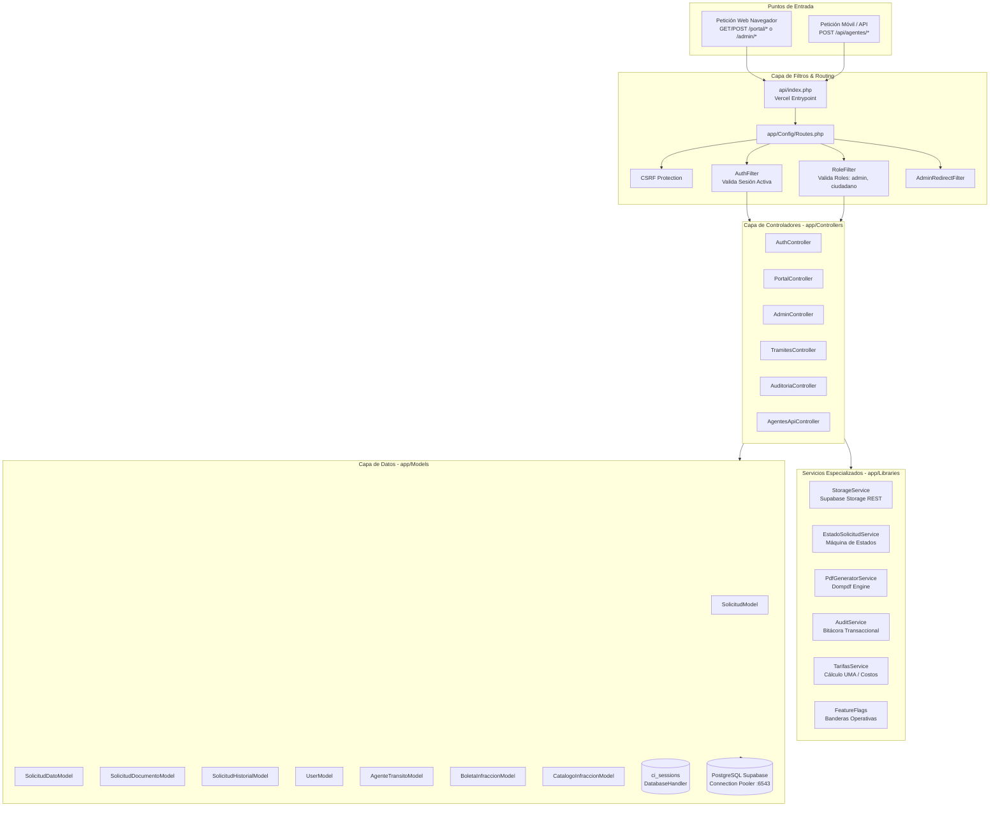

# Sistema Integral de Ventanilla Única de Movilidad y Transporte de Uriangato
## Documentación Técnica Exhaustiva del Backend (CodeIgniter 4 / PHP 8.2)

**Gobierno Municipal de Uriangato, Guanajuato**  
**Dirección de Movilidad y Transporte**  
**Versión del Backend:** 2.5.0  
**Stack Principal:** PHP 8.2+ | CodeIgniter 4.7.4 | PostgreSQL 15+ (Supabase) | Supabase Storage  
**Fecha de Actualización:** Octubre 2026  

---

## 1. Visión General de la Arquitectura Backend

El backend del sistema actúa como el motor transaccional, normativo y de seguridad para todos los procesos de la Dirección de Movilidad y Transporte de Uriangato. Está implementado sobre **CodeIgniter 4.7.4** con tipado estricto en PHP 8.2 (`declare(strict_types=1)`), estructurado bajo el patrón clásico **Modelo-Vista-Controlador (MVC)** y optimizado para ejecutarse en entornos serverless (**Vercel**) conectado a un clúster de alta disponibilidad en **PostgreSQL (Supabase)**.



---

## 2. Estructura de Directorios app/

```text
├── Config/                    # Configuraciones de la aplicación (44 archivos CI4)
│   ├── Database.php           # Conexión a PostgreSQL (PgBouncer en 6543)
│   ├── Filters.php            # Registro y alias de los cinco filtros de seguridad
│   ├── Routes.php             # Definición canónica de rutas Web y API
│   ├── Security.php           # Configuración de tokens CSRF y cookies
│   └── Session.php            # Sesiones en base de datos (tabla ci_sessions)
├── Controllers/               # 26 controladores MVC y API REST
│   ├── Admin/                 # 12 controladores del panel administrativo
│   │   ├── AdminController.php              # Tablero, bandeja de solicitudes y dictamen
│   │   ├── AppTransitoController.php        # Agentes, boletas y catálogo de infracciones
│   │   ├── CatalogoConcesionesController.php# Padrón de concesiones (borrado RESTRICT)
│   │   ├── CatalogoTarifasController.php    # Tarifario dinámico y valor de la UMA
│   │   ├── ConvocatoriasController.php      # CRUD T-01, bases, evaluación y ganadores
│   │   ├── DesgloseController.php           # Desglose navegable de todas las métricas
│   │   ├── DocumentosController.php         # Visor y descarga de expedientes
│   │   ├── PermisosController.php           # Permisología configurable del operador
│   │   ├── SesionesAppController.php        # Sesiones/tokens activos de la app móvil
│   │   ├── SolicitudPresencialController.php# Radicación en ventanilla (los 7 trámites)
│   │   ├── UsuariosController.php           # Cuentas de ciudadanos y funcionarios
│   │   └── VerificacionesController.php     # Citas de inspección física (T-02)
│   ├── Api/                   # Endpoints REST para la App Móvil de Tránsito
│   │   ├── AgentesTransitoApiController.php # Login seguro (BCrypt/Bearer); sin registro público de agentes
│   │   └── InfraccionesApiController.php    # Parámetros, checklist, sincronización y evidencias
│   ├── Ciudadano/             # 9 controladores del portal
│   │   ├── PortalController.php             # Dashboard, mis solicitudes, expediente, perfil
│   │   ├── TramitesController.php           # Catálogo de trámites y API de radicación
│   │   └── Tramite*Controller.php           # Un controlador por trámite (UR-TT-T-01 a 07)
│   ├── Juez/                  # Panel del juez calificador (solo lectura)
│   │   └── DashboardController.php          # Bandeja de boletas, calificación y cobros pendientes
│   ├── DocumentosPagoController.php         # Hoja de pago imprimible de trámites y multas (COB-05)
│   ├── ArchivosLocalesController.php        # Sirve el almacenamiento local con URL firmada
│   ├── AuthController.php      # Autenticación, registro, recuperación y cierre de sesión
│   └── Home.php                 # Portada de ventanilla única (redirige según sesión)
├── Database/
│   ├── Migrations/             # 30 migraciones Spark (la 000024 cambia la FK a RESTRICT;
│   │                           # 000027 a 000030: cobros, rol del juez, calificación y acceso opcional)
│   └── Seeds/                  # 11 semillas: roles, usuarios demo, tarifas, concesiones,
│                               # convocatorias, catálogo de infracciones, boletas y agentes
├── Entities/
│   └── Solicitud.php            # Entidad del expediente maestro
├── Filters/                    # Los cinco middlewares del sistema
│   ├── AdminRedirectFilter.php  # Funcionario que entra a la portada → su panel
│   ├── AgenteTokenFilter.php    # Token de portador para los endpoints de sincronización
│   ├── AuthFilter.php            # Barrera de acceso: sin sesión redirige a /auth/login
│   ├── PermisoOperadorFilter.php # Secciones del panel activas/apagadas por prefijo de URI
│   └── RoleFilter.php            # Validación de roles (aborta con 302, no con 403)
├── Helpers/
│   └── url_helper_custom.php     # Utilerías propias de URLs, normalización y formato
├── Interfaces/
│   └── PaymentGatewayInterface.php # Contrato de pasarela de pago (implementa el mock)
├── Language/es/
│   └── Validation.php            # Mensajes de validación en español
├── Libraries/                    # 17 archivos: 15 servicios y 2 excepciones de dominio
│   ├── AgenteTokenService.php     # Emisión y caducidad de tokens de la app móvil
│   ├── BanbajioMockGateway.php    # Pasarela de pago simulada para el flujo de pruebas
│   ├── CalificacionBoletaException.php # Rechazo de una calificación inválida
│   ├── CalificarBoletaService.php # Calificación de boletas con desglose en UMA (COB-10)
│   ├── CobroException.php         # Rechazo de un movimiento de cobro inválido
│   ├── CobroService.php           # Alta, cobro, condonación y cancelación de cobros (COB-01)
│   ├── CuentaCiudadanoService.php # Alta de ciudadanos, cuenta sin acceso y reclamo (COB-08)
│   ├── DesgloseSistema.php        # Agregación de métricas del desglose del tablero
│   ├── DocumentoUploader.php      # Validación de subida (tamaño, MIME, errores de PHP)
│   ├── EstadoSolicitudService.php # Máquina de estados y reglas de transición
│   ├── FeatureFlags.php           # Flags de activación de trámites (ej. UR-TT-T-06)
│   ├── FolioGenerator.php         # Folio institucional único
│   ├── HojaPagoService.php         # Datos de la hoja de ayuda para el pago (COB-05)
│   ├── PermisosOperador.php       # Catálogo de secciones y resolución por prefijo
│   ├── ResolverMontoInfraccionService.php # Cálculo del monto de infracción en UMA
│   ├── SupabaseStorage.php         # Fachada nube/local con firma HMAC-SHA256
│   └── TarifarioService.php        # Cálculo dinámico de costos y conversión en UMA
├── Models/                         # 24 modelos relacionales
│   ├── SolicitudModel.php          # Maestro de solicitudes y generación de folios
│   ├── SolicitudDatoModel.php      # Datos específicos de trámite (almacenamiento EAV)
│   ├── DocumentoModel.php          # Metadatos de expedientes y hash SHA-256
│   ├── HistorialEstatusModel.php   # Historial inmutable de estados de trámite
│   ├── ConvocatoriaModel.php       # T-01: ventanas de registro, estatus y postulaciones
│   ├── ConcesionModel.php          # Padrón de títulos de concesión
│   ├── UserModel.php / RoleModel.php # Cuentas y los cuatro roles del sistema
│   ├── AgenteTransitoModel.php / AgenteTokenModel.php # Oficiales y sus tokens
│   ├── BoletaInfraccionModel.php / BoletaChecklistItemModel.php # Boletas y checklist
│   ├── CatalogoInfraccionModel.php / CatalogoInfraccionAppModel.php # Tipificación del reglamento
│   ├── CobroModel.php / CobroMovimientoModel.php # Cobros vigentes (COB/REC) y su bitácora
│   ├── BoletaCalificacionModel.php / BoletaCalificacionDetalleModel.php # Calificación del juez y desglose
│   ├── TarifaModel.php / ParametroAppModel.php / ParametroSistemaModel.php # Tarifario y parámetros
│   ├── FormatoTramiteModel.php / VerificacionFisicaModel.php # Formatos e inspecciones
│   └── AuditoriaModel.php          # Bitácora de operaciones del sistema
└── Views/                          # 68 vistas PHP con la convención /** @var */
    ├── admin/                      # Pantallas del panel (incluye convocatorias/, catálogos/,
    │                               # usuarios/ y solicitudes_presenciales/)
    ├── auth/                       # Login, registro, recuperación, términos y privacidad
    ├── errors/                     # Páginas propias de 400, 404, excepción y producción
    ├── layouts/                    # Plantillas base (admin.php, portal.php) y partiales
    └── portal/                     # Portal ciudadano y los formularios de los 7 trámites
```

> La otra mitad del esquema vive en `supabase/migrations/` (16 archivos SQL que se aplican a mano en el **SQL Editor**). Ese doble camino es la causa del *drift* documentado en `DOC_METODOLOGIA_PORTAL_PANEL.md` §11.3.4: `php spark migrate` no los ve, así que hay que cotejarlos con `scripts/verificar_esquema_bd.php`.

---

## 3. Capa de Controladores (Controllers) al Detalle

### 3.1. `AuthController.php`
* **Rutas Gestionadas** (declaración literal en `app/Config/Routes.php`, líneas 15-26 y 133-135):

  | Verbo | Ruta | Acción | `as` |
  |---|---|---|---|
  | GET | `auth/login` | `login` | `login` |
  | POST | `auth/attempt-login` | `attemptLogin` | — |
  | GET | `auth/register` | `register` | `register` |
  | POST | `auth/attempt-register` | `attemptRegister` | — |
  | GET | `auth/logout` | `logout` | `logout` |
  | GET | `auth/forgot` | `forgot` | — |
  | POST | `auth/attempt-forgot` | `attemptForgot` | — |
  | GET/POST | `auth/reset/(:any)` | `reset/$1` | — |
  | GET | `auth/terminos` | `terminos` | — |
  | GET | `auth/privacidad` | `privacidad` | — |
  | GET | `login` · `register` · `logout` | las tres mismas acciones | `acceso` · `registro` · `salida` |

  Las rutas cortas `/login`, `/register` y `/logout` no son pantallas nuevas: son **atajos** al mismo controlador que ya atiende `auth/login`, `auth/register` y `auth/logout`. Cada una necesita un nombre propio (`acceso`, `registro`, `salida`) por la trampa descrita en §7.1.
* **Registro público:** solo de **ciudadanos**. Los agentes de tránsito los crea el administrador desde el panel; no existe autorregistro de personal con capacidad de sanción.
* **Lógica Operativa:**
  * Valida credenciales contra `UserModel` utilizando hashing seguro de contraseñas de PHP (`password_verify` con compatibilidad para `bcrypt` y `Argon2id`).
  * En inicio de sesión exitoso, regenera el ID de sesión para prevenir Session Fixation y establece los datos en `ci_sessions`.
  * Redirecciona inteligentemente según el rol: administradores a `/admin/dashboard`, ciudadanos a `/portal/dashboard`.
  * Registra automáticamente el evento de inicio/cierre de sesión en la bitácora vía `AuditService`.

### 3.2. `PortalController.php`
* **Rutas Gestionadas:**
  * `/portal/dashboard`: Panel principal del ciudadano con estadísticas personales, trámites en curso y accesos rápidos.
  * `/portal/tramites`: Catálogo interactivo de trámites disponibles con buscador en vivo y categorización.
  * `/portal/mis-solicitudes`: Bandeja personal del ciudadano con filtrado por texto, badges de estado interactivos y copiado de folio.
  * `/portal/solicitud/(:segment)`: Vista detallada del expediente, con stepper visual de progreso, desglose de requisitos, visor de documentos y descarga de resolución oficial.
  * `/portal/perfil`: Gestión de datos generales del contribuyente (RFC, teléfono, domicilio).

### 3.3. `TramitesController.php`
* **Rutas Gestionadas:**
  * Formularios de radicación para cada trámite: `/portal/tramites/concesion-transporte`, `/portal/tramites/constancia-despintado`, `/portal/tramites/orden-plaqueo`, `/portal/tramites/permiso-eventual`, `/portal/tramites/cierre-calle`, `/portal/tramites/cesion-concesion`, `/portal/tramites/carga-descarga`.
  * Pantallas de resumen y pasarela de pago: `.../resumen/{folio}`, `.../procesar-pago/{folio}`.
* **Lógica Operativa:**
  * Generación atómica del folio institucional mediante `SolicitudModel::generarFolio($tramite)`.
  * Procesamiento transaccional de archivos adjuntos: subida al bucket `documentos` mediante `StorageService`, cálculo de hash criptográfico SHA-256 e inserción en `solicitudes_documentos`.
  * Inserción de metadatos variables en `solicitudes_datos`.
  * Registro del estatus inicial (`Recibido` o `Pago pendiente`) en `solicitudes_historial`.

### 3.4. `AdminController.php`
* **Rutas Gestionadas:**
  * `/admin/dashboard`: Monitor de mando municipal con conteo de solicitudes por estatus, métricas de recaudación y alertas urgentes.
  * `/admin/solicitudes`: Bandeja general de expedientes con paginación, filtros combinados de búsqueda (folio, RFC, solicitante) y accesos directos por estado.
  * `/admin/solicitudes/(:segment)`: Interfaz de dictaminación donde el revisor evalúa la documentación, visualiza el historial de transiciones y emite cambios de estatus.
  * `/admin/solicitudes/cambiar-estatus`: Endpoint transaccional que valida transiciones permitidas según `EstadoSolicitudService` y **exige obligatoriamente observaciones** cuando el estado destino es `Prevención` o `Rechazado`.
  * `/admin/despintado`: Módulo especializado para agendar citas de inspección física en patio municipal para el trámite UR-TT-T-02.
  * `/admin/infracciones`: Visor administrativo de boletas de infracción levantadas por los agentes viales en la app móvil.

### 3.5. `AgentesTransitoApiController.php` / `InfraccionesApiController.php`
* **Rutas Gestionadas:**
  * `POST /api/agentes/login`: único punto de acceso de la app móvil; valida placa y contraseña contra `agentes_transito` con BCrypt y emite token de portador con caducidad.
  * `GET /api/checklist-infracciones`: entrega el catálogo normativo de infracciones tipificadas y los parámetros de la UMA en formato JSON para el consumo de la app móvil.
  * **No existe `POST /api/agentes/registro`.** Los agentes de tránsito tienen capacidad de sanción y por eso **no se autorregistran**: solo el administrador los da de alta desde `/admin/app-transito` (`app-transito/agentes/guardar`, protegido por `role:administrador`). Cualquier documento anterior que mencionara ese endpoint está desactualizado.
* **Lógica Operativa:**
  * Respuestas normalizadas con encabezados `Content-Type: application/json` y códigos HTTP RFC estándar (`200 OK`, `201 Created`, `400 Bad Request`, `409 Conflict`, `500 Internal Server Error`).

### 3.6. `Juez\DashboardController.php`
* **Filtros:** `auth` y `role:juez_calificador` en todo el grupo `/juez`.
* **Rutas Gestionadas:**
  * `GET /juez` y `GET /juez/boletas`: bandeja de boletas recibidas desde la app de campo, con folio, fecha, placas e infractor.
  * `GET /juez/boletas/{id}`: detalle con evidencia fotográfica y faltas tipificadas.
  * `POST /juez/boletas/{id}/vista-previa`: calcula el desglose en UMA sin persistir, para que el juez revise antes de firmar.
  * `POST /juez/boletas/{id}/calificar`: delega en `CalificarBoletaService::calificar()` y genera el cobro correspondiente.
* **Mesa de cobros:** `index()` arma también `$cobrosPendientes` (`CobroModel`, `origen = 'boleta'` y `estatus = 'pendiente'`, los 10 más recientes con el folio de su boleta) y enlaza cada renglón a la hoja de pago. El juez **consulta** el cobro; no puede marcarlo como pagado.

### 3.7. `DocumentosPagoController.php`
* **Filtros:** solo `auth` en el grupo `/documentos`; el permiso fino se resuelve dentro del controlador porque depende del documento y del dueño, no del rol.
* **Rutas Gestionadas:**
  * `GET /documentos/hoja-pago/solicitud/{folio o id}`: acepta el folio institucional o el identificador numérico; resuelve con `SolicitudModel::findByFolio()` o por llave primaria.
  * `GET /documentos/hoja-pago/boleta/{id}`: hoja de una multa calificada.
* **Regla de autorización:** el personal (`administrador`, `operador_ventanilla`, `juez_calificador`) imprime cualquier documento; el `ciudadano` solo los de sus propios trámites y **nunca** las multas. Cuando la solicitud no es suya responde con redirección y aviso `error`; cuando el folio no existe lanza `PageNotFoundException` (404 propio, no 500).

---

## 4. Capa de Modelos (Models) y Persistencia de Datos

### 4.1. `SolicitudModel.php`
* **Tabla Relacionada:** `solicitudes`
* **Campos Principales:** `id`, `folio`, `ciudadano_id`, `tramite`, `estatus`, `monto`, `fecha_creacion`, `fecha_pago`, `fecha_actualizacion`.
* **Método Especial:** `generarFolio(string $tramite): string`
  * Construye un folio institucional inmutable bajo la nomenclatura: `UR-TT-{SUFIJO}-{AÑO}-{CONSECUTIVO_5_DIGITOS}` (ejemplo: `UR-TT-T01-2026-00042`).

### 4.2. `SolicitudDatoModel.php`
* **Tabla Relacionada:** `solicitudes_datos`
* **Esquema:** Almacenamiento tipo **EAV (Entity-Attribute-Value)** con columnas: `solicitud_id`, `campo`, `valor`.
* **Propósito:** Permite almacenar atributos dinámicos que difieren entre los 7 trámites sin requerir alteraciones al esquema relacional de la tabla principal.
* **Método Especial:** `porSolicitudAgrupado(int $solicitudId): array`
  * Devuelve un arreglo asociativo `['campo' => 'valor']` para consumo inmediato en vistas y reportes.

### 4.3. `SolicitudDocumentoModel.php`
* **Tabla Relacionada:** `solicitudes_documentos`
* **Campos:** `solicitud_id`, `tipo_documento`, `nombre_original`, `ruta_storage`, `tamano_bytes`, `mime_type`, `sha256_hash`, `fecha_subida`.
* **Garantía de Integridad:** El campo `sha256_hash` almacena la firma criptográfica generada al momento de la carga. Esto permite verificar judicialmente que un documento no ha sido alterado ni reemplazado con posterioridad.

### 4.4. `SolicitudHistorialModel.php`
* **Tabla Relacionada:** `solicitudes_historial`
* **Campos:** `solicitud_id`, `usuario_id`, `estatus_anterior`, `estatus_nuevo`, `comentario`, `fecha`.
* **Principio de Inmutabilidad:** Cada cambio en el estado de una solicitud genera un nuevo registro que nunca se actualiza ni se borra, preservando la cadena de custodia administrativa.

### 4.5. `AgenteTransitoModel.php` y `BoletaInfraccionModel.php`
* **Tablas Relacionadas:** `agentes_transito` y `boletas_infracciones`
* **Interacción con la App Móvil:** Sirven como puente entre las operaciones del oficial en vía pública y la supervisión del director de movilidad. La tabla `boletas_infracciones` almacena:
  * Folio único de la boleta.
  * Número de placa del oficial y nombre.
  * Datos del infractor y vehículo infractor.
  * Coordenadas geográficas (`latitud`, `longitud`).
  * Infracciones cometidas (serializadas en formato JSON).
  * Garantías retenidas y número de inventario de grúa/corralón.
  * URLs firmadas de las fotografías de evidencia en Supabase Storage.

### 4.6. `CobroModel.php`, `CobroMovimientoModel.php` y los modelos de calificación
* **Tablas Relacionadas:** `cobros`, `cobro_movimientos`, `boleta_calificaciones`, `boleta_calificacion_detalles`.
* **`CobroModel`:** conserva la obligación de pago con folio `COB-AAAA-NNNNNN`, concepto, origen (`solicitud` o `boleta`), monto base, descuento o recargo aplicado, total, estatus (`pendiente`, `aprobado`, `cancelado`), lugar de pago y, cuando procede, `referencia_pago`. Métodos `vigenteDeSolicitud(int)` y `vigenteDeBoleta(int)` devuelven el cobro activo o `null`, y son la guarda contra cobros duplicados.
* **`CobroMovimientoModel`:** bitácora del cobro (`porCobro()`); cada pago genera un folio de recibo `REC-AAAA-NNNNNN` con importe, usuario y notas. El cobro no se reescribe: se le agregan movimientos.
* **`BoletaCalificacionModel` / `BoletaCalificacionDetalleModel`:** guardan la calificación firmada por el juez y su desglose por falta (fundamento legal, UMA mínima y máxima, valor asignado y orden de impresión).

---

## 5. Servicios y Librerías de Soporte (`app/Libraries`)

### 5.1. `StorageService.php` (Integración con Supabase Storage)
Encapsula todas las operaciones de almacenamiento de archivos a través de peticiones HTTP cURL autenticadas contra la API REST de Supabase:
* **Subida de Archivo:** `subirArchivo(string $bucket, string $rutaDestino, string $rutaLocal, string $mimeType): array`
  * Ejecuta un `POST /storage/v1/object/{bucket}/{rutaDestino}` enviando el archivo con la clave privada `SUPABASE_SERVICE_ROLE_KEY`.
* **Generación de URL de Descarga:** `obtenerUrlDescarga(string $bucket, string $ruta, int $expiracionSegundos = 3600): string`
  * Genera una URL firmada temporal para permitir la visualización segura de expedientes sensibles sin exponer los buckets al acceso público.
* **Eliminación:** `eliminarArchivo(string $bucket, string $ruta): bool`

### 5.2. `EstadoSolicitudService.php`
Define la máquina de estados del sistema para blindar la legalidad de los trámites:
* **Constantes de Estado:** `RECIBIDO`, `PAGO_PENDIENTE`, `EN_REVISION`, `CITA_INSPECCION`, `PREVENCION`, `APROBADO`, `RECHAZADO`, `CONCLUIDO`.
* **Matriz de Transiciones Permitidas:** Un arreglo estricto que impide transiciones inválidas (por ejemplo, pasar de `Recibido` directamente a `Concluido` sin haber sido `Aprobado`).
* **Validación de Justificación:** Función que verifica que cualquier estado restrictivo (`PREVENCION` o `RECHAZADO`) contenga un texto explicativo no vacío.

### 5.3. `PdfGeneratorService.php` (Motor Dompdf)
* Integra la librería `dompdf/dompdf` para renderizar documentos oficiales a partir de plantillas HTML.
* Incorpora el escudo institucional del Municipio de Uriangato, el código de validación alfanumérico, el hash SHA-256 del dictamen y el marco jurídico correspondiente.

### 5.4. `AuditService.php`
* Registra eventos de seguridad en la tabla `auditoria` con usuario, acción, módulo, IP de procedencia (`request()->getIPAddress()`) y fecha/hora exacta.

### 5.5. `CobroService.php`
Es la única puerta de entrada a la tabla `cobros` y lo consumen tanto el panel como la app de campo:
* **Alta:** `crearDesdeSolicitud(int $solicitudId, ?int $usuarioId)` y `crearDesdeBoleta(int $boletaId, float $montoBase, ?int $usuarioId, ?string $nombrePagador)`. Asignan folio `COB-AAAA-NNNNNN`, calculan descuento o recargo con `ResolverMontoInfraccionService` y dejan el cobro en `pendiente`.
* **Cierre:** `marcarCobrado(int $cobroId, string $lugarPago, ?string $referencia, ?int $usuarioId)` valida el lugar contra `LUGARES_PAGO` (`juez_calificador`, `banbajio`, `ventanilla`, `en_linea`) y escribe el movimiento con folio de recibo.
* **Ajustes:** `mandarACompletar()`, `cancelar()`, `sincronizarConSolicitud()` e `historial()`.
* **Errores:** toda regla incumplida lanza `CobroException`; el controlador la traduce a aviso de sesión, nunca a error 500.

### 5.6. `CalificarBoletaService.php`
* `faltasDeBoleta(object $boleta)` extrae las faltas capturadas en campo; `vistaPrevia(object $boleta, array $seleccionesUma)` calcula el desglose sin guardar; `calificar(int $boletaId, string $nombreInfractor, array $seleccionesUma, int $juezId)` persiste la calificación, su detalle y dispara el cobro. Los rechazos usan `CalificacionBoletaException`.

### 5.7. `CuentaCiudadanoService.php`
Centraliza el alta de ciudadanos y el acceso opcional (COB-08):
* `crearSinAcceso(array $datos, ?int $creadoPor)`: registra a la persona **sin contraseña ni usuario** y le asigna el rol `ciudadano`, para que el trámite de ventanilla tenga dueño.
* `habilitarAcceso(int $userId, array $datos)`: convierte esa cuenta en una cuenta con acceso cuando el ciudadano la reclama; devuelve `false` si ya tenía contraseña.
* `buscarPorCurp()`, `buscarPorNombre()`, `nombreSimilar()` y `generarPassword()`: búsqueda, aviso de homónimos y contraseña temporal. La CURP se valida con `REGEX_CURP` y se normaliza antes de comparar.

### 5.8. `HojaPagoService.php`
Arma los datos de la hoja imprimible **sin escribir nada**:
* `paraSolicitud(int $solicitudId)` y `paraBoleta(int $boletaId)` devuelven concepto, folio, desglose (base, descuento, recargo, condonado, total), datos del pagador y lugares de pago; `null` si el registro no existe.
* `fechaLimiteDescuento(string $fechaInfraccion)`: suma los días hábiles configurados para el pronto pago.
* `lugaresDePago()`: traduce `CobroService::LUGARES_PAGO` a textos para imprimir.
* **No modifica** `CobroService` ni `ResolverMontoInfraccionService`: solo los consume, que es lo que permitió trabajar en paralelo con los demás carriles.

---

## 6. Seguridad, Filtros y Manejo de Sesiones

### 6.1. Manejo de Sesiones en Base de Datos (`ci_sessions`)
En arquitecturas serverless como Vercel, el sistema de archivos del servidor es efímero. Por este motivo, el sistema utiliza el manejador de base de datos de CodeIgniter:
* **Configuración (`app/Config/Session.php`):**
  ```php
  public string $driver = 'CodeIgniter\Session\Handlers\DatabaseHandler';
  public string $savePath = 'ci_sessions';
  public int $expiration = 7200; // 2 horas
  ```
* Cada petición recupera y persiste la sesión directamente desde la tabla `ci_sessions` en PostgreSQL, garantizando continuidad absoluta entre invocaciones independientes de funciones serverless.

### 6.2. Filtros de Seguridad (Middlewares)
* **`AuthFilter` (`auth`):** intercepta los grupos de rutas `/portal/*` y `/admin/*`. Si no existe `user_id` en la sesión, fija un mensaje flash (`Acceso denegado: debes iniciar sesión`) y **redirige a `/auth/login`** con 302 — no a `/login`, que solo es un atajo.
* **`RoleFilter` (`role:rol1,rol2`):** verifica que la cuenta autenticada posea alguno de los roles del argumento (`administrador`, `operador_ventanilla`). **No responde 403**: sin sesión manda a `/auth/login` y con sesión sin rol suficiente aborta con **302 a `/`** más un mensaje flash. Es una decisión de diseño: el ciudadano no debe ver códigos de infraestructura ni confirmar que la sección existe.
* **`AdminRedirectFilter` (`adminRedirect`):** si la sesión ya trae un rol que contenga `admin` u `operador`, redirige a `/admin/dashboard` al intentar abrir la portada de acceso.
* **`PermisoOperadorFilter` (`permisoOperador`):** declarado sobre `admin` y `admin/*`, baja secciones concretas del panel para el operador según el mapa JSON de `parametros_app`. La coincidencia es por **prefijo de URI más largo**.
* **`AgenteTokenFilter` (`agenteToken`):** protege los endpoints de sincronización de la app móvil con token de portador y caducidad.

### 6.3. Protección CSRF
* Configurado con cookies `SameSite=Lax` y modo estricto en formularios POST. Cada formulario incluye la directiva `<?= csrf_field() ?>`.

---

## 7. Catálogo de Rutas y Endpoints de la API REST

| Método | Ruta | Controlador / Acción | Filtros | Descripción |
|---|---|---|---|---|
| **POST** | `/api/agentes/login` | `Api\AgentesTransitoApiController::login` | Ninguno (autentica en el controlador) | Autenticación de oficiales con validación BCrypt y token Bearer. |
| **GET** | `/api/checklist-infracciones`| `Api\InfraccionesApiController::checklist` | Ninguno | Descarga del catálogo normativo de infracciones clasificadas y valor UMA. |
| **GET** | `/api/parametros` | `Api\InfraccionesApiController::parametros` | Ninguno | Parámetros operativos (valor UMA, mínimo de fotos obligatorias, versión de la app). |
| **POST** | `/api/infracciones/sincronizar` | `Api\InfraccionesApiController::sincronizar` | **`agenteToken`** | Recepción y almacenamiento de boletas levantadas en campo en `boletas_infracciones`. |
| **POST** | `/api/infracciones/evidencias` | `Api\InfraccionesApiController::subirEvidencia` | **`agenteToken`** | Recepción multipart (`FormData`) de fotografías de evidencia asociadas al folio. |
| **GET** | `/portal/dashboard` | `Ciudadano\PortalController::dashboard` | `auth` | Dashboard ciudadano. |
| **GET** | `/portal/mis-solicitudes` | `Ciudadano\PortalController::misSolicitudes`| `auth` | Listado y búsqueda de trámites del ciudadano. |
| **GET** | `/portal/solicitud/{folio}`| `Ciudadano\PortalController::verSolicitud` | `auth` | Expediente y evolución del trámite. |
| **POST** | `/portal/tramites/{tipo}/guardar`| `Ciudadano\TramitesController::guardar` | `auth, csrf` | Recepción y procesamiento de solicitud. |
| **GET** | `/admin/dashboard` | `Admin\AdminController::dashboard` | `auth`, `role:administrador,operador_ventanilla` | Dashboard general de supervisión municipal. |
| **GET** | `/admin/solicitudes` | `Admin\AdminController::solicitudes` | `auth`, grupo `role:administrador,operador_ventanilla` | Bandeja maestra de expedientes con filtros. |
| **POST** | `/admin/solicitudes/cambiar-estatus`| `Admin\AdminController::cambiarEstatus`| `auth`, rol del grupo, CSRF global | Cambio regulado de estatus con observaciones. |
| **GET** | `/admin/infracciones` | `Admin\AdminController::infracciones`| `auth`, rol del grupo | Monitoreo de boletas levantadas en campo. |
| **GET** | `/admin/auditoria` | `Admin\AdminController::auditoria` | `auth`, `role:administrador` | Bitácora de eventos y auditoría. |
| **GET** | `/admin/convocatorias` | `Admin\ConvocatoriasController::index` | grupo `auth` + `role:administrador,operador_ventanilla`, `permisoOperador` | Listado del módulo T-01 (`as: admin.convocatorias`). |
| **GET / POST** | `/admin/convocatorias/nueva`, `/admin/convocatorias/guardar` | `ConvocatoriasController::formNuevo` / `guardar` | igual que el listado, más CSRF global | Alta de convocatoria con carga de bases al almacén. |
| **GET / POST** | `/admin/convocatorias/editar/(:num)`, `/admin/convocatorias/actualizar/(:num)` | `formEditar` / `actualizar` | igual que el listado | Edición de título, periodos de registro, estatus y bases. |
| **GET** | `/admin/convocatorias/(:num)/bases` | `ConvocatoriasController::bases` | igual que el listado | Descarga del PDF de bases (URL firmada). |
| **GET / POST** | `/admin/convocatorias/(:num)/evaluacion`, `/admin/convocatorias/(:num)/seleccionar` | `evaluacion` / `seleccionar` | igual que el listado | Cuadro comparativo de postulantes y designación de ganador. |
| **POST** | `/admin/convocatorias/eliminar/(:num)` | `ConvocatoriasController::eliminar` | **`role:administrador`** (grupo exclusivo, línea 111) | Baja definitiva; se niega si hay postulaciones ligadas. |
| **GET** | `/juez`, `/juez/boletas`, `/juez/boletas/(:num)` | `Juez\DashboardController::index` / `boletas` / `detalle` | `auth`, `role:juez_calificador` | Bandeja, listado y detalle de boletas para el juez. |
| **POST** | `/juez/boletas/(:num)/vista-previa`, `/juez/boletas/(:num)/calificar` | `Juez\DashboardController::vistaPrevia` / `calificar` | `auth`, `role:juez_calificador`, CSRF global | Desglose previo y calificación formal de la boleta. |
| **GET** | `/documentos/hoja-pago/solicitud/{folio o id}` | `DocumentosPagoController::hojaPagoSolicitud` | solo `auth`; permiso fino en el controlador | Hoja de ayuda para el pago de un trámite (COB-05). |
| **GET** | `/documentos/hoja-pago/boleta/(:num)` | `DocumentosPagoController::hojaPagoBoleta` | solo `auth`; permiso fino en el controlador | Hoja de ayuda para el pago de una multa (COB-05). |
| **GET** | `/login`, `/register`, `/logout` | `AuthController::login` / `register` / `logout` | Ninguno | Atajos públicos; ver §7.1. |

**Notas sobre esta tabla:**

* El filtro de rol **no se declara ruta por ruta**: se aplica en los dos grupos de `app/Config/Routes.php` —`role:administrador,operador_ventanilla` para casi todo el panel y `role:administrador` para las rutas exclusivas del administrador (líneas 45–46 y 111). Sobrescribirlo por ruta solo se hace cuando una acción debe quedar fuera del alcance del operador.
* Encima del rol actúa `PermisoOperadorFilter`, declarado sobre `admin` y `admin/*`, que puede bloquear secciones concretas para el operador según el mapa JSON guardado en `parametros_app`.
* El CSRF está exento en `api/*` (la app móvil no maneja tokens de formulario) y **activo** en todo lo demás, incluyendo los `POST` del portal y del panel.
* Las rutas `OPTIONS` de `/api/agentes/login`, `/api/parametros`, `/api/infracciones/sincronizar` y `/api/boletas/sincronizar` están declaradas explícitamente para responder al *preflight* del navegador cuando la app móvil se sirve como SPA web. Existe además el alias `POST /api/boletas/sincronizar`, que resuelve a la misma acción `sincronizar`.

### 7.1. Trampa de enrutamiento: una ruta declarada no es una ruta registrada

CodeIgniter 4 descarta **en silencio** (sin excepción, sin aviso en el arranque y sin línea en los logs) cualquier ruta cuyo `from` coincida con el **nombre** ya asignado con `['as' => …]` a otra ruta: en `RouteCollection::_setRoute()` el `from` se usa como clave de búsqueda y, si `isset($this->routesNames[$verbo][$nombre])` o la clave ya existe, la definición se ignora.

Eso mantuvo muertos `/login`, `/register` y `/logout` **desde el commit inicial**: su `from` era idéntico a los nombres `login`, `register` y `logout` que ya estaban dados en `auth/login`, `auth/register` y `auth/logout`. Como la página 404 propia enlazaba a `/login`, el botón «Iniciar sesión» de la página de error llevaba a otra página de error, y ninguna prueba lo detectaba porque ninguna seguía ese enlace.

**Cómo se comprueba y cómo se evita:**
* `php spark routes` es la única autoridad: si el atajo no aparece en la tabla, no existe aunque esté escrito en `Routes.php`.
* Todo atajo necesita su propio `as` (`acceso`, `registro`, `salida`), y el comentario de `app/Config/Routes.php` líneas 129-132 explica la razón para que nadie la quite.
* La cobertura durable es `tests/app/Controllers/Views/EnlacesEstaticosTest.php`: recolecta los `href` literales de todas las vistas y exige que cada uno coincida con una ruta del mapa real o con un archivo físico bajo `public/`. El mapa se obtiene con `service('routes')->loadRoutes()` y `getRoutes('GET')` — **las claves de verbo van en mayúsculas** y el servicio llega sin leer `app/Config/Routes.php`; con `'get'` o sin `loadRoutes()` el mapa sale vacío y la prueba pasa en falso, por eso hay una salvaguarda que falla si el mapa viniera vacío. Método completo en `DOC_METODOLOGIA_PORTAL_PANEL.md` §10.7.

---

## 8. Procedimiento de Ejecución y Pruebas Locales

1. **Prueba de Conexión a Base de Datos:**
   ```bash
   php spark db:table ci_sessions
   ```
2. **Ejecución del Servidor Local:**
   ```bash
   php spark serve --port 8080
   ```
3. **Verificación de Rutas Registradas:**
   ```bash
   php spark routes
   ```
4. **Ejecución de Migraciones y Semillas de Tránsito:**
   ```bash
   php spark migrate
   php spark db:seed DatabaseSeeder
   ```
5. **Ejecución de Pruebas Unitarias Automatizadas (PHPUnit):**
   ```bash
   # Suite completa (347 casos / 1358 aserciones en 37 clases)
   vendor/bin/phpunit
   
   # Pruebas exclusivas de la API de Tránsito y Sincronización de Boletas
   vendor/bin/phpunit tests/app/Controllers/Api/ApiAgentesTransitoYBoletasTest.php
   ```
