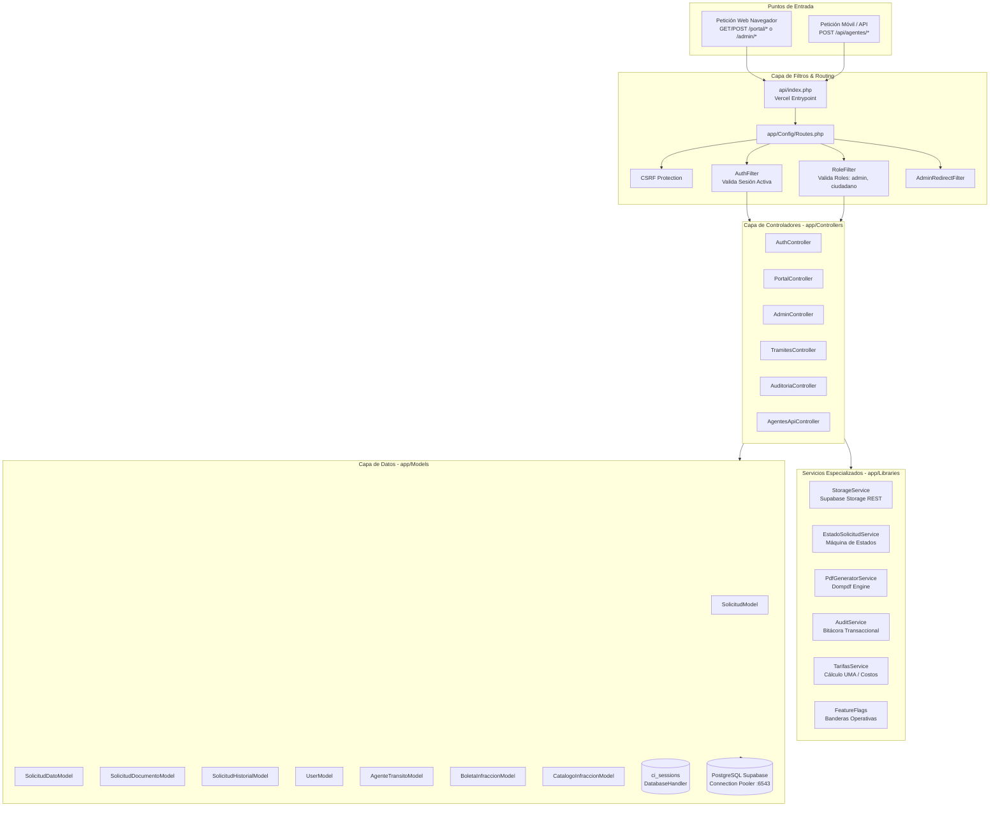

# Sistema Integral de Ventanilla Única de Movilidad y Transporte de Uriangato
## Documentación Técnica Exhaustiva del Backend (CodeIgniter 4 / PHP 8.2)

**Gobierno Municipal de Uriangato, Guanajuato**  
**Dirección de Movilidad y Transporte**  
**Versión del Backend:** 2.5.0  
**Stack Principal:** PHP 8.2+ | CodeIgniter 4.5.8 | PostgreSQL 15+ (Supabase) | Supabase Storage  
**Fecha de Actualización:** Octubre 2026  

---

## 1. Visión General de la Arquitectura Backend

El backend del sistema actúa como el motor transaccional, normativo y de seguridad para todos los procesos de la Dirección de Movilidad y Transporte de Uriangato. Está implementado sobre **CodeIgniter 4.5.8** con tipado estricto en PHP 8.2 (`declare(strict_types=1)`), estructurado bajo el patrón clásico **Modelo-Vista-Controlador (MVC)** y optimizado para ejecutarse en entornos serverless (**Vercel**) conectado a un clúster de alta disponibilidad en **PostgreSQL (Supabase)**.



---

## 2. Estructura de Directorios del Backend

```
app/
├── Common.php                 # Funciones helper globales del sistema
├── Config/                    # Configuraciones de la aplicación
│   ├── App.php                # Configuración base (baseURL, encoding, CSP)
│   ├── Database.php           # Conexión a PostgreSQL (PgBouncer en 6543)
│   ├── Filters.php            # Registro y alias de filtros de seguridad
│   ├── Routes.php             # Definición canónica de rutas Web y API
│   ├── Security.php           # Configuración de tokens CSRF y cookies
│   └── Session.php            # Configuración de sesiones en base de datos (ci_sessions)
├── Controllers/               # Controladores MVC y API
│   ├── AdminController.php    # Panel administrativo, bandeja de solicitudes, dictámenes
│   ├── AgentesApiController.php # API REST para registro de agentes y catálogos
│   ├── AuditoriaController.php# Bitácora de eventos y auditoría municipal
│   ├── AuthController.php     # Autenticación, registro, recuperación y cierre de sesión
│   ├── CatalogosController.php# Administración de tarifas y catálogos
│   ├── ConvocatoriasController.php # Convocatorias y avisos oficiales
│   ├── FormatosController.php # Formatos oficiales descargables
│   ├── PortalController.php   # Portal ciudadano, mis solicitudes, seguimiento, pagos
│   └── TramitesController.php # Control de captura de los 7 trámites oficiales
├── Database/                  # Migraciones y semillas de datos
│   └── Migrations/            # Migraciones Spark para estructura relacional
├── Filters/                   # Middlewares y filtros de seguridad
│   ├── AdminRedirectFilter.php# Redirección contextual según el rol autenticado
│   ├── AuthFilter.php         # Barrera de acceso para usuarios sin sesión activa
│   └── RoleFilter.php         # Validación de permisos basados en roles (RBAC)
├── Helpers/                   # Funciones de conveniencia (formatos, monedas, fechas)
│   ├── general_helper.php
│   └── tramites_helper.php
├── Libraries/                 # Servicios de negocio y utilerías
│   ├── AuditService.php       # Registro de auditoría con IP y usuario
│   ├── EstadoSolicitudService.php # Máquina de estados y reglas de transición
│   ├── FeatureFlags.php       # Flags de activación de trámites (ej. UR-TT-T-06)
│   ├── PdfGeneratorService.php# Generación de resoluciones y dictámenes oficiales
│   ├── StorageService.php     # Cliente HTTP REST para Supabase Storage
│   └── TarifasService.php     # Cálculo dinámico de costos y conversión en UMA
├── Models/                    # Modelos relacionales y de negocio
│   ├── AgenteTransitoModel.php# Padrón de oficiales de tránsito
│   ├── AuditoriaModel.php     # Bitácora de operaciones del sistema
│   ├── BoletaInfraccionModel.php # Boletas levantadas por agentes
│   ├── CatalogoInfraccionModel.php # Catálogo de infracciones del reglamento
│   ├── ParametrosAppModel.php # Parámetros globales (UMA, fotos obligatorias)
│   ├── SolicitudDatoModel.php # Datos específicos de trámite (almacenamiento EAV)
│   ├── SolicitudDocumentoModel.php # Metadatos de expedientes y hash SHA-256
│   ├── SolicitudHistorialModel.php # Historial inmutable de estados de trámite
│   ├── SolicitudModel.php     # Maestro de solicitudes y generación de folios
│   ├── UserModel.php          # Cuentas ciudadanas y administrativas
│   └── VerificacionDespintadoModel.php # Citas de despintado (T-02)
└── Views/                     # Vistas Blade-like de CodeIgniter
    ├── admin/                 # Pantallas del panel administrativo
    ├── auth/                  # Pantallas de login, registro, recuperación
    ├── errors/                # Pantallas de error HTTP 404, 403, 500
    ├── layouts/               # Plantillas base (admin.php, portal.php, auth.php)
    └── portal/                # Pantallas del portal ciudadano y trámites
```

---

## 3. Capa de Controladores (Controllers) al Detalle

### 3.1. `AuthController.php`
* **Rutas Gestionadas:** `/login`, `/registro`, `/logout`, `/olvide-password`, `/restablecer-password`.
* **Lógica Operativa:**
  * Valida credenciales contra `UserModel` utilizando hashing seguro de contraseñas de PHP (`password_verify` con compatibilidad para `bcrypt` y `Argon2id`).
  * En inicio de sesión exitoso, regenera el ID de sesión para prevenir Session Fixation y establece los datos en `ci_sessions`.
  * Redirecciona inteligentemente según el rol: administradores a `/admin/dashboard`, ciudadanos a `/portal/dashboard`.
  * Registra automáticamente el evento de inicio/cierre de sesión en la bitácora vía `AuditService`.

### 3.2. `PortalController.php`
* **Rutas Gestionadas:**
  * `/portal/dashboard`: Panel principal del ciudadano con estadísticas personales, trámites en curso y accesos rápidos.
  * `/portal/tramites`: Catálogo interactivo de trámites disponibles con buscador en vivo y categorización.
  * `/portal/mis-solicitudes`: Bandeja personal del ciudadano con filtrado por texto, badges de estado interactivos y copiado de folio.
  * `/portal/solicitud/(:segment)`: Vista detallada del expediente, con stepper visual de progreso, desglose de requisitos, visor de documentos y descarga de resolución oficial.
  * `/portal/perfil`: Gestión de datos generales del contribuyente (RFC, teléfono, domicilio).

### 3.3. `TramitesController.php`
* **Rutas Gestionadas:**
  * Formularios de radicación para cada trámite: `/portal/tramites/concesion-transporte`, `/portal/tramites/constancia-despintado`, `/portal/tramites/orden-plaqueo`, `/portal/tramites/permiso-eventual`, `/portal/tramites/cierre-calle`, `/portal/tramites/cesion-concesion`, `/portal/tramites/carga-descarga`.
  * Pantallas de resumen y pasarela de pago: `.../resumen/{folio}`, `.../procesar-pago/{folio}`.
* **Lógica Operativa:**
  * Generación atómica del folio institucional mediante `SolicitudModel::generarFolio($tramite)`.
  * Procesamiento transaccional de archivos adjuntos: subida al bucket `documentos` mediante `StorageService`, cálculo de hash criptográfico SHA-256 e inserción en `solicitudes_documentos`.
  * Inserción de metadatos variables en `solicitudes_datos`.
  * Registro del estatus inicial (`Recibido` o `Pago pendiente`) en `solicitudes_historial`.

### 3.4. `AdminController.php`
* **Rutas Gestionadas:**
  * `/admin/dashboard`: Monitor de mando municipal con conteo de solicitudes por estatus, métricas de recaudación y alertas urgentes.
  * `/admin/solicitudes`: Bandeja general de expedientes con paginación, filtros combinados de búsqueda (folio, RFC, solicitante) y accesos directos por estado.
  * `/admin/solicitudes/(:segment)`: Interfaz de dictaminación donde el revisor evalúa la documentación, visualiza el historial de transiciones y emite cambios de estatus.
  * `/admin/solicitudes/cambiar-estatus`: Endpoint transaccional que valida transiciones permitidas según `EstadoSolicitudService` y **exige obligatoriamente observaciones** cuando el estado destino es `Prevención` o `Rechazado`.
  * `/admin/despintado`: Módulo especializado para agendar citas de inspección física en patio municipal para el trámite UR-TT-T-02.
  * `/admin/infracciones`: Visor administrativo de boletas de infracción levantadas por los agentes viales en la app móvil.

### 3.5. `AgentesApiController.php`
* **Rutas Gestionadas:**
  * `POST /api/agentes/registro`: Endpoint seguro para el enrolamiento de oficiales de tránsito en el padrón municipal. Valida unicidad de placa, nombre y genera hash de contraseña seguro.
  * `GET /api/checklist-infracciones`: Entrega el catálogo normativo de infracciones tipificadas y parámetros de la UMA en formato JSON para el consumo de la app móvil.
* **Lógica Operativa:**
  * Respuestas normalizadas con encabezados `Content-Type: application/json` y códigos HTTP RFC estándar (`200 OK`, `201 Created`, `400 Bad Request`, `409 Conflict`, `500 Internal Server Error`).

---

## 4. Capa de Modelos (Models) y Persistencia de Datos

### 4.1. `SolicitudModel.php`
* **Tabla Relacionada:** `solicitudes`
* **Campos Principales:** `id`, `folio`, `ciudadano_id`, `tramite`, `estatus`, `monto`, `fecha_creacion`, `fecha_pago`, `fecha_actualizacion`.
* **Método Especial:** `generarFolio(string $tramite): string`
  * Construye un folio institucional inmutable bajo la nomenclatura: `UR-TT-{SUFIJO}-{AÑO}-{CONSECUTIVO_5_DIGITOS}` (ejemplo: `UR-TT-T01-2026-00042`).

### 4.2. `SolicitudDatoModel.php`
* **Tabla Relacionada:** `solicitudes_datos`
* **Esquema:** Almacenamiento tipo **EAV (Entity-Attribute-Value)** con columnas: `solicitud_id`, `campo`, `valor`.
* **Propósito:** Permite almacenar atributos dinámicos que difieren entre los 7 trámites sin requerir alteraciones al esquema relacional de la tabla principal.
* **Método Especial:** `porSolicitudAgrupado(int $solicitudId): array`
  * Devuelve un arreglo asociativo `['campo' => 'valor']` para consumo inmediato en vistas y reportes.

### 4.3. `SolicitudDocumentoModel.php`
* **Tabla Relacionada:** `solicitudes_documentos`
* **Campos:** `solicitud_id`, `tipo_documento`, `nombre_original`, `ruta_storage`, `tamano_bytes`, `mime_type`, `sha256_hash`, `fecha_subida`.
* **Garantía de Integridad:** El campo `sha256_hash` almacena la firma criptográfica generada al momento de la carga. Esto permite verificar judicialmente que un documento no ha sido alterado ni reemplazado con posterioridad.

### 4.4. `SolicitudHistorialModel.php`
* **Tabla Relacionada:** `solicitudes_historial`
* **Campos:** `solicitud_id`, `usuario_id`, `estatus_anterior`, `estatus_nuevo`, `comentario`, `fecha`.
* **Principio de Inmutabilidad:** Cada cambio en el estado de una solicitud genera un nuevo registro que nunca se actualiza ni se borra, preservando la cadena de custodia administrativa.

### 4.5. `AgenteTransitoModel.php` y `BoletaInfraccionModel.php`
* **Tablas Relacionadas:** `agentes_transito` y `boletas_infracciones`
* **Interacción con la App Móvil:** Sirven como puente entre las operaciones del oficial en vía pública y la supervisión del director de movilidad. La tabla `boletas_infracciones` almacena:
  * Folio único de la boleta.
  * Número de placa del oficial y nombre.
  * Datos del infractor y vehículo infractor.
  * Coordenadas geográficas (`latitud`, `longitud`).
  * Infracciones cometidas (serializadas en formato JSON).
  * Garantías retenidas y número de inventario de grúa/corralón.
  * URLs firmadas de las fotografías de evidencia en Supabase Storage.

---

## 5. Servicios y Librerías de Soporte (`app/Libraries`)

### 5.1. `StorageService.php` (Integración con Supabase Storage)
Encapsula todas las operaciones de almacenamiento de archivos a través de peticiones HTTP cURL autenticadas contra la API REST de Supabase:
* **Subida de Archivo:** `subirArchivo(string $bucket, string $rutaDestino, string $rutaLocal, string $mimeType): array`
  * Ejecuta un `POST /storage/v1/object/{bucket}/{rutaDestino}` enviando el archivo con la clave privada `SUPABASE_SERVICE_ROLE_KEY`.
* **Generación de URL de Descarga:** `obtenerUrlDescarga(string $bucket, string $ruta, int $expiracionSegundos = 3600): string`
  * Genera una URL firmada temporal para permitir la visualización segura de expedientes sensibles sin exponer los buckets al acceso público.
* **Eliminación:** `eliminarArchivo(string $bucket, string $ruta): bool`

### 5.2. `EstadoSolicitudService.php`
Define la máquina de estados del sistema para blindar la legalidad de los trámites:
* **Constantes de Estado:** `RECIBIDO`, `PAGO_PENDIENTE`, `EN_REVISION`, `CITA_INSPECCION`, `PREVENCION`, `APROBADO`, `RECHAZADO`, `CONCLUIDO`.
* **Matriz de Transiciones Permitidas:** Un arreglo estricto que impide transiciones inválidas (por ejemplo, pasar de `Recibido` directamente a `Concluido` sin haber sido `Aprobado`).
* **Validación de Justificación:** Función que verifica que cualquier estado restrictivo (`PREVENCION` o `RECHAZADO`) contenga un texto explicativo no vacío.

### 5.3. `PdfGeneratorService.php` (Motor Dompdf)
* Integra la librería `dompdf/dompdf` para renderizar documentos oficiales a partir de plantillas HTML.
* Incorpora el escudo institucional del Municipio de Uriangato, el código de validación alfanumérico, el hash SHA-256 del dictamen y el marco jurídico correspondiente.

### 5.4. `AuditService.php`
* Registra eventos de seguridad en la tabla `auditoria` con usuario, acción, módulo, IP de procedencia (`request()->getIPAddress()`) y fecha/hora exacta.

---

## 6. Seguridad, Filtros y Manejo de Sesiones

### 6.1. Manejo de Sesiones en Base de Datos (`ci_sessions`)
En arquitecturas serverless como Vercel, el sistema de archivos del servidor es efímero. Por este motivo, el sistema utiliza el manejador de base de datos de CodeIgniter:
* **Configuración (`app/Config/Session.php`):**
  ```php
  public string $driver = 'CodeIgniter\Session\Handlers\DatabaseHandler';
  public string $savePath = 'ci_sessions';
  public int $expiration = 7200; // 2 horas
  ```
* Cada petición recupera y persiste la sesión directamente desde la tabla `ci_sessions` en PostgreSQL, garantizando continuidad absoluta entre invocaciones independientes de funciones serverless.

### 6.2. Filtros de Seguridad (Middlewares)
* **`AuthFilter`:** Intercepta todas las rutas bajo `/portal/*` y `/admin/*`. Si no existe `usuario_id` en la sesión, redirige inmediatamente a `/login` con mensaje de alerta.
* **`RoleFilter`:** Verifica que el usuario autenticado posea el rol necesario (`admin` o `superadmin`) para acceder a rutas de gestión interna en `/admin/*`. Si un ciudadano intenta ingresar, el filtro aborta con código HTTP 403 Forbidden.
* **`AdminRedirectFilter`:** Si un administrador accede a `/login` o a la raíz, lo redirige automáticamente a su panel de control.

### 6.3. Protección CSRF
* Configurado con cookies `SameSite=Lax` y modo estricto en formularios POST. Cada formulario incluye la directiva `<?= csrf_field() ?>`.

---

## 7. Catálogo de Rutas y Endpoints de la API REST

| Método | Ruta | Controlador / Acción | Filtros | Descripción |
|---|---|---|---|---|
| **POST** | `/api/agentes/registro` | `AgentesApiController::registro` | Ninguno | Enrolamiento de agentes de tránsito desde la app móvil. |
| **GET** | `/api/checklist-infracciones`| `AgentesApiController::checklist` | Ninguno | Descarga del catálogo tipificado de infracciones y UMA. |
| **GET** | `/portal/dashboard` | `PortalController::dashboard` | `auth` | Dashboard ciudadano. |
| **GET** | `/portal/mis-solicitudes` | `PortalController::misSolicitudes`| `auth` | Listado y búsqueda de trámites del ciudadano. |
| **GET** | `/portal/solicitud/{folio}`| `PortalController::verSolicitud` | `auth` | Expediente y evolución del trámite. |
| **POST** | `/portal/tramites/{tipo}/guardar`| `TramitesController::guardar` | `auth, csrf` | Recepción y procesamiento de solicitud. |
| **GET** | `/admin/dashboard` | `AdminController::dashboard` | `auth, role:admin` | Dashboard general de supervisión municipal. |
| **GET** | `/admin/solicitudes` | `AdminController::solicitudes` | `auth, role:admin` | Bandeja maestra de expedientes con filtros. |
| **POST** | `/admin/solicitudes/cambiar-estatus`| `AdminController::cambiarEstatus`| `auth, role:admin, csrf`| Cambio regulado de estatus con observaciones. |
| **GET** | `/admin/infracciones` | `AdminController::infracciones`| `auth, role:admin` | Monitoreo de boletas levantadas en campo. |
| **GET** | `/admin/auditoria` | `AuditoriaController::index` | `auth, role:superadmin` | Bitácora de eventos y auditoría. |

---

## 8. Procedimiento de Ejecución y Pruebas Locales

1. **Prueba de Conexión a Base de Datos:**
   ```bash
   php spark db:table ci_sessions
   ```
2. **Ejecución del Servidor Local:**
   ```bash
   php spark serve --port 8080
   ```
3. **Verificación de Rutas:**
   ```bash
   php spark routes
   ```
