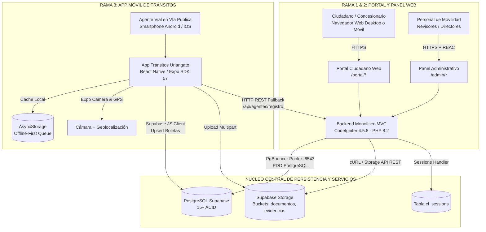
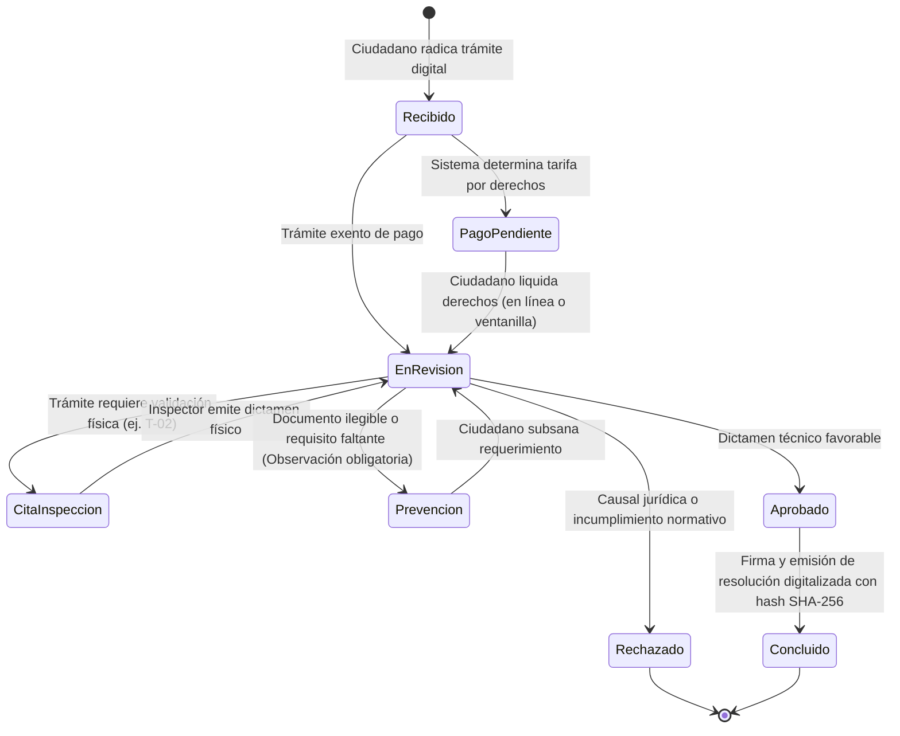
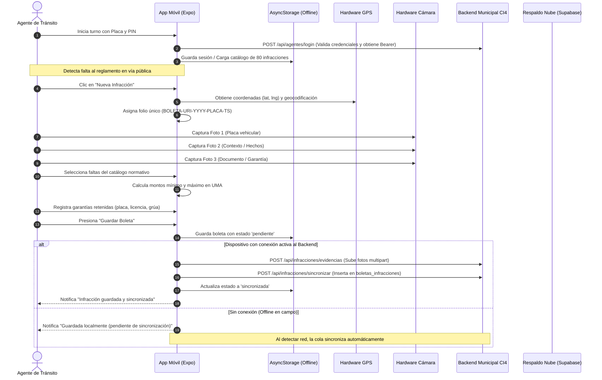

# Sistema Integral de Ventanilla Única de Movilidad y Transporte de Uriangato
## Documentación Técnica y Operativa General

**Gobierno Municipal de Uriangato, Guanajuato**  
**Dirección de Movilidad y Transporte**  
**Versión del Sistema:** 2.5.0 (Producción / Vercel Serverless + Supabase PostgreSQL)  
**Clasificación:** Documento Maestro de Arquitectura, División de Módulos y Operación  
**Fecha de Actualización:** Octubre 2026  

---

## 1. Identificación y Propósito del Proyecto

El **Sistema Integral de Ventanilla Única de Movilidad y Transporte de Uriangato** es una plataforma gubernamental de nivel municipal diseñada para modernizar, digitalizar y transparentar la gestión de la movilidad urbana.

El sistema unifica en una sola solución tecnológica:
1. **La atención ciudadana y transportista (Portal Web):** Radicación 100% digital de solicitudes, carga de expedientes, cálculo automatizado de tarifas y pago en línea.
2. **La dictaminación municipal (Panel Administrativo Web):** Ventanilla única de revisión documental, agenda de inspecciones físicas vehiculares, prevención, requerimientos y expedición de resoluciones oficiales con validez jurídica.
3. **La operatividad en vía pública (App Móvil para Agentes de Tránsito):** Levantamiento digital de boletas de infracción, captura georreferenciada de evidencia fotográfica con cámara y GPS, cálculo automático en UMAs y sincronización offline-first hacia la base de datos municipal.

---

## 2. Visión Integral y Arquitectura de las Tres Ramas

El ecosistema está concebido bajo una arquitectura desacoplada y escalable, comunicada a través de un núcleo de datos de alta disponibilidad en **PostgreSQL (Supabase)** y almacenamiento seguro en la nube.



---

## PARTE I: PORTAL CIUDADANO Y PANEL ADMINISTRATIVO WEB

### 1. Arquitectura y Tecnologías Web
* **Framework Backend:** CodeIgniter 4.5.8 (PHP 8.2) con arquitectura Modelo-Vista-Controlador (MVC).
* **Motor de Plantillas:** Vistas PHP nativas con layouts desacoplados (`layouts/portal.php`, `layouts/admin.php`, `layouts/auth.php`).
* **Frontend:** Bootstrap 5.3.2, Bootstrap Icons 1.11.1, CSS modular (`custom.css`) con variables personalizadas y JavaScript modular nativo (sin dependencias pesadas).
* **Autenticación y Sesiones:** Sesiones persistentes basadas en base de datos (`ci_sessions`) que garantizan tolerancia a fallos en la infraestructura serverless de Vercel.
* **Seguridad:** Control de Acceso Basado en Roles (**RBAC** con filtros `AuthFilter`, `RoleFilter`, `AdminRedirectFilter`), protección estricta contra CSRF con tokens regenerados, sanitización XSS y consultas preparadas con PDO.

---

### 2. Catálogo Oficial de Trámites Digitalizados

El Portal Ciudadano implementa el flujo normativo para los 7 trámites oficiales de la Dirección de Movilidad:

| Clave | Trámite Oficial | Fundamento / Descripción | Documentación Requerida | Costo / Tarifa |
|---|---|---|---|---|
| **UR-TT-T-01** | **Concesión de Transporte Público** | Alta o renovación de concesión para modalidades taxi, colectivo y mixto. | Identificación oficial, RFC, acreditación de concesión, póliza de seguro y tarjeta de circulación. | Conforme a Ley de Ingresos del ejercicio vigente. |
| **UR-TT-T-02** | **Constancia de Despintado** | Desincorporación y baja de unidad del servicio público; requiere inspección física en patio municipal. | Baja de placas del Estado, factura de la unidad, identificación oficial y tarjeta anterior. | Gratuito / Derechos de inspección. |
| **UR-TT-T-03** | **Orden de Plaqueo** | Emisión de oficio municipal para gestión de placas de servicio público ante SATEG Guanajuato. | Título de concesión, pago de refrendo, revista mecánica aprobada e identificación. | Cuota fija de derechos municipales. |
| **UR-TT-T-04** | **Permiso Eventual de Transporte** | Autorización temporal de viaje fuera de ruta o servicio especial fuera de itinerario ordinario. | Póliza de seguro vigente, datos de itinerario, fecha de salida/regreso y lista de pasajeros. | Calculado según días de vigencia y tipo de vehículo. |
| **UR-TT-T-05** | **Permiso para Cierre de Calle** | Cierre temporal de vialidad por eventos sociales, religiosos, cívicos o de obra civil. | Croquis de ubicación, anuencia vecinal, plan de vías alternas y Vo.Bo. de Tránsito. | Tarifa tabulada por horas/días y categoría vial. |
| **UR-TT-T-06** | **Cesión de Concesión** | Traspaso legal de derechos concesionados (regulado por FeatureFlag de administración). | Comparecencia de cedente y cesionario, anuencia del H. Ayuntamiento y constancia de no adeudo. | Dictamen especial y derechos de transferencia. |
| **UR-TT-T-07** | **Permiso de Carga y Descarga** | Maniobras de carga pesada en zonas comerciales y primer cuadro urbano en horarios restringidos. | Tarjeta de circulación, póliza vehicular, comprobante de domicilio de entrega y horarios. | Tarifa calculada según toneladas y periodo (evento/semanal/mensual). |

---

### 3. Flujo Operativo y Ciclo de Vida de las Solicitudes

El ciclo de dictamen sigue una máquina de estados determinista gobernada por la clase `EstadoSolicitudService`:



#### Reglas de Validación y Dictamen en el Panel Administrativo:
1. **Observaciones Obligatorias:** Ningún revisor puede cambiar un estatus a `Prevención` o `Rechazado` sin registrar formalmente el motivo legal o deficiencia técnica detectada.
2. **Historial Inmutable:** Cada cambio de estado queda asentado en la tabla `solicitudes_historial` con usuario responsable, fecha y comentario.
3. **Generación de Expediente Oficial:** Al concluirse un trámite, el sistema genera automáticamente un documento con código de validación, firma del director y hash SHA-256 del expediente, almacenado en el bucket `documentos` de Supabase Storage.

---

### 4. Módulos del Panel Administrativo Web

1. **Dashboard General de Métricas:** KPIs en tiempo real de solicitudes recibidas, en revisión, prevenidas, concluidas y montos recaudados.
2. **Bandeja Maestra de Solicitudes:** Búsqueda avanzada por folio, RFC, solicitante y filtros rápidos por estatus ("Recibidos", "Pago pendiente", "En revisión", "Concluidos", "Prevención").
3. **Detalle del Expediente y Dictamen:** Visor de documentos PDF e imágenes, formulario de cambio de estado con validaciones y registro de observaciones.
4. **Módulo de Inspección de Despintado (T-02):** Agenda de citas para revisión en patio y dictamen técnico de despintado con cotejo vehicular.
5. **Monitoreo de Infracciones de Tránsito:** Visor centralizado de boletas levantadas en campo por los agentes viales, con consulta de infractor, placas, coordenadas y fotografías de evidencia.
6. **Administración de Catálogos y Parámetros:** Gestión de valor de la UMA, tarifas municipales, convocatorias y formatos oficiales.
7. **Bitácora de Auditoría Municipal:** Registro de todas las operaciones administrativas críticas (altas, modificaciones, cancelaciones) con IP y usuario.

---

## PARTE II: APP MÓVIL PARA AGENTES DE TRÁNSITO

### 1. Arquitectura y Tecnologías Móviles
* **Framework:** React Native 0.86 / Expo SDK 57 con tipado estricto en TypeScript.
* **Enrutamiento:** Expo Router (File-based routing en carpeta `/app`).
* **Estado y Contextos:**
  * `AuthContext`: Gestión de credenciales del agente, placa, rol y persistencia de sesión en dispositivo.
  * `InfraccionesContext`: Motor de persistencia local, cálculo de multas, cola de sincronización y catálogo.
  * `ThemeContext`: Conmutación de tema Claro / Oscuro de alto contraste optimizado para uso nocturno o bajo luz solar intensa.
* **Almacenamiento Local (Offline-First):** `AsyncStorage` como base de datos embebida en el dispositivo móvil.
* **Conectividad:** Sincronización REST prioritaria con el **Backend Municipal en CodeIgniter 4** (`/api/infracciones/*` y `/api/agentes/*`), con compatibilidad de respaldo en Supabase.

---

### 2. Flujo Operativo del Agente Vial en Campo



---

### 3. Características Clave de la App Móvil

1. **Autonomía Fuera de Línea (Offline-First):**
   * El agente puede trabajar sin señal en carreteras o colonias sin cobertura.
   * Las infracciones quedan en cola local (`@infracciones_pendientes_v1`).
   * Al regresar a base o tener cobertura 4G/WiFi, el botón de sincronización o el proceso en segundo plano sube todas las boletas pendientes.

2. **Captura Georreferenciada con Cámara y GPS:**
   * Uso de `expo-camera` (`CameraView`) para captura instantánea sin depender de apps externas.
   * Geoposicionamiento de alta precisión (`expo-location`) que registra latitud, longitud y dirección aproximada, blindando legalmente la infracción contra impugnaciones.

3. **Cálculo Automático de Sanciones en UMA:**
   * La app utiliza el valor vigente de la Unidad de Medida y Actualización (UMA) configurado centralmente.
   * Permite seleccionar múltiples faltas simultáneas, calculando la sumatoria total del rango mínimo y máximo en pesos mexicanos ($ MXN).

4. **Gestión de Garantías Retenidas:**
   * Selección de garantías: Licencia de conducir, tarjeta de circulación, placa vehicular o vehículo remitido al corralón.
   * En caso de arrastre con grúa, solicita el número de inventario de grúa y corralón correspondiente.

5. **Historial y Detalle de Boletas:**
   * Pestaña de historial con filtros por estado: Sincronizadas, Pendientes y Errores.
   * Modal de detalle completo con visualización de evidencias fotográficas, desglose de faltas y estatus de sincronización.

---

## PARTE III: BASE DE DATOS UNIFICADA Y ESQUEMA DE SEGURIDAD

### 1. Modelo de Entidad-Relación y Tablas Principales

La persistencia unificada reside en PostgreSQL alojado en Supabase:

| Tabla | Módulo Principal | Propósito / Contenido |
|---|---|---|
| `users` | Portal / Admin | Cuentas de ciudadanos, transportistas y administradores con contraseña encriptada (Argon2id/bcrypt) y rol (`ciudadano`, `admin`, `superadmin`). |
| `ci_sessions` | Backend CI4 | Manejador de sesiones persistentes en base de datos para entornos serverless en Vercel. |
| `solicitudes` | Portal / Admin | Registro maestro de trámites ciudadanos con folio único, estatus, monto, fechas de radicación y pago. |
| `solicitudes_datos` | Portal / Admin | Almacenamiento tipo EAV (Entity-Attribute-Value) de campos específicos según el tipo de trámite (vehículos, rutas, placas, motivos). |
| `solicitudes_documentos`| Portal / Admin | Metadatos de archivos adjuntos: nombre original, tipo, tamaño en bytes, ruta en Supabase Storage y hash SHA-256 de integridad. |
| `solicitudes_historial` | Portal / Admin | Trazabilidad inmutable de cambios de estado, funcionario que autorizó y observaciones técnicas. |
| `verificaciones_despintado`| Admin (T-02) | Agenda de citas de inspección física en patio municipal, dictamen de despintado y observaciones del perito. |
| `agentes_transito` | Móvil / Admin | Padrón de oficiales de tránsito activos: número de placa/credencial, nombre completo, contraseña encriptada y sector asignado. |
| `boletas_infracciones` | Móvil / Admin | Boletas levantadas en campo por los agentes: folio, agente, conductor, vehículo, coordenadas GPS, faltas en JSON, garantías y URLs de fotos. |
| `catalogo_infracciones_app`| Móvil / Admin | Catálogo tipificado del reglamento de tránsito municipal: fundamento legal, descripción, categoría y rangos de UMA. |
| `parametros_app` | Global | Parámetros dinámicos del sistema: valor vigente de UMA, fotos obligatorias, versión mínima requerida. |
| `auditoria` | Admin | Registro de eventos sensibles: inicios de sesión, cambios de permisos, resoluciones de trámites e IP de origen. |

---

### 2. Infraestructura de Archivos y Supabase Storage

El sistema utiliza dos buckets en Supabase Storage:
1. `documentos`: Almacena las identificaciones, pólizas, facturas y expedientes generados del portal web.
2. `evidencias`: Almacena las fotografías de placas, vehículos y garantías capturadas por los agentes de tránsito desde la app móvil.

**Garantía de Inmutabilidad con SHA-256:**
Cada vez que un ciudadano o funcionario sube un documento al portal, el backend calcula su hash criptográfico SHA-256 (`hash_file('sha256', $rutaTmp)`). Este hash se almacena en la tabla `solicitudes_documentos` y previene cualquier alteración o sustitución indebida del archivo en el expediente.

---

## PARTE IV: GUÍA DE INSTALACIÓN, CONFIGURACIÓN Y DESPLIEGUE

### 1. Requisitos Previos del Sistema
* **PHP:** Versión 8.2 o superior con extensiones `pdo_pgsql`, `curl`, `mbstring`, `fileinfo`, `gd`, `intl`.
* **Composer:** Versión 2.x para dependencias de PHP.
* **Node.js:** Versión 18+ o 20 LTS con `npm`.
* **Git:** Para control de versiones.

### 2. Instalación Local

```bash
# 1. Clonar el repositorio
git clone https://github.com/soportealoraapp/App-Residencias.git
cd App-Residencias

# 2. Instalar dependencias del backend PHP
composer install --no-interaction --prefer-dist

# 3. Configurar variables de entorno
cp env .env
# Configurar POSTGRES_URL, SUPABASE_URL, SUPABASE_ANON_KEY en .env

# 4. Instalar y compilar la App Móvil (versión Web para /agentes/)
cd mobile/agentes-transito
npm install --legacy-peer-deps
npx expo export --platform web --output-dir ../../public/agentes --clear
cd ../..

# 5. Iniciar servidor de desarrollo
php spark serve --port 8080
```

* **Portal Ciudadano:** `http://localhost:8080/portal/dashboard`
* **Panel Administrativo:** `http://localhost:8080/admin/dashboard`
* **App de Tránsito Web:** `http://localhost:8080/agentes/`

### 3. Despliegue en Producción (Vercel CI/CD)
El proyecto está configurado para despliegue continuo en Vercel Serverless mediante `vercel.json` y `scripts/vercel-install.sh`:
* Cualquier push a la rama `main` dispara automáticamente la instalación de Composer, la compilación de la app móvil en Expo y el despliegue del runtime PHP sin intervención manual.

---

## 5. Documentos Complementarios Específicos

Para una inmersión técnica profunda en cada componente, consulta los manuales especializados:
* [DOCUMENTACION_BACKEND.md](file:///c:/Users/Alejandro/Downloads/App%20Residencias/DOCUMENTACION_BACKEND.md): Arquitectura completa del Backend CodeIgniter 4, controladores, modelos, servicios, filtros de seguridad y API REST.
* [DOCUMENTACION_APP_TRANSITO.md](file:///c:/Users/Alejandro/Downloads/App%20Residencias/DOCUMENTACION_APP_TRANSITO.md): Manual técnico exhaustivo de la App Móvil en React Native/Expo, modo offline-first, cámara, GPS y sincronización con Supabase.
* [DOC_METODOLOGIA_PORTAL_PANEL.md](file:///c:/Users/Alejandro/Downloads/App%20Residencias/DOC_METODOLOGIA_PORTAL_PANEL.md): Metodología de desarrollo, especificación de formularios y flujos normativos de ventanilla única.
