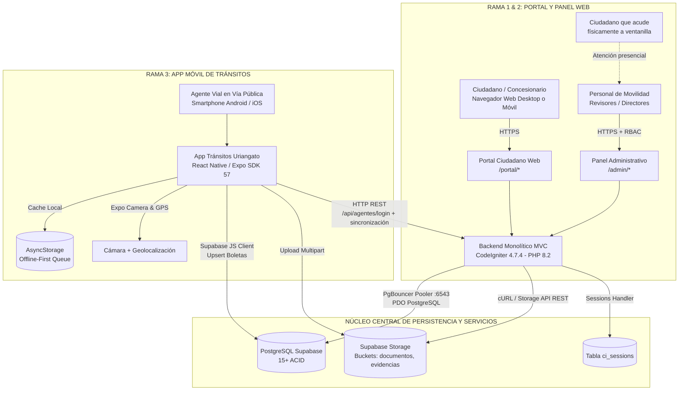
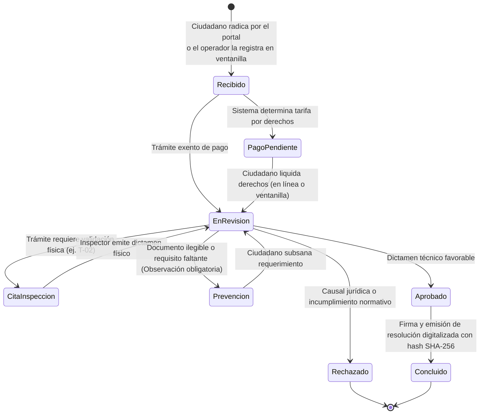
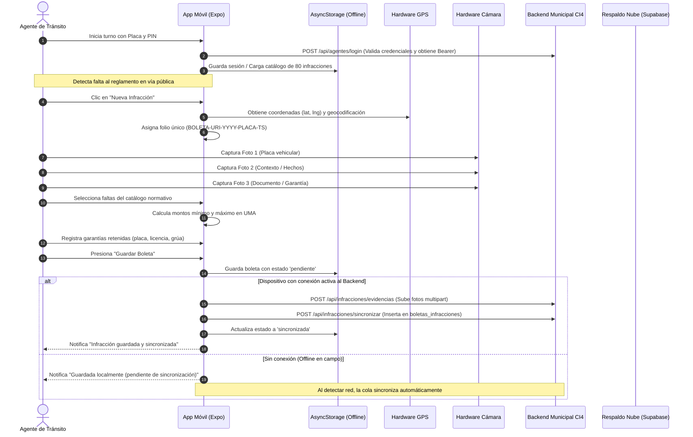

# Sistema Integral de Ventanilla Única de Movilidad y Transporte de Uriangato
## Documentación Técnica y Operativa General

**Gobierno Municipal de Uriangato, Guanajuato**  
**Dirección de Movilidad y Transporte**  
**Versión del Sistema:** 2.6.0 (Producción / Vercel Serverless + Supabase PostgreSQL)  
**Clasificación:** Documento Maestro de Arquitectura, División de Módulos y Operación  
**Fecha de Actualización:** Octubre 2026  

---

## 1. Identificación y Propósito del Proyecto

El **Sistema Integral de Ventanilla Única de Movilidad y Transporte de Uriangato** es una plataforma gubernamental de nivel municipal diseñada para modernizar, digitalizar y transparentar la gestión de la movilidad urbana.

El sistema unifica en una sola solución tecnológica:
1. **La atención ciudadana y transportista (Portal Web):** Radicación digital de solicitudes con **autorregistro libre del ciudadano**, carga de expedientes, cálculo automatizado de tarifas y pago en línea.
2. **La dictaminación municipal (Panel Administrativo Web):** Ventanilla única de revisión documental, **radicación presencial para el ciudadano que acude físicamente y no usa el portal**, agenda de inspecciones físicas vehiculares, prevención, requerimientos y expedición de resoluciones oficiales con validez jurídica.
3. **La operatividad en vía pública (App Móvil para Agentes de Tránsito):** Levantamiento digital de boletas de infracción, captura georreferenciada de evidencia fotográfica con cámara y GPS, cálculo automático en UMAs y sincronización offline-first hacia la base de datos municipal.

---

## 2. Visión Integral y Arquitectura de las Tres Ramas

El ecosistema está concebido bajo una arquitectura desacoplada y escalable, comunicada a través de un núcleo de datos de alta disponibilidad en **PostgreSQL (Supabase)** y almacenamiento seguro en la nube.



---

## PARTE I: PORTAL CIUDADANO Y PANEL ADMINISTRATIVO WEB

### 1. Arquitectura y Tecnologías Web
* **Framework Backend:** CodeIgniter 4.7.4 (línea `^4.5` en `composer.json`) sobre PHP 8.2, con arquitectura Modelo-Vista-Controlador (MVC).
* **Motor de Plantillas:** Vistas PHP nativas con layouts desacoplados (`layouts/portal.php`, `layouts/admin.php`, `layouts/auth.php`).
* **Frontend:** Bootstrap 5.3.2, Bootstrap Icons 1.11.1, CSS modular (`custom.css`) con variables personalizadas y JavaScript modular nativo (sin dependencias pesadas).
* **Autenticación y Sesiones:** Sesiones persistentes basadas en base de datos (`ci_sessions`) que garantizan tolerancia a fallos en la infraestructura serverless de Vercel.
* **Seguridad:** Control de Acceso Basado en Roles (**RBAC** con filtros `AuthFilter`, `RoleFilter`, `AdminRedirectFilter`), **autorización de grano fino por sección** (`PermisoOperadorFilter`), protección estricta contra CSRF con tokens regenerados, sanitización XSS y consultas preparadas con PDO.

---

### 2. Catálogo Oficial de Trámites Digitalizados

El Portal Ciudadano implementa el flujo normativo para los 7 trámites oficiales de la Dirección de Movilidad:

| Clave | Trámite Oficial | Fundamento / Descripción | Documentación Requerida | Costo / Tarifa |
|---|---|---|---|---|
| **UR-TT-T-01** | **Concesión de Transporte Público** | Alta o renovación de concesión para modalidades taxi, colectivo y mixto. | Identificación oficial, RFC, acreditación de concesión, póliza de seguro y tarjeta de circulación. | Conforme a Ley de Ingresos del ejercicio vigente. |
| **UR-TT-T-02** | **Constancia de Despintado** | Desincorporación y baja de unidad del servicio público; requiere inspección física en patio municipal. | Baja de placas del Estado, factura de la unidad, identificación oficial y tarjeta anterior. | Gratuito / Derechos de inspección. |
| **UR-TT-T-03** | **Orden de Plaqueo** | Emisión de oficio municipal para gestión de placas de servicio público ante SATEG Guanajuato. | Título de concesión, pago de refrendo, revista mecánica aprobada e identificación. | Cuota fija de derechos municipales. |
| **UR-TT-T-04** | **Permiso Eventual de Transporte** | Autorización temporal de viaje fuera de ruta o servicio especial fuera de itinerario ordinario. | Póliza de seguro vigente, datos de itinerario, fecha de salida/regreso y lista de pasajeros. | Calculado según días de vigencia y tipo de vehículo. |
| **UR-TT-T-05** | **Permiso para Cierre de Calle** | Cierre temporal de vialidad por eventos sociales, religiosos, cívicos o de obra civil. | Croquis de ubicación, anuencia vecinal, plan de vías alternas y Vo.Bo. de Tránsito. | Tarifa tabulada por horas/días y categoría vial. |
| **UR-TT-T-06** | **Cesión de Concesión** | Traspaso legal de derechos concesionados (regulado por FeatureFlag de administración). | Comparecencia de cedente y cesionario, anuencia del H. Ayuntamiento y constancia de no adeudo. | Dictamen especial y derechos de transferencia. |
| **UR-TT-T-07** | **Permiso de Carga y Descarga** | Maniobras de carga pesada en zonas comerciales y primer cuadro urbano en horarios restringidos. | Tarjeta de circulación, póliza vehicular, comprobante de domicilio de entrega y horarios. | Tarifa calculada según toneladas y periodo (evento/semanal/mensual). |

---

### 3. Flujo Operativo y Ciclo de Vida de las Solicitudes

El ciclo de dictamen sigue una máquina de estados determinista gobernada por la clase `EstadoSolicitudService`:



#### Reglas de Validación y Dictamen en el Panel Administrativo:
1. **Observaciones Obligatorias:** Ningún revisor puede cambiar un estatus a `Prevención` o `Rechazado` sin registrar formalmente el motivo legal o deficiencia técnica detectada.
2. **Historial Inmutable:** Cada cambio de estado queda asentado en la tabla `historial_estatus` con usuario responsable, fecha y comentario.
3. **Generación de Expediente Oficial:** Al concluirse un trámite, el sistema genera automáticamente un documento con código de validación, firma del director y hash SHA-256 del expediente, almacenado en el bucket `documentos`.
4. **Doble Canal de Radicación:** Una solicitud puede nacer del portal web (el ciudadano la captura y paga en línea) o de la ventanilla física (el operador la radica presencialmente). Ambos canales escriben en las mismas tablas y comparten la misma máquina de estados; el origen se registra como `origen = 'presencial'` en `solicitud_datos`.

---

### 4. Módulos del Panel Administrativo Web

1. **Dashboard General de Métricas:** KPIs en tiempo real de solicitudes recibidas, en revisión, prevenidas, concluidas y montos recaudados.
2. **Bandeja Maestra de Solicitudes:** Búsqueda avanzada por folio, RFC, solicitante y filtros rápidos por estatus ("Recibidos", "Pago pendiente", "En revisión", "Concluidos", "Prevención").
3. **Radicación Presencial de Solicitudes (`/admin/solicitudes/nueva`):** Registro de trámites por el funcionario cuando el ciudadano **acude físicamente a ventanilla** y no usa el portal web. Cubre los 7 trámites con asistente en dos pasos (buscar/seleccionar ciudadano → formulario dinámico del trámite). Genera el mismo folio, aplica el mismo tarifario y produce el mismo expediente que el portal; los documentos son opcionales porque pueden entregarse después. El expediente queda marcado con `origen = 'presencial'` y el ciudadano puede seguirlo en línea.
4. **Detalle del Expediente y Dictamen:** Visor de documentos PDF e imágenes, formulario de cambio de estado con validaciones y registro de observaciones.
5. **Módulo de Inspección de Despintado (T-02):** Agenda de citas para revisión en patio y dictamen técnico de despintado con cotejo vehicular.
6. **Monitoreo de Infracciones de Tránsito:** Visor centralizado de boletas levantadas en campo por los agentes viales, con consulta de infractor, placas, coordenadas y fotografías de evidencia.
7. **Administración de Catálogos y Parámetros:** Gestión de valor de la UMA, tarifas municipales, convocatorias, concesiones y formatos oficiales.
   * **Convocatorias (`/admin/convocatorias`)**: CRUD completo — listado, alta (`/nueva`), edición, borrado, carga de bases, evaluación y selección de ganadores. **No se puede eliminar una convocatoria que ya tenga solicitudes ligadas**: el sistema lo impide y manda al operador a desligar los expedientes primero.
   * **Concesiones (`/admin/concesiones`)**: el borrado está **guardado por la misma base de datos** — la llave foránea `solicitudes.concesion_id` es `ON DELETE RESTRICT`, así que intentar eliminar un título con historial arriba produce un error visible en vez de borrar solicitudes en cascada.
8. **Usuarios y Ciudadanos (`/admin/usuarios`):** Alta, edición y desactivación de cuentas de ciudadanos desde la ventanilla. La baja definitiva es exclusiva del administrador.
9. **Permisos del Operador (`/admin/permisos-operador`, solo administrador):** El administrador enciende o apaga secciones del panel para el rol `operador_ventanilla` (solicitudes, usuarios, tarifas, concesiones, formatos, auditoría, convocatorias y los tres módulos de App Tránsito) **sin programar ni crear roles nuevos**. Se persiste como JSON en `parametros_app` y lo hace cumplir `PermisoOperadorFilter` en todo el prefijo `admin`.
10. **Bitácora de Auditoría Municipal:** Registro de todas las operaciones administrativas críticas (altas, modificaciones, cancelaciones) con IP y usuario.
11. **Panel del Juez Calificador (`/juez`):** Superficie de solo lectura para el rol `juez_calificador`. Reúne la bandeja de boletas de infracción recibidas desde la app de campo, su detalle con evidencia fotográfica, la calificación con vista previa y una **mesa de cobros pendientes** con folio de recibo, monto exigible, descuento o recargo aplicado y lugar de pago. El juez **califica pero no cobra**: registrar el pago es acto de ventanilla o del módulo de cobros, y el panel lo refleja separando ambas columnas.
12. **Módulo de cobros y hoja de pago (COB-05):** Cada solicitud aprobada o boleta calificada exige un **cobro** con folio propio (`COB-AAAA-NNNNNN`); cada pago efectivo deja su recibo (`REC-AAAA-NNNNNN`) como movimiento, sin sobrescribir el cobro original. Desde la solicitud, la boleta y el portal se imprime la **hoja de ayuda para el pago** (`/documentos/hoja-pago/solicitud/{folio o id}` y `/documentos/hoja-pago/boleta/{id}`), que concentra folio, concepto, desglose de multas por fundamento legal, descuento por pronto pago o recargo mensual, condonaciones y lugares de pago habilitados. La ruta solo exige sesión y el permiso fino vive en el controlador: **el personal de ventanilla imprime cualquier documento; el ciudadano únicamente los de sus propios trámites y nunca las multas**. La hoja es de apoyo: no sustituye el recibo oficial ni la referencia bancaria, que dependen de los datos pendientes de la Dirección de Finanzas (COB-04 y COB-07).

---

## PARTE II: APP MÓVIL PARA AGENTES DE TRÁNSITO

### 1. Arquitectura y Tecnologías Móviles
* **Framework:** React Native 0.86 / Expo SDK 57 con tipado estricto en TypeScript.
* **Enrutamiento:** Expo Router (File-based routing en carpeta `/app`).
* **Estado y Contextos:**
  * `AuthContext`: Gestión de credenciales del agente, placa, rol y persistencia de sesión en dispositivo.
  * `InfraccionesContext`: Motor de persistencia local, cálculo de multas, cola de sincronización y catálogo.
  * `ThemeContext`: Conmutación de tema Claro / Oscuro de alto contraste optimizado para uso nocturno o bajo luz solar intensa.
* **Almacenamiento Local (Offline-First):** `AsyncStorage` como base de datos embebida en el dispositivo móvil.
* **Conectividad:** Sincronización REST prioritaria con el **Backend Municipal en CodeIgniter 4** (`/api/agentes/login`, `/api/parametros`, `/api/checklist-infracciones`, `/api/infracciones/sincronizar`, `/api/infracciones/evidencias`), con compatibilidad de respaldo directa a Supabase. Las escrituras van protegidas por el filtro `agenteToken`.

---

### 2. Flujo Operativo del Agente Vial en Campo



---

### 3. Características Clave de la App Móvil

1. **Autonomía Fuera de Línea (Offline-First):**
   * El agente puede trabajar sin señal en carreteras o colonias sin cobertura.
   * Las infracciones quedan en cola local (`@infracciones_pendientes_v1`).
   * Al regresar a base o tener cobertura 4G/WiFi, el botón de sincronización o el proceso en segundo plano sube todas las boletas pendientes.

2. **Captura Georreferenciada con Cámara y GPS:**
   * Uso de `expo-camera` (`CameraView`) para captura instantánea sin depender de apps externas.
   * Geoposicionamiento de alta precisión (`expo-location`) que registra latitud, longitud y dirección aproximada, blindando legalmente la infracción contra impugnaciones.

3. **Cálculo Automático de Sanciones en UMA:**
   * La app utiliza el valor vigente de la Unidad de Medida y Actualización (UMA) configurado centralmente.
   * Permite seleccionar múltiples faltas simultáneas, calculando la sumatoria total del rango mínimo y máximo en pesos mexicanos ($ MXN).

4. **Gestión de Garantías Retenidas:**
   * Selección de garantías: Licencia de conducir, tarjeta de circulación, placa vehicular o vehículo remitido al corralón.
   * En caso de arrastre con grúa, solicita el número de inventario de grúa y corralón correspondiente.

5. **Historial y Detalle de Boletas:**
   * Pestaña de historial con filtros por estado: Sincronizadas, Pendientes y Errores.
   * Modal de detalle completo con visualización de evidencias fotográficas, desglose de faltas y estatus de sincronización.

---

## PARTE III: BASE DE DATOS UNIFICADA Y ESQUEMA DE SEGURIDAD

### 1. Modelo de Entidad-Relación y Tablas Principales

La persistencia unificada reside en PostgreSQL alojado en Supabase:

| Tabla | Módulo Principal | Propósito / Contenido |
|---|---|---|
| `users` | Portal / Admin | Cuentas de ciudadanos y funcionarios con perfil civil (nombre, CURP, RFC, domicilio, teléfono, INE). `password_hash` es **nullable**: una cuenta puede existir sin acceso mientras el ciudadano no reclame el expediente que ventanilla le radicó. |
| `roles` / `user_roles` | Portal / Admin | Catálogo de los cuatro roles del sistema (`administrador`, `operador_ventanilla`, `ciudadano`, `juez_calificador`) y su asignación por cuenta. |
| `ci_sessions` | Backend CI4 | Manejador de sesiones persistentes en base de datos para entornos serverless en Vercel. |
| `solicitudes` | Portal / Admin | Registro maestro de trámites con folio único, estatus, monto, fechas de radicación y pago, y ligas **opcionales** a `concesion_id` y `convocatoria_id`. Ambas llaves son `ON DELETE RESTRICT` (con `ON UPDATE SET NULL`): el expediente sobrevive si el catálogo de arriba se va. |
| `solicitud_datos` | Portal / Admin | Almacenamiento tipo EAV (Entity-Attribute-Value) de campos específicos según el tipo de trámite (vehículos, rutas, placas, motivos) y el marcador de canal `origen` (`portal` o `presencial`). |
| `documentos` | Portal / Admin | Metadatos de archivos adjuntos: nombre original, tipo, tamaño en bytes, ruta en el almacén y hash SHA-256 de integridad. |
| `historial_estatus` | Portal / Admin | Trazabilidad inmutable de cambios de estado, funcionario que autorizó, fecha y observaciones técnicas. |
| `verificaciones_fisicas` | Admin (T-02) | Agenda de citas de inspección física en patio municipal, dictamen de despintado y observaciones del perito. |
| `concesiones` | Admin | Padrón municipal de títulos de concesión: número de título, titular, ruta, placas, vigencia y estatus. Su eliminación está restringida mientras exista alguna solicitud que los mencione. |
| `tarifas` | Admin | Conceptos de cobro con monto, factores UMA y periodo de vigencia (`vigente_desde` / `vigente_hasta`). |
| `convocatorias` | Admin (T-01) | Convocatorias públicas de licitación de concesiones: título, periodo de registro (`periodo_registro_inicio` / `periodo_registro_fin`), bases publicadas, estatus `vigente` y selección de ganadores. El panel lleva el CRUD completo; el borrado está restringido si hay solicitudes ligadas. Cuando hay varias convocatorias abiertas, **el ciudadano elige cuál** en el formulario UR-TT-T-01. |
| `formatos_tramite` | Portal / Admin | Repositorio de formatos oficiales descargables desde el portal. |
| `parametros_app` | Global | Parámetros dinámicos en formato clave-valor: valor de la UMA, reglas fotográficas de la app y **permisos del operador como JSON**. |
| `parametros_sistema` | Global | Configuración general del sistema web. |
| `agentes_transito` | Móvil / Admin | Padrón de oficiales de tránsito dados de alta por el administrador: placa/credencial, nombre completo, contraseña encriptada, rol operativo, sector y activo. |
| `agentes_transito_tokens` | Móvil / API | Tokens de portador emitidos en el inicio de sesión de la app móvil, con caducidad, para proteger los endpoints de sincronización. |
| `boletas_infracciones` | Móvil / Admin | Boletas levantadas en campo: folio, agente, conductor, vehículo, coordenadas GPS, faltas, garantías y URLs de fotos. |
| `boleta_checklist_item` | Móvil | Items de verificación asociados a cada boleta de infracción. |
| `catalogo_infracciones` / `catalogo_infracciones_app` | Móvil / Admin | Tipificación del reglamento municipal: fundamento legal, descripción, categoría de actor y rangos de UMA mínimo/máximo. |
| `auditoria` | Admin | Registro de eventos sensibles: inicios de sesión, cambios de permisos, resoluciones de trámites, intentos de registro y IP de origen. |
| `cobros` | Admin / Juez | Obligación de pago derivada de una solicitud o de una boleta: folio `COB-AAAA-NNNNNN`, concepto, monto base, descuento o recargo aplicado, total, estado (`pendiente`, `aprobado`, `cancelado`), lugar de pago y marca de cobro efectivo con fecha y funcionario. Una solicitud o boleta tiene **un solo cobro vigente**. |
| `cobro_movimientos` | Admin | Bitácora de cada movimiento de un cobro (alta, condonación, pago), con folio de recibo `REC-AAAA-NNNNNN`, importe, usuario responsable y notas. Es la fuente de verdad del historial: el cobro no se edita hacia atrás. |
| `boleta_calificaciones` | Juez | Calificación formal de una boleta por el juez: nombre del infractor, valor de la UMA aplicado, total en UMA, monto base, si procede descuento por pronto pago o recargo, y juez responsable. |
| `boleta_calificacion_detalles` | Juez | Desglose por falta calificada: fundamento legal, descripción, UMA mínima y máxima y valor asignado, en el orden en que se imprimen. |

**Migraciones del corte de cobros.** Del lado de la aplicación, `2026-10-23-000028_AddJuezCalificadorRole` (rol del juez), `2026-10-24-000027_CreateCobrosTables` (`cobros` y `cobro_movimientos`), `2026-10-24-000030_CreateBoletaCalificaciones` (calificación y su detalle) y `2026-10-25-000029_PermitirCiudadanoSinAcceso` (`users.password_hash` nullable), junto con `2026-10-21-000025_SeedTarifasBaseFaltantes` y `2026-10-22-000026_ResyncSecuenciasPostgres`. Para la base hosteada existen sus espejos SQL en `supabase/migrations/`: `0010_tarifas_base_faltantes`, `0011_resincronizar_secuencias`, `0012_cobros`, `0013_juez_calificador_role`, `0014_ciudadano_sin_acceso` y `0015_boleta_calificaciones`. **Los dos caminos deben aplicarse juntos**: el archivo PHP corre en la suite de pruebas y en instalaciones locales, y el `.sql` en el SQL Editor de Supabase.

> **Nota de operación (SQLite):** cambiar la nulabilidad de una columna obliga al Forge de CI4 a reconstruir la tabla renombrando `users` a `temp_users`. Desde SQLite 3.25 ese renombre reescribe las claves foráneas de otras tablas, así que `user_roles.user_id` terminaría apuntando a una tabla que se borra al final. La migración `000029` activa `PRAGMA legacy_alter_table` alrededor del cambio para evitarlo; está verificado con `PRAGMA foreign_key_check` e `integrity_check` en limpio.

---

### 2. Infraestructura de Archivos y Almacenamiento

El sistema usa una **fachada única** (`App\Libraries\SupabaseStorage`) con dos backends intercambiables, elegidos automáticamente según la configuración del `.env`:

| Modo | Requisito | Ubicación | Entrega |
|---|---|---|---|
| **Nube** | `SUPABASE_URL` + `SUPABASE_SERVICE_ROLE_KEY` | Buckets privados `documentos` y `evidencias` en Supabase Storage | URL firmada emitida por Supabase |
| **Local** | Sin credenciales (desarrollo, demostración, pruebas) | `writable/uploads/storage/{bucket}/` (o `STORAGE_LOCAL_PATH`) | URL propia firmada con **HMAC-SHA256** que sirve `ArchivosLocalesController` |

**Garantía de Inmutabilidad con SHA-256:**
Cada vez que un ciudadano o funcionario sube un documento, el backend calcula su hash criptográfico SHA-256 (`hash('sha256', $contenido)`). Este hash se almacena en la columna `documentos.hash_sha256` y previene cualquier alteración o sustitución indebida del archivo en el expediente. El nombre físico en el almacén es un **UUID v4**, nunca el nombre original, que se conserva solo como metadato.

**Seguridad del modo local:** el enlace firmado caduca en 1 hora, se compara en tiempo constante (`hash_equals`) y la ruta se valida contra travesía de directorios (`..`, rutas absolutas, bytes nulos). La carpeta `writable/` no es alcanzable por URL directa.

### 3. Control de Acceso: Roles y Permisos Configurables

* **RBAC por rol** (`AuthFilter`, `RoleFilter`, `AdminRedirectFilter`): cuatro roles — `ciudadano` usa el portal; `administrador` y `operador_ventanilla` usan el panel; `juez_calificador` entra solo a `/juez` y no puede cobrar; los funcionarios son redirigidos automáticamente si intentan entrar al portal.
* **Cobrar no es administrar:** la calificación de una boleta (juez) y el registro de su pago (ventanilla o módulo de cobros) son permisos distintos y quedan en tablas distintas (`boleta_calificaciones` frente a `cobro_movimientos`), de modo que ninguna cuenta puede cerrar sola el ciclo completo de una multa.
* **Autorización de grano fino** (`PermisoOperadorFilter`): dentro del rol `operador_ventanilla`, el administrador habilita o bloquea secciones concretas del panel desde `/admin/permisos-operador`. El mapa se guarda como JSON en `parametros_app`, sin migraciones y sin crear roles nuevos. La coincidencia se hace por **prefijo de URI más largo**, así que una ruta nueva bajo un prefijo ya catalogado queda protegada automáticamente.
* **Invariantes:** el administrador nunca se filtra; las bajas definitivas no son configurables (grupo de ruta exclusivo `role:administrador`); sin configuración guardada todo está permitido.
* **Agentes de tránsito:** no se autorregistran ni por el portal ni desde la app; no existe un endpoint público de registro de agentes. Solo el administrador los da de alta en `/admin/app-transito`, por ser personal con capacidad de sanción.

### 4. Interfaz Web Responsiva (Portal y Panel)

Ambas interfaces son *mobile-first* y operan desde teléfono sin perder funcionalidad:

* **Objetivos táctiles de 44 px** (`--touch-target`) y campos a 16 px, que evita el zoom automático de iOS al enfocar un formulario.
* **Portal:** navegación inferior fija tipo app en móvil; menú colapsable con fondo sólido; montos con `clamp()` y quiebre de palabra para que no desborden.
* **Panel:** la barra lateral se convierte en gaveta deslizante (`min(300px, 86vw)`) con fondo oscurecido y barra superior pegajosa; respeta áreas seguras en dispositivos con muesca (`viewport-fit=cover` + `env(safe-area-inset-*)`).
* **Sin desbordes horizontales, comprobado y no supuesto:** el título de la barra del panel, los encabezados de tarjeta con insignia y las hileras de botones se corrigieron tras una **auditoría instrumental de 55 páginas medidas a 360/320/290 px**. La causa raíz fue de modelo de caja (*flexbox* no permite que un hijo se comprima por debajo de su contenido) y quedó enmascarada porque el contenedor declara `overflow-x: hidden`: el texto se recortaba **sin dejar barra de desplazamiento**. Detalle en `DOC_PORTAL_PANEL.md` §11.9.
* **Portada:** la fotografía institucional se ancla y se reduce el desenfoque en pantallas verticales, para conservar el sujeto y el contraste del texto sin sacrificar rendimiento.
* **Accesibilidad:** `prefers-reduced-motion`, foco visible por teclado, `lang="es"`, `aria-label` en controles de acordeón y modo de impresión que oculta la interfaz para imprimir expedientes. Páginas de error propias en español (400, 404, excepción y producción) en lugar de las del marco.

> ⚠️ **Restricción de despliegue:** en Vercel solo se sirve lo declarado en el arreglo `routes` de `vercel.json`; cualquier otra petición cae en el comodín que la entrega a PHP y responde 404. **Al agregar una imagen o archivo estático a `public/`, hay que declarar su ruta** y verificarla contra la URL desplegada, porque en local `spark serve` sí sirve todo el directorio.

> ⚠️ **Restricción de enrutamiento (CodeIgniter 4):** una ruta cuyo `from` coincida con el **nombre** ya asignado con `['as' => …]` a otra ruta se descarta **en silencio** — no hay error ni en arranque ni en logs. Es lo que tenía muertos los atajos `/login`, `/register` y `/logout` desde el commit inicial: su `from` era idéntico al nombre `login`/`register`/`logout` de `auth/login`. Cada atajo necesita su propio `as` (`acceso`, `registro`, `salida`). Antes de sospechar del despliegue, compruébalo con `php spark routes`: **declarada no es lo mismo que registrada**. Cobertura duradera: `tests/app/Controllers/Views/EnlacesEstaticosTest.php` coteja los `href` literales de las vistas contra el mapa real de rutas y contra `public/` (método en `DOC_PORTAL_PANEL.md` §12.4).

---

## PARTE IV: GUÍA DE INSTALACIÓN, CONFIGURACIÓN Y DESPLIEGUE

### 1. Requisitos Previos del Sistema
* **PHP:** Versión 8.2 o superior con extensiones `pdo_pgsql`, `curl`, `mbstring`, `fileinfo`, `gd`, `intl`.
* **Composer:** Versión 2.x para dependencias de PHP.
* **Node.js:** Versión 18+ o 20 LTS con `npm`.
* **Git:** Para control de versiones.

### 2. Instalación Local

```bash
# 1. Clonar el repositorio
git clone https://github.com/soportealoraapp/App-Residencias-Ventanilla.git
cd App-Residencias-Ventanilla

# 2. Instalar dependencias del backend PHP
composer install --no-interaction --prefer-dist

# 3. Configurar variables de entorno
cp .env.example .env
# Configurar POSTGRES_URL, SUPABASE_URL, SUPABASE_ANON_KEY en .env
# El diccionario de variables está en el propio .env.example, agrupado por sección.

# 4. Instalar y compilar la App Móvil (versión Web para /agentes/)
cd mobile/agentes-transito
npm install --legacy-peer-deps
# Usar el script, no `expo export` suelto: además de exportar vuelve a copiar
# los .ttf y localiza el shell HTML a español (falla si queda texto en inglés).
cd ../..
powershell -File scripts/exportar_agentes_web.ps1

# 5. Iniciar servidor de desarrollo
php spark serve --port 8080
```

* **Portal Ciudadano:** `http://localhost:8080/portal/dashboard`
* **Panel Administrativo:** `http://localhost:8080/admin/dashboard`
* **App de Tránsito Web:** `http://localhost:8080/agentes/`

### 3. Despliegue en Producción (Vercel CI/CD)
El proyecto está configurado para despliegue continuo en Vercel Serverless mediante `vercel.json` y `scripts/vercel-install.sh`:
* Cualquier push a la rama `main` dispara automáticamente la instalación de Composer, la compilación de la app móvil en Expo y el despliegue del runtime PHP sin intervención manual.
* El arreglo `routes` de `vercel.json` es la única puerta de entrada de los recursos estáticos; todo lo no declarado se delega a la función PHP.

### 4. Verificación con Pruebas Automatizadas
```bash
./vendor/bin/phpunit                       # Linux / macOS
./php82/php.exe vendor/bin/phpunit         # Windows con el PHP del repositorio
```
La suite consta de **347 casos de prueba y 1358 aserciones** repartidas en 37 clases (control de acceso, permisos del operador, los 7 trámites, tarifario dinámico, máquina de estados, radicación presencial, API REST de agentes, almacenamiento local, renderizado de vistas, desglose del tablero, **CRUD de convocatorias, protección del catálogo de concesiones, cotejo de los enlaces estáticos de las vistas, alta de ciudadano sin acceso con aviso de homónimos, reclamo de cuenta desde el autorregistro y hoja de pago con su permiso fino**). Corre contra SQLite en memoria con prefijo `db_`, de modo que **jamás toca la base institucional**. Requiere migraciones aplicadas. Duración de referencia: ~2 min 20 s con 30 MB de memoria.

La app móvil tiene su propio verificador, independiente de PHPUnit:

```bash
cd mobile/agentes-transito
node tests/auth-flow.test.cjs     # 18 casos: login, caducidad de token, cola offline, manejo de 401
npx tsc --noEmit                  # tipos del cliente; debe salir limpio
```

El procedimiento completo para comprobar que la app móvil sigue sincronizada con el backend (contrato de API, ausencia de rupturas, versión y haz exportado) está documentado en `DOC_PORTAL_PANEL.md` §12.5.

---

## 5. Metodología de Trabajo y División del Equipo

El proyecto se desarrolló con una **metodología iterativa e incremental**: primero el andamiaje común (autenticación, roles, expediente maestro, enrutamiento, sesiones, almacenamiento) y después iteraciones que se construyeron, probaron y validaron por separado (un trámite, luego el canal presencial, luego la permisología, luego la adaptación móvil y su auditoría). Cada iteración cerró con evidencia reproducible —una corrida de PHPUnit, una prueba de humo contra la URL desplegada o una medición en el navegador— y no con una revisión visual.

**Tres responsables de módulo, un solo repositorio.** Se evaluaron tableros virtuales de gestión, pero la dinámica real del equipo (tres personas, bloqueos técnicos que se resolvían en minutos y no en días) pedía coordinación directa, así que la división de módulos, la asignación de responsabilidades y el desbloqueo técnico se llevaron mediante **comunicación síncrona en un grupo de mensajería instantánea (WhatsApp)**. El compromiso metodológico que hace defendible esa elección es que **todo acuerdo de conversación se materializó en un commit, una prueba o una línea de documentación**, que es la parte auditable.

| Rama | Superficie del repositorio | Cómo se verifica |
|---|---|---|
| **Backend** | `app/Config`, `app/Models`, `app/Libraries`, `app/Filters`, `app/Database/Migrations`, `api/` | PHPUnit (§4) y `php spark migrate` |
| **Portal y Panel Web** | `app/Controllers/{Admin,Ciudadano}`, `app/Views/{portal,admin,layouts,auth}`, `public/css`, `public/js` | PHPUnit, barrido de vistas (§12.3 de `DOC_PORTAL_PANEL.md`) y auditoría de desbordes (§11.9) |
| **App Móvil de Agentes** | `mobile/agentes-transito/` y su exportación servida en `public/agentes/` | `node tests/auth-flow.test.cjs`, `npx tsc --noEmit` y cotejo de endpoints contra `app/Config/Routes.php` |

Recorrido completo por fases, con las tablas de evidencia listas para desplegar en el documento final: `DOC_METODOLOGIA.md` §3.

**Fase de cobros: tablero COB (12 tickets).** La fase se organizó en tres carriles con un tablero de doce tickets. Estado real al cierre de este corte:

| Ticket | Estado | Alcance entregado o motivo de espera |
|---|---|---|
| **COB-01** | Entregado | `CobroService`, `CobroModel` y las tablas `cobros` / `cobro_movimientos` con sus folios `COB-` y `REC-` (migraciones `000027` y `0012`). |
| **COB-09** | Entregado | Rol `juez_calificador`, migraciones `000028` y `0013`, panel `/juez` de solo consulta. |
| **COB-10** | Entregado | `CalificarBoletaService` y el desglose de la calificación (migraciones `000030` y `0015`). |
| **COB-08** | Entregado en este corte | Ciudadano registrado con solo su nombre: CURP opcional, cuenta sin contraseña, aviso de homónimos y reclamo posterior desde el autorregistro (migración `000029` y espejo `0014`). |
| **COB-05** | Entregado en este corte | Hoja de ayuda para el pago, imprimible en tamaño carta, para trámites y multas, con su permiso fino y sus accesos desde panel, portal y panel del juez. |
| **COB-02**, **COB-03** | Pendiente | Inciden en `CobroService`; no se intervinieron para respetar la regla de carriles y evitar choques con la hoja de pago, que solo consume ese servicio. |
| **COB-04** | Pendiente por datos | Referencia de pago del convenio con BanBajío. Mientras no exista, la hoja imprime «Se entrega al formalizar el convenio» en lugar de una referencia inventada. |
| **COB-06**, **COB-07** | Pendiente por datos | Requieren el tope de condonación autorizado, el formato del recibo y del oficio reales y la fecha de la sesión con el juez. La hoja de pago ya contempla la consulta por folio, pero la imprime **sin enlace** para no publicar una ruta muerta. |
| **COB-11**, **COB-12** | Pendiente | Cierre de la fase: faltan por asignar en el tablero del equipo. |

La regla de carriles que hizo posible el avance en paralelo: **cada carril agrega métodos y archivos nuevos, pero no modifica lo que otro ya entregó**. La hoja de pago lo ejemplifica: `HojaPagoService` consume `CobroService` y `ResolverMontoInfraccionService` sin tocar una línea de ambos.

---

## 6. Documentos Complementarios Específicos

Para una inmersión técnica profunda en cada componente, consulta los manuales especializados:
* [DOCUMENTACION_BACKEND.md](./DOCUMENTACION_BACKEND.md): Arquitectura completa del Backend CodeIgniter 4, controladores, modelos, servicios, filtros de seguridad y API REST.
* [DOCUMENTACION_APP_TRANSITO.md](./DOCUMENTACION_APP_TRANSITO.md): Manual técnico exhaustivo de la App Móvil en React Native/Expo, modo offline-first, cámara, GPS y sincronización con Supabase.
* [DOC_PORTAL_PANEL.md](./DOC_PORTAL_PANEL.md): Documentación funcional y técnica del Portal Ciudadano y del Panel Administrativo Web, pantalla por pantalla: inventario y mapa de rutas, fichas de cada pantalla de los tres paneles, los 7 formularios de trámite, el módulo de cobros y pagos (COB-01 a COB-12), los CRUD de catálogos, las reglas de negocio y estados, la seguridad de la superficie web, el diseño responsivo móvil con su auditoría de desbordes, la estrategia de pruebas y los anexos de diccionario de datos, almacenamiento documental y despliegue serverless.
* [DOC_METODOLOGIA.md](./DOC_METODOLOGIA.md): Metodología de desarrollo del proyecto: delimitación del alcance, coordinación del equipo, recorrido procesal por fases con su evidencia y conclusiones técnicas.
