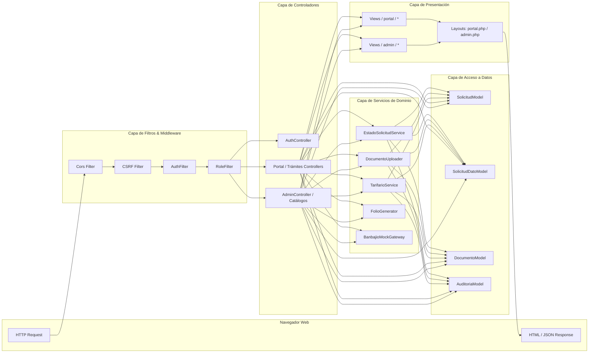
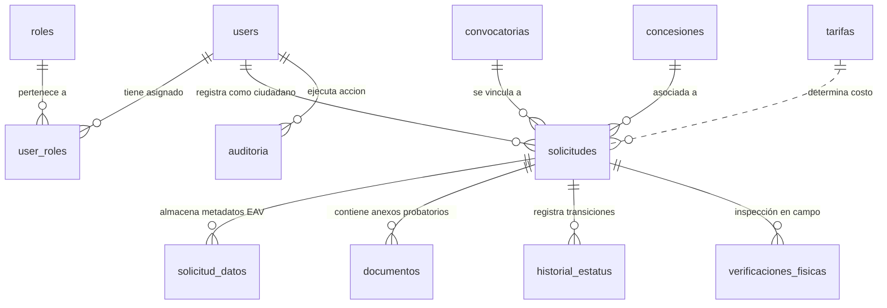
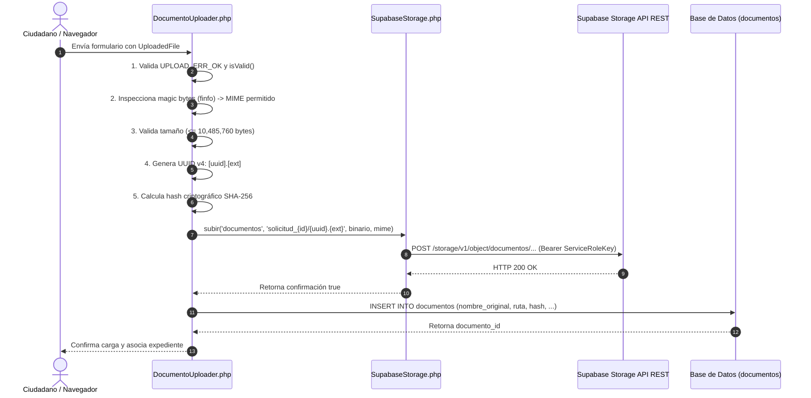
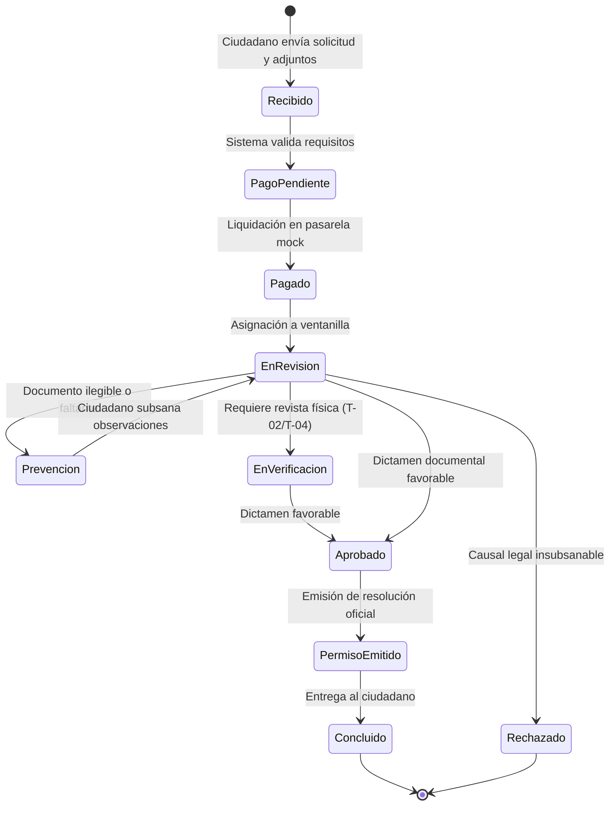

# Metodología de Desarrollo y Arquitectura Técnica: Portal Ciudadano y Panel Administrativo Web
## Sistema Integral de Ventanilla Única de Movilidad y Transporte de Uriangato

**Documento Académico y Técnico de Residencia Profesional**  
**Carrera:** Ingeniería en Sistemas Computacionales / Ingeniería en Software  
**Institución Receptora:** Dirección de Movilidad y Transporte — H. Ayuntamiento de Uriangato, Gto.  
**Autor:** Residente Profesional  
**Versión del Documento:** 2.0  
**Fecha:** Octubre 2026  

---

## Índice General

1. [Delimitación del Alcance del Proyecto de Residencia](#1-delimitación-del-alcance-del-proyecto-de-residencia)
2. [Arquitectura de Software y Patrones de Diseño (MVC en CodeIgniter 4)](#2-arquitectura-de-software-y-patrones-de-diseño-mvc-en-codeigniter-4)
   * 2.1. Implementación del Patrón Modelo-Vista-Controlador (MVC)
   * 2.2. Patrón Entity-Attribute-Value (EAV) para Metadatos de Trámites
   * 2.3. Patrón Feature Flags para Despliegues Progresivos
   * 2.4. Patrón Gateway para Abstracción de Pasarelas Bancarias
3. [Modelo de Base de Datos y Gestión Avanzada de Almacenamiento](#3-modelo-de-base-de-datos-y-gestión-avanzada-de-almacenamiento)
   * 3.1. Esquema Relacional en PostgreSQL (Supabase)
   * 3.2. Diccionario de Datos del Módulo Web
   * 3.3. Pipeline de Almacenamiento Documental y Criptografía en Supabase Storage
   * 3.4. Mecanismo de Descarga Segura y Forzado de Content-Disposition
4. [Seguridad y Control de Acceso Basado en Roles (RBAC)](#4-seguridad-y-control-de-acceso-basado-en-roles-rbac)
   * 4.1. Matriz de Control de Acceso por Rol
   * 4.2. Arquitectura de Filtros y Middlewares
   * 4.3. Mitigación de Vulnerabilidades Web (CSRF, XSS, SQLi)
5. [Despliegue en Entorno Serverless y Persistencia de Sesiones](#5-despliegue-en-entorno-serverless-y-persistencia-de-sesiones)
   * 5.1. Retos del Paradigma Serverless en Vercel para PHP
   * 5.2. Persistencia de Sesiones en Base de Datos (ci_sessions)
   * 5.3. Conectividad Resiliente vía Connection Pooler (PgBouncer)
6. [Lógica de Negocio del Portal Ciudadano](#6-lógica-de-negocio-del-portal-ciudadano)
   * 6.1. Especificación y Flujo de los 7 Trámites Municipales (UR-TT-T-01 al UR-TT-T-07)
   * 6.2. Motor de Cotización Dinámica (TarifarioService)
   * 6.3. Arquitectura del Mock de Pasarela de Pagos
   * 6.4. Consulta de Expedientes y Gestión del Perfil Ciudadano
7. [Lógica de Negocio del Panel Administrativo](#7-lógica-de-negocio-del-panel-administrativo)
   * 7.1. Dashboard de Métricas y Analítica Operativa
   * 7.2. Máquina de Estados Finitos y Transiciones Reguladas
   * 7.3. Regla de Negocio: Observaciones Obligatorias en Prevenciones y Rechazos
   * 7.4. Padrón Inmutable de Auditoría
   * 7.5. Módulos de Catálogos Municipales y Parámetros Operativos
8. [Integración HTTP y Consumo de Servicios Centralizados](#8-integración-http-y-consumo-de-servicios-centralizados)
   * 8.1. Integración con la API REST de Supabase Storage mediante cURL
   * 8.2. Exposición y Gobernanza de Endpoints REST para Clientes Externos

---

## 1. Delimitación del Alcance del Proyecto de Residencia

El presente reporte metodológico documenta formalmente el diseño ingenieril, construcción técnica, aseguramiento de la calidad y despliegue del subsistema **Portal Ciudadano y Panel Administrativo Web**, desarrollado en el marco del proyecto integral de modernización digital para la Dirección de Movilidad y Transporte del Municipio de Uriangato, Guanajuato.

### 1.1. Alcance Técnico Asignado
* **Portal Ciudadano:** Desarrollo de la interfaz web para el registro autenticado de ciudadanos, captura asistida de solicitudes para 7 trámites de transporte y vialidad, cálculo automatizado de derechos municipales según la Ley de Ingresos, carga validada de expedientes probatorios en formato digital, pasarela mock de pago en línea y consulta de estatus con trazabilidad histórica.
* **Panel Administrativo Web:** Construcción del panel de control de uso exclusivo para funcionarios públicos (roles `administrador` y `operador_ventanilla`), incorporando tableros analíticos de control (KPIs), visualizador centralizado de expedientes con dictaminación técnica, módulo de citas para verificación física, bitácora de auditoría inmutable y módulos de administración para los catálogos del municipio (tarifas, concesiones, convocatorias y formatos oficiales).

### 1.2. Exclusiones Metodológicas
Se excluye del análisis profundo de este documento la implementación interna del cliente móvil nativo para agentes de tránsito (desarrollado en Expo / React Native), abordándose únicamente en lo relativo a los puntos de contacto e interoperabilidad con la base de datos relacional y los endpoints de configuración y registro expuestos por el backend web.

---

## 2. Arquitectura de Software y Patrones de Diseño (MVC en CodeIgniter 4)

### 2.1. Implementación del Patrón Modelo-Vista-Controlador (MVC)

El núcleo del sistema web está construido sobre el framework **CodeIgniter 4.5.8** bajo **PHP 8.2+** con declaración de tipado estricto (`declare(strict_types=1)`), adoptando una arquitectura en capas basada en el patrón clásico **Modelo-Vista-Controlador (MVC)**, complementada por una capa intermedia de Servicios y Filtros de Seguridad.



#### A. Capa de Enrutamiento y Filtros (`Config/Routes.php` y `Config/Filters.php`)
Las peticiones entrantes son interceptadas inicialmente por el enrutador centralizado. Todas las rutas se declaran explícitamente (`setAutoRoute(false)`) para evitar vulnerabilidades de ejecución arbitraria. Los filtros aplican validación perimetral de seguridad antes de transferir el control al controlador.

#### B. Capa de Controladores (`app/Controllers/`)
Estructurada en dos espacios de nombres principales para garantizar el principio de responsabilidad única (SRP):
* `App\Controllers\Ciudadano`: Controladores especializados para cada trámite (`TramiteConcesionTransporteController`, `TramiteDespintadoController`, `TramiteOrdenPlaqueoController`, `TramitePermisoEventualController`, `TramiteCierreCalleController`, `TramiteCesionConcesionController`, `TramiteCargaDescargaController`) y el controlador general del portal (`PortalController`).
* `App\Controllers\Admin`: Controlador maestro de gestión de expedientes (`AdminController`), controladores CRUD de catálogos (`CatalogoTarifasController`, `CatalogoConcesionesController`) y controlador de configuración operativa de tránsito (`AppTransitoController`).

#### C. Capa de Modelos (`app/Models/`)
Heredan de `CodeIgniter\Model` y encapsulan el acceso a la base de datos relacional mediante el Query Builder de CodeIgniter. Emplean protección activa de campos (`$allowedFields`), mapeo de tipos a objetos (`$returnType = 'object'`), gestión automatizada de marcas de tiempo (`$useTimestamps = true`, `$createdField = 'created_at'`) y encapsulación de consultas transaccionales.

#### D. Capa de Vistas (`app/Views/`)
Dividida en plantillas maestras (`app/Views/layouts/portal.php` y `app/Views/layouts/admin.php`) que implementan un sistema de layout por secciones (`$this->extend()`, `$this->section()`). Las vistas incorporan Bootstrap 5.3.2, hojas de estilo modulares (`custom.css`), helpers de renderizado seguro con sanitización contra XSS (`esc()`) y scripts desacoplados.

### 2.2. Patrón Entity-Attribute-Value (EAV) para Metadatos de Trámites

Debido a que cada uno de los 7 trámites municipales posee un conjunto disímil de variables legales (por ejemplo, el trámite `UR-TT-T-02` exige placas y número de serie, mientras que `UR-TT-T-05` requiere dimensiones de calle, croquis y anuencia vecinal), se evitó la creación de tablas rígidas y redundantes para cada procedimiento mediante el patrón **Entity-Attribute-Value (EAV)** a través de la tabla `solicitud_datos`.

* **Entidad:** `solicitud_id` (referencia a la tabla maestra `solicitudes`).
* **Atributo:** `clave` (identificador normalizado, ej. `vehiculo_placas`, `tipo_evento`, `motivo_despintado`).
* **Valor:** `valor` (contenido en texto plano o estructurado).

El modelo `SolicitudDatoModel` implementa el método `porSolicitudAgrupado(int $solicitudId): array`, el cual realiza un pivote en memoria para transformar el conjunto de tuplas en un diccionario asociativo clave-valor de fácil consumo en los controladores y vistas del expediente.

### 2.3. Patrón Feature Flags para Despliegues Progresivos

Para permitir el despliegue continuo de código sin exponer al público trámites con validación regulatoria pendiente ante el Cabildo Municipal, se implementó la librería `App\Libraries\FeatureFlags`.

El trámite `UR-TT-T-06` (Cesión de Derechos de Concesión) se encuentra condicionado por la bandera `TRAMITE_CESION_CONCESION_ENABLED`. Si la variable de entorno se define como `false`, el controlador intercepta la navegación y redirige al ciudadano con un mensaje de aviso preventivo, garantizando que el sistema sea desplegable a producción de manera segura.

### 2.4. Patrón Gateway para Abstracción de Pasarelas Bancarias

El procesamiento de pagos en línea se desacopló mediante la interfaz `App\Interfaces\PaymentGatewayInterface`, la cual define el contrato:
* `crearCargo(string $folio, float $monto, string $descripcion, array $metadata): array`
* `confirmarPago(string $referenciaPago): array`
* `reembolsar(string $referenciaPago, float $monto, string $motivo): bool`

La clase `App\Libraries\BanbajioMockGateway` provee la implementación inicial que simula la autorización bancaria en entorno de pruebas, generando identificadores únicos y códigos de autorización bancaria sin acoplar el código del negocio a un proveedor específico.

---

## 3. Modelo de Base de Datos y Gestión Avanzada de Almacenamiento

### 3.1. Esquema Relacional en PostgreSQL (Supabase)

La persistencia del sistema está soportada en **PostgreSQL 15+** alojado en la infraestructura administrada de **Supabase**. El modelo garantiza integridad referencial estricta mediante restricciones de clave foránea (`FOREIGN KEY ... ON DELETE RESTRICT / CASCADE`), unicidad de identificadores e índices optimizados para las consultas de mayor concurrencia.



### 3.2. Diccionario de Datos del Módulo Web

#### A. Tabla `users` (Usuarios del Sistema)
Almacena las cuentas de acceso al sistema tanto para ciudadanos como para servidores públicos municipales.
* `id` (BIGSERIAL, PK): Identificador único secuencial.
* `nombre_completo` (VARCHAR(150), NOT NULL): Nombre o razón social del usuario.
* `email` (VARCHAR(100), NOT NULL, UNIQUE): Correo electrónico institucional o personal, utilizado como identificador de inicio de sesión.
* `password_hash` (VARCHAR(255), NOT NULL): Huella criptográfica de la contraseña calculada con BCRYPT.
* `curp` (VARCHAR(18), NULL): Clave Única de Registro de Población del ciudadano.
* `rfc` (VARCHAR(13), NULL): Registro Federal de Contribuyentes.
* `telefono` (VARCHAR(20), NULL): Número de contacto telefónico.
* `direccion` (TEXT, NULL): Domicilio fiscal o particular registrado.
* `ine_ruta` (VARCHAR(255), NULL): Ruta en Supabase Storage de la identificación oficial guardada en el perfil.
* `activo` (SMALLINT, DEFAULT 1): Bandera de activación de cuenta.
* `created_at`, `updated_at` (TIMESTAMPTZ): Marcas de tiempo de auditoría.

#### B. Tablas `roles` y `user_roles` (Control de Acceso)
* `roles.id` (BIGSERIAL, PK), `roles.nombre` (VARCHAR(50), UNIQUE), `roles.descripcion` (TEXT).
* `user_roles.user_id` (BIGINT, FK -> `users.id`), `user_roles.role_id` (BIGINT, FK -> `roles.id`), PK compuesta `(user_id, role_id)`.

#### C. Tabla `solicitudes` (Expediente Maestro de Trámites)
Representa la entidad central del proceso administrativo municipal.
* `id` (BIGSERIAL, PK): Identificador numérico interno.
* `folio` (VARCHAR(35), NOT NULL, UNIQUE): Folio institucional generado bajo el formato `UR-TT-{TRAMITE}-{AÑO}-{CONSECUTIVO}`.
* `tipo_tramite` (VARCHAR(20), NOT NULL): Código normalizado del trámite (ej. `UR-TT-T-01`, `UR-TT-T-07`).
* `ciudadano_id` (BIGINT, NOT NULL, FK -> `users.id`): Usuario solicitante del trámite.
* `estatus` (VARCHAR(50), NOT NULL, DEFAULT 'Recibido'): Estado actual en la máquina de estados.
* `monto_pago` (DECIMAL(10,2), DEFAULT 0.00): Importe monetario oficial a liquidar.
* `estado_pago` (VARCHAR(30), DEFAULT 'pendiente'): Estatus de cobranza (`pendiente`, `pagado`, `exento`).
* `metodo_pago` (VARCHAR(50), NULL): Medio utilizado (`en_linea_mock`, `ventanilla`).
* `id_transaccion` (VARCHAR(100), NULL): Código de autorización emitido por la pasarela de pago.
* `convocatoria_id` (BIGINT, NULL, FK -> `convocatorias.id`): Relación cuando el trámite deriva de una licitación pública.
* `concesion_id` (BIGINT, NULL, FK -> `concesiones.id`): Concesión sobre la cual se solicita el acto administrativo.
* `created_at`, `updated_at` (TIMESTAMPTZ): Marcas temporales de creación y última actualización.

#### D. Tabla `solicitud_datos` (Esquema EAV de Metadatos)
* `id` (BIGSERIAL, PK).
* `solicitud_id` (BIGINT, NOT NULL, FK -> `solicitudes.id` ON DELETE CASCADE).
* `clave` (VARCHAR(100), NOT NULL): Identificador de la variable específica del formulario.
* `valor` (TEXT, NOT NULL): Dato capturado por el solicitante.
* Índice único en `(solicitud_id, clave)`.

#### E. Tabla `documentos` (Expediente Digital Inmutable)
* `id` (BIGSERIAL, PK).
* `solicitud_id` (BIGINT, NOT NULL, FK -> `solicitudes.id` ON DELETE CASCADE).
* `usuario_id` (BIGINT, NOT NULL, FK -> `users.id`): Usuario que cargó el archivo.
* `tipo_documento` (VARCHAR(80), NOT NULL): Clave documental (ej. `identificacion_oficial`, `poliza_seguro`, `tarjeta_circulacion`).
* `nombre_original` (VARCHAR(255), NOT NULL): Nombre del archivo en la computadora del usuario.
* `ruta_interna` (VARCHAR(255), NOT NULL): Ruta canónica en el bucket de Supabase Storage.
* `mime_type` (VARCHAR(80), NOT NULL): Tipo de contenido MIME validado (`application/pdf`, etc.).
* `tamano_bytes` (BIGINT, NOT NULL): Peso exacto del archivo.
* `hash_sha256` (CHAR(64), NOT NULL): Huella criptográfica SHA-256 de 64 caracteres hexadecimales.
* `fecha_carga` (TIMESTAMPTZ, DEFAULT NOW()).

#### F. Tabla `historial_estatus` (Bitácora de Trazabilidad)
* `id` (BIGSERIAL, PK).
* `solicitud_id` (BIGINT, NOT NULL, FK -> `solicitudes.id` ON DELETE CASCADE).
* `estatus_anterior` (VARCHAR(50), NULL): Estatus previo a la transición.
* `estatus_nuevo` (VARCHAR(50), NOT NULL): Estatus resultante.
* `comentario` (TEXT, NULL): Observaciones técnicas o fundamentación jurídica del cambio.
* `usuario_id` (BIGINT, NOT NULL, FK -> `users.id`): Servidor público o ciudadano responsable del evento.
* `fecha` (TIMESTAMPTZ, DEFAULT NOW()).

#### G. Tabla `auditoria` (Seguridad y Forense Digital)
* `id` (BIGSERIAL, PK).
* `tabla` (VARCHAR(80), NOT NULL): Tabla afectada (`solicitudes`, `concesiones`, etc.).
* `registro_id` (BIGINT, NOT NULL): Identificador de la fila modificada.
* `accion` (VARCHAR(50), NOT NULL): Acción realizada (`crear`, `editar`, `cambiar_estatus`, `toggle_estado`).
* `usuario_id` (BIGINT, NULL, FK -> `users.id`): Usuario que ejecutó la operación.
* `datos_json` (TEXT, NULL): Snapshot serializado en JSON con el estado de los datos.
* `ip_origen` (VARCHAR(45), NULL): Dirección IPv4 o IPv6 del cliente.
* `user_agent` (VARCHAR(255), NULL): Agente de usuario del navegador web.
* `created_at` (TIMESTAMPTZ, DEFAULT NOW()).

#### H. Tabla `ci_sessions` (Persistencia de Sesiones Serverless)
* `id` (VARCHAR(128), NOT NULL, PK): Identificador único de sesión de CodeIgniter.
* `ip_address` (VARCHAR(45), NOT NULL): Dirección IP asociada.
* `timestamp` (BIGINT, NOT NULL): Marca de tiempo UNIX de la última actividad.
* `data` (BYTEA / TEXT, NOT NULL): Contenido serializado de la sesión de usuario.

---

### 3.3. Pipeline de Almacenamiento Documental y Criptografía en Supabase Storage

La carga de documentación se diseñó bajo una política de **cero confianza (Zero-Trust Upload Pipeline)** implementada en `App\Libraries\DocumentoUploader` y `App\Libraries\SupabaseStorage`:



#### Fases del Pipeline de Carga:
1. **Validación de Transporte y Tamaño:** Se comprueba el código nativo de subida de PHP y se descarta cualquier archivo cuyo tamaño exceda los 10 MB (`10485760` bytes).
2. **Validación Estricta de Tipo MIME:** No se confía en la extensión provista por el navegador del cliente; se inspecciona el contenido binario a través de `fileinfo` permitiendo únicamente:
   * `application/pdf` (documentación oficial, pólizas, concesiones).
   * `image/jpeg` y `image/png` (fotografías de inspección, INE).
3. **Ofuscación de Nombres mediante UUID v4:** El nombre original del archivo se almacena únicamente como metadato administrativo. En el almacenamiento físico, el archivo se renombra con un **UUID versión 4** generado mediante entropía criptográfica (`random_bytes(16)`), evitando colisiones, caracteres inválidos y ataques de ejecución de scripts en el servidor.
4. **Cálculo de Huella Criptográfica SHA-256:**
   ```php
   $contenido = file_get_contents($file->getTempName());
   $hash = hash('sha256', $contenido);
   ```
   Esta cadena de 64 caracteres se persiste en la columna `documentos.hash_sha256`. Cualquier alteración posterior del archivo en reposo rompería la firma, otorgando certeza jurídica e inmutabilidad probatoria al expediente administrativo.
5. **Estructura Jerárquica en Supabase Storage:** El archivo se almacena en el bucket privado `documentos` bajo el prefijo `solicitud_{id}/{nombre_interno}.{ext}`.
6. **Subida Segura vía cURL con Service Role:** `SupabaseStorage` realiza una petición HTTP `POST` a la API REST de Supabase Storage (`/storage/v1/object/documentos/{ruta}`) autenticada mediante la cabecera `Authorization: Bearer {SUPABASE_SERVICE_ROLE_KEY}` con el encabezado de sobreescritura `x-upsert: true`.

---

### 3.4. Mecanismo de Descarga Segura y Forzado de Content-Disposition

Para mitigar riesgos de filtración de información y accesos no autorizados a expedientes ciudadanos, el sistema implementa un modelo de descarga indirecta con autorización previa:

1. **Aislamiento de Acceso Directo:** Los buckets de Supabase Storage para expedientes no tienen lectura pública (`public: false`). Ningún usuario puede acceder a los archivos mediante una URL estática directa.
2. **Autorización en el Controlador:** Cuando un usuario invoca el endpoint de descarga (ej. `/admin/solicitudes/descargar-documento/(:num)` o `/portal/solicitud/(:any)/descargar/(:num)`):
   * Se verifica que la sesión esté autenticada.
   * Se comprueba la pertenencia del expediente: si es ciudadano, se valida estrictamente que `solicitud.ciudadano_id === session.user_id`. Si es personal administrativo, se valida el rol `operador_ventanilla` o `administrador`.
3. **Generación de Token Firmado (Presigned URL) con TTL:**
   El backend se comunica con Supabase Storage para generar una URL temporal firmada criptográficamente con tiempo de vida limitado a 1 hora (3,600 segundos):
   ```php
   $url = $storage->urlFirmada('documentos', $doc->ruta_interna, 3600);
   ```
4. **Preservación del Nombre Original (`Content-Disposition: attachment`):**
   Al redireccionar al usuario a la URL de descarga o al transmitir el binario mediante proxy, se asegura que el agente de usuario reciba la cabecera HTTP:
   ```http
   Content-Disposition: attachment; filename="Identificacion_Oficial_Juan_Perez.pdf"
   ```
   De este modo, aunque el archivo interno en la nube se llame `a1b2c3d4-e5f6-7890-abcd-ef1234567890.pdf`, el usuario descarga el archivo con su nombre legítimo y representativo.

---

## 4. Seguridad y Control de Acceso Basado en Roles (RBAC)

### 4.1. Matriz de Control de Acceso por Rol

El sistema implementa un esquema formal de **Control de Acceso Basado en Roles (RBAC)** administrado mediante las tablas `roles` y `user_roles`. Los tres roles operacionales y sus privilegios son:

| Módulo / Funcionalidad | `ciudadano` | `operador_ventanilla` | `administrador` | Justificación Operativa |
|---|:---:|:---:|:---:|---|
| Registro y Acceso al Portal Ciudadano | **Permitido** | Denegado | Denegado | Los administradores son redirigidos automáticamente al panel. |
| Iniciar y Pagar los 7 Trámites | **Permitido** | Denegado | Denegado | Operación reservada al solicitante legítimo. |
| Consultar "Mis Solicitudes" | **Permitido (Propias)**| Denegado | Denegado | Acceso restringido exclusivamente a su `user_id`. |
| Dashboard con Métricas de Recaudación | Denegado | **Permitido** | **Permitido** | Monitoreo del flujo de atención municipal. |
| Bandeja General de Solicitudes | Denegado | **Permitido** | **Permitido** | Revisión y dictaminación de expedientes. |
| Dictaminar y Cambiar Estatus | Denegado | **Permitido** | **Permitido** | Emisión de prevenciones, aprobaciones y rechazos. |
| Catálogo de Tarifas y Factores UMA | Denegado | Solo Lectura | **Control Total** | La modificación de tarifas es facultad administrativa. |
| Catálogo Oficial de Concesiones | Denegado | Solo Lectura | **Control Total** | Padrón oficial de títulos de concesión. |
| Gestión de Convocatorias Públicas | Solo Lectura | Evaluación | **Control Total** | Asignación y fallo de concesiones de transporte. |
| Repositorio de Formatos Descargables | Solo Lectura | Solo Lectura | **Control Total** | Publicación de formatos oficiales. |
| Padrón Inmutable de Auditoría | Denegado | Denegado | **Permitido** | Inspección forense de movimientos en el sistema. |

### 4.2. Arquitectura de Filtros y Middlewares

CodeIgniter 4 aplica los filtros configurados en `app/Config/Filters.php` de forma secuencial antes de que las peticiones alcancen los métodos de los controladores:

```php
public array $globals = [
    'before' => [
        'cors',
        'csrf' => ['except' => ['api/agentes/registro']],
        'invalidchars',
    ],
    'after' => [
        'toolbar',
        'secureheaders',
    ],
];
```

#### Filtros Específicos de Seguridad:
1. **`AuthFilter` (`app/Filters/AuthFilter.php`):**
   Verifica la existencia y validez de las variables de sesión `session('logged_in')` y `session('user_id')`. Si la sesión ha expirado o no existe, preserva la URL solicitada y redirige al formulario de acceso (`auth/login`) con un mensaje informativo.
2. **`RoleFilter` (`app/Filters/RoleFilter.php`):**
   Acepta una lista delimitada por comas de roles permitidos como parámetro del filtro (ej. `role:administrador,operador_ventanilla` o `role:ciudadano`). Consulta el rol activo del usuario en la sesión y, en caso de discrepancia, deniega la ejecución emitiendo un código de estado `HTTP 403 Forbidden` o redireccionando al entorno autorizado.
3. **`AdminRedirectFilter` (`app/Filters/AdminRedirectFilter.php`):**
   Intercepta las rutas públicas del portal ciudadano (`portal/*`). Si detecta que el usuario autenticado posee rol de `administrador` u `operador_ventanilla`, lo redirige de inmediato al panel administrativo (`admin/dashboard`), evitando que servidores públicos operen inadvertidamente sobre la interfaz ciudadana.

### 4.3. Mitigación de Vulnerabilidades Web (CSRF, XSS, SQLi)

* **Cross-Site Request Forgery (CSRF):** El filtro nativo de CSRF de CodeIgniter protege todos los formularios web enviados por método `POST`, `PUT` o `DELETE`. Se inyecta un campo oculto con token criptográfico generado por sesión (`csrf_field()`), regenerándose periódicamente para evitar ataques de fijación de sesión.
* **Cross-Site Scripting (XSS):** Todas las variables dinámicas impresas en las vistas HTML son procesadas a través del helper nativo `esc($variable, 'html')`, neutralizando caracteres como `<`, `>`, `"` y `'` mediante entidades HTML seguras.
* **Inyección SQL (SQLi):** No se realiza concatenación manual de cadenas en sentencias SQL. La interacción con la base de datos se ejecuta exclusivamente mediante el Query Builder de CodeIgniter 4, el cual utiliza sentencias preparadas de **PDO** con vinculación estricta de parámetros (*Prepared Statements*).

---

## 5. Despliegue en Entorno Serverless y Persistencia de Sesiones

### 5.1. Retos del Paradigma Serverless en Vercel para PHP

El despliegue de una aplicación web construida en PHP sobre la infraestructura **Serverless de Vercel** (mediante el runtime comunitario `vercel-php@0.7.4`) presenta desafíos arquitectónicos fundamentales:
1. **Entorno de Ejecución Efímero (Statelessness):** Las funciones lambda se inicializan bajo demanda, procesan una petición HTTP y pueden destruirse inmediatamente. No existe memoria compartida ni procesos en segundo plano persistentes.
2. **Sistema de Archivos de Solo Lectura:** El directorio de la aplicación en Vercel es inmutable. El único directorio con permisos de escritura es `/tmp`, cuyo contenido es volátil y no se comparte entre distintas instancias de la función serverless.
3. **Destrucción de Sesiones Tradicionales:** Por defecto, CodeIgniter almacena las sesiones en archivos dentro del directorio `writable/session/`. En Vercel, esto provoca que cada petición sea atendida potencialmente por un contenedor diferente que carece del archivo de sesión previo, provocando cierres de sesión inmediatos y pérdida de transacciones.

### 5.2. Persistencia de Sesiones en Base de Datos (`ci_sessions`)

Para superar la restricción de efimeridad, se configuró la persistencia de sesiones a nivel de base de datos relacional en PostgreSQL/Supabase.

#### Configuración en `app/Config/App.php`:
```php
public string $sessionDriver = 'CodeIgniter\Session\Handlers\DatabaseHandler';
public string $sessionSavePath = 'ci_sessions';
public string $sessionCookieName = 'ci_session';
public int $sessionExpiration = 7200; // 2 horas de inactividad
public bool $sessionMatchIP = false; // Compatible con proxies y CDNs de Vercel
public int $sessionTimeToUpdate = 300;
public bool $sessionRegenerateDestroy = false;
```

#### Estructura de la Tabla `ci_sessions` en PostgreSQL:
```sql
CREATE TABLE IF NOT EXISTS public.ci_sessions (
    id VARCHAR(128) NOT NULL PRIMARY KEY,
    ip_address VARCHAR(45) NOT NULL,
    timestamp BIGINT NOT NULL DEFAULT 0,
    data BYTEA NOT NULL
);
CREATE INDEX IF NOT EXISTS idx_ci_sessions_timestamp ON public.ci_sessions(timestamp);
```

Al recibir una petición HTTP, el handler de CodeIgniter extrae el identificador de la cookie `ci_session`, realiza una consulta `SELECT` a la tabla `ci_sessions`, deserializa los datos del usuario en memoria y, al finalizar la ejecución, actualiza la fila mediante `UPDATE` o `INSERT`. Este diseño desacopla completamente el estado del usuario del contenedor físico que ejecuta el código PHP.

### 5.3. Conectividad Resiliente vía Connection Pooler (PgBouncer)

Las plataformas serverless pueden generar cientos de invocaciones concurrentes, lo que provocaría el agotamiento inmediato del límite de conexiones máximas de PostgreSQL (error `FATAL: remaining connection slots are reserved for non-replication superuser connections`). Adicionalmente, los entornos serverless de Vercel restringen las conexiones salientes directas al puerto tradicional `5432`.

Para resolver este problema, la clase `app/Config/Database.php` implementa un conmutador inteligente:
* Detecta si la aplicación se ejecuta en Vercel mediante las variables `VERCEL` o `VERCEL_ENV`.
* Conmuta automáticamente la conexión hacia el **Connection Pooler (PgBouncer)** de Supabase en el puerto **6543** utilizando la variable `POSTGRES_URL` con modo transaccional y cifrado `sslmode=require`.
* Esto permite reutilizar un grupo compacto de conexiones físicas para atender miles de peticiones HTTP serverless sin degradación de latencia.

---

## 6. Lógica de Negocio del Portal Ciudadano

### 6.1. Especificación y Flujo de los 7 Trámites Municipales

El portal implementa la digitalización exhaustiva de los siete trámites normados por la Dirección de Movilidad:



#### 1. `UR-TT-T-01`: Concesión de Transporte Público Colectivo y Suburbano
* **Alcance:** Solicitud de participación en convocatorias públicas para la asignación de títulos de concesión municipal.
* **Datos Capturados:** Modalidad de servicio (urbano, suburbano), propuesta de derrotero, capacidad de pasajeros, modelo de unidad.
* **Documentación:** Identificación oficial, comprobante de domicilio, propuesta de plan operativo, cartas de antecedentes no penales.
* **Integración Especial:** Se vincula a un registro activo de la tabla `convocatorias`.

#### 2. `UR-TT-T-02`: Constancia de Despintado y Retiro de Aditamentos
* **Alcance:** Trámite obligatorio previo a la desincorporación de una unidad vehicular del servicio público para acreditar el retiro de cromática oficial, números económicos y taxímetro.
* **Datos Capturados:** Número de concesión actual, placas del vehículo, número de serie (VIN), motivo de baja (renovación de flota, fin de concesión).
* **Flujo Operativo:** Requiere inspección física obligatoria agendada en patio de maniobras (`Cita agendada` -> `Verificado`).

#### 3. `UR-TT-T-03`: Orden de Plaqueo para Transporte Público
* **Alcance:** Emisión de la anuencia municipal requerida por la Secretaría de Finanzas del Estado de Guanajuato para dotar de placas de servicio público a una unidad.
* **Datos Capturados:** Número de concesión, datos de la factura vehicular, empresa aseguradora, número de póliza vigente.
* **Validación:** Verifica que la concesión se encuentre en estatus `vigente` en el padrón municipal.

#### 4. `UR-TT-T-04`: Permiso Eventual Fuera de Ruta o de Horario
* **Alcance:** Autorización temporal otorgada a unidades concesionadas para prestar servicios excepcionales de transporte fuera de su derrotero autorizado (peregrinaciones, eventos deportivos, viajes turísticos).
* **Datos Capturados:** Origen, destino exacto, fecha y horario de salida y retorno, lista tentativa de pasajeros.
* **Validación Técnica:** Validación de póliza de seguro de viajero con cobertura foránea extendida.

#### 5. `UR-TT-T-05`: Autorización para Cierre Temporal de Calles por Obras o Eventos
* **Alcance:** Permiso para la ocupación y cierre de arroyo vehicular por festividades patronales, eventos sociales, obras civiles o maniobras pesadas.
* **Datos Capturados:** Nombre de la vialidad, entrecalles, dimensiones lineales en metros, croquis de desvío vial propuesto, anuencia vecinal firmada.
* **Validación:** Análisis de impacto vial por parte de la Dirección de Tránsito.

#### 6. `UR-TT-T-06`: Cesión de Derechos de Concesión de Transporte (Fase Regulada)
* **Alcance:** Trámite para transferir legalmente la titularidad de una concesión de transporte de un titular cedente a un cesionario propuesto.
* **Control:** Condicionado por la bandera `FeatureFlags::isCesionConcesionEnabled()`.
* **Datos Capturados:** Cédula del concesionario actual, datos completos del cesionario propuesto, justificación legal del acto.

#### 7. `UR-TT-T-07`: Permiso de Carga y Descarga en Zonas Comerciales y Urbanas
* **Alcance:** Autorización expedida a vehículos de transporte de mercancías para maniobrar en zonas céntricas y de alta densidad vehicular.
* **Datos Capturados:** Tipo de solicitante (`persona_fisica`, `empresa`), período solicitado (`dia`, `mes`, `semestre`, `anual`), número de vehículos, tonelaje bruto y dimensiones de la unidad.
* **Tarificación:** Cálculo proporcional del costo en función del período y la cantidad de camiones registrados.

### 6.2. Motor de Cotización Dinámica (`TarifarioService`)

El servicio `App\Libraries\TarifarioService` desacopla las reglas de cálculo fiscal de los controladores:
* Consulta la tabla relacional `tarifas` filtrando por el código del trámite y el criterio operacional vigente (`TarifaModel::vigente($tramite, $criterio)`).
* Para el trámite `UR-TT-T-07`, resuelve criterios combinados como `empresa_mes` o `persona_fisica_dia`:
  $$\text{Monto Total} = \text{Monto Base} \times \max(1, \min(15, \text{NumCamiones}))$$
* Identifica si la tarifa devuelta corresponde a un valor oficial aprobado o a una tarifa preliminar provisional (`placeholder_oficial = 1`), desplegando en la vista del ciudadano una advertencia institucional de transparencia presupuestaria.

### 6.3. Arquitectura del Mock de Pasarela de Pagos

El flujo de pago del portal ciudadano simula una pasarela de comercio electrónico institucional:
1. Una vez que la solicitud alcanza el estatus `Pago pendiente`, el botón "Proceder al Pago en Línea" se activa en la vista del expediente.
2. La vista `portal/tramites/pago_mock` presenta un formulario interactivo con validación de tarjeta de crédito/débito, fecha de expiración y CVV.
3. Al procesar el envío, el controlador interactúa con `BanbajioMockGateway::crearCargo()` y `confirmarPago()`.
4. El sistema actualiza la fila de la solicitud:
   * `estado_pago = 'pagado'`
   * `metodo_pago = 'en_linea_mock'`
   * `id_transaccion = 'MOCK-670...-AUTH'`
5. Se inserta un evento automático en la tabla `historial_estatus` acreditando el pago y avanzando la solicitud al estatus operativo subsecuente.

### 6.4. Consulta de Expedientes y Gestión del Perfil Ciudadano

* **Módulo "Mis Solicitudes":** Permite al ciudadano visualizar en una tabla responsiva todos sus trámites iniciados, filtrados por folio, fecha y estado actual, incorporando insignias de color (*status badges*) y accesos directos al detalle del expediente.
* **Módulo "Mi Perfil" (`app/Views/portal/mi_perfil.php`):** Centraliza los datos generales del ciudadano (CURP, RFC, dirección física, teléfono) y permite la carga perenne de su Identificación Oficial (INE), facilitando que en trámites futuros el documento pueda ser referenciado automáticamente sin obligar al usuario a digitalizarlo repetidamente.

---

## 7. Lógica de Negocio del Panel Administrativo

### 7.1. Dashboard de Métricas y Analítica Operativa

El panel administrativo (`AdminController::dashboard`) funciona como un centro de inteligencia operativa para los directores y jefes de departamento:
* **Tarjetas KPI Elevadas:** Cálculo dinámico de indicadores agregados:
  * *Total de Solicitudes Ingresadas*.
  * *Expedientes en Revisión Documental*.
  * *Expedientes Prevenidos* (requieren subsanación del ciudadano).
  * *Expedientes Dictaminados Favorables / Aprobados*.
  * *Monto Total Recaudado* (acumulado en MXN de solicitudes con `estado_pago = 'pagado'`).
* **Visualizadores de Distribución:** Desglose visual de expedientes por tipo de trámite y barras de estado porcentuales para la detección oportuna de cuellos de botella en la atención ciudadana.

### 7.2. Máquina de Estados Finitos y Transiciones Reguladas

El servicio `App\Libraries\EstadoSolicitudService` encapsula las reglas formales de transición de estados por trámite, asegurando que un operador no pueda ejecutar saltos de estado que vulneren el debido proceso administrativo:

* **Inmutabilidad de Conclusión:** Una solicitud en estatus `Rechazado`, `Permiso emitido` o `Concluido` no puede ser retrocedida arbitrariamente a estados de captura.
* **Transiciones Válidas:** Cada procedimiento posee un grafo dirigido específico. Por ejemplo, en el trámite `UR-TT-T-02` (Despintado), la transición `Recibido -> Cita agendada -> Verificado` es forzosa y no permite la emisión de dictamen sin constancia de verificación.

### 7.3. Regla de Negocio: Observaciones Obligatorias en Prevenciones y Rechazos

Para cumplir con el principio constitucional de legalidad y fundamentación de los actos administrativos:
* Cuando un operador municipal selecciona el estatus `Prevención` o `Rechazado` en el formulario de resolución de expedientes, el campo de texto `comentario` se vuelve **estrictamente obligatorio** a nivel de validación del backend:
  ```php
  if (in_array($nuevoEstatus, ['Prevención', 'Rechazado'], true) && trim((string)$comentario) === '') {
      return redirect()->back()->with('error', 'Es obligatorio ingresar un motivo o comentario para este estatus.');
  }
  ```
* El comentario capturado se almacena en `historial_estatus` y se refleja de manera destacada en la vista del portal ciudadano, permitiendo que el usuario conozca con exactitud qué documento subsanar o la causal jurídica de rechazo.

### 7.4. Padrón Inmutable de Auditoría (`AuditoriaModel`)

Cada alteración sensible realizada desde el panel administrativo es interceptada por el modelo de auditoría (`AuditoriaModel::registrar()`):
* **Captura de Contexto:** Se almacena la tabla modificada, la clave primaria del registro, el tipo de operación (`crear`, `editar`, `cambiar_estatus`, `toggle_estado`), el ID del funcionario responsable, la marca de tiempo precisa, la dirección IP remota y el User-Agent del navegador.
* **Volcado de Carga Útil (Payload JSON):** Los datos modificados o el estado previo y posterior se serializan en formato JSON dentro de la columna `datos_json`, generando una pista de auditoría forense inalterable ante controversias legales o quejas ciudadanas.

### 7.5. Módulos de Catálogos Municipales y Parámetros Operativos

* **Catálogo de Tarifas (`CatalogoTarifasController`):** Administración de los conceptos de cobro municipal, configuración de valores monetarios fijos, definición de factores aplicables al valor diario de la Unidad de Medida y Actualización (UMA) y asignación del ejercicio fiscal.
* **Catálogo de Concesiones (`CatalogoConcesionesController`):** Registro del padrón municipal de concesiones de transporte público, vinculación de números económicos, rutas asignadas, datos de la unidad vehicular (placas, serie), vigencia de la concesión y control de estatus (`vigente`, `vencida`, `suspendida`, `cancelada`).
* **Módulo de Formatos Oficiales (`AdminController::formatos`):** Repositorio institucional para la subida y sustitución de formatos editables y solicitudes oficiales que los ciudadanos pueden descargar desde el portal web.
* **Consola de Configuración de Tránsito (`AppTransitoController`):** Módulo administrativo que permite actualizar el valor de la UMA vigente, configurar las reglas fotográficas de la aplicación móvil de agentes de tránsito, dar de alta fundamentos legales en el catálogo de infracciones y auditar el historial de boletas levantadas en vía pública.

---

## 8. Integración HTTP y Consumo de Servicios Centralizados

### 8.1. Integración con la API REST de Supabase Storage mediante cURL

El backend de CodeIgniter 4 no depende de SDKs pesados de terceros para interactuar con los servicios en la nube de Supabase; implementa un cliente HTTP especializado sobre la extensión nativa **cURL** de PHP dentro de `App\Libraries\SupabaseStorage`:

```php
protected function request(string $method, string $url, ?string $body, array $headers): array|false
{
    $ch = curl_init($url);
    $options = [
        CURLOPT_RETURNTRANSFER => true,
        CURLOPT_TIMEOUT        => 30,
        CURLOPT_HTTPHEADER     => $headers,
        CURLOPT_CUSTOMREQUEST  => $method,
    ];
    if ($body !== null && $method !== 'GET' && $method !== 'HEAD') {
        $options[CURLOPT_POSTFIELDS] = $body;
    }
    curl_setopt_array($ch, $options);
    $responseBody = curl_exec($ch);
    $statusCode   = curl_getinfo($ch, CURLINFO_HTTP_CODE);
    curl_close($ch);
    
    return ['status' => $statusCode, 'body' => $responseBody];
}
```

#### Capacidades Implementadas:
* **`subir()`:** Petición `POST` multipart/binaria a `/object/{bucket}/{path}` con encabezados `apikey`, `Authorization: Bearer {serviceKey}` y `x-upsert: true`.
* **`urlFirmada()`:** Petición `POST` a `/object/sign/{bucket}/{path}` enviando payload JSON con el parámetro `expiresIn` en segundos para generar tokens de descarga temporales.
* **`descargar()`:** Petición `GET` para obtener el flujo binario completo del archivo y retransmitirlo a través del controlador web forzando la cabecera `Content-Disposition`.
* **`eliminar()`:** Petición `DELETE` enviando un arreglo JSON con prefijos de archivos a depurar.

### 8.2. Exposición y Gobernanza de Endpoints REST para Clientes Externos

El backend web expone rutas de API para interoperabilidad con clientes móviles y servicios satélite:
1. **`POST /api/agentes/registro`:**
   * Controlador: `App\Controllers\Api\AgentesTransitoApiController::registrar()`.
   * Propósito: Alta y enrolamiento de agentes operativos de tránsito desde la aplicación móvil.
   * Manejo CORS y Preflight: Soporta peticiones preflight `OPTIONS` devolviendo `HTTP 204 No Content` con cabeceras `Access-Control-Allow-Origin`, `Access-Control-Allow-Methods: POST, OPTIONS` y `Access-Control-Allow-Headers`.
   * Seguridad: Excluido de la validación de tokens CSRF en `app/Config/Filters.php`, pero sujeto a validación estricta de estructura JSON (placa única, longitud de contraseña de 3 a 50 caracteres, hashing BCRYPT).
2. **`GET /api/checklist-infracciones`:**
   * Controlador: `App\Controllers\Api\InfraccionesApiController::checklist()`.
   * Propósito: Entrega del catálogo estructurado de faltas administrativas al reglamento de movilidad para sincronización offline en la app móvil.

---

## 9. Conclusiones Técnicas de la Metodología

La arquitectura construida para el **Portal Ciudadano y Panel Administrativo Web** resolvió con éxito las demandas operativas y normativas de la Dirección de Movilidad y Transporte de Uriangato:

1. **Robustez y Resiliencia:** La integración del patrón MVC con persistencia de sesiones en base de datos (`ci_sessions`) y el uso de Connection Pooling sobre PostgreSQL garantizó una operación 100% estable en un entorno Serverless moderno (Vercel).
2. **Certeza Jurídica y Seguridad:** La inmutabilidad de los expedientes mediante hashing criptográfico SHA-256, el almacenamiento privado con firmas temporales en Supabase Storage y la rigurosidad de la matriz de control de acceso RBAC protegen los datos personales de la ciudadanía y blindan los actos de autoridad municipal.
3. **Mantenibilidad y Escalabilidad:** El desacoplamiento mediante patrones de diseño (EAV para trámites heterogéneos, Feature Flags para control de versiones y Gateway para pagos) proporciona al H. Ayuntamiento una base tecnológica sólida, lista para escalar e integrar nuevos trámites y servicios en ejercicios fiscales futuros.
