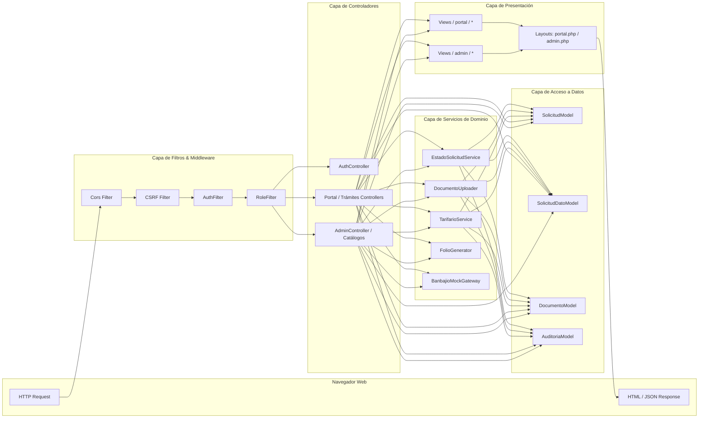
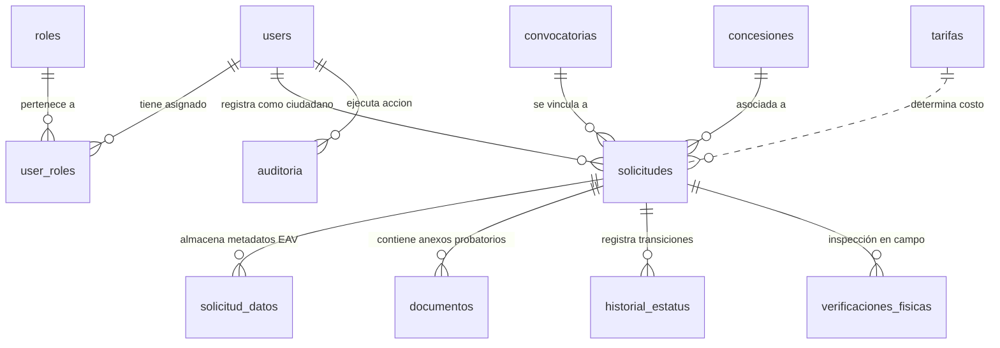
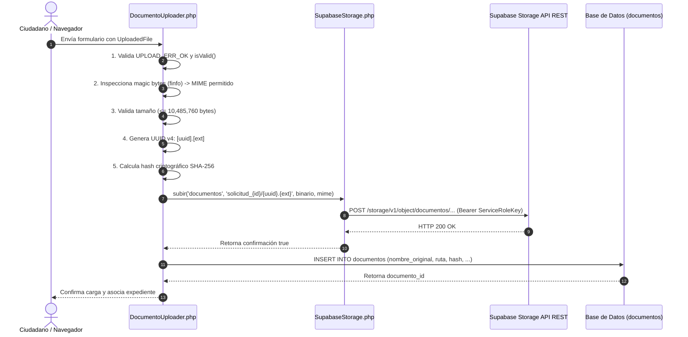
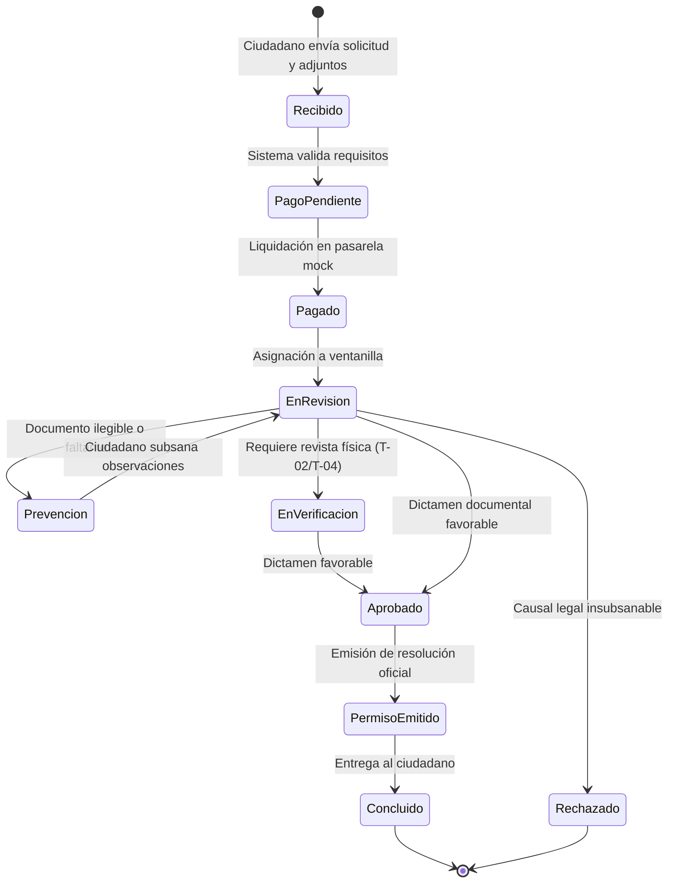
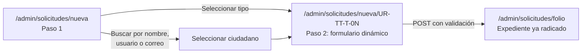

# Metodología de Desarrollo y Arquitectura Técnica: Portal Ciudadano y Panel Administrativo Web
## Sistema Integral de Ventanilla Única de Movilidad y Transporte de Uriangato

**Documento Académico y Técnico de Residencia Profesional**  
**Carrera:** Ingeniería en Sistemas Computacionales / Ingeniería en Software  
**Institución Receptora:** Dirección de Movilidad y Transporte — H. Ayuntamiento de Uriangato, Gto.  
**Autor:** Residente Profesional  
**Versión del Documento:** 4.0  
**Fecha:** Octubre 2026  

---

## Índice General

1. [Delimitación del Alcance del Proyecto de Residencia](#1-delimitación-del-alcance-del-proyecto-de-residencia)
   * 1.1. Alcance Técnico Asignado
   * 1.2. Exclusiones Metodológicas
   * **1.3. Metodología de Trabajo: Desarrollo Iterativo-Incremental y Coordinación Síncrona**
2. [Arquitectura de Software y Patrones de Diseño (MVC en CodeIgniter 4)](#2-arquitectura-de-software-y-patrones-de-diseño-mvc-en-codeigniter-4)
   * 2.1. Implementación del Patrón Modelo-Vista-Controlador (MVC)
   * 2.2. Patrón Entity-Attribute-Value (EAV) para Metadatos de Trámites
   * 2.3. Patrón Feature Flags para Despliegues Progresivos
   * 2.4. Patrón Gateway para Abstracción de Pasarelas Bancarias
3. [Modelo de Base de Datos y Gestión Avanzada de Almacenamiento](#3-modelo-de-base-de-datos-y-gestión-avanzada-de-almacenamiento)
   * 3.1. Esquema Relacional en PostgreSQL (Supabase)
   * 3.2. Diccionario de Datos del Módulo Web
   * 3.3. Pipeline de Almacenamiento Documental y Criptografía en Supabase Storage
   * 3.4. Mecanismo de Descarga Segura y Forzado de Content-Disposition
   * 3.5. Estrategia Dual de Almacenamiento: Nube Supabase y Depósito Local Firmado
4. [Seguridad y Control de Acceso Basado en Roles (RBAC)](#4-seguridad-y-control-de-acceso-basado-en-roles-rbac)
   * 4.1. Matriz de Control de Acceso por Rol
   * 4.2. Arquitectura de Filtros y Middlewares
   * 4.3. Mitigación de Vulnerabilidades Web (CSRF, XSS, SQLi)
   * 4.4. Permisos Configurables del Operador de Ventanilla (Autorización de Grano Fino)
5. [Despliegue en Entorno Serverless y Persistencia de Sesiones](#5-despliegue-en-entorno-serverless-y-persistencia-de-sesiones)
   * 5.1. Retos del Paradigma Serverless en Vercel para PHP
   * 5.2. Persistencia de Sesiones en Base de Datos (ci_sessions)
   * 5.3. Conectividad Resiliente vía Connection Pooler (PgBouncer)
6. [Lógica de Negocio del Portal Ciudadano](#6-lógica-de-negocio-del-portal-ciudadano)
   * 6.1. Especificación y Flujo de los 7 Trámites Municipales (UR-TT-T-01 al UR-TT-T-07)
   * 6.2. Motor de Cotización Dinámica (TarifarioService)
   * 6.3. Arquitectura del Mock de Pasarela de Pagos
   * 6.4. Consulta de Expedientes y Gestión del Perfil Ciudadano
   * 6.5. Autorregistro de Ciudadanos y Recuperación de Cuenta
7. [Lógica de Negocio del Panel Administrativo](#7-lógica-de-negocio-del-panel-administrativo)
   * 7.1. Dashboard de Métricas y Analítica Operativa
   * 7.2. Máquina de Estados Finitos y Transiciones Reguladas
   * 7.3. Regla de Negocio: Observaciones Obligatorias en Prevenciones y Rechazos
   * 7.4. Padrón Inmutable de Auditoría
   * 7.5. Módulos de Catálogos Municipales y Parámetros Operativos
   * 7.6. Radicación Presencial de Solicitudes desde Ventanilla (Canal Híbrido)
   * 7.7. Gestión del Padrón de Cuentas desde el Panel
   * 7.8. Mapa Maestro de Rutas y Módulos del Panel
8. [Integración HTTP y Consumo de Servicios Centralizados](#8-integración-http-y-consumo-de-servicios-centralizados)
   * 8.1. Integración con la API REST de Supabase Storage mediante cURL
   * 8.2. Exposición y Gobernanza de Endpoints REST para Clientes Externos
9. [Experiencia de Usuario y Diseño Responsivo Mobile-First](#9-experiencia-de-usuario-y-diseño-responsivo-mobile-first)
   * 9.1. Sistema de Diseño y Design Tokens
   * 9.2. Escala Tipográfica y Objetivos Táctiles
   * 9.3. Adaptación del Portal Ciudadano (Navegación Inferior y Colapso)
   * 9.4. Adaptación del Panel Administrativo (Gaveta Lateral y Áreas Seguras)
   * 9.5. Portada Fotográfica: Composición, Velo de Contraste y Comportamiento en Retrato
   * 9.6. Identidad Visual, Favicones y Recursos Estáticos en el Edge
   * 9.7. Accesibilidad, Movimiento Reducido y Rendimiento
   * **9.8. Auditoría Medible de Desbordes Horizontales en Móvil**
10. [Aseguramiento de la Calidad y Estrategia de Pruebas](#10-aseguramiento-de-la-calidad-y-estrategia-de-pruebas)
   * 10.1. Suite Automatizada con PHPUnit y FeatureTestTrait
   * 10.2. Matriz de Cobertura Funcional
   * 10.3. Harness de Pruebas Aislado en SQLite
   * 10.4. Pruebas de Humo y Verificación en Producción
   * **10.5. Barrido de Renderizado de Vistas y Convención de Inyección de Datos**
   * **10.6. Verificación de Sincronía entre Ramas (Backend ↔ App Móvil)**
11. **Recorrido Procesal del Desarrollo (Fases)** — *organizado por fases de trabajo, para el capítulo de metodología del documento final*
   * 11.0. Mapa de Correspondencia con las Fases del Proyecto
   * 11.1. Fase de Análisis y Levantamiento de Requerimientos en Campo
   * 11.2. Fase de Diseño y Validación de Interfaces de Usuario (UX/UI)
   * 11.3. Fase de Diseño e Implementación de la Base de Datos
   * 11.4. Fase de Programación del Backend y Reglas de Negocio
   * 11.5. Fase de Frontend y Despliegue en Entorno de Producción
   * 11.6. Correspondencia con las Figuras del Documento Final
   * 11.7. Referencias Tecnológicas Utilizadas
12. [Conclusiones Técnicas de la Metodología](#12-conclusiones-técnicas-de-la-metodología)

---

## 1. Delimitación del Alcance del Proyecto de Residencia

El presente reporte metodológico documenta formalmente el diseño ingenieril, construcción técnica, aseguramiento de la calidad y despliegue del subsistema **Portal Ciudadano y Panel Administrativo Web**, desarrollado en el marco del proyecto integral de modernización digital para la Dirección de Movilidad y Transporte del Municipio de Uriangato, Guanajuato.

### 1.1. Alcance Técnico Asignado
* **Portal Ciudadano:** Desarrollo de la interfaz web para el **autorregistro** autogestionado de ciudadanos, captura asistida de solicitudes para 7 trámites de transporte y vialidad, cálculo automatizado de derechos municipales según la Ley de Ingresos, carga validada de expedientes probatorios en formato digital, pasarela mock de pago en línea y consulta de estatus con trazabilidad histórica.
* **Panel Administrativo Web:** Construcción del panel de control de uso exclusivo para funcionarios públicos (roles `administrador` y `operador_ventanilla`), incorporando tableros analíticos de control (KPIs), visualizador centralizado de expedientes con dictaminación técnica, módulo de citas para verificación física, **radicación presencial de solicitudes desde ventanilla** (atención del ciudadano que no usa el portal web), bitácora de auditoría inmutable, **permisología configurable por sección para el operador**, gestión del padrón de cuentas y módulos de administración para los catálogos del municipio (tarifas, concesiones, convocatorias y formatos oficiales).
* **Transversal:** Diseño responsivo *mobile-first* para operarse desde teléfono, tableta o escritorio en ambas interfaces, y despliegue sobre infraestructura serverless (Vercel PHP) con doble estrategia de almacenamiento documental (nube Supabase y depósito local firmado).

### 1.2. Exclusiones Metodológicas
Se excluye del análisis profundo de este documento la implementación interna del cliente móvil nativo para agentes de tránsito (desarrollado en Expo / React Native), abordándose únicamente en lo relativo a los puntos de contacto e interoperabilidad con la base de datos relacional y los endpoints de configuración y registro expuestos por el backend web.

### 1.3. Metodología de Trabajo: Desarrollo Iterativo-Incremental y Coordinación Síncrona

El subsistema web no se construyó como un bloque único que se prueba al final, sino con una **metodología iterativa e incremental**: se entregaron primero los troncos comunes (autenticación, roles, expediente maestro, listas) y sobre ellos se fueron incorporando iteraciones —un trámite, luego dos, luego el canal presencial, luego la permisología, luego la adaptación móvil—, de modo que cada iteración se **construyó, probó y validó por separado** antes de depender de la siguiente. Esta secuencia fue posible porque el esquema de datos se definió de forma declarativa (§3) y porque cada iteración quedó protegida por pruebas automatizadas (§10): si un cambio rompía una regla ya validada, la suite lo detectaba el mismo día.

Tres consecuencias prácticas de ese orden de trabajo:

1. **El andamiaje se construyó antes que la funcionalidad voluminosa.** Enrutamiento, filtros, sesiones en base de datos y la fachada de almacenamiento existían antes del segundo trámite, así que agregar los seis restantes fue rellenar un patrón ya probado y no reinventarlo siete veces.
2. **Nada se declaró terminado sin evidencia.** Cada iteración cerró con una verificación reproducible (una corrida de PHPUnit, una prueba de humo contra la URL desplegada o una medición en el navegador), no con una revisión visual.
3. **El desecho fue barato.** Cuando una decisión resultó cara —por ejemplo el modelo de datos duplicado por trámite que se reemplazó por el catálogo declarativo (§7.6.2)— solo se perdió el trabajo de una iteración, no el del proyecto.

**Gestión diaria del equipo.** La residencia se repartió en tres responsables de módulo: **backend**, **panel web** y **aplicación móvil**. Inicialmente se evaluaron herramientas tradicionales de gestión (tableros virtuales tipo Kanban, seguimiento de tarjetas, flujos de ticket), pero se determinó que la dinámica real del equipo —tres personas, un mismo repositorio, bloqueos técnicos que se resolvían en minutos y no en días— pedía coordinación directa. La división de módulos, la asignación de responsabilidades y el desbloqueo técnico se llevaron mediante **comunicación síncrona en un grupo de mensajería instantánea (WhatsApp)**, lo que mantuvo el avance de las tres ramas alineado: cuando el backend publicaba un endpoint nuevo, el panel y la app lo consumían en la misma jornada.

Esta elección de gestión no sustituyó la disciplina técnica, sino que se apoyó en ella, y es la razón por la que el repositorio conserva artefactos que hacen visible el estado del trabajo sin necesidad de un tablero:

| Artefacto en el repositorio | Qué sustituye del tablero tradicional |
|---|---|
| Historial de `git` con mensajes convencionales (`feat:`, `fix:`, `docs:`) | Registro de tareas terminadas y su autor |
| Suite de PHPUnit en verde (`vendor/bin/phpunit`) | Criterio de "listo" (*definition of done*) verificable |
| `FeatureFlags` y banderas de función (§2.3) | Tablero de "en desarrollo / listo para activar" |
| Los cuatro documentos de este repositorio (§12 y documentos complementarios) | Documentación viva de cada módulo en lugar de tickets sueltos |
| Bitácora de `auditoria` en base de datos (§7.4) | Traza de decisiones tomadas sobre datos reales, no conversaciones |

> **Nota para el documento final:** la coordinación por mensajería es válida y defendible en una residencia de tres personas, pero conviene registrarla con su límite: no deja artefactos buscables por sí sola. El compromiso metodológico que se documentó aquí es que **todo acuerdo de conversación se materializó en un commit, una prueba o una línea de documentación**, y esa es la parte que se puede auditar años después.

---

## 2. Arquitectura de Software y Patrones de Diseño (MVC en CodeIgniter 4)

### 2.1. Implementación del Patrón Modelo-Vista-Controlador (MVC)

El núcleo del sistema web está construido sobre el framework **CodeIgniter 4.7.4** (línea `^4.5` en `composer.json`) bajo **PHP 8.2+** con declaración de tipado estricto (`declare(strict_types=1)`), adoptando una arquitectura en capas basada en el patrón clásico **Modelo-Vista-Controlador (MVC)**, complementada por una capa intermedia de Servicios y Filtros de Seguridad.



#### A. Capa de Enrutamiento y Filtros (`Config/Routes.php` y `Config/Filters.php`)
Las peticiones entrantes son interceptadas inicialmente por el enrutador centralizado. Todas las rutas se declaran explícitamente (`setAutoRoute(false)`) para evitar vulnerabilidades de ejecución arbitraria. Los filtros aplican validación perimetral de seguridad antes de transferir el control al controlador.

#### B. Capa de Controladores (`app/Controllers/`)
Estructurada en dos espacios de nombres principales para garantizar el principio de responsabilidad única (SRP):
* `App\Controllers\Ciudadano`: Controladores especializados para cada trámite (`TramiteConcesionTransporteController`, `TramiteDespintadoController`, `TramiteOrdenPlaqueoController`, `TramitePermisoEventualController`, `TramiteCierreCalleController`, `TramiteCesionConcesionController`, `TramiteCargaDescargaController`) y el controlador general del portal (`PortalController`).
* `App\Controllers\Admin`: Controlador maestro de gestión de expedientes (`AdminController`), controladores CRUD de catálogos (`CatalogoTarifasController`, `CatalogoConcesionesController`) y controlador de configuración operativa de tránsito (`AppTransitoController`).

#### C. Capa de Modelos (`app/Models/`)
Heredan de `CodeIgniter\Model` y encapsulan el acceso a la base de datos relacional mediante el Query Builder de CodeIgniter. Emplean protección activa de campos (`$allowedFields`), mapeo de tipos a objetos (`$returnType = 'object'`), gestión automatizada de marcas de tiempo (`$useTimestamps = true`, `$createdField = 'created_at'`) y encapsulación de consultas transaccionales.

#### D. Capa de Vistas (`app/Views/`)
Dividida en plantillas maestras (`app/Views/layouts/portal.php` y `app/Views/layouts/admin.php`) que implementan un sistema de layout por secciones (`$this->extend()`, `$this->section()`). Las vistas incorporan Bootstrap 5.3.2, hojas de estilo modulares (`custom.css`), helpers de renderizado seguro con sanitización contra XSS (`esc()`) y scripts desacoplados.

### 2.2. Patrón Entity-Attribute-Value (EAV) para Metadatos de Trámites

Debido a que cada uno de los 7 trámites municipales posee un conjunto disímil de variables legales (por ejemplo, el trámite `UR-TT-T-02` exige placas y número de serie, mientras que `UR-TT-T-05` requiere dimensiones de calle, croquis y anuencia vecinal), se evitó la creación de tablas rígidas y redundantes para cada procedimiento mediante el patrón **Entity-Attribute-Value (EAV)** a través de la tabla `solicitud_datos`.

* **Entidad:** `solicitud_id` (referencia a la tabla maestra `solicitudes`).
* **Atributo:** `clave` (identificador normalizado, ej. `vehiculo_placas`, `tipo_evento`, `motivo_despintado`).
* **Valor:** `valor` (contenido en texto plano o estructurado).

El modelo `SolicitudDatoModel` implementa el método `porSolicitudAgrupado(int $solicitudId): array`, el cual realiza un pivote en memoria para transformar el conjunto de tuplas en un diccionario asociativo clave-valor de fácil consumo en los controladores y vistas del expediente.

### 2.3. Patrón Feature Flags para Despliegues Progresivos

Para permitir el despliegue continuo de código sin exponer al público trámites con validación regulatoria pendiente ante el Cabildo Municipal, se implementó la librería `App\Libraries\FeatureFlags`.

El trámite `UR-TT-T-06` (Cesión de Derechos de Concesión) se encuentra condicionado por la bandera `TRAMITE_CESION_CONCESION_ENABLED`. Si la variable de entorno se define como `false`, el controlador intercepta la navegación y redirige al ciudadano con un mensaje de aviso preventivo, garantizando que el sistema sea desplegable a producción de manera segura.

### 2.4. Patrón Gateway para Abstracción de Pasarelas Bancarias

El procesamiento de pagos en línea se desacopló mediante la interfaz `App\Interfaces\PaymentGatewayInterface`, la cual define el contrato:
* `crearCargo(string $folio, float $monto, string $descripcion, array $metadata): array`
* `confirmarPago(string $referenciaPago): array`
* `reembolsar(string $referenciaPago, float $monto, string $motivo): bool`

La clase `App\Libraries\BanbajioMockGateway` provee la implementación inicial que simula la autorización bancaria en entorno de pruebas, generando identificadores únicos y códigos de autorización bancaria sin acoplar el código del negocio a un proveedor específico.

---

## 3. Modelo de Base de Datos y Gestión Avanzada de Almacenamiento

### 3.1. Esquema Relacional en PostgreSQL (Supabase)

La persistencia del sistema está soportada en **PostgreSQL 15+** alojado en la infraestructura administrada de **Supabase**. El modelo garantiza integridad referencial estricta mediante restricciones de clave foránea (`FOREIGN KEY ... ON DELETE RESTRICT / CASCADE`), unicidad de identificadores e índices optimizados para las consultas de mayor concurrencia.



### 3.2. Diccionario de Datos del Módulo Web

#### A. Tabla `users` (Usuarios del Sistema)
Almacena las cuentas de acceso al sistema tanto para ciudadanos como para servidores públicos municipales.
* `id` (BIGSERIAL, PK): Identificador único secuencial.
* `nombre_completo` (VARCHAR(150), NOT NULL): Nombre o razón social del usuario.
* `email` (VARCHAR(100), NOT NULL, UNIQUE): Correo electrónico institucional o personal, utilizado como identificador de inicio de sesión.
* `password_hash` (VARCHAR(255), NOT NULL): Huella criptográfica de la contraseña calculada con BCRYPT.
* `curp` (VARCHAR(18), NULL): Clave Única de Registro de Población del ciudadano.
* `rfc` (VARCHAR(13), NULL): Registro Federal de Contribuyentes.
* `telefono` (VARCHAR(20), NULL): Número de contacto telefónico.
* `direccion` (TEXT, NULL): Domicilio fiscal o particular registrado.
* `ine_ruta` (VARCHAR(255), NULL): Ruta en Supabase Storage de la identificación oficial guardada en el perfil.
* `activo` (SMALLINT, DEFAULT 1): Bandera de activación de cuenta.
* `created_at`, `updated_at` (TIMESTAMPTZ): Marcas de tiempo de auditoría.

#### B. Tablas `roles` y `user_roles` (Control de Acceso)
* `roles.id` (BIGSERIAL, PK), `roles.nombre` (VARCHAR(50), UNIQUE), `roles.descripcion` (TEXT).
* `user_roles.user_id` (BIGINT, FK -> `users.id`), `user_roles.role_id` (BIGINT, FK -> `roles.id`), PK compuesta `(user_id, role_id)`.

#### C. Tabla `solicitudes` (Expediente Maestro de Trámites)
Representa la entidad central del proceso administrativo municipal.
* `id` (BIGSERIAL, PK): Identificador numérico interno.
* `folio` (VARCHAR(35), NOT NULL, UNIQUE): Folio institucional generado bajo el formato `UR-TT-{TRAMITE}-{AÑO}-{CONSECUTIVO}`.
* `tipo_tramite` (VARCHAR(20), NOT NULL): Código normalizado del trámite (ej. `UR-TT-T-01`, `UR-TT-T-07`).
* `ciudadano_id` (BIGINT, NOT NULL, FK -> `users.id`): Usuario solicitante del trámite.
* `estatus` (VARCHAR(50), NOT NULL, DEFAULT 'Recibido'): Estado actual en la máquina de estados.
* `monto_pago` (DECIMAL(10,2), DEFAULT 0.00): Importe monetario oficial a liquidar.
* `estado_pago` (VARCHAR(30), DEFAULT 'pendiente'): Estatus de cobranza (`pendiente`, `pagado`, `exento`).
* `metodo_pago` (VARCHAR(50), NULL): Medio utilizado (`en_linea_mock`, `ventanilla`).
* `id_transaccion` (VARCHAR(100), NULL): Código de autorización emitido por la pasarela de pago.
* `convocatoria_id` (BIGINT, NULL, FK -> `convocatorias.id`): Relación cuando el trámite deriva de una licitación pública.
* `concesion_id` (BIGINT, NULL, FK -> `concesiones.id`): Concesión sobre la cual se solicita el acto administrativo.
* `created_at`, `updated_at` (TIMESTAMPTZ): Marcas temporales de creación y última actualización.

#### D. Tabla `solicitud_datos` (Esquema EAV de Metadatos)
* `id` (BIGSERIAL, PK).
* `solicitud_id` (BIGINT, NOT NULL, FK -> `solicitudes.id` ON DELETE CASCADE).
* `clave` (VARCHAR(100), NOT NULL): Identificador de la variable específica del formulario.
* `valor` (TEXT, NOT NULL): Dato capturado por el solicitante.
* Índice único en `(solicitud_id, clave)`.

#### E. Tabla `documentos` (Expediente Digital Inmutable)
* `id` (BIGSERIAL, PK).
* `solicitud_id` (BIGINT, NOT NULL, FK -> `solicitudes.id` ON DELETE CASCADE).
* `usuario_id` (BIGINT, NOT NULL, FK -> `users.id`): Usuario que cargó el archivo.
* `tipo_documento` (VARCHAR(80), NOT NULL): Clave documental (ej. `identificacion_oficial`, `poliza_seguro`, `tarjeta_circulacion`).
* `nombre_original` (VARCHAR(255), NOT NULL): Nombre del archivo en la computadora del usuario.
* `ruta_interna` (VARCHAR(255), NOT NULL): Ruta canónica en el bucket de Supabase Storage.
* `mime_type` (VARCHAR(80), NOT NULL): Tipo de contenido MIME validado (`application/pdf`, etc.).
* `tamano_bytes` (BIGINT, NOT NULL): Peso exacto del archivo.
* `hash_sha256` (CHAR(64), NOT NULL): Huella criptográfica SHA-256 de 64 caracteres hexadecimales.
* `fecha_carga` (TIMESTAMPTZ, DEFAULT NOW()).

#### F. Tabla `historial_estatus` (Bitácora de Trazabilidad)
* `id` (BIGSERIAL, PK).
* `solicitud_id` (BIGINT, NOT NULL, FK -> `solicitudes.id` ON DELETE CASCADE).
* `estatus_anterior` (VARCHAR(50), NULL): Estatus previo a la transición.
* `estatus_nuevo` (VARCHAR(50), NOT NULL): Estatus resultante.
* `comentario` (TEXT, NULL): Observaciones técnicas o fundamentación jurídica del cambio.
* `usuario_id` (BIGINT, NOT NULL, FK -> `users.id`): Servidor público o ciudadano responsable del evento.
* `fecha` (TIMESTAMPTZ, DEFAULT NOW()).

#### G. Tabla `auditoria` (Seguridad y Forense Digital)
* `id` (BIGSERIAL, PK).
* `tabla` (VARCHAR(80), NOT NULL): Tabla afectada (`solicitudes`, `concesiones`, etc.).
* `registro_id` (BIGINT, NOT NULL): Identificador de la fila modificada.
* `accion` (VARCHAR(50), NOT NULL): Acción realizada (`crear`, `editar`, `cambiar_estatus`, `toggle_estado`).
* `usuario_id` (BIGINT, NULL, FK -> `users.id`): Usuario que ejecutó la operación.
* `datos_json` (TEXT, NULL): Snapshot serializado en JSON con el estado de los datos.
* `ip_origen` (VARCHAR(45), NULL): Dirección IPv4 o IPv6 del cliente.
* `user_agent` (VARCHAR(255), NULL): Agente de usuario del navegador web.
* `created_at` (TIMESTAMPTZ, DEFAULT NOW()).

#### H. Tabla `ci_sessions` (Persistencia de Sesiones Serverless)
* `id` (VARCHAR(128), NOT NULL, PK): Identificador único de sesión de CodeIgniter.
* `ip_address` (VARCHAR(45), NOT NULL): Dirección IP asociada.
* `timestamp` (BIGINT, NOT NULL): Marca de tiempo UNIX de la última actividad.
* `data` (BYTEA / TEXT, NOT NULL): Contenido serializado de la sesión de usuario.

---

### 3.3. Pipeline de Almacenamiento Documental y Criptografía en Supabase Storage

La carga de documentación se diseñó bajo una política de **cero confianza (Zero-Trust Upload Pipeline)** implementada en `App\Libraries\DocumentoUploader` y `App\Libraries\SupabaseStorage`:



#### Fases del Pipeline de Carga:
1. **Validación de Transporte y Tamaño:** Se comprueba el código nativo de subida de PHP y se descarta cualquier archivo cuyo tamaño exceda los 10 MB (`10485760` bytes).
2. **Validación Estricta de Tipo MIME:** No se confía en la extensión provista por el navegador del cliente; se inspecciona el contenido binario a través de `fileinfo` permitiendo únicamente:
   * `application/pdf` (documentación oficial, pólizas, concesiones).
   * `image/jpeg` y `image/png` (fotografías de inspección, INE).
3. **Ofuscación de Nombres mediante UUID v4:** El nombre original del archivo se almacena únicamente como metadato administrativo. En el almacenamiento físico, el archivo se renombra con un **UUID versión 4** generado mediante entropía criptográfica (`random_bytes(16)`), evitando colisiones, caracteres inválidos y ataques de ejecución de scripts en el servidor.
4. **Cálculo de Huella Criptográfica SHA-256:**
   ```php
   $contenido = file_get_contents($file->getTempName());
   $hash = hash('sha256', $contenido);
   ```
   Esta cadena de 64 caracteres se persiste en la columna `documentos.hash_sha256`. Cualquier alteración posterior del archivo en reposo rompería la firma, otorgando certeza jurídica e inmutabilidad probatoria al expediente administrativo.
5. **Estructura Jerárquica en Supabase Storage:** El archivo se almacena en el bucket privado `documentos` bajo el prefijo `solicitud_{id}/{nombre_interno}.{ext}`.
6. **Subida Segura vía cURL con Service Role:** `SupabaseStorage` realiza una petición HTTP `POST` a la API REST de Supabase Storage (`/storage/v1/object/documentos/{ruta}`) autenticada mediante la cabecera `Authorization: Bearer {SUPABASE_SERVICE_ROLE_KEY}` con el encabezado de sobreescritura `x-upsert: true`.

---

### 3.4. Mecanismo de Descarga Segura y Forzado de Content-Disposition

Para mitigar riesgos de filtración de información y accesos no autorizados a expedientes ciudadanos, el sistema implementa un modelo de descarga indirecta con autorización previa:

1. **Aislamiento de Acceso Directo:** Los buckets de Supabase Storage para expedientes no tienen lectura pública (`public: false`). Ningún usuario puede acceder a los archivos mediante una URL estática directa.
2. **Autorización en el Controlador:** Cuando un usuario invoca el endpoint de descarga (ej. `/admin/solicitudes/descargar-documento/(:num)` o `/portal/solicitud/(:any)/descargar/(:num)`):
   * Se verifica que la sesión esté autenticada.
   * Se comprueba la pertenencia del expediente: si es ciudadano, se valida estrictamente que `solicitud.ciudadano_id === session.user_id`. Si es personal administrativo, se valida el rol `operador_ventanilla` o `administrador`.
3. **Generación de Token Firmado (Presigned URL) con TTL:**
   El backend se comunica con Supabase Storage para generar una URL temporal firmada criptográficamente con tiempo de vida limitado a 1 hora (3,600 segundos):
   ```php
   $url = $storage->urlFirmada('documentos', $doc->ruta_interna, 3600);
   ```
4. **Preservación del Nombre Original (`Content-Disposition: attachment`):**
   Al redireccionar al usuario a la URL de descarga o al transmitir el binario mediante proxy, se asegura que el agente de usuario reciba la cabecera HTTP:
   ```http
   Content-Disposition: attachment; filename="Identificacion_Oficial_Juan_Perez.pdf"
   ```
   De este modo, aunque el archivo interno en la nube se llame `a1b2c3d4-e5f6-7890-abcd-ef1234567890.pdf`, el usuario descarga el archivo con su nombre legítimo y representativo.

---

### 3.5. Estrategia Dual de Almacenamiento: Nube Supabase y Depósito Local Firmado

El requisito operativo de que el sistema **funcione igual en producción y en una laptop sin salida a internet** (demostración en palacio municipal, desarrollo en red restringida, pruebas automatizadas) obligó a que el almacenamiento documental no fuera una dependencia dura de Supabase.

La librería `App\Libraries\SupabaseStorage` actúa como **fachada única** con dos backends intercambiables. El selector se resuelve una sola vez en el constructor, por detección de configuración y no por una bandera manual, de forma que nadie pueda quedar "a medias" entre ambos modos:

```php
$supabaseUrl = trim((string) ($_ENV['SUPABASE_URL'] ?? ''));
$this->serviceKey = $_ENV['SUPABASE_SERVICE_ROLE_KEY'] ?? '';

// Modo local si la URL no es un host válido o falta la clave de servicio.
$this->usarLocal   = parse_url($supabaseUrl, PHP_URL_HOST) === null || $this->serviceKey === '';
$this->rutaLocal   = rtrim((string) ($_ENV['STORAGE_LOCAL_PATH']
                    ?? (WRITEPATH . 'uploads' . DIRECTORY_SEPARATOR . 'storage')), '/\\');
```

| Método de la fachada | Backend Nube (`usarLocal = false`) | Backend Local (`usarLocal = true`) |
|---|---|---|
| `subir()` | `POST /storage/v1/object/{bucket}/{path}` con `x-upsert` | `mkdir -p` + `file_put_contents` bajo `writable/uploads/storage/{bucket}/` |
| `descargar()` | `GET` binario vía cURL | `file_get_contents()` de la ruta resuelta |
| `urlFirmada()` | `POST /object/sign/...` (token emitido por Supabase) | URL propia con **firma HMAC-SHA256** y caducidad |
| `eliminar()` | `DELETE` con arreglo JSON de rutas | `unlink()` recursivo por lista |
| `existe()` | `HEAD /object/info/...` | `is_file()` |
| `listar()` | `POST /object/list` con paginación | `scandir()` + corte por límite/desplazamiento |

#### 3.5.1. Firmas de URL en Modo Local (`ArchivosLocalesController`)

Renunciar a Supabase no puede significar renunciar al control de acceso. Como el disco local no emite tokens, el sistema se los fabrica: `SupabaseStorage::urlFirmada()` construye un enlace de un solo uso y `App\Controllers\ArchivosLocalesController::servir()` lo verifica antes de entregar un byte.

```php
// Generación (SupabaseStorage::firmaLocal)
hash_hmac('sha256', $bucket . '|' . $path . '|' . $expira, $this->secretoLocal());

// Validación (ArchivosLocalesController::servir)
if (! $storage->esLocal() || $path === '' || $expira < time()
    || ! hash_equals($storage->firmaLocal($bucket, $path, $expira), $firma)) {
    return $this->response->setStatusCode(403)->setBody('Enlace inválido o caducado.');
}
```

Decisiones de seguridad incorporadas:

1. **Comparación en tiempo constante:** se usa `hash_equals()` en lugar de `==` para no filtrar la firma byte por byte mediante ataques de temporización.
2. **Caducidad corta:** el parámetro `exp` (TTL de una hora) se incluye dentro del mensaje firmado, así que alterarlo invalida la firma.
3. **Recorrido de ruta contenido (no path traversal):** `rutaArchivoLocal()` rechaza buckets no permitidos, rutas absolutas, bytes nulos y segmentos `..`, y solo responde dentro de `WRITEPATH`.
4. **Carpeta fuera del *document root*:** el depósito vive en `writable/`, que en Vercel y en Apache no es alcanzable por URL directa; el único camino de lectura es el controlador firmado.
5. **Cabeceras de entrega endurecidas:** `X-Content-Type-Options: nosniff`, `Cache-Control: private, max-age=300` y mapa estricto de MIME (`pdf`, `jpg`, `jpeg`, `png`); cualquier otra extensión se sirve como `application/octet-stream` para evitar ejecución de contenidos subidos por terceros.

> **Consecuencia metodológica:** al ser la misma fachada, ningún controlador del portal ni del panel contiene un `if (¿hay Supabase?)`. Alta de trámites, descarga de expedientes y borrado de evidencias funcionan idénticos en ambos backends, lo que además hizo posible correr la suite de pruebas completa contra SQLite sin red.

---

## 4. Seguridad y Control de Acceso Basado en Roles (RBAC)

### 4.1. Matriz de Control de Acceso por Rol

El sistema implementa un esquema formal de **Control de Acceso Basado en Roles (RBAC)** administrado mediante las tablas `roles` y `user_roles`. Los tres roles operacionales y sus privilegios son:

| Módulo / Funcionalidad | `ciudadano` | `operador_ventanilla` | `administrador` | Justificación Operativa |
|---|:---:|:---:|:---:|---|
| Registro y Acceso al Portal Ciudadano | **Permitido** | Denegado | Denegado | Los administradores son redirigidos automáticamente al panel. |
| Iniciar y Pagar los 7 Trámites | **Permitido** | Denegado | Denegado | Operación reservada al solicitante legítimo. |
| Consultar "Mis Solicitudes" | **Permitido (Propias)**| Denegado | Denegado | Acceso restringido exclusivamente a su `user_id`. |
| Dashboard con Métricas de Recaudación | Denegado | **Permitido** | **Permitido** | Monitoreo del flujo de atención municipal. |
| Bandeja General de Solicitudes | Denegado | **Permitido** | **Permitido** | Revisión y dictaminación de expedientes. |
| Dictaminar y Cambiar Estatus | Denegado | **Permitido** | **Permitido** | Emisión de prevenciones, aprobaciones y rechazos. |
| Catálogo de Tarifas y Factores UMA | Denegado | Solo Lectura | **Control Total** | La modificación de tarifas es facultad administrativa. |
| Catálogo Oficial de Concesiones | Denegado | Solo Lectura | **Control Total** | Padrón oficial de títulos de concesión. |
| Gestión de Convocatorias Públicas | Solo Lectura | Evaluación | **Control Total** | Asignación y fallo de concesiones de transporte. |
| Repositorio de Formatos Descargables | Solo Lectura | Solo Lectura | **Control Total** | Publicación de formatos oficiales. |
| Padrón Inmutable de Auditoría | Denegado | Denegado | **Permitido** | Inspección forense de movimientos en el sistema. |

### 4.2. Arquitectura de Filtros y Middlewares

CodeIgniter 4 aplica los filtros configurados en `app/Config/Filters.php` de forma secuencial antes de que las peticiones alcancen los métodos de los controladores:

```php
public array $globals = [
    'before' => [
        'cors',
        'csrf' => ['except' => ['api/*']],
        'invalidchars',
    ],
    'after' => [
        'toolbar',
        'secureheaders',
    ],
];
```

#### Filtros Específicos de Seguridad:
1. **`AuthFilter` (`app/Filters/AuthFilter.php`):**
   Verifica la existencia y validez de las variables de sesión `session('logged_in')` y `session('user_id')`. Si la sesión ha expirado o no existe, preserva la URL solicitada y redirige al formulario de acceso (`auth/login`) con un mensaje informativo.
2. **`RoleFilter` (`app/Filters/RoleFilter.php`):**
   Acepta una lista delimitada por comas de roles permitidos como parámetro del filtro (ej. `role:administrador,operador_ventanilla` o `role:ciudadano`). Consulta el rol activo del usuario en la sesión y, en caso de discrepancia, deniega la ejecución emitiendo un código de estado `HTTP 403 Forbidden` o redireccionando al entorno autorizado.
3. **`AdminRedirectFilter` (`app/Filters/AdminRedirectFilter.php`):**
   Intercepta las rutas públicas del portal ciudadano (`portal/*`). Si detecta que el usuario autenticado posee rol de `administrador` u `operador_ventanilla`, lo redirige de inmediato al panel administrativo (`admin/dashboard`), evitando que servidores públicos operen inadvertidamente sobre la interfaz ciudadana.
4. **`PermisoOperadorFilter` (`app/Filters/PermisoOperadorFilter.php`):**
   Aplica la permisología configurable de la ventanilla sobre **todo el prefijo del panel** (`admin`, `admin/*`). Está registrado en `app/Config/Filters.php` y su comportamiento se detalla en la sección 4.4.
5. **`AgenteTokenFilter` (`app/Filters/AgenteTokenFilter.php`):**
   Protege los endpoints REST de sincronización móvil (`api/infracciones/*`, `api/boletas/*`) exigiendo un token de portador válido emitido por `AgenteTokenService` y persistido en `agentes_transito_tokens`.
6. **`secureheaders` / `cors`:** Emiten las cabeceras de blindaje del navegador (`X-Frame-Options`, `X-Content-Type-Options`, `Referrer-Policy`, `Strict-Transport-Security`, `Permissions-Policy`) definidas también en `vercel.json` para cubrir la capa de borde.

### 4.3. Mitigación de Vulnerabilidades Web (CSRF, XSS, SQLi)

* **Cross-Site Request Forgery (CSRF):** El filtro nativo de CSRF de CodeIgniter protege todos los formularios web enviados por método `POST`, `PUT` o `DELETE`. Se inyecta un campo oculto con token criptográfico generado por sesión (`csrf_field()`), regenerándose periódicamente para evitar ataques de fijación de sesión.
* **Cross-Site Scripting (XSS):** Todas las variables dinámicas impresas en las vistas HTML son procesadas a través del helper nativo `esc($variable, 'html')`, neutralizando caracteres como `<`, `>`, `"` y `'` mediante entidades HTML seguras.
* **Inyección SQL (SQLi):** No se realiza concatenación manual de cadenas en sentencias SQL. La interacción con la base de datos se ejecuta exclusivamente mediante el Query Builder de CodeIgniter 4, el cual utiliza sentencias preparadas de **PDO** con vinculación estricta de parámetros (*Prepared Statements*).

### 4.4. Permisos Configurables del Operador de Ventanilla (Autorización de Grano Fino)

La matriz de la sección 4.1 define el RBAC **por rol** (dos niveles: ciudadano / personal del panel). En operación real apareció un segundo requerimiento: el rol `operador_ventanilla` agrupa perfiles muy distintos (quien solo recibe trámites, quien además cobra, quien da de alta cuentas), y el administrador necesitaba **encender o apagar secciones del panel por funcionario sin escribir código ni crear roles nuevos**.

Se resolvió con un modelo de autorización de grano fino construido sobre la librería `App\Libraries\PermisosOperador`, deliberadamente sin tablas nuevas.

#### 4.4.1. Catálogo de Permisos

El catálogo vive declarativamente en el código (`private const CATALOGO`), lo que garantiza que una ruta no pueda quedar protegida por una clave inexistente. Cada permiso define nombre, descripción, icono y **prefijos de URI** que protege:

| Clave | Sección que protege | Prefijo de URI |
|---|---|---|
| `solicitudes` | Solicitudes y trámites (cambio de estatus, validación de pago, descargas) | `admin/solicitudes` |
| `usuarios` | Altas y edición de cuentas de ciudadanos | `admin/usuarios` |
| `tarifas` | Catálogo de tarifario | `admin/tarifas` |
| `concesiones` | Padrón de concesiones | `admin/concesiones` |
| `formatos` | Formatos descargables del portal | `admin/formatos` |
| `auditoria` | Bitácora de auditoría | `admin/auditoria` |
| `convocatorias` | Evaluación de convocatorias UR-01 | `admin/convocatorias` |
| `app_transito_config` | Parámetros, UMA y altas de agentes | `admin/app-transito` |
| `app_transito_boletas` | Consulta y edición de boletas de campo | `admin/app-transito/boletas` |
| `app_transito_catalogo` | Catálogo de faltas y sus UMA | `admin/app-transito/catalogo` |

#### 4.4.2. Persistencia sin Migraciones

El mapa se serializa como JSON en la tabla ya existente `parametros_app`, bajo la clave `permisos_operador_ventanilla`. La elección es metodológica: un cambio de política de permisos **no debe requerir despliegue de esquema**, y la pantalla de configuración puede escribirse reutilizando `ParametroAppModel::setValor()`.

```php
$guardado = (new ParametroAppModel())->getValor(self::CLAVE_PARAMETRO);
// Sin fila guardada => todo permitido (comportamiento histórico de la ventanilla).
```

`guardar()` trata el mapa como **completo**: toda clave del catálogo que no llegue en el `POST` se almacena como bloqueada. El formulario envía exactamente los interruptores encendidos, de modo que desmarcar una sección no depende de que el navegador mande un `false` (los checkboxes no enviados son la falla clásica de este tipo de pantallas).

#### 4.4.3. Resolución de Permiso por URI (Prefijo Más Largo)

`requeridoParaUri()` devuelve la clave aplicable a una URI eligiendo **el prefijo más largo que coincida**, no el primero declarado. Esto es lo que permite que `admin/app-transito/boletas` se governe por `app_transito_boletas` aunque `app_transito_config` declara el prefijo genérico `admin/app-transito`:

```php
foreach (self::CATALOGO as $clave => $def) {
    foreach ($def['rutas'] as $prefijo) {
        if (strlen($prefijo) > $largo && str_starts_with($uri, $prefijo)) {
            $mejor = $clave;
            $largo = strlen($prefijo);
        }
    }
}
```

Consecuencia práctica para nuevas funcionalidades: **Registrar una ruta bajo un prefijo ya catalogado la protege automáticamente**, sin tocar el filtro. Es el caso del módulo de radicación presencial (sección 7.6), que al vivir en `admin/solicitudes/nueva` quedó sujeto al permiso `solicitudes` sin código adicional.

#### 4.4.4. Aplicación en Dos Capas (Defensa en Profundidad)

1. **Capa servidor (obligatoria):** `PermisoOperadorFilter` corre `before` en `admin` y `admin/*`. Su lógica de exclusión es deliberadamente angosta:
   ```php
   if (in_array('administrador', $roles, true))          return null; // nunca se filtra
   if (!in_array('operador_ventanilla', $roles, true))   return null; // lo resuelven auth/role
   $clave = PermisosOperador::requeridoParaUri(uri_string());
   if ($clave === null || PermisosOperador::activo($clave)) return null;
   $session->setFlashdata('error', 'No tienes permiso para usar "' . $def['nombre'] . '"...');
   return redirect()->to('/admin/dashboard')->setStatusCode(302);
   ```
   El bloqueo responde con **redirección 302 y mensaje explicativo**, no con `403`: el operador no técnico entiende "pide al administrador habilitarlo en Permisos del Operador" mejor que un código de error HTTP.
2. **Capa vista (usabilidad):** el *layout* del panel (`app/Views/layouts/admin.php`) construye una clausura `$permitido()` a partir de `PermisosOperador::todos()` y **omite los enlaces no concedidos** en la barra lateral, agrupando secciones completas (`$hayCatalogos`, `$hayAppTransito`) cuando todos sus hijos están apagados. Ocultar es cosmético; el filtro es lo que protege.

#### 4.4.5. Invariantes de Seguridad

* **El administrador nunca se filtra**, ni siquiera si una política futura lo intentara.
* **Las bajas definitivas no son configurables.** `usuarios/eliminar`, `app-transito/*/eliminar` y la pantalla `permisos-operador` se declararon en un grupo de ruta aparte con `filter: role:administrador`, fuera del alcance de la ventanilla. Un permiso mal activado no puede habilitar borrados.
* **Fallos abiertos intencionales:** sin fila guardada todo está permitido (`activo()` devuelve `true` por omisión). Un parámetro corrupto o no sembrado no deja al municipio sin poder trabajar.
* **Caché de vida útil por petición** (`private static ?array $cache`): en Vercel cada invocación es un proceso efímero, así que la caché no puede ser de larga duración ni en disco; se reinicia explícitamente al guardar (`reiniciarCache()`) y en `setUp()`/`tearDown()` de las pruebas.

---

## 5. Despliegue en Entorno Serverless y Persistencia de Sesiones

### 5.1. Retos del Paradigma Serverless en Vercel para PHP

El despliegue de una aplicación web construida en PHP sobre la infraestructura **Serverless de Vercel** (mediante el runtime comunitario `vercel-php@0.7.4`) presenta desafíos arquitectónicos fundamentales:
1. **Entorno de Ejecución Efímero (Statelessness):** Las funciones lambda se inicializan bajo demanda, procesan una petición HTTP y pueden destruirse inmediatamente. No existe memoria compartida ni procesos en segundo plano persistentes.
2. **Sistema de Archivos de Solo Lectura:** El directorio de la aplicación en Vercel es inmutable. El único directorio con permisos de escritura es `/tmp`, cuyo contenido es volátil y no se comparte entre distintas instancias de la función serverless.
3. **Destrucción de Sesiones Tradicionales:** Por defecto, CodeIgniter almacena las sesiones en archivos dentro del directorio `writable/session/`. En Vercel, esto provoca que cada petición sea atendida potencialmente por un contenedor diferente que carece del archivo de sesión previo, provocando cierres de sesión inmediatos y pérdida de transacciones.

### 5.2. Persistencia de Sesiones en Base de Datos (`ci_sessions`)

Para superar la restricción de efimeridad, se configuró la persistencia de sesiones a nivel de base de datos relacional en PostgreSQL/Supabase.

#### Configuración en `app/Config/App.php`:
```php
public string $sessionDriver = 'CodeIgniter\Session\Handlers\DatabaseHandler';
public string $sessionSavePath = 'ci_sessions';
public string $sessionCookieName = 'ci_session';
public int $sessionExpiration = 7200; // 2 horas de inactividad
public bool $sessionMatchIP = false; // Compatible con proxies y CDNs de Vercel
public int $sessionTimeToUpdate = 300;
public bool $sessionRegenerateDestroy = false;
```

#### Estructura de la Tabla `ci_sessions` en PostgreSQL:
```sql
CREATE TABLE IF NOT EXISTS public.ci_sessions (
    id VARCHAR(128) NOT NULL PRIMARY KEY,
    ip_address VARCHAR(45) NOT NULL,
    timestamp BIGINT NOT NULL DEFAULT 0,
    data BYTEA NOT NULL
);
CREATE INDEX IF NOT EXISTS idx_ci_sessions_timestamp ON public.ci_sessions(timestamp);
```

Al recibir una petición HTTP, el handler de CodeIgniter extrae el identificador de la cookie `ci_session`, realiza una consulta `SELECT` a la tabla `ci_sessions`, deserializa los datos del usuario en memoria y, al finalizar la ejecución, actualiza la fila mediante `UPDATE` o `INSERT`. Este diseño desacopla completamente el estado del usuario del contenedor físico que ejecuta el código PHP.

### 5.3. Conectividad Resiliente vía Connection Pooler (PgBouncer)

Las plataformas serverless pueden generar cientos de invocaciones concurrentes, lo que provocaría el agotamiento inmediato del límite de conexiones máximas de PostgreSQL (error `FATAL: remaining connection slots are reserved for non-replication superuser connections`). Adicionalmente, los entornos serverless de Vercel restringen las conexiones salientes directas al puerto tradicional `5432`.

Para resolver este problema, la clase `app/Config/Database.php` implementa un conmutador inteligente:
* Detecta si la aplicación se ejecuta en Vercel mediante las variables `VERCEL` o `VERCEL_ENV`.
* Conmuta automáticamente la conexión hacia el **Connection Pooler (PgBouncer)** de Supabase en el puerto **6543** utilizando la variable `POSTGRES_URL` con modo transaccional y cifrado `sslmode=require`.
* Esto permite reutilizar un grupo compacto de conexiones físicas para atender miles de peticiones HTTP serverless sin degradación de latencia.

---

## 6. Lógica de Negocio del Portal Ciudadano

### 6.1. Especificación y Flujo de los 7 Trámites Municipales

El portal implementa la digitalización exhaustiva de los siete trámites normados por la Dirección de Movilidad:



#### 1. `UR-TT-T-01`: Concesión de Transporte Público Colectivo y Suburbano
* **Alcance:** Solicitud de participación en convocatorias públicas para la asignación de títulos de concesión municipal.
* **Datos Capturados:** Modalidad de servicio (urbano, suburbano), propuesta de derrotero, capacidad de pasajeros, modelo de unidad.
* **Documentación:** Identificación oficial, comprobante de domicilio, propuesta de plan operativo, cartas de antecedentes no penales.
* **Integración Especial:** Se vincula a un registro activo de la tabla `convocatorias`.

#### 2. `UR-TT-T-02`: Constancia de Despintado y Retiro de Aditamentos
* **Alcance:** Trámite obligatorio previo a la desincorporación de una unidad vehicular del servicio público para acreditar el retiro de cromática oficial, números económicos y taxímetro.
* **Datos Capturados:** Número de concesión actual, placas del vehículo, número de serie (VIN), motivo de baja (renovación de flota, fin de concesión).
* **Flujo Operativo:** Requiere inspección física obligatoria agendada en patio de maniobras (`Cita agendada` -> `Verificado`).

#### 3. `UR-TT-T-03`: Orden de Plaqueo para Transporte Público
* **Alcance:** Emisión de la anuencia municipal requerida por la Secretaría de Finanzas del Estado de Guanajuato para dotar de placas de servicio público a una unidad.
* **Datos Capturados:** Número de concesión, datos de la factura vehicular, empresa aseguradora, número de póliza vigente.
* **Validación:** Verifica que la concesión se encuentre en estatus `vigente` en el padrón municipal.

#### 4. `UR-TT-T-04`: Permiso Eventual Fuera de Ruta o de Horario
* **Alcance:** Autorización temporal otorgada a unidades concesionadas para prestar servicios excepcionales de transporte fuera de su derrotero autorizado (peregrinaciones, eventos deportivos, viajes turísticos).
* **Datos Capturados:** Origen, destino exacto, fecha y horario de salida y retorno, lista tentativa de pasajeros.
* **Validación Técnica:** Validación de póliza de seguro de viajero con cobertura foránea extendida.

#### 5. `UR-TT-T-05`: Autorización para Cierre Temporal de Calles por Obras o Eventos
* **Alcance:** Permiso para la ocupación y cierre de arroyo vehicular por festividades patronales, eventos sociales, obras civiles o maniobras pesadas.
* **Datos Capturados:** Nombre de la vialidad, entrecalles, dimensiones lineales en metros, croquis de desvío vial propuesto, anuencia vecinal firmada.
* **Validación:** Análisis de impacto vial por parte de la Dirección de Tránsito.

#### 6. `UR-TT-T-06`: Cesión de Derechos de Concesión de Transporte (Fase Regulada)
* **Alcance:** Trámite para transferir legalmente la titularidad de una concesión de transporte de un titular cedente a un cesionario propuesto.
* **Control:** Condicionado por la bandera `FeatureFlags::isCesionConcesionEnabled()`.
* **Datos Capturados:** Cédula del concesionario actual, datos completos del cesionario propuesto, justificación legal del acto.

#### 7. `UR-TT-T-07`: Permiso de Carga y Descarga en Zonas Comerciales y Urbanas
* **Alcance:** Autorización expedida a vehículos de transporte de mercancías para maniobrar en zonas céntricas y de alta densidad vehicular.
* **Datos Capturados:** Tipo de solicitante (`persona_fisica`, `empresa`), período solicitado (`dia`, `mes`, `semestre`, `anual`), número de vehículos, tonelaje bruto y dimensiones de la unidad.
* **Tarificación:** Cálculo proporcional del costo en función del período y la cantidad de camiones registrados.

### 6.2. Motor de Cotización Dinámica (`TarifarioService`)

El servicio `App\Libraries\TarifarioService` desacopla las reglas de cálculo fiscal de los controladores:
* Consulta la tabla relacional `tarifas` filtrando por el código del trámite y el criterio operacional vigente (`TarifaModel::vigente($tramite, $criterio)`).
* Para el trámite `UR-TT-T-07`, resuelve criterios combinados como `empresa_mes` o `persona_fisica_dia`:
  $$\text{Monto Total} = \text{Monto Base} \times \max(1, \min(15, \text{NumCamiones}))$$
* Identifica si la tarifa devuelta corresponde a un valor oficial aprobado o a una tarifa preliminar provisional (`placeholder_oficial = 1`), desplegando en la vista del ciudadano una advertencia institucional de transparencia presupuestaria.

### 6.3. Arquitectura del Mock de Pasarela de Pagos

El flujo de pago del portal ciudadano simula una pasarela de comercio electrónico institucional:
1. Una vez que la solicitud alcanza el estatus `Pago pendiente`, el botón "Proceder al Pago en Línea" se activa en la vista del expediente.
2. La vista `portal/tramites/pago_mock` presenta un formulario interactivo con validación de tarjeta de crédito/débito, fecha de expiración y CVV.
3. Al procesar el envío, el controlador interactúa con `BanbajioMockGateway::crearCargo()` y `confirmarPago()`.
4. El sistema actualiza la fila de la solicitud:
   * `estado_pago = 'pagado'`
   * `metodo_pago = 'en_linea_mock'`
   * `id_transaccion = 'MOCK-670...-AUTH'`
5. Se inserta un evento automático en la tabla `historial_estatus` acreditando el pago y avanzando la solicitud al estatus operativo subsecuente.

### 6.4. Consulta de Expedientes y Gestión del Perfil Ciudadano

* **Módulo "Mis Solicitudes":** Permite al ciudadano visualizar en una tabla responsiva todos sus trámites iniciados, filtrados por folio, fecha y estado actual, incorporando insignias de color (*status badges*) y accesos directos al detalle del expediente.
* **Módulo "Mi Perfil" (`app/Views/portal/mi_perfil.php`):** Centraliza los datos generales del ciudadano (CURP, RFC, dirección física, teléfono) y permite la carga perenne de su Identificación Oficial (INE), facilitando que en trámites futuros el documento pueda ser referenciado automáticamente sin obligar al usuario a digitalizarlo repetidamente.

### 6.5. Autorregistro de Ciudadanos y Recuperación de Cuenta

El portal ciudadano es autosuficiente: **una persona puede crear su propia cuenta sin intermediario**, requisito indispensable para que la ventanilla digital descongestione la atención presencial.

#### 6.5.1. Privilegio del Autorregistro por Tipo de Cuenta

La regla de negocio que gobierna este módulo es asimétrica y está explícita en el controlador:

| Tipo de cuenta | ¿Puede crearse desde `auth/register`? | Responsable del alta |
|---|:---:|---|
| `ciudadano` | **Sí** | El propio interesado |
| `operador_ventanilla` | No | El `administrador` desde `/admin/usuarios` |
| `administrador` | No | El `administrador` existente |
| Agente de tránsito | No | El `administrador` desde `/admin/app-transito` |

```php
// AuthController::attemptRegister()
// El autorregistro SOLO produce cuentas de ciudadano; nunca de agente,
// operador o administrador (esos los da de alta el personal).
if ($this->userModel->asignarRol($userId, 'ciudadano')) {
    $this->auditoriaModel->registrar('users', $userId, 'asignar_rol', null, ['rol' => 'ciudadano']);
}
```

El rol **no se recibe por `POST`**: se asigna hardcodeado en el servidor. Un atacante que inyecte `rol=administrador` en el formulario simplemente no será escuchado. El registro público de agentes de tránsito fue evaluado y **retirado** del sistema: al ser funcionarios con capacidad de sanción (multas en UMA), su identidad debe ser verificada físicamente y dada de alta por la Dirección.

#### 6.5.2. Validación Estructural de Identidad

El formulario no se limita a campos obligatorios; verifica la **sintaxis oficial** de los identificadores gubernamentales mexicanos:

```php
'curp'  => 'required|exact_length[18]|regex_match[/^[A-Z]{4}\d{6}[HM][A-Z]{5}[A-Z\d]{2}\d$/]',
'rfc'   => 'permit_empty|exact_length[13]|regex_match[/^[A-ZÑ&]{3,4}\d{6}[A-Z\d]{3}$/]',
'email' => 'required|valid_email|max_length[180]|is_unique[users.email]',
'password' => 'required|min_length[8]|max_length[100]|regex_match[/^(?=.*[A-Za-z])(?=.*\d).+$/',
```

* La CURP se normaliza a mayúsculas (`strtoupper`) antes de persistir, y su expresión regular respeta el patrón oficial de la RENAPO (bloque de letras, fecha de nacimiento, estado, sexo y dígito único).
* La contraseña exige **al menos una letra y un dígito** y se almacena con `password_hash(..., PASSWORD_DEFAULT)` (bcrypt con salt automático), nunca reversible.
* El RFC y las fotografías del INE son `permit_empty`: opcionales, pero validados en tipo y tamaño (`image/jpeg|image/png`, 5 MB) si el ciudadano decide adjuntarlos durante el alta.
* `is_unique[users.email]` y `is_unique[users.username]` impiden cuentas duplicadas, lo que a su vez protege la unicidad del expediente administrativo.
* Se exige `acepto_terminos`, enlazando a las vistas `auth/terminos` y `auth/privacidad` (avisos de privacidad bajo la normativa de protección de datos personales).

#### 6.5.3. Límite de Alta Automatizada Resiliente al Entorno Serverless

El mecanismo habitual de CodeIgniter (`Throttler`) depende de la caché de la aplicación. En Vercel esa caché corre en modo `Dummy` (sin persistencia entre invocaciones), por lo que el limitador **nunca acumularía conteo** y dejaría pasar cualquier avalancha de registros. El blindaje se diseñó entonces sobre la base de datos, que sí es compartida:

```php
$ip = $this->request->getIPAddress();
// Anti abuso: frena el alta automatizada masiva desde una misma IP.
if (ENVIRONMENT !== 'testing' && $this->auditoriaModel->registrosPorIp($ip) >= 5) {
    return redirect()->back()->withInput()->with('errors', [
        'registro' => 'Has enviado demasiados registros seguidos. Espera un momento o acude a la ventanilla.',
    ]);
}
```

Tres criterios de diseño justificables:
1. **Fuente de verdad persistente:** el conteo sale de la tabla `auditoria`, no de memoria volátil, así que resiste la naturaleza efímera de la función serverless.
2. **Mensaje orientado al servicio:** la respuesta no revela el umbral exacto ni el mecanismo de detección, y ofrece el canal alternativo (la ventanilla física), coherente con el enfoque híbrido de la sección 7.6.
3. **Exención en pruebas:** la condición `ENVIRONMENT !== 'testing'` evita que la suite de integración se autobloquee entre casos, sin debilitar la regla en producción.

#### 6.5.4. Recuperación de Acceso

El flujo `auth/forgot` → `auth/reset/(:any)` permite restablecer la contraseña sin exponer la existente. El token de restablecimiento viaja ligado a la cuenta y se consume en la propia ruta, y el mensaje al usuario no distingue entre "el correo existe" y "no existe", para no convertir el formulario en un oráculo de enumeración de cuentas.

---

## 7. Lógica de Negocio del Panel Administrativo

### 7.1. Dashboard de Métricas y Analítica Operativa

El panel administrativo (`AdminController::dashboard`) funciona como un centro de inteligencia operativa para los directores y jefes de departamento:
* **Tarjetas KPI Elevadas:** Cálculo dinámico de indicadores agregados:
  * *Total de Solicitudes Ingresadas*.
  * *Expedientes en Revisión Documental*.
  * *Expedientes Prevenidos* (requieren subsanación del ciudadano).
  * *Expedientes Dictaminados Favorables / Aprobados*.
  * *Monto Total Recaudado* (acumulado en MXN de solicitudes con `estado_pago = 'pagado'`).
* **Visualizadores de Distribución:** Desglose visual de expedientes por tipo de trámite y barras de estado porcentuales para la detección oportuna de cuellos de botella en la atención ciudadana.

### 7.2. Máquina de Estados Finitos y Transiciones Reguladas

El servicio `App\Libraries\EstadoSolicitudService` encapsula las reglas formales de transición de estados por trámite, asegurando que un operador no pueda ejecutar saltos de estado que vulneren el debido proceso administrativo:

* **Inmutabilidad de Conclusión:** Una solicitud en estatus `Rechazado`, `Permiso emitido` o `Concluido` no puede ser retrocedida arbitrariamente a estados de captura.
* **Transiciones Válidas:** Cada procedimiento posee un grafo dirigido específico. Por ejemplo, en el trámite `UR-TT-T-02` (Despintado), la transición `Recibido -> Cita agendada -> Verificado` es forzosa y no permite la emisión de dictamen sin constancia de verificación.

### 7.3. Regla de Negocio: Observaciones Obligatorias en Prevenciones y Rechazos

Para cumplir con el principio constitucional de legalidad y fundamentación de los actos administrativos:
* Cuando un operador municipal selecciona el estatus `Prevención` o `Rechazado` en el formulario de resolución de expedientes, el campo de texto `comentario` se vuelve **estrictamente obligatorio** a nivel de validación del backend:
  ```php
  if (in_array($nuevoEstatus, ['Prevención', 'Rechazado'], true) && trim((string)$comentario) === '') {
      return redirect()->back()->with('error', 'Es obligatorio ingresar un motivo o comentario para este estatus.');
  }
  ```
* El comentario capturado se almacena en `historial_estatus` y se refleja de manera destacada en la vista del portal ciudadano, permitiendo que el usuario conozca con exactitud qué documento subsanar o la causal jurídica de rechazo.

### 7.4. Padrón Inmutable de Auditoría (`AuditoriaModel`)

Cada alteración sensible realizada desde el panel administrativo es interceptada por el modelo de auditoría (`AuditoriaModel::registrar()`):
* **Captura de Contexto:** Se almacena la tabla modificada, la clave primaria del registro, el tipo de operación (`crear`, `editar`, `cambiar_estatus`, `toggle_estado`), el ID del funcionario responsable, la marca de tiempo precisa, la dirección IP remota y el User-Agent del navegador.
* **Volcado de Carga Útil (Payload JSON):** Los datos modificados o el estado previo y posterior se serializan en formato JSON dentro de la columna `datos_json`, generando una pista de auditoría forense inalterable ante controversias legales o quejas ciudadanas.

### 7.5. Módulos de Catálogos Municipales y Parámetros Operativos

* **Catálogo de Tarifas (`CatalogoTarifasController`):** Administración de los conceptos de cobro municipal, configuración de valores monetarios fijos, definición de factores aplicables al valor diario de la Unidad de Medida y Actualización (UMA) y asignación del ejercicio fiscal.
* **Catálogo de Concesiones (`CatalogoConcesionesController`):** Registro del padrón municipal de concesiones de transporte público, vinculación de números económicos, rutas asignadas, datos de la unidad vehicular (placas, serie), vigencia de la concesión y control de estatus (`vigente`, `vencida`, `suspendida`, `cancelada`).
* **Módulo de Formatos Oficiales (`AdminController::formatos`):** Repositorio institucional para la subida y sustitución de formatos editables y solicitudes oficiales que los ciudadanos pueden descargar desde el portal web.
* **Consola de Configuración de Tránsito (`AppTransitoController`):** Módulo administrativo que permite actualizar el valor de la UMA vigente, configurar las reglas fotográficas de la aplicación móvil de agentes de tránsito, dar de alta fundamentos legales en el catálogo de infracciones y auditar el historial de boletas levantadas en vía pública.

### 7.6. Radicación Presencial de Solicitudes desde Ventanilla (Canal Híbrido)

#### 7.6.1. Justificación del Módulo

Un portal ciudadano que solo admite captura en línea desplaza la fila de ventanilla al teléfono y al correo electrónico, y deja fuera a quien no tiene cuenta bancaria para pagar en línea, sin escáner o sin confianza digital. Para un municipio como Uriangato, donde una parte relevante de los concesionarios es persona física de edad avanzada, **el canal presencial no es un complemento: es la vía principal**.

El módulo `App\Controllers\Admin\SolicitudPresencialController` permite que el funcionario **radique la solicitud en nombre del ciudadano** que acudió físicamente, con la misma validez jurídica, el mismo folio, el mismo tarifario y la misma máquina de estados que una captura hecha desde el portal.

> **Principio rector del módulo:** el canal presencial no es un sistema paralelo ni una tabla de "capturas pendientes". Escribe en `solicitudes`, `solicitud_datos`, `historial_estatus` y `auditoria` exactamente las mismas estructuras que el portal, por lo que desde el momento de su creación la solicitud vive el resto del ciclo de vida sin saber cómo nació.

#### 7.6.2. Modelo de Datos Declarativo (Un Solo Catálogo para 7 Trámites)

En lugar de siete controladores y siete vistas espejo del flujo ciudadano, el módulo define **un catálogo de campos por trámite** (`private const CAMPOS_TRAMITE`) de donde se derivan automáticamente el formulario HTML, las reglas de validación y el paquete de metadatos EAV:

```php
'UR-TT-T-05' => [
    ['name' => 'nombre_solicitante', 'label' => 'Nombre del solicitante', 'type' => 'text',  'required' => true, 'max_length' => 180],
    ['name' => 'fecha_cierre',       'label' => 'Fecha del cierre',      'type' => 'date',  'required' => true],
    ['name' => 'tipo_cierre',        'label' => 'Tipo de cierre',        'type' => 'select','required' => true,
     'options' => ['parcial' => 'Parcial', 'total' => 'Total']],
    // ...
],
```

| Trámite | Campos capturados | Tipos presentes |
|---|:---:|---|
| UR-TT-T-01 Concesión de Transporte | 6 | `text`, `select`, `number` |
| UR-TT-T-02 Constancia de Despintado | 5 | `text`, `textarea` |
| UR-TT-T-03 Orden de Plaqueo | 6 | `text`, `select` |
| UR-TT-T-04 Permiso Eventual | 12 | `text`, `select`, `textarea`, `number` |
| UR-TT-T-05 Cierre de Calle | 10 | `text`, `date`, `time`, `select`, `textarea` |
| UR-TT-T-06 Cesión de Concesión | 6 | `text`, `select` |
| UR-TT-T-07 Carga y Descarga | 10 | `text`, `select`, `time`, `number` |
| **Total** | **55** | 6 variantes de control |

La validación se **genera** desde ese mismo catálogo, de modo que la interfaz y el servidor no pueden desincronizarse (la falla clásica de formularios duplicados portal/panel):

```php
foreach (self::CAMPOS_TRAMITE[$tramite] as $campo) {
    $ruleStr = $campo['required'] ? 'required' : 'permit_empty';
    if (isset($campo['max_length']))              $ruleStr .= '|max_length[' . $campo['max_length'] . ']';
    if ($campo['type'] === 'select')              $ruleStr .= '|in_list[' . implode(',', array_keys($campo['options'])) . ']';
    if ($campo['type'] === 'date')                $ruleStr .= '|valid_date[Y-m-d]';
    if ($campo['type'] === 'number' && $campo['required']) $ruleStr .= '|is_natural_no_zero';
    $rules[$campo['name']] = ['rules' => $ruleStr, 'label' => $campo['label']];
}
```

Notable: `in_list[...]` se construye con las **claves** del `options` del catálogo, no con el texto visible. Un operador que altere el `POST` para enviar un valor inventado en `tipo_cesion` recibe error de validación, no un catálogo contaminado.

#### 7.6.3. Flujo de Asistente en Dos Pasos



1. **Paso 1 (`index()`):** muestra los trámites disponibles y un buscador de ciudadano. La búsqueda filtra `activo = 1`, limita a 20 resultados y ordena por nombre, usando `like` sobre `nombre_completo`, `username` y `email` agrupados con `groupStart()/groupEnd()` (los paréntesis importan: sin ellos, el `where('activo',1)` dejaría de aplicarse a las alternativas `orLike`).
2. **Buscador asincrónico (`buscarCiudadano()`):** endpoint `POST` que responde JSON con `id`, `nombre`, `email` y `rfc` a partir de **2 caracteres** como mínimo. Exigir un umbral corta de raíz exploraciones vacías que drenen el padrón de datos personales.
3. **Paso 2 (`formulario($tramite)`):** renderiza `admin/solicitudes_presenciales/formulario.php` recorriendo el catálogo del trámite, con el monto de tarifa visible antes de guardar.

#### 7.6.4. Transacción y Orden de Escritura

La radicación escribe en cuatro destinos. Hacerlo sin atomicidad produciría expedientes huérfanos (folio sin datos, o solicitud sin trazabilidad), así que el bloque se envuelve en transacción:

```php
$db = $solicitudModel->db;
$db->transStart();

$folio = FolioGenerator::generar();                       // 1. folio (UUIDv4 -> 20 hex)
$solicitudId = $solicitudModel->([... 'estatus' => 'Recibido', 'monto' => $monto]);
if ($solicitudId === false) { $db->transRollback(); return ...; }
(new SolicitudDatoModel())->guardarDatos($solicitudId, $datosGuardar);  // 2. EAV
(new HistorialEstatusModel())->insert([...]);                          // 3. trazabilidad
$documentosSubidos = $this->manejarDocumentosOpcionales(...);          // 4. archivos

$db->transComplete();
if ($db->transStatus() === false) { return ...; }
(new AuditoriaModel())->registrar('solicitudes', $solicitudId, 'creada_presencial', ...); // fuera de la transacción
```

La **auditoría se escribe deliberadamente después** de `transComplete()`: es una bitácora de seguridad, no parte del expediente. Si el expediente se revirtió, la auditoría debe quedar constando el intento fallido con su payload, no desaparecer con él.

#### 7.6.5. Trazado del Origen sin Alterar el Esquema

En lugar de agregar una columna `canal` a `solicitudes` (que habría requerido migración en CI4 **y** en los scripts de Supabase, más la actualización de vistas y consultas), el origen se registra como un par EAV más:

```php
$datosGuardar = ['origen' => 'presencial'];
```

Y en el historial de estatus, un comentario legible para el ciudadano:

```php
'comentario' => 'Solicitud registrada presencialmente por ventanilla.',
```

Consecuencia: el ciudadano que acudió físicamente **ve su expediente en el portal web** con su folio, puede consultar estatus, subsanar prevenciones y pagar en línea, sin que nadie haya duplicado su registro. El módulo presencial y el portal son dos puertas al mismo expediente.

#### 7.6.6. Casos de Uso Cubiertos por Trámite

| # | Caso de uso presencial | Comportamiento implementado |
|:---:|---|---|
| 1 | Ciudadano **sin cuenta** en el portal | Se **requiere** seleccionar un ciudadano existente (`ciudadano_id > 0`) porque la FK es `NOT NULL`. El mensaje no solo rechaza: **redirige al alta** — "créela primero en Usuarios y ciudadanos". Ver §7.6.7. |
| 2 | UR-01 sin **convocatoria vigente** | Se valida `ConvocatoriaModel::vigente($id)`; si no hay ninguna, la vista muestra advertencia y el paso queda bloqueado. |
| 3 | UR-02/03/06 con **número de título de concesión** | Se resuelve la FK automáticamente con `ConcesionModel::findByNumeroTitulo()` y se asienta `concesion_id`; la coincidencia se busca por número de título, no por ID interno que el operador no conoce. |
| 4 | UR-06 con **función deshabilitada** | Se consulta `FeatureFlags::habilitarUrTtT06()` en **tres puntos**: listado, GET del formulario y POST de guardado. Bloquear solo el listado sería eludirlo escribiendo la URL directa. |
| 5 | UR-07 con **monto dinámico** | Se calcula con `TarifarioService::calcularMontoUrTtT07($tipoSolicitante, $periodo, $numCamiones)`, multiplicando por el número de camiones (`max(1, ...)` para que 0 o vacío no produzca monto cero). |
| 6 | Trámite **sin tarifa configurada** | Se niega la radicación con diagnóstico accionable: "Configúrala primero en Tarifario". No se crean solicitudes con `monto = 0` disfrazadas de exentas. |
| 7 | Ciudadano **sin documentos a la mano** | Los documentos son **opcionales** en ventanilla: se admiten con `doc_` como prefijo de campo, y el expediente queda radicado. La prevención documental ocurre después, en revisión. |
| 8 | Operador que **escanea los documentos en el momento** | Cada archivo pasa por `DocumentoUploader` (validación MIME + UUID + SHA-256), mismo pipeline del portal (sección 3.3). |
| 9 | Intento de **inyectar un trámite inexistente** | `$_POST['tramite']` se valida contra `isset(self::CAMPOS_TRAMITE[...])`; un valor espurio aborta sin escribir nada. |
| 10 | Solicitud **ya radicada que requiere corrección** | Al concluir se redirige a `/admin/solicitudes/{folio}`, donde aplica la máquina de estados y las prevenciones ya documentadas (§7.2 y §7.3). |

#### 7.6.7. Decisiones de Diseño Discutidas y Descartadas

* **¿Por qué no permitir `ciudadano_id` nulo para "un transeúnte sin registro"?**
  La columna tiene restricción `NOT NULL REFERENCES users(id)` definida tanto en la migración de CI4 como en el esquema de Supabase. Hacerla nullable habría exigido: migración nueva + script paralelo en Supabase + relajar el modelo de permisos del portal + resolver quién consulta después un expediente sin dueño. Se optó por **exigir la cuenta y guiar su creación**, que además beneficia al ciudadano (recibe trazabilidad en línea). En SQLite ni siquiera se puede *relajar* una columna: el motor no soporta `ALTER COLUMN`, por lo que una migración de ese tipo sería imposible en las pruebas.
* **¿Por qué documentos opcionales si el portal los exige?**
  Porque son canales con distinta física. El portal recibe el archivo digital del interesado; la ventanilla recibe una persona que puede traer la documentación en papel al día siguiente. Endurecer el canal presencial empujaría al ciudadano al portal, que es justo lo que el módulo evita.
* **¿Por qué no reutilizar `TramitesController::crear()`?**
  Su API básica solo cubre T-01, T-02 y T-03 y no modela los campos propios de T-04 a T-07. Forzarla habría implicado agregarle bifurcaciones, en lugar de un catálogo declarativo nuevo que describe los 7.

### 7.7. Gestión del Padrón de Cuentas desde el Panel

Complemento necesario del módulo presencial: para radicarse una solicitud debe existir una cuenta. `Admin\UsuariosController` expone `/admin/usuarios` con alta, edición, alternado de activos (`toggle`) y búsqueda, gobernado por el permiso configurable `usuarios`.

* **La baja definitiva es exclusiva del administrador** (`POST usuarios/eliminar/(:num)` está en el grupo `role:administrador`), para que un operador no pueda eliminar expedientes de ciudadanos de tajo.
* **Roles asignables desde el panel:** `ciudadano`, `operador_ventanilla`, `administrador` (sembrados por `RolesSeeder`). Los **agentes de tránsito no se gestionan aquí sino en `/admin/app-transito`**, porque pertenecen a `agentes_transito` con placa, sector y rol operativo propio de la aplicación móvil.
* Toda operación sensible (alta, edición, cambio de estado, asignación de rol) se asienta en `auditoria`, incluida la del autorregistro (§6.5.1).

### 7.8. Mapa Maestro de Rutas y Módulos del Panel

La superficie completa del panel, declarada en `app/Config/Routes.php` dentro del grupo `admin` con `filter: auth`:

| Módulo | Rutas principales | Filtro de acceso |
|---|---|---|
| Dashboard | `GET admin/dashboard` | `role:administrador,operador_ventanilla` + permiso libre |
| Solicitudes | `GET admin/solicitudes`, `GET admin/solicitudes/(:segment)` | permiso `solicitudes` |
| **Radicación presencial** | `GET admin/solicitudes/nueva`, `GET admin/solicitudes/nueva/(:segment)`, `POST admin/solicitudes/nueva/guardar`, `POST admin/solicitudes/nueva/buscar-ciudadano` | permiso `solicitudes` |
| Dictaminación | `POST admin/solicitudes/cambiar-estatus/(:num)`, `ur04/evaluacion`, `ur05/validacion`, `dictamen-ur02` | permiso `solicitudes` |
| Descarga documental | `GET admin/solicitudes/descargar-documento/(:num)` | permiso `solicitudes` |
| Tarifario | `admin/tarifas` (listar, nuevo, guardar, editar, actualizar, eliminar) | permiso `tarifas` (eliminar: solo admin) |
| Concesiones | `admin/concesiones` (CRUD completo) | permiso `concesiones` (eliminar: solo admin) |
| Convocatorias | `admin/convocatorias/(:num)/evaluacion`, `seleccionar` | permiso `convocatorias` |
| Formatos | `admin/formatos`, `subir`, `eliminar` | permiso `formatos` |
| Usuarios | `admin/usuarios` (index, nuevo, guardar, editar, actualizar, toggle) | permiso `usuarios` |
| **Permisos del operador** | `GET admin/permisos-operador`, `POST admin/permisos-operador/guardar` | **solo `administrador`** |
| App Tránsito | `admin/app-transito` + `boletas`, `catalogo` | permisos `app_transito_*` |
| Auditoría | `GET admin/auditoria` | permiso `auditoria` |

**Detalle técnico que evitó un defecto de enrutamiento:** la ruta literal `solicitudes/nueva` se declaró **antes** del patrón comodín `solicitudes/(:segment)`. CodeIgniter 4 evalúa patrones en orden de declaración, así que sin ese orden `nueva` habría sido interpretado como un folio inexistente. Como salvaguarda adicional está activo `setPrioritize(true)`.

---

## 8. Integración HTTP y Consumo de Servicios Centralizados

### 8.1. Integración con la API REST de Supabase Storage mediante cURL

El backend de CodeIgniter 4 no depende de SDKs pesados de terceros para interactuar con los servicios en la nube de Supabase; implementa un cliente HTTP especializado sobre la extensión nativa **cURL** de PHP dentro de `App\Libraries\SupabaseStorage`:

```php
protected function request(string $method, string $url, ?string $body, array $headers): array|false
{
    $ch = curl_init($url);
    $options = [
        CURLOPT_RETURNTRANSFER => true,
        CURLOPT_TIMEOUT        => 30,
        CURLOPT_HTTPHEADER     => $headers,
        CURLOPT_CUSTOMREQUEST  => $method,
    ];
    if ($body !== null && $method !== 'GET' && $method !== 'HEAD') {
        $options[CURLOPT_POSTFIELDS] = $body;
    }
    curl_setopt_array($ch, $options);
    $responseBody = curl_exec($ch);
    $statusCode   = curl_getinfo($ch, CURLINFO_HTTP_CODE);
    curl_close($ch);
    
    return ['status' => $statusCode, 'body' => $responseBody];
}
```

#### Capacidades Implementadas:
* **`subir()`:** Petición `POST` multipart/binaria a `/object/{bucket}/{path}` con encabezados `apikey`, `Authorization: Bearer {serviceKey}` y `x-upsert: true`.
* **`urlFirmada()`:** Petición `POST` a `/object/sign/{bucket}/{path}` enviando payload JSON con el parámetro `expiresIn` en segundos para generar tokens de descarga temporales.
* **`descargar()`:** Petición `GET` para obtener el flujo binario completo del archivo y retransmitirlo a través del controlador web forzando la cabecera `Content-Disposition`.
* **`eliminar()`:** Petición `DELETE` enviando un arreglo JSON con prefijos de archivos a depurar.

### 8.2. Exposición y Gobernanza de Endpoints REST para Clientes Externos

El backend web expone exactamente cinco rutas de API para interoperabilidad con la app móvil. La lista es corta y deliberada: **cada endpoint existe porque una pantalla de la app lo consume**, y el cotejo se hace en ambas direcciones (§10.6).

| # | Endpoint | Controlador · acción | Filtro | Propósito |
|---|---|---|---|---|
| 1 | `POST /api/agentes/login` | `Api\AgentesTransitoApiController::login()` | Ninguno (autentica el controlador) | Inicio de turno con placa y PIN contra `agentes_transito` con BCRYPT; emite token de portador con caducidad |
| 2 | `GET /api/checklist-infracciones` | `Api\InfraccionesApiController::checklist()` | Ninguno | Catálogo estructurado de faltas con su fundamento legal y rangos de UMA, para sincronización offline |
| 3 | `GET /api/parametros` | `Api\InfraccionesApiController::parametros()` | Ninguno | Valor UMA vigente, mínimo de fotos obligatorias y versión de la app |
| 4 | `POST /api/infracciones/sincronizar` | `Api\InfraccionesApiController::sincronizar()` | **`agenteToken`** | Inserción de boletas levantadas en campo en `boletas_infracciones` |
| 5 | `POST /api/infracciones/evidencias` | `Api\InfraccionesApiController::subirEvidencia()` | **`agenteToken`** | Recepción multipart de las fotografías de evidencia asociadas al folio |

**Tres decisiones de gobernanza visibles en `app/Config/Routes.php`:**

* **Escritura protegida, lectura abierta.** Los tres primeros no requieren token (el login no puede pedirlo todavía y el catálogo es público); las dos escrituras sí, mediante el filtro `agenteToken`, que valida el bearer y su caducidad.
* **`OPTIONS` declarados explícitamente** para `login`, `parametros`, `sincronizar` y `boletas/sincronizar`, porque la app se sirve también como SPA web y el navegador emite *preflight*. La respuesta es `204 No Content` con `Access-Control-Allow-Origin`, `Access-Control-Allow-Methods` y `Access-Control-Allow-Headers`.
* **CSRF exento en todo `api/*`** (`'csrf' => ['except' => ['api/*']]`): un cliente móvil no maneja tokens de formulario, y su protección es el token de portador. La exención está acotada al prefijo `api`, **no** al panel ni al portal.

> **Nota histórica para quien lea versiones anteriores de este documento:** existió un endpoint `POST /api/agentes/registro` con su pantalla de enrolamiento en la app. Fue **retirado del código** por una razón de fondo: un agente de tránsito tiene capacidad de sanción, y esa alta no puede ser un autorregistro público. Hoy solo el administrador los da de alta desde `/admin/app-transito` (`app-transito/agentes/guardar`, grupo `role:administrador`). Este cambio de modelo de seguridad es un ejemplo concreto de las iteraciones de §1.3: la funcionalidad existía, se evaluó contra el requisito operativo y se eliminó.

---

## 9. Experiencia de Usuario y Diseño Responsivo Mobile-First

La hipótesis de uso real del sistema es que **el ciudadano abre el portal desde el teléfono**, no desde el escritorio de su oficina, y que el operador de ventanilla trabaja con el mostrador abarrotado y una pantalla pequeña. El subsistema web se construyó entonces con una hoja de estilos *mobile-first* (`public/css/custom.css`) que gobierna portal y panel con el mismo sistema de diseño.

### 9.1. Sistema de Diseño y Design Tokens

Toda decisión visual se centraliza en variables CSS del `:root`, evitando valores mágicos dispersos por las vistas:

```css
:root {
  --font-family: "Plus Jakarta Sans", "Inter", -apple-system, ... ;
  --primary-color: #0d47a1;   /* Azul institucional */
  --success-color: #0e9f6e;   /* Confirmación / pago */
  --danger-color:  #dc2626;   /* Prevención y rechazo */
  --radius-sm: 8px;  --radius-md: 12px;  --radius-lg: 16px;  --radius-pill: 9999px;
  --shadow-sm: ...;  --shadow-md: ...;   --shadow-lg: ...;
  --touch-target: 44px;   /* objetivo mínimo táctil */
}
```

El token `--touch-target` es el más importante del sistema en móvil: **44 px es el mínimo que recomienda Apple HIG y WCAG** para un objetivo digital editable por un dedo. Al estar centralizado, cambiar la ergonomia de todo el sistema es una línea, no un barrido de cientos de reglas.

### 9.2. Escala Tipográfica y Objetivos Táctiles

```css
@media (max-width: 768px) {
  input, select, textarea, .form-control, .form-select {
    font-size: 16px !important;      /* evita el zoom automático de iOS */
    min-height: var(--touch-target);
  }
  .btn { min-height: var(--touch-target);
         display: inline-flex; align-items: center; justify-content: center; }
}
```

* **La corrección de `16px` no es estética:** iOS Safari aplica zoom incontrolable al enfocar un campo cuyo texto es menor a 16 px, rompiendo el encuadre del formulario y dejando al usuario navegando a ciegas. Fijar el tamaño neutraliza ese comportamiento.
* **`touch-action: manipulation`** en botones e insumos desactiva el doble retardo de 300 ms que algunos navegadores aplican para distinguir pellizco de toque.
* **`-webkit-tap-highlight-color: transparent`** elimina el sombreado gris residual al pulsar enlaces, y `scroll-behavior: smooth` unifica la navegación larga por expedientes.
* La escala tipográfica se comprime en móvil (`h1` 1.45 rem, `display-5` 1.75 rem) para que ningún título obligue a hacer scroll horizontal con números de folio o razones sociales largas.

### 9.3. Adaptación del Portal Ciudadano

| Elemento | Escritorio | Móvil (≤ 767.98 px) |
|---|---|---|
| Navegación principal | horizontal en la barra superior | acordeón colapsado (`navbar-toggler`) con fondo sólido `#0d47a1`, separadores internos y enlaces de 0.75 rem |
| Acceso a secciones | menú superior | **barra inferior fija tipo app** (`.mobile-bottom-bar`, 62 px) con icono + microtexto |
| Contenido bajo la barra | sin ajuste | `body.has-mobile-bottom-nav { padding-bottom: 75px }` + margen inferior del pie |
| Tarjetas de trámite | 2 columnas | 1 columna a todo el ancho, radios y separaciones reducidos |
| Monto del trámite | texto grande | `clamp(1.4rem, 2.5vw, 2.2rem)` con `white-space: normal` y `word-break` |

La barra inferior merece mención metodológica: en telefonos el pulgar no alcanza la parte superior de la pantalla (zona muerta), por eso las acciones frecuentes se mudan al borde inferior. La clase se aplica **solo cuando hay sesión** (`session('user_id')`), porque un visitante anónimo no tiene "mis solicitudes" a donde ir.

> **`clamp()` y quiebre de palabras:** un monto en UMA o una razón social de persona moral sin separadores rompería el diseño en un móvil angosto. Permitir salto de línea y ruptura explícita evita que el contenido se desborde horizontalmente, que es la causa número uno de abandono en formularios gubernamentales móviles.

### 9.4. Adaptación del Panel Administrativo

El panel es un tablero denso: forzarlo a móvil con scroll horizontal lo vuelve inservible. La solución fue **convertir la barra lateral en gaveta (drawer)**:

```css
@media (max-width: 767.98px) {
  .sidebar-admin { width: min(300px, 86vw); transform: translateX(-100%);
                   box-shadow: 4px 0 20px rgba(0,0,0,.3); }
  .sidebar-admin.show      { transform: translateX(0); }
  .main-admin              { margin-left: 0 !important; width: 100% !important; }
  .topbar-admin            { position: sticky; top: 0; z-index: 1000; }
}
```

Cuatro decisiones de ingeniería de interfaz:

1. **`min(300px, 86vw)` en lugar de un ancho fijo:** en pantallas de 320 px (teléfonos de entrada aún muy comunes en atención municipal) una gaveta de 300 px dejaría 20 px visibles, sin referencia de contexto. Al atarla al 86 % del ancho, siempre queda una franja de la página de fondo que el usuario interpreta como "hay algo detrás, puedo cerrarla".
2. **El modo *colapsado* solo existe en escritorio:** en móvil el modificador `.collapsed` se neutraliza (`opacity: 1; white-space: normal; display: block`). Un panel colapsado a solo iconos es inviable en una gaveta de 300 px donde el funcionario no sabe qué está tocando.
3. **Barra superior pegajosa:** `position: sticky` conserva la identidad del expediente y el botón de cierre al scrollear documentos largos.
4. **Fondo oscurecido** (`.sidebar-backdrop`) que intercepta el toque fuera de la gaveta para cerrarla, patrón ya conocido del usuario de apps móviles.

**Áreas seguras en dispositivos con muesca (notch):**

```css
@supports (padding: env(safe-area-inset-left)) {
  @media (max-width: 767.98px) {
    .topbar-admin { padding-top: calc(0.65rem + env(safe-area-inset-top)); }
    .main-admin   { padding-left:  calc(0.75rem + env(safe-area-inset-left));
                    padding-right: calc(0.75rem + env(safe-area-inset-right));
                    padding-bottom:calc(0.75rem + env(safe-area-inset-bottom)); }
  }
}
```

Requiere el `viewport-fit=cover` declarado en el meta `viewport` de los tres *layouts*. Sin ese par (atributo + variable de entorno) el contenido queda tapado por la muesca o por la barra de gestos del iPhone.

Se añade un tramo específico para pantallas ultrangostas (`max-width: 379.98px`) que ensancha la gaveta al 92 % de la venta y comprime aun más la barra superior.

### 9.5. Portada Fotográfica: Composición, Velo de Contraste y Comportamiento en Retrato

La portada del portal usa una fotografía institucional de Uriangato como fondo. Una foto de este tipo es un riesgo de legibilidad: compite con el texto. El diseño la encerró en una pila de tres capas con `isolation: isolate` para que sus `z-index` negativos no interfieran con el resto de la página:

```css
.inicio-hero          { position: relative; isolation: isolate; overflow: hidden; }
.inicio-hero::before  { inset: -24px; z-index: -2;   /* la foto */
                        background: #eef2f7 url('/uriangato.webp') center / cover no-repeat; }
.inicio-hero::after   { inset: 0;     z-index: -1;   /* velo de contraste */
                        background: linear-gradient(180deg, rgba(255,255,255,.82), ...);
                        backdrop-filter: blur(7px); }
```

* **`inset: -24px` (desbordamiento negativo):** el desenfoque muestrea píxeles fuera del recuadro; sin esa holgura quedarían bordes vacíos translúcidos.
* **El velo es obligatorio, no decorativo:** la cota de blanco semitransparente **garantiza el contraste del texto incluso en navegadores sin soporte de `backdrop-filter`**. El desenfoque degrada elegantemente; la legibilidad no depende de él.
* **Comportamiento en móvil:** el fondo horizontal recortado con `cover` en una vista vertical (retrato) elimina justo el sujeto de la foto. Se corrige anclando la posición y bajando el costo gráfico:

```css
@media (max-width: 767.98px) {
  .inicio-hero-logo  { height: 60px; }                     /* antes 96px fijo */
  .inicio-hero::before { background-position: center 35%; } /* conserva el sujeto */
  .inicio-hero::after  { background: linear-gradient(180deg, rgba(255,255,255,.9), ...);
                         backdrop-filter: blur(2px); }      /* velo fuerte + blur ligero */
  .inicio-hero .tramite-card { backdrop-filter: none; }     /* elimina capas de composición */
}
```

Subir la opacidad del velo y bajar el desenfoque a 2 px es un **intercambio deliberado**: se gana rendimiento en gama baja de teléfono (donde el desenfoque a pantalla completa es la causa típica de scroll entrecortado) y se conserva contraste, que en móvil se prioriza sobre el efecto visual.

* **Logo responsivo por clase, no en línea:** el alto antes estaba fijado con `style="height: 96px"`, un estilo en línea que ninguna media query puede pisar sin `!important`. Se sustituyó por `.inicio-hero-logo` con alto por breakpoint.

### 9.6. Identidad Visual, Favicones y Recursos Estáticos en el Edge

Un defecto observado en producción: la imagen de portada devolvía `404` y el navegador pedía `/favicon.ico` sin existir. La causa no era del CSS sino de la **capa de borde de Vercel**.

En `vercel.json` las rutas se evalúan en orden, y la última es un comodín que entrega **todas** las peticiones no reconocidas a la función PHP:

```json
{ "src": "/(favicon\\.ico|robots\\.txt|.*\\.webp)", "dest": "/public/$1" },
{ "src": "/(.*)", "dest": "/api/index.php" }
```

El patrón whitelistaba `logo-uri.webp` de forma **literal**, así que la segunda imagen agregada a la raíz (`uriangato.webp`) no tenía ruta propia y caía en el comodín: la petición llegaba a CodeIgniter, que no sirve binarios, y respondía 404. La corrección fue generalizar el patrón a `.*\\.webp`.

> **Lección metodológica registrada:** en este despliegue **añadir un archivo a `public/` no basta**; hay que declararlo en `vercel.json`. La validación de cualquier cambio de recursos estáticos debe incluir la prueba de la URL ya desplegada, no solo el funcionamiento en local (donde `spark serve` sí sirve todo el directorio).

Para el icono se eliminó la petición por defecto del navegador enlazando el logotipo existente en los tres *layouts* (portal, panel y autenticación):

```html
<link rel="icon" type="image/webp" href="/logo-uri.webp">
<link rel="apple-touch-icon" href="/logo-uri.webp">
```

Además, las cabeceras `Strict-Transport-Security`, `X-Content-Type-Options: nosniff`, `X-Frame-Options: SAMEORIGIN` y `Permissions-Policy` se aplican en `vercel.json` para todo recurso estático, no solo a las respuestas PHP.

### 9.7. Accesibilidad, Movimiento Reducido y Rendimiento

```css
@media (prefers-reduced-motion: reduce) {
  .sidebar-admin, .main-admin, .sidebar-backdrop, ... { transition: none !important; animation: none !important; }
  html { scroll-behavior: auto; }
  .ayuda-icon:hover, .btn-ayuda-rol:hover { transform: none; }
}
```

* **`prefers-reduced-motion`:** respeto a la preferencia del sistema operativo para personas con vestibular o fotosensibilidad; las animaciones de la gaveta y los elevados de tarjeta se anulan.
* **Foco visible:** `:focus-visible` con contorno `#60a5fa` y separación de 2 px en enlaces de la barra lateral, para navegación por teclado sin degradar el aspecto del clic de ratón.
* **Jerarquía semántica:** los tres *layouts* declaran `<html lang="es">`, `meta viewport` con `viewport-fit=cover`, `theme-color` institucional y `alt` descriptivo en el logotipo; los botones de acordeón llevan `aria-controls`, `aria-expanded` y `aria-label="Abrir menú"`.
* **Utilidades de impresión:** `@media print` oculta barra lateral, barra superior y pie (`display: none`) para que un expediente pueda imprimirse en papel sin ruido de interfaz, requisito operativo de la ventanilla física.
* **Descarga en demanda:** tipografías desde CDN con `display=swap`, Bootstrap y sus iconos desde CDN, y una sola hoja propia; en móvil se suprimen las capas de `backdrop-filter` restantes para reducir composición.

### 9.8. Auditoría Medible de Desbordes Horizontales en Móvil

La adaptación descrita en §§9.1–9.7 se construyó pantalla por pantalla, y aun así quedó un defecto residual que la inspección visual no alcanzaba a dimensionar: en ciertos títulos largos del panel, parte del texto **se salía de la pantalla sin que apareciera barra de desplazamiento**, de modo que el funcionario nunca podía leerlo completo. Se realizó entonces una auditoría sistemática, no una corrección puntual.

#### 9.8.1. Por qué el desbordamiento era invisible

El contenedor general del panel declara `overflow-x: hidden`. Con esa regla, un elemento más ancho que el *viewport* **se recorta en silencio**: `document.documentElement.scrollWidth` resulta igual a `clientWidth`, no se pinta barra de desplazamiento y una prueba ingenua del tipo "¿hay scroll horizontal?" devuelve *limpio* en todas las páginas. El defecto existía y era medible, pero no era detectable con el criterio equivocado.

De ahí el primer hallazgo metodológico: **un detector de desbordes debe clasificar el ancestro que recorta**, no limitarse a comparar anchos.

| Ancestro encontrado hacia arriba | Interpretación |
|---|---|
| `overflow-x: auto/scroll` | Carril o tabla con desplazamiento intencional (`.table-responsive`, rieles de pestañas). **No es defecto.** |
| `overflow-x: hidden` | Contenido **recortado sin medio de alcanzarlo**. **Sí es defecto.** |
| Ninguno (`visible` hasta `<body>`) | Desplazamiento horizontal de toda la página. **Sí es defecto.** |

#### 9.8.2. Causa raíz: `min-width: auto` en hijos de *flexbox*

La causa no fue un píxel mal puesto sino una propiedad del modelo de caja flexible: **un hijo de contenedor *flex* no puede reducirse por debajo del tamaño de su contenido** (`min-width` inicial vale `auto`, no `0`). Como consecuencia, el `<h1>` de la barra superior llevaba un `text-truncate` que no servía de nada: en lugar de truncarse, obligaba a toda la hilera a crecer más que la pantalla y empujaba hacia afuera tanto el título como los iconos de acción.

#### 9.8.3. Procedimiento de medición

1. **Render real, no maqueta.** Se generaron **55 páginas autenticadas** poblando la base de pruebas con el sembrador institucional (`DatabaseSeeder`) y despachando cada ruta con `FeatureTestTrait`, incluyendo los estados que solo aparecen con datos (expediente prevenido, rechazado, con cita, con boleta sincronizada). Las respuestas se volcaron a HTML estático y se sirvieron con `php -S -t public` **sin** *script* enrutador, para que las hojas de estilo se resolvieran igual que en producción.
2. **Pantalla móvil sin cambiar la ventana del sistema.** Cada página se midió dentro de un `<iframe>` mismo-origen oculto cuyo ancho se fijó en 360, 320 y 290 px. Las *media queries* evalúan el *viewport* del propio *iframe*, así que se obtiene la distribución real de un teléfono sin redimensionar el navegador.
3. **Detector clasificado** (la tabla de §9.8.1) sobre `getBoundingClientRect()`, con umbral de 1 px, excluyendo las gavetas laterales apartadas fuera de pantalla (`translateX(-100%)`) que están ocultas por diseño.
4. **Página de control.** Se añadió una página con un bloque deliberadamente ancho para confirmar que el detector dispara (+347 px). Sin este paso, un "cero desbordes" podría haber sido simplemente un detector roto.

#### 9.8.4. Hallazgos cuantificados antes de corregir

| Síntoma | Medición (*viewport* de 354 px) |
|---|---|
| Título de la barra superior (7 pantallas distintas del panel, entre ellas "Registrar Solicitud Presencial") | recortado entre **+31 y +177 px** |
| Distintivo "Cita: …" en UR-02 | **+12 px** dentro de su tarjeta |
| Bloque de aviso UR-01 (insignia, título y ayuda) | **+25 px** |
| `.row` de Bootstrap | **+2 px** por lado (ver nota) |

> **Nota sobre el reborde de la retícula:** los `.row` de Bootstrap usan márgenes negativos de `-.75rem` (−12 px) para alinear columnas. Si el contenedor padre tiene menos de 12 px de relleno lateral, toda la retícula sangra y se recorta. El relleno móvil del panel era de `0.65rem` (10.4 px): por eso cada página perdía ~1.6 px por lado. Se subió a `0.8rem`.

#### 9.8.5. Correcciones aplicadas

Las cuatro reglas siguientes sustituyeron el patrón defectuoso en todo el panel, no pantalla por pantalla:

```css
/* 1. Autorizar que el hijo flex se comprima (cancela min-width: auto) */
.topbar-admin > div { min-width: 0; }
.topbar-admin > div:first-child { flex: 1 1 auto; }   /* el título cede */
.topbar-admin > div:last-child  { flex: 0 0 auto; }   /* las acciones no */

@media (max-width: 767.98px) {
  /* 2. Sin envoltura: con wrap, el navegador manda los iconos a una segunda
        línea en vez de apretar el título (las líneas flex se deciden ANTES
        de comprimir). */
  .topbar-admin { flex-wrap: nowrap; }

  /* 3. Título con máximo dos líneas, y sin que un folio sin espacios pueda
        abrir la barra. */
  .topbar-admin h1 {
    white-space: normal; overflow: hidden; text-overflow: ellipsis;
    display: -webkit-box; -webkit-box-orient: vertical;
    -webkit-line-clamp: 2; line-clamp: 2; line-height: 1.2;
    overflow-wrap: anywhere;
  }

  /* 4. Encabezados de tarjeta "título + insignia": la insignia baja de línea */
  .card-header.d-flex, .card-header .d-flex { flex-wrap: wrap; row-gap: .4rem; }
  .card-header.d-flex > *, .card-header .d-flex > * { min-width: 0; }
  .card-header .badge { white-space: normal; text-align: left; line-height: 1.35; }
}
```

El orden de las dos reglas de la barra es revelador y costó dos iteraciones encontrarlo: al aplicar solo `min-width: 0`, los iconos de acción saltaban a una segunda línea; al quitar la envoltura sin más, el título de tres líneas estiraba la barra pegajosa a 116 px de alto (casi un tercio del alto útil de un teléfono). La acotación a dos líneas la dejó en 77 px. **Corregir un desbordamiento puede crear un problema de altura; hay que volver a medir después de cada corrección.**

Complementos de capa de vista:

* La barra conserva el texto íntegro accesible cuando lo acorta: `<h1 … title="<?= esc($__tituloPagina) ?>">`, además del `<title>` de la pestaña.
* Dos hileras de botones del módulo App de Tránsito y el grupo de radios "Tipo de Persona" de UR-01 recibieron `flex-wrap`, porque sus etiquetas ("Abrir App Web (/agentes)", "Persona Moral (Sociedad/Empresa)") eran las únicas que sí desbordaban a 314 px. **No se envolvió sistemáticamente todo lo parecido:** los grupos de radios de UR-03 y UR-07, visualmente idénticos, se dejaron intactos porque la medición no los marcó.

#### 9.8.6. Resultado verificado

* **55 de 55 páginas sin desbordes reales en el rango de 312 a 354 px de *viewport* efectivo**, que cubre los teléfonos municipales más comunes (360 × 800 y los de entrada de 320 px).
* Por debajo de ~300 px (fuera del piso de diseño de 320 px) quedan cuatro piezas apretadas: los interruptores de `/admin/permisos-operador` (+19/+23 px), una insignia del visor de boletas (+27 px) y una del catálogo (+10 px). Se documentan como límite conocido, no como defecto oculto.
* La lectura `scroll = 1 px` en las 16 páginas del portal a 282 px se investigó y resultó ser ruido del medidor: al repetir la toma con más tiempo de asentamiento, `scrollWidth === clientWidth`. No se modificó nada para "corregir" un artefacto de medición.
* Suite completa en verde tras las correcciones: **210 casos, 845 aserciones**, incluido el nuevo candado de §10.5.

#### 9.8.7. Valor metodológico

Este apartado existe en la documentación porque convierte una queja subjetiva ("el texto sobresale") en un resultado reproducible: una lista de rutas, un sembrador, un medidor con su página de control y una tabla de antes/después. Es el mismo criterio aplicado al resto del proyecto: **la usabilidad móvil se demuestra midiendo, no mirando.**

---

## 10. Aseguramiento de la Calidad y Estrategia de Pruebas

### 10.1. Suite Automatizada con PHPUnit y FeatureTestTrait

El subsistema web está cubierto por una suite de **PHPUnit** (`vendor/bin/phpunit`, configuración en `phpunit.xml.dist`) que combina dos naturalezas de prueba:

* **Pruebas unitarias de lógica de negocio** (`tests/app/Libraries/`): validan servicios puros sin HTTP — transiciones de estado, cálculo de tarifas, resolución de montos de infracción y almacenamiento de archivos.
* **Pruebas de funcionalidad de extremo a extremo** (`tests/app/Controllers/`): usan `FeatureTestTrait` para despachar peticiones reales por el enrutador, con filtros, sesiones y validaciones incluidas, y asertar sobre la respuesta y las filas escritas en base de datos.

**Estado verificable de la suite: 24 clases de prueba, 210 casos, 845 aserciones, todas en verde** (PHPUnit 10.5.64 sobre PHP 8.2.25; tiempo de corrida ~46 s, 26 MB). La cifra es reproducible con `vendor/bin/phpunit --no-coverage` y debe volver a tomarse antes de citar en un documento final.

### 10.2. Matriz de Cobertura Funcional

| Classe de prueba | Qué protege |
|---|---|
| `SolicitudPresencialTest` | Acceso por rol, formulario por trámite, creación T-03/T-05/T-07, monto dinámico (tarifa × camiones), rechazo sin ciudadano, campos obligatorios, trazas de auditoría e historial, buscador AJAX |
| `PermisosOperadorTest` | Todo permitido sin configurar, prefijo más específico, mapa completo con claves omitidas, redirección de ventanilla bloqueada, **administrador nunca bloqueado** |
| `UsuariosControllerTest` | Alta, edición y control de cuentas desde el panel |
| `AppTransitoAdminTest` | Configuración de la app móvil, UMA y altas de agentes desde el panel |
| `TramitesControllerTest`, `TramitesValidacionRedirectTest` | API de radicación y reenvío con errores de validación |
| `TramiteConcesionTransporteControllerTest`, `TramiteDespintadoControllerTest`, `TramiteOrdenPlaqueoControllerTest` | Reglas propias de UR-01, UR-02 y UR-03 |
| `TramiteCesionConcesionValidationTest`, `PortalTramitesT06ViewRenderTest` | Cesión de concesión y su bandera de función |
| `EstadoSolicitudServiceTest` | Grafo de transiciones de la máquina de estados |
| `TarifarioServiceTest`, `ResolverMontoInfraccionServiceTest` | Cálculo de derechos municipales y de multas en UMA |
| `AlmacenamientoLocalTest` | Firma HMAC, caducidad, rechazo de travesía de ruta y buckets no permitidos |
| `ApiAgentesTransitoYBoletasTest`, `InfraccionesApiControllerTest` | Endpoints REST y autenticación por token de agente |
| `DesgloseSistemaTest` | Desglose navegable del panel: cada tarjeta del tablero lleva a su detalle y el desglose concuerda con las cifras del expediente |
| `VistasInyectadasRenderTest` | Barrido de renderizado de vistas con datos inyectados (§10.5) |
| `AuthFormsRenderTest` | formularios de acceso y registro se pintan completos, con token CSRF y sin texto huérfano |
| `DocumentosAdminTest`, `VerificacionesAdminTest`, `SesionesAppAdminTest` | Descarga segura de expedientes, agenda de inspección física y gestión de sesiones de la app |
| `TramiteCargaDescargaFormTest` | Reglas propias de UR-07 (tons, periodo y horarios) |

### 10.3. Harness de Pruebas Aislado en SQLite

La suite **no toca la base de datos institucional**: corre contra SQLite en memoria con prefijo `db_` (configuración `database.tests`), de forma que un error de lógica jamás pueda borrar o ensuciar datos de producción.

Elegir un motor distinto al de producción (PostgreSQL) tiene un costo real que se documentó y se pagó con conocimiento:

* **SQLite anteriores a 3.35 no soportan `ALTER TABLE DROP COLUMN`.** El caso base `DatabaseTestCase` usa `$refresh = true`, que antes de cada prueba **revierte** todas las migraciones ejecutando sus métodos `down()`. Toda migración que hiciera `dropColumn()` fallaba en harness, produciendo ~95 falsos errores que no tenían nada que ver con la funcionalidad probada.
* **Solución adoptada — guardia por conductor en el `down()`, no en el `up()`:**
  ```php
  public function down()
  {
      if ($this->db->DBDriver === 'SQLite3') {
          return;   // SQLite no soporta DROP COLUMN; el esquema de prueba se descarta entero.
      }
      $this->forge->dropColumn('users', 'ine_frente');
  }
  ```
  Omitir el retroceso en SQLite es inocuo porque la base de pruebas se reconstruye en memoria en cada corrida; lo que **no** puede omitirse es el retroceso real en PostgreSQL, que sí se conserva.
* **Decisiones descartadas:** crear una migración que relajara columnas (imposible: SQLite tampoco soporta `ALTER COLUMN`), o heredar `$migrateOnce = true` en la clase de prueba (provocó error fatal por conflicto de declaración de tipo con el caso base).

Otros dos ajustes del entorno de prueba:
* **CSRF deshabilitado en entorno de pruebas**, para poder despachar `POST` sin extraer tokens de las vistas; la protección se verifica en cambio por inspección de las vistas (todas los formularios contienen `csrf_field()`).
* **Excepciones del enrutador propagadas:** `FeatureTestTrait` deja que `PageNotFoundException` llegue a la prueba, por lo que un `assertStatus(404)` no basta; se declara `expectException(PageNotFoundException::class)`.

### 10.4. Pruebas de Humo y Verificación en Producción

Además de PHPUnit, el repositorio conserva utilitarias ejecutables para validación manual y en integración continua (`scripts/`), entre ellas `smoke_test_local.ps1`, `test-local.ps1`, `test_auth_and_users.php`, `verificar_montos_catalogo.php` y `probar_calculo_infracciones.php`.

**Criterio de verificación en el navegador:** el entorno de desarrollo local (`spark serve`) sirve todo el contenido de `public/`, mientras que Vercel solo sirve lo declarado en `vercel.json`. Por eso los cambios de recursos estáticos, rutas y *headers* **deben comprobarse contra la URL desplegada**, no solo en local. La comprobación de las cabeceras de seguridad y de las rutas de la app móvil se hace sobre el dominio de producción.

### 10.5. Barrido de Renderizado de Vistas y Convención de Inyección de Datos

Un controlador puede devolver 200 con una vista semánticamente vacía: un título que no se pinta, una variable mal escrita que degrada a `null`, una sección que el *layout* nunca consume. Ese tipo de fallo no lo detecta una aserción sobre el estado HTTP, así que se añadió una capa de prueba específica.

**Convención de capa de vista.** Toda vista declara primero qué variables espera y las lee de una única fuente:

```php
<?php
/** @var array $tarifas */
/** @var int $id */
$__view     = $this->data;
$idTarifa   = (int) ($__view['id'] ?? 0);
$registros  = $__view['tarifas'] ?? [];
?>
```

La convención aporta tres cosas medibles: el editor y el analizador estático saben qué inyecta cada controlador (`@var`), la vista no revienta si una liga cambió de nombre sino que degrada explícitamente, y la lectura de `$this->data` es el único canal admitido, de modo que una variable huérfana se ve como tal.

**Prueba de barrido.** `VistasInyectadasRenderTest` despacha rutas reales del panel con sesión autenticada y aserta sobre el **HTML producido**, no sobre el estado de la respuesta:

* el `<h1>` de la barra superior y el `<title>` de la pestaña llevan el título del trámite (candado de la corrección de `renderSection()`);
* el título completo figura también en el atributo `title` del `<h1>`, para que siga accesible cuando la barra lo acorta en móvil (§9.8.5);
* el cuerpo contiene la cabecera y el pie del *layout*, es decir, la vista no se pintó desnuda;
* el número de filas de la tabla coincide con los registros sembrados.

**El defecto que esta capa descubrió y cómo.** El consumo de `renderSection('pageTitle')` con argumentos vacíos sobreescribía la captura previa: el *layout* pedía el contenido de la sección pero una segunda llamada sin el parámetro `true` la vaciaba, produciendo `<h1></h1>` y `<title>` vacío en **todas** las páginas administrativas. La corrección exige **una sola lectura con captura** y reutilización del valor:

```php
$__tituloPagina = trim($this->renderSection('pageTitle', true));   // captura sin emitir
```

y `<?= $__tituloPagina ?>` en los dos puntos donde se necesita. Este fallo pasaba inadvertido porque la página se veía funcional: solo faltaba un rótulo.

### 10.6. Verificación de Sincronía entre Ramas (Backend ↔ App Móvil)

Como las tres ramas del proyecto comparten un repositorio y se coordinan por mensajería (§1.3), la pregunta "¿la app móvil está alineada con el backend más reciente?" no puede responderse por confianza: tiene un procedimiento.

| Verificación | Cómo se comprueba | Resultado esperado |
|---|---|---|
| **Contrato de API** | Cotejar las rutas que llama el cliente (`src/services/`, `src/api/`) contra `app/Config/Routes.php` | Coincidencia exacta de los cinco endpoints (`/api/agentes/login`, `/api/checklist-infracciones`, `/api/parametros`, `/api/infracciones/sincronizar`, `/api/infracciones/evidencias`), con los de escritura protegidos por el filtro `agenteToken` |
| **Ausencia de ruptura de contrato** | `git show --stat <último commit>` restringido a los archivos que la app consume | Solo cambios **aditivos**; ninguna columna o campo consumido desaparece |
| **Tipos del cliente** | `npx tsc --noEmit` en `mobile/agentes-transito` | Salida limpia |
| **Pruebas del cliente** | `node tests/auth-flow.test.cjs` | 18 casos en verde (inicio de sesión, caducidad de token, cola offline, conservación de boletas ante `401`) |
| **Versión publicada** | `package.json`, `app.json` y el valor por defecto del parámetro `app_version` | Misma versión en los tres sitios |
| **Entorno del cliente** | `mobile/agentes-transito/.env` | `EXPO_PUBLIC_API_BASE_URL` apuntando al dominio de producción |
| **Haz servido** | `git status` sobre `mobile/` y `public/agentes/` | Sin cambios sin exportar; el *build* (`npx expo export --platform web`) reproduce el contenido servido |

> **Enseñanza metodológica:** los cambios de diseño responsivo del *layout* PHP (§9.8) **no** afectan al haz de la app móvil, porque `/agentes` es una SPA de Expo con su propio CSS; y a la inversa, exportar la app no toca las vistas del panel. Confundir ambas superficies produce dos errores clásicos: corregir CSS esperando que cambie la app, o reexportar la app creyendo que así se arregla el portal.

---

## 11. Recorrido Procesal del Desarrollo (Fases)

Los capítulos anteriores de este documento están organizados **por tema técnico** (arquitectura, datos, seguridad, despliegue, UX, pruebas). Este capítulo está organizado **por fase de trabajo**, que es como sucedió realmente y como suele pedirse que se narre en un informe de residencia. Su función es servir de matriz de despliegue: cada apartado indica qué ocurrió, con qué evidencia en el repositorio puede demostrarse y a qué sección temática remitir para el detalle.

### 11.0. Mapa de Correspondencia con las Fases del Proyecto

| Fase | Qué se hizo | Evidencia verificable en el repositorio | Detalle temático |
|---|---|---|---|
| **1. Análisis y levantamiento en campo** | Reuniones en Presidencia (área de TI) y entrevista en Tránsito y Seguridad | Directiva de framework (§11.1.1), catálogos y módulos derivados del proceso de ventanilla (§11.1.2) | §§1, 6, 7 |
| **2. Diseño y validación de interfaces** | Portal ciudadano y panel; iteración sobre los 7 trámites; *mobile-first* | `app/Views/` (61 vistas), 3 *layouts*, `public/css/custom.css` (1 892 líneas), auditoría de desbordes (§9.8) | §9 |
| **3. Diseño e implementación de la base de datos** | Modelado relacional y su construcción automatizada | 22 migraciones PHP en `app/Database/Migrations/`, 8 migraciones SQL en `supabase/migrations/`, 21 tablas + `ci_sessions` | §3 |
| **4. Programación del backend y reglas de negocio** | MVC, gestión documental, seguridad por roles, tarifario, máquina de estados | 25 controladores, 20 modelos, 11 bibliotecas de servicio, 5 filtros propios | §§2, 4, 6, 7, 8 |
| **5. Frontend y despliegue en producción** | Vistas conectadas al controlador, pruebas end-to-end, publicación serverless | `vercel.json`, `scripts/vercel-install.sh`, tabla `ci_sessions`, suite de 210 casos | §§5, 10 |

---

### 11.1. Fase de Análisis y Levantamiento de Requerimientos en Campo

El primer paso no fue escribir código sino entender las necesidades exactas del H. Ayuntamiento de Uriangato. El levantamiento fue presencial e interactivo, y se dividió en dos vertientes que aportaron requerimientos distintos pero complementarios.

#### 11.1.1. Reuniones en Presidencia Municipal (Área de TI)

Se acudió en múltiples ocasiones a las instalaciones de la Presidencia para entrevistarse con el encargado del departamento de Tecnologías de la Información y Telecomunicaciones. De esas sesiones salieron dos determinantes que condicionaron todo el trabajo posterior:

1. **Directriz técnica inamovible: CodeIgniter 4.** La decisión no fue de preferencia personal ni de moda, sino de **compatibilidad futura**: es el mismo framework que utiliza la Ventanilla Digital oficial del municipio, así que el código de este proyecto podrá ser leído, mantenido y absorbido por el personal que ya opera esa plataforma. Consecuencia práctica en el repositorio: se aceptó la línea `codeigniter4/framework: ^4.5` y se trabajó sobre la versión instalada (4.7.4), sin introducir un segundo framework ni una capa de interfaz gráfica del lado del servidor (ningún Laravel, Symfony completo, Vue o React en el portal).
2. **No existía API ni backend preexistente que consumir.** La dependencia no contaba con un servicio institucional. El equipo asumió entonces **toda la infraestructura desde cero**, lo que convierte el proyecto en un desarrollo *greenfield* y no en una integración. El inventario de lo que hubo que construir desde el vacío es, en sí mismo, un resultado medible:

| Pieza construida desde cero | Dónde vive | Nota |
|---|---|---|
| Esquema de base de datos | 22 migraciones + 8 SQL | §3, §11.3 |
| Autenticación (login, registro, cierre, recuperación) | `AuthController`, `app/Views/auth/`, `AuthFilter` | §4 |
| Gestión de roles (ciudadano, operador, administrador) | `roles`, `user_roles`, `RoleModel`, `RoleFilter` | §4.1 |
| Autorización de grano fino por sección | `PermisoOperadorFilter`, `PermisosOperador`, `parametros_app` | §4.4 |
| Lógica de los 7 trámites | 7 controladores `Tramite*` + `TramitesController` | §6.1 |
| Máquina de estados del expediente | `EstadoSolicitudService`, `historial_estatus` | §7.2 |
| Tarifario y cálculo de derechos | `TarifarioService`, `tarifas` | §6.2 |
| Gestión documental y almacenamiento | `DocumentoUploader`, `SupabaseStorage`, `ArchivosLocalesController` | §3.3 |
| API REST para clientes externos | `Api\AgentesTransitoApiController`, `Api\InfraccionesApiController` | §8.2 |
| Sesiones persistentes en base de datos | `ci_sessions`, `Config/Session.php` | §5.2 |

> **Cómo redactar esto en la tesis:** la directriz de TI es un **requerimiento de diseño impuesto por el cliente**, no una elección del residente. Conviene enunciarla así, porque explica decisiones que de otro modo parecerían arbitrarias (ausencia de un SPA en el portal, uso de vistas PHP, Bootstrap en lugar de una librería de componentes moderna).

#### 11.1.2. Entrevista Operativa en Tránsito y Seguridad

Se realizó una visita de campo a las oficinas de Tránsito y Seguridad de Uriangato y se entrevistó al personal encargado. El motivo central era el proceso de **levantamiento de infracciones viales**, requerimiento de la aplicación móvil que desarrollaba en paralelo otro miembro del equipo; pero la visita resultó vital también para el módulo web, por tres razones concretas y cada una con su huella en el código:

1. **Comprender el flujo operativo de la dependencia permitió dimensionar el panel.** El Panel Administrativo no es un CRUD de solicitudes genéricas: tiene que **recibir, visualizar y administrar boletas de campo generadas por los agentes**. Eso se tradujo en un módulo específico de monitoreo (`Admin\AppTransitoController`, `Admin\DesgloseController`), en las tablas `boletas_infracciones`, `boleta_checklist_item`, `catalogo_infracciones_app`, `agentes_transito` y `agentes_transito_tokens`, y en el visor `/admin/app-transito/boletas`.
2. **La bitácora física de control de folios y documentos retenidos reveló el modelo de datos real.** El municipio ya llevaba control en papel: folio consecutivo, placas retenidas, licencia retenida, vehículo al corralón, inventario de grúa. Ese mismo vocabulario se conservó en el sistema para que el funcionario reconozca su propio proceso: la app captura **garantías retenidas** y la **tipificación con fundamento legal y rangos de UMA**, y el expediente conserva el **folio único** (`FolioGenerator`).
3. **El trabajo en vía pública ocurre sin cobertura.** La observación operativa de que el agente levanta la boleta en la calle, sin señal, es el origen del requisito *offline-first* de la app y de los endpoints de sincronización y evidencia (`/api/infracciones/sincronizar`, `/api/infracciones/evidencias`) que el backend web expone.

> **Dato metodológico aprovechable:** la entrevista de campo no generó un documento de requerimientos formal en el sentido estricto; generó **restricciones verificables** (framework obligatorio, inexistencia de backend, vocabulario operativo del papel, trabajo sin cobertura). En la tesis conviene presentarlas así, porque una restricción es auditable y un "el usuario quiere algo moderno" no lo es.

---

### 11.2. Fase de Diseño y Validación de Interfaces de Usuario (UX/UI)

Con los requerimientos técnicos y operativos claros, se diseñó la interfaz gráfica con dos objetivos diferenciados: un **portal ciudadano fácil de usar para cualquier persona**, y un **panel administrativo que diera herramientas de control real a los funcionarios** (no solo consultar, sino dictaminar).

**Componentes principales** que se diseñaron y construyeron: formularios de trámite con validación en el servidor y mensajes en español, tablas de expedientes con búsqueda y filtros por estatus, botones de acción por transición válida de la máquina de estados, tarjetas de métricas enlazadas a su detalle, gaveta lateral de navegación, visor de documentos y asistente de radicación en dos pasos.

**Iteración sobre los 7 trámites operativos.** La interfaz sufrió varias correcciones para ajustarse a la realidad normativa de cada trámite: UR-01 exige distinguir persona física de moral y validar RFC; UR-02 es gratuito pero requiere cita de inspección física en patio; UR-03 genera oficio para trámite estatal (SATEG); UR-04 cotiza por días de vigencia; UR-05 cobra por horas/días y categoría vial y exige plan de vías alterna y anuencia vecinal; UR-06 está regulada y se libera por bandera de función; UR-07 calcula por toneladas y periodo. Cada una de esas diferencias se resolvió en el mismo tronco (EAV + catálogo declarativo + tarifario), que es la razón por la que la iteración fue barata (§2.2, §6.1, §7.6.2).

**Maquetación y responsividad.** Para el código final se utilizó **Bootstrap 5.3.2** (CDN de jsDelivr) con **Bootstrap Icons 1.11.1** y una hoja propia `public/css/custom.css`, declarados en los tres *layouts* (`layouts/portal.php`, `layouts/admin.php`, `layouts/auth.php`). La responsividad no se dejó al comportamiento por defecto del marco: se definieron *design tokens* (variables CSS para tipografía, espaciado y el objetivo táctil de 44 px), escala tipográfica fluida con `clamp()`, campos de formulario a 16 px para evitar el zoom automático de iOS, navegación inferior fija en el portal y gaveta deslizante en el panel (§9.1–9.4).

**Validación de las interfaces.** La fase cerró con tres mecanismos, en orden de costo creciente:

1. **Recorrido manual en el navegador** de cada pantalla en escritorio y en móvil.
2. **Auditoría instrumental de desbordes horizontales** (§9.8): 55 páginas renderizadas con datos reales, medidas a 360/320/290 px con un detector clasificado y una página de control. Esta auditoría detectó y corrigió la clase de defecto que la inspección visual no dimensiona: texto recortado en silencio por `overflow-x: hidden`.
3. **Barrido de renderizado de vistas** (§10.5): prueba automatizada que aserta sobre el HTML producido, la cual destapó que el título de todas las páginas administrativas se pintaba vacío.

> **Lección de diseño que conviene citar:** las dos últimas verificaciones encontraron fallos **después** de que las pantallas "se veían bien". La validación de interfaz en este proyecto no fue una etapa previa que termina al entregar el diseño, sino un criterio de cierre que se aplicó sobre el producto ya funcionando.

---

### 11.3. Fase de Diseño e Implementación de la Base de Datos

#### 11.3.1. Modelado y alojamiento

Para modelar y alojar la base de datos se utilizó **Supabase**, plataforma que proveyó un entorno robusto de **PostgreSQL** en la nube. La elección aporta tres propiedades que interesaban al proyecto: motor relacional maduro (integridad referencial real, transacciones ACID), almacenamiento de objetos integrado (buckets privados para expedientes y evidencias) y acceso por dos vías —conexión directa con `pdo_pgsql`/PgBouncer para el backend y API REST para el cliente móvil— sin duplicar la fuente de verdad.

#### 11.3.2. Construcción del esquema mediante migraciones, no de forma manual

La creación de las tablas (usuarios, solicitudes, documentos, catálogos) **no se hizo a mano** en el panel de la plataforma, sino a través del sistema de **Migraciones de CodeIgniter 4**. Se escribieron clases en PHP que definen cada tabla, sus columnas, índices y llaves primarias y foráneas:

| Aspecto | Valor real del repositorio |
|---|---|
| Migraciones PHP (esquema) | 22 archivos en `app/Database/Migrations/`, con prefijo de fecha y secuencia (`2026-01-01-000005_CreateSolicitudesTable.php`) |
| Migraciones SQL complementarias (Supabase) | 8 archivos en `supabase/migrations/`, entre ellas `0003_ci_sessions.sql` |
| Tablas del modelo relacional | 21 + `ci_sessions` (sesiones) |
| Definición | `Forge` de CodeIgniter: `$this->forge->addField([...])`, `addKey('id', true)`, `addForeignKey(...)` |

**Extracto real de una migración del proyecto** (`app/Database/Migrations/2026-01-01-000005_CreateSolicitudesTable.php`, con omisiones marcadas):

```php
<?php declare(strict_types=1);

namespace App\Database\Migrations;

use CodeIgniter\Database\Migration;

class CreateSolicitudesTable extends Migration
{
    public function up()
    {
        // Id generada según el conductor: PostgreSQL usa BIGSERIAL,
        // SQLite (harness de pruebas) usa INTEGER.
        $idType = $this->db->DBDriver === 'SQLite3' ? 'INTEGER' : 'BIGSERIAL';

        $this->forge->addField([
            'id'                => ['type' => $idType, 'auto_increment' => true],
            'folio'             => ['type' => 'VARCHAR', 'constraint' => 20, 'null' => false],
            'tramite'           => ['type' => 'VARCHAR', 'constraint' => 20, 'null' => false],
            'ciudadano_id'      => ['type' => 'BIGINT',  'null' => false],
            'estatus'           => ['type' => 'VARCHAR', 'constraint' => 50, 'null' => false],
            'monto'             => ['type' => 'DECIMAL', 'constraint' => '12,2', 'null' => true],
            'fecha_solicitud'   => ['type' => 'TIMESTAMP', 'null' => false],
            'fecha_pago'        => ['type' => 'TIMESTAMP', 'null' => true],
            // ... fechas de vigencia ...
            'comentario_rechazo' => ['type' => 'TEXT', 'null' => true],
            'created_at'        => ['type' => 'TIMESTAMP', 'null' => true],
            'updated_at'        => ['type' => 'TIMESTAMP', 'null' => true],
        ]);

        $this->forge->addKey('id', true);                      // clave primaria
        $this->forge->addKey('folio', false, true);            // índice único
        $this->forge->addKey('ciudadano_id');
        $this->forge->addKey('tramite');
        $this->forge->addKey('estatus');
        $this->forge->addForeignKey('ciudadano_id', 'users', 'id', 'RESTRICT', 'RESTRICT');

        $this->forge->createTable('solicitudes', true);
    }

    public function down()
    {
        $this->forge->dropTable('solicitudes', true);
    }
}
```

Tres detalles de este archivo documentan el proyecto mejor que cualquier descripción prolongada:

* **La columna `comentario_rechazo` está en el esquema, no solo en la interfaz.** La regla de negocio de que un operador debe escribir el motivo del rechazo tiene respaldo físico: si la columna no admite el texto, el rechazo no se registra (§7.3).
* **`addForeignKey('ciudadano_id', 'users', 'id', 'RESTRICT', 'RESTRICT')` protege el expediente maestro:** no se puede borrar la cuenta de un ciudadano que ya tiene trámites. La baja de cuentas es lógica, no física (§7.7).
* **La misma migración produce dos dialectos.** La consulta por `DBDriver` para elegir `BIGSERIAL` o `INTEGER` es lo que permite que el esquema se levante tanto en el Supabase de producción como en el SQLite en memoria del harness de pruebas (§10.3). La portabilidad del esquema se pagó con una línea por columna generada, y fue la inversión más rentable del proyecto en términos de capacidad de prueba.

#### 11.3.3. Ejecución y comprobación

Posteriormente se ejecutaron los comandos de migración desde la consola, lo que construyó automáticamente el esquema relacional en el servidor de Supabase:

```bash
php spark migrate          # aplica las migraciones pendientes
php spark migrate:refresh  # reconstruye desde cero (solo entorno de pruebas)
```

Accediendo al panel visual de la plataforma se comprobó que las entidades quedaran correctamente generadas: tablas, claves foráneas y tipos. El mismo mecanismo sustenta el harness de pruebas (§10.3), que levanta y revierte el esquema completo contra SQLite antes de cada caso.

**Tres decisiones de modelado que conviene explicar en la tesis**, porque son las que sostienen el resto del sistema:

1. **Expediente maestro + metadatos EAV.** Una sola tabla `solicitudes` para los 7 trámites, con los campos específicos en `solicitud_datos` (entidad-atributo-valor). Evita siete tablas casi idénticas y permite que agregar un trámite nuevo sea **añadir una entrada al catálogo declarativo**, no un controlador y una vista nuevos (§2.2, §7.6.2).
2. **Traza inmutable de decisiones.** `historial_estatus` guarda cada cambio de estado con funcionario responsable, fecha y comentario obligatorio; `auditoria` registra eventos sensibles con IP. Son la base de la validez administrativa del expediente (§7.4).
3. **Origen del trámite como dato, no como esquema.** El canal (`portal` o `presencial`) se registra como un atributo en `solicitud_datos`, de modo que las dos vías de radicación comparten folio, tarifario, estados y expediente en lugar de duplicarlos (§7.6.5).

---

### 11.4. Fase de Programación del Backend y Reglas de Negocio

El desarrollo del motor del sistema en CodeIgniter 4 bajo el patrón **Modelo-Vista-Controlador (MVC)** fue el núcleo del trabajo: al no existir una API institucional (§11.1.1), hubo que programar toda la lógica operativa.

#### 11.4.1. Modelos y controladores

Se programaron los *Models* para interactuar de forma segura con la base de datos y los *Controllers* para recibir las peticiones del usuario. El inventario real del repositorio:

| Capa | Cantidad | Detalle |
|---|---|---|
| Controladores | 25 | 3 de acceso e inicio (`AuthController`, `Home`, `ArchivosLocalesController`), 12 del panel, 9 del portal, 2 API REST |
| Modelos | 20 | uno por entidad persistible, todos sobre `BaseModel` con *prepared statements* de PDO |
| Bibliotecas de servicio | 11 | lógica que no pertenece ni al controlador ni al modelo (§11.4.5) |
| Vistas PHP | 61 | organizadas por destino: `admin/`, `portal/`, `auth/`, `layouts/`, `errors/` |
| Filtros propios | 5 | `AuthFilter`, `RoleFilter`, `PermisoOperadorFilter`, `AdminRedirectFilter`, `AgenteTokenFilter` |

**Controladores independientes por trámite.** Se desarrolló un controlador dedicado para cada uno de los 7 trámites operativos de movilidad, asegurando que el sistema validara correctamente los campos antes de guardarlos:

| Trámite | Controlador | Regla distintiva que valida |
|---|---|---|
| UR-TT-T-01 Concesión de Transporte | `Ciudadano\TramiteConcesionTransporteController` | persona física/moral, RFC, modalidades |
| UR-TT-T-02 Constancia de Despintado | `Ciudadano\TramiteDespintadoController` | exento de pago, obliga a cita de inspección física |
| UR-TT-T-03 Orden de Plaqueo | `Ciudadano\TramiteOrdenPlaqueoController` | oficio para gestión estatal (SATEG) |
| UR-TT-T-04 Permiso Eventual | `Ciudadano\TramitePermisoEventualController` | cotización por días de vigencia, con pago |
| UR-TT-T-05 Cierre Temporal de Calles | `Ciudadano\TramiteCierreCalleController` | horas/días y categoría vial, vías alternas |
| UR-TT-T-06 Cesión de Concesión | `Ciudadano\TramiteCesionConcesionController` | regulado, detrás de bandera de función |
| UR-TT-T-07 Carga y Descarga | `Ciudadano\TramiteCargaDescargaController` | toneladas y periodo, con pago |

Cada uno de los siete tiene su clase de prueba dedicada o compartida en la suite (§10.2), más `TramitesValidacionRedirectTest`, que verifica que un formulario inválido regrese con los errores visibles y **no** con el expediente a medias.

#### 11.4.2. Gestión documental (el módulo crítico)

Se programó un módulo específico para la subida de archivos (`app/Libraries/DocumentoUploader.php` + `app/Libraries/SupabaseStorage.php`). Su secuencia, tal como está en el código:

1. **Rechazo en origen:** se descarta cualquier archivo con error de subida y, fuera del entorno de pruebas, todo lo que no pase `isValid()` (evita confiar en un `multipart` fabricado a mano).
2. **Validación de peso:** tope duro de **10 MB** (`$tamanoMaximo = 10485760`).
3. **Validación de tipo por contenido, no por nombre:** se inspecciona el *MIME* real del archivo con `getMimeType()` contra una lista corta de tipos permitidos —`application/pdf`, `image/jpeg`, `image/png`— y la **extensión se deduce del MIME**, nunca del nombre que envió el cliente. Un archivo llamado `licencia.pdf` que en realidad es otro formato no pasa.
4. **Nombre único:** se genera un **UUID v4** completo con `random_bytes(16)` (con los bits de versión y variante correctos) y se le anexa la extensión deducida. La ruta dentro del almacén es `solicitud_{id}/{uuid}.{ext}`, así que los documentos de un expediente quedan agrupados y ninguno puede pisar a otro.
5. **Huella criptográfica:** se calcula `hash('sha256', $contenido)` sobre el binario leído en memoria y se guarda en la columna `documentos.hash_sha256`. Esto garantiza que el archivo **no sea alterable en el futuro** sin que la alteración se detecte al recalcular la huella.
6. **Envío al bucket** `documentos` de Supabase Storage, en modo privado, con el *metadata* de `nombre_original`, `mime_type` y tamaño conservados como datos descriptivos.
7. **Entrega controlada:** la descarga no usa URLs públicas sino **URLs firmadas de vida corta** (§3.4); en modo local la firma es propia con **HMAC-SHA256**, caducidad de 1 hora, comparación en tiempo constante (`hash_equals`) y validación contra travesía de rutas (§3.5.1).

> **Argumento para la defensa:** el orden importa. Validar el MIME **antes** de asignar nombre y **antes** de subir significa que nunca se escribe en el almacén un archivo que no se quiera; y calcular el hash sobre el contenido en memoria (no sobre el archivo ya almacenado) significa que la huella corresponde a lo que el ciudadano efectivamente entregó, no a lo que el almacén conserva.

#### 11.4.3. Seguridad y roles

Se implementaron **Filtros** (*middleware*) de CodeIgniter para proteger el sistema. Estos filtros leen el rol del usuario que inició sesión; si un ciudadano intenta abrir una URL que pertenece al panel de administración, el sistema lo bloquea automáticamente.

| Filtro | Qué hace | Alcance declarado |
|---|---|---|
| `AuthFilter` | Exige sesión iniciada (`user_id`); sin ella, redirige a login | rutas protegidas de portal y panel |
| `RoleFilter` | Consulta el rol real en base de datos (`tieneRol`) y autoriza o rechaza | argumentos por ruta (`role:administrador`) |
| `AdminRedirectFilter` | Si un funcionario entra al portal ciudadano, lo devuelve a su panel | prefijo `portal/*` |
| `PermisoOperadorFilter` | Autorización de grano fino por sección dentro del rol operador | `admin`, `admin/*` |
| `AgenteTokenFilter` | Valida el token de portador con caducidad para las escrituras de la app móvil | `api/infracciones/*` |

Complemento importante para el documento final: la permisología de grano fino se resuelve por **prefijo de URI más largo**, así que una ruta nueva creada bajo un prefijo ya catalogado queda protegida sin escribir configuración (§4.4.3), y el administrador **nunca puede bloquearse a sí mismo** (§4.4.5).

#### 11.4.4. Reglas de negocio del expediente

* **Máquina de estados finita:** `EstadoSolicitudService` define qué transiciones son legales; un expediente no puede saltar de `Rechazado` a `Aprobado` ni pasar por alto un estado intermedio (§7.2).
* **Motivo obligatorio:** ningún cambio a `Prevención` o `Rechazo` se acepta sin comentario escrito, con respaldo físico en `historial_estatus.comentario` y en `solicitudes.comentario_rechazo` (§7.3, §11.3.2).
* **Cotización dinámica:** `TarifarioService` resuelve el monto a partir de tarifas vigentes por periodo y, cuando aplica, del valor de la UMA; `ResolverMontoInfraccionService` hace lo propio con los rangos mínimo/máximo de las infracciones (§6.2).
* **Folio único:** `FolioGenerator` produce un identificador de 20 caracteres derivados de un UUID v4, usado como llave visible del expediente y como criterio de búsqueda en ambos canales (§7.6).

#### 11.4.5. Desplazamiento de lógica a servicios (por qué no todo va en el controlador)

Once bibliotecas asumen la lógica que un MVC ingenuo dejaría en los controladores: `EstadoSolicitudService`, `TarifarioService`, `ResolverMontoInfraccionService`, `DocumentoUploader`, `SupabaseStorage`, `FolioGenerator`, `BanbajioMockGateway`, `FeatureFlags`, `AgenteTokenService`, `PermisosOperador` y `DesgloseSistema`. La razón no es estética: **una regla que vive en una biblioteca puede probarse sin HTTP** (las cuatro clases de `tests/app/Libraries/`) y puede reutilizarse desde el portal, desde el panel y desde la API sin copiar código. El caso más claro es el tarifario: el mismo cálculo lo consumen el ciudadano que inicia el trámite, el operador que lo radica en ventanilla y el tablero que suma lo recaudado.

---

### 11.5. Fase de Frontend y Despliegue en Entorno de Producción

#### 11.5.1. Conexión de vistas

La última etapa de desarrollo consistió en programar las **vistas** (*Views*) en PHP/HTML, conectándolas con los datos que enviaba el controlador. Se construyeron dos entornos visuales complejos:

* **El Portal Ciudadano:** permite iniciar trámites, subir documentos y cuenta con un **simulador de pago en línea** para cambiar el estatus del expediente. El simulador no es un adorno del frontend: está aislado tras la interfaz `PaymentGatewayInterface` y su implementación `BanbajioMockGateway`, con tres endpoints `pagar` reales (`carga-descarga`, `permiso-eventual`, `cierre-calle`) que invocan la pasarela, registran `fecha_pago` y hacen avanzar la máquina de estados. Cambiar el proveedor real exige **sustituir la implementación, no reescribir el portal** (§2.4, §6.3).
* **El Panel Administrativo Web:** desarrollado desde cero con un *dashboard* de control para funcionarios, con desglose navegable (cada tarjeta de métrica lleva a su detalle), bandeja maestra de expedientes, visor documental, agenda de inspecciones, radicación presencial y administración de catálogos. Se incluyó una **regla de negocio estricta**: si un operador rechaza un trámite ciudadano, el sistema lo obliga a escribir el motivo del rechazo para que el ciudadano pueda subsanarlo (§7.3).

**Convención de capa de vista adoptada en la fase final.** Las 61 vistas se unificaron tras la convención `/** @var */` + lectura de `$this->data` (§10.5), y las páginas de error por defecto del marco se sustituyeron por cuatro páginas propias en español (`app/Views/errors/html/`: `error_400.php`, `error_404.php`, `error_exception.php` y `production.php`), de modo que un 404 o un 400 no muestre ni trazas técnicas ni texto en inglés a la ciudadanía.

#### 11.5.2. Pruebas y despliegue

Con el sistema codificado se realizaron **pruebas manuales simulando el ciclo completo de una solicitud ciudadana** (radicar → cotizar → pagar → revisar → prevenir → subsanar → dictaminar → consultar en el portal), y ese mismo ciclo quedó automatizado en la suite de funcionalidad de `tests/app/Controllers/` (§10.1, §10.2). Una vez validado, el sistema se publicó en internet mediante **Vercel**.

Dado que Vercel utiliza tecnología **serverless** (sin un servidor fijo ni sistema de archivos persistente), se tuvo que reconfigurar CodeIgniter para que **las sesiones de los usuarios se guardaran dentro de la base de datos de PostgreSQL** en lugar de en archivos temporales:

| Ajuste | Configuración |
|---|---|
| Motor de sesiones | se cambia **condicionalmente según la plataforma**, en el constructor de `app/Config/Session.php` (ver código abajo) |
| Tabla de destino | `ci_sessions`, creada por `supabase/migrations/0003_ci_sessions.sql` |
| Conectividad | Connection pooler **PgBouncer** de Supabase (puerto 6543, modo transacción) con PDO (§5.3) |
| Entrega estática | `vercel.json` declara el arreglo `routes`; **solo se sirve lo declarado** (§10.4) |
| Construcción automática | `scripts/vercel-install.sh` ejecuta `composer install` y el *build* de la app Expo en cada publicación |
| HTTPS | filtro `forcehttps` y `APP_FORCE_HTTPS` hacia el dominio de producción |

El cambio de motor de sesiones no se escribió como un valor fijo sino como una **adaptación detectada en tiempo de arranque**, lo que permite conservar un solo código base para dos entornos:

```php
// app/Config/Session.php
public function __construct()
{
    parent::__construct();

    if ($this->isVercel()) {                 // getenv('VERCEL') == '1'
        $this->driver   = DatabaseHandler::class;
        $this->savePath = 'ci_sessions';
        $this->DBGroup  = null;              // usa el DBGroup 'default'
    }
}
```

Fuera de Vercel el controlador sigue siendo `FileHandler` con `savePath = WRITEPATH.'session'`, así que el desarrollo local no depende de tener la base de datos levantada para iniciar sesión. **El costo de esa comodidad:** el comportamiento de sesiones solo se ejercita contra PostgreSQL en producción, motivo adicional para verificar siempre contra la URL desplegada.

Con este último ajuste el sistema quedó publicado en línea, completamente funcional y seguro, y listo para la fase final de pruebas con la dependencia.

> **Error de despliegue que conviene registrar** (y que la prueba de humo contra producción detectó): en local, `php -S` / `spark serve` sirve todo el contenido de `public/`, pero Vercel solo sirve lo declarado en `vercel.json`. Un recurso estático nuevo (una imagen, un favicon) **funciona en local y responde 404 en producción**. Por eso la verificación de estáticos, rutas y *headers* se hace siempre contra la URL desplegada.

---

### 11.6. Correspondencia con las Figuras del Documento Final

La tabla siguiente indica, para cada figura ya prevista en el capítulo de metodología, qué debe mostrar y de dónde obtenerla, más cuatro figuras adicionales que sostienen apartados nuevos.

| Figura | Qué debe capturar | Dónde obtenerla |
|---|---|---|
| Figura 1 | Captura del grupo de mensajería del equipo | conversación real; recortar nombres y teléfonos ajenos |
| Figura 2 | Bitácora física de control de folios y documentos retenidos | fotografía de campo en Tránsito y Seguridad |
| Figura 3 | Diseño preliminar de la pantalla de inicio | borrador de diseño o captura temprana del repositorio (`git log` de `app/Views/`) |
| Figura 4 | Diagrama relacional preliminar de la base de datos | panel visual de Supabase (Database Schema) o exportación de las 21 tablas |
| Figura 5 | Fragmento de código del método de subida de archivos del controlador administrativo | `app/Libraries/DocumentoUploader.php::subir()` (el paso de UUID + SHA-256 es el más ilustrativo) |
| Figura 6 | Panel administrativo (`Dashboard`) | `/admin/dashboard` en producción |
| Figura 7 | Portal Ciudadano publicado en línea | `/portal/dashboard` en el dominio de producción |
| **Figura sugerida 8** | Before/after del desbordamiento móvil | el título "Registrar Solicitud Presencial" recortado vs. acotado a dos líneas (§9.8.4) |
| **Figura sugerida 9** | Terminal con `php spark migrate` y las 22 migraciones aplicadas | evidencia directa de §11.3.3 |
| **Figura sugerida 10** | Corrida de PHPUnit en verde: `OK (210 tests, 845 assertions)` | evidencia de §10.1 y del criterio de cierre por iteración (§1.3) |
| **Figura sugerida 11** | Flujo de la máquina de estados | diagrama de la sección 3 de `DOCUMENTACION_GENERAL.md` o §7.2 |

### 11.7. Referencias Tecnológicas Utilizadas (para la bibliografía)

Formato tentativo en APA 7, pendiente de que el autor verifique fechas de consulta y versión conforme a su institución:

* Bootstrap. (s.f.). *Bootstrap 5.3.2 documentation*. https://getbootstrap.com/
* Bootstrap Icons. (s.f.). *Bootstrap Icons 1.11.1*. https://icons.getbootstrap.com/
* CodeIgniter Foundation. (s.f.). *CodeIgniter 4 documentation* (versión 4.7.4). https://codeigniter.com/user_guide/
* Expo. (s.f.). *Expo SDK 57 / React Native 0.86*. https://docs.expo.dev/
* National Institute of Standards and Technology (NIST). (2015). *FIPS 180-4: Secure Hash Standard (SHS)*. U.S. Department of Commerce. https://nvlpubs.nist.gov/nistpubs/FIPS/NIST.FIPS.180-4.pdf
* PostgreSQL Global Development Group. (s.f.). *PostgreSQL 15 documentation*. https://www.postgresql.org/docs/15/
* PHPUnit. (s.f.). *PHPUnit 10.5 documentation*. https://phpunit.de/
* Supabase. (s.f.). *Supabase: Open Source Firebase Alternative* (PostgreSQL y Storage). https://supabase.com/docs
* Vercel. (s.f.). *Vercel: Build and deploy the best web experiences with the Frontend Cloud*. https://vercel.com/docs

---

## 12. Conclusiones Técnicas de la Metodología

La arquitectura construida para el **Portal Ciudadano y Panel Administrativo Web** resolvió con éxito las demandas operativas y normativas de la Dirección de Movilidad y Transporte de Uriangato:

1. **Robustez y Resiliencia:** La integración del patrón MVC con persistencia de sesiones en base de datos (`ci_sessions`) y el uso de Connection Pooling sobre PostgreSQL garantizó una operación 100% estable en un entorno Serverless moderno (Vercel). La fachada de almacenamiento con doble backend (nube y local firmado) sumó la capacidad de operar y probarse sin salida a internet.
2. **Certeza Jurídica y Seguridad:** La inmutabilidad de los expedientes mediante hashing criptográfico SHA-256, el almacenamiento privado con firmas temporales, la matriz de control de acceso RBAC y la **permisología configurable de grano fino** (§4.4) protegen los datos personales de la ciudadanía y blindan los actos de autoridad municipal. La restricción inamovible de que el administrador nunca se autoexcluya y de que las bajas definitivas no sean configurables cierra la superficie de error administrativo.
3. **Mantenibilidad y Escalabilidad:** El desacoplamiento mediante patrones de diseño (EAV para trámites heterogéneos, Feature Flags para control de versiones y Gateway para pagos) proporciona al H. Ayuntamiento una base tecnológica sólida. El catálogo declarativo de campos (§7.6.2) demostró su valor concreto: agregar un trámite nuevo al canal presencial es **añadir una entrada al arreglo**, no escribir un controlador y una vista nuevos.
4. **Cobertura del Mundo Real (Canal Híbrido):** El sistema no asume un ciudadano digitalmente competente. La coexistencia del portal de autogestión (§6) y la radicación presencial con validez idéntica (§7.6), ambas escribiendo en el mismo expediente y compartiendo folio, tarifario y máquina de estados, es la decisión que convierte la plataforma en una herramienta **usable por la totalidad de la población** y no solo por su segmento conectado.
5. **Usabilidad Multidispositiva como Requisito, no como Adorno:** El diseño *mobile-first* con objetivos táctiles de 44 px, navegación inferior en el portal, gaveta lateral con áreas seguras en el panel y una portada que degrada el desenfoque para priorizar contraste (§9) responde al dispositivo real con el que la gente tramita. La corrección del servidor de borde para recursos estáticos (§9.6) dejó registrada una restricción de arquitectura que de otra forma se manifestaría como fallos silenciosos en producción.
6. **Calidad Comprobable:** La verificación no es una afirmación sino un resultado reproducible: **210 casos de prueba y 845 aserciones en verde**, en 24 clases, sobre un harness SQLite aislado de los datos institucionales (§10), con cobertura de permisos, estados, montos dinámicos, validaciones por trámite, renderizado de vistas y blindajes de almacenamiento.
7. **Medir en Lugar de Suponer:** Dos hallazgos del cierre del proyecto no habrían aparecido con una revisión visual: el título de todas las páginas administrativas se pintaba vacío (§10.5) y el texto largo del panel se recortaba en silencio por debajo del *overflow-x: hidden* (§9.8). Ambos se detectaron con instrumentación —barrido de HTML producido y medición a 360/320/290 px con página de control— y ambos se convirtieron en candados automatizados para que no puedan regresar.
8. **El Proceso También Es Resultado:** La secuencia iterativa e incremental (§1.3) y el levantamiento presencial en dos vertientes (§11.1) no son un preámbulo del trabajo sino parte de él: explican por qué el andamiaje soportó siete trámites sin reescribirse, por qué el esquema de datos es portable entre PostgreSQL y SQLite y por qué el panel habla el vocabulario operativo de la dependencia en lugar de imponer otro.

### Cómo usar este documento en el informe final

* **Capítulo de metodología (proceso por fases):** copiar y desplegar desde la **sección 11**, que ya está redactada en orden temporal y con sus tablas de evidencia.
* **Capítulos de arquitectura, base de datos y seguridad:** remitirse a las **secciones 2 a 8**, que son el detalle técnico.
* **Capítulo de resultados y análisis (pendientes):** la sección 9.8 (tabla de antes/después de la auditoría móvil), la 10.1 (cifra de suite), la 10.6 (verificación de sincronía entre ramas) y la 11.3 (número de migraciones y tablas) aportan datos cuantitativos directos.
* **Antes de entregar:** volver a ejecutar `vendor/bin/phpunit --no-coverage` y citar la cifra obtenida en ese momento, no la de este documento.
