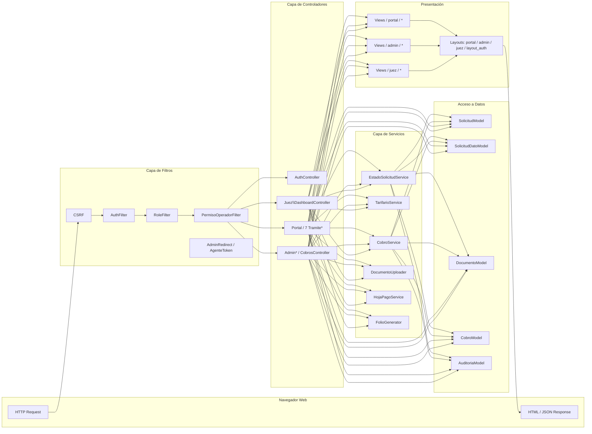
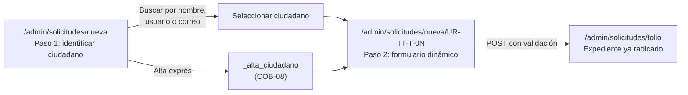
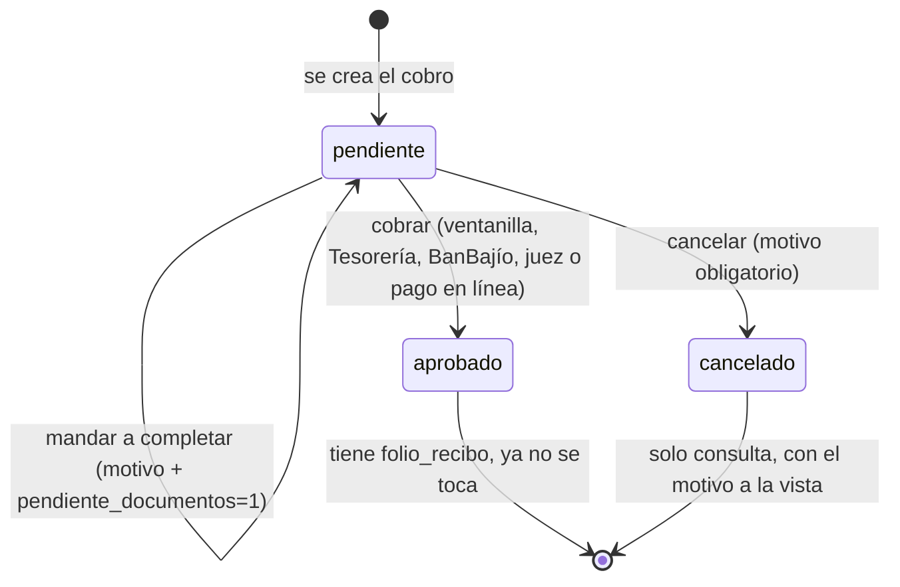
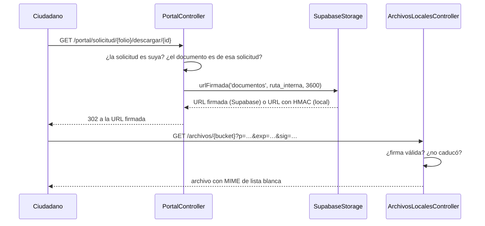
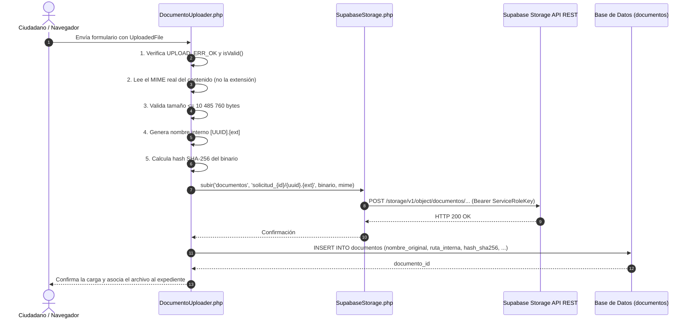

# Documentación Funcional y Técnica: Portal Ciudadano y Panel Administrativo Web
## Sistema Integral de Ventanilla Única de Movilidad y Transporte de Uriangato

**Documento Académico y Técnico de Residencia Profesional**
**Carrera:** Ingeniería en Sistemas Computacionales / Ingeniería en Software
**Institución Receptora:** Dirección de Movilidad y Transporte — H. Ayuntamiento de Uriangato, Gto.
**Autor:** Residente Profesional
**Versión del Documento:** 5.0
**Fecha:** Octubre 2026

> **Alcance de este documento.** Aquí está el subsistema web completo, pantalla por pantalla: el Portal Ciudadano, el Panel Administrativo, el Panel del Juez Calificador, el módulo de cobros, los CRUD de catálogos, la seguridad de la superficie web, el frontend responsivo y las pruebas. El **proceso** de desarrollo (levantamiento, metodología, fases y conclusiones) vive en [`DOC_METODOLOGIA.md`](./DOC_METODOLOGIA.md); el **backend profundo** (API, migraciones, servicios, máquina de estados desde el servidor) en [`DOCUMENTACION_BACKEND.md`](./DOCUMENTACION_BACKEND.md); la **visión integral del proyecto** en [`DOCUMENTACION_GENERAL.md`](./DOCUMENTACION_GENERAL.md).
>
> **Cómo está organizado.** Los capítulos 1 y 2 son el mapa (qué existe y dónde vive cada ruta). Los capítulos 3 a 6 recorren las pantallas de los tres paneles. El capítulo 7 es el módulo de cobros y pagos. El 8 documenta los CRUD de catálogos. El 9 las reglas de negocio transversales. El 10 la seguridad, el 11 el frontend y el 12 las pruebas. Los anexos guardan el diccionario de datos, el pipeline documental y el despliegue serverless, para que el cuerpo del documento se lea como recorrido de pantallas y no como inventario de tablas.

---

## Índice General

1. [Alcance e Inventario del Subsistema Web](#1-alcance-e-inventario-del-subsistema-web)
   * 1.1. Actores y Roles
   * 1.2. URLs Base del Subsistema
   * 1.3. Arquitectura MVC y Patrones Aplicados
   * 1.4. Inventario Real de Controladores, Vistas, Modelos y Servicios
   * 1.5. Stack de Presentación
   * 1.6. API REST para la App de Agentes de Tránsito
2. [Mapa Maestro de Rutas](#2-mapa-maestro-de-rutas)
   * 2.1. Convenciones de Enrutamiento y Filtros
   * 2.2. Tabla Completa de Rutas
   * 2.3. Notas de Enrutamiento que Evitaron Defectos
3. [Autenticación y Cuentas](#3-autenticación-y-cuentas)
   * 3.1. Inicio de Sesión
   * 3.2. Autorregistro de Ciudadanos
   * 3.3. Recuperación de Contraseña
   * 3.4. Términos, Privacidad y Aviso de Datos
   * 3.5. Cuenta Sin Acceso y Reclamo en Línea (COB-08)
   * 3.6. Sesión, Redirecciones por Rol y Cierre
4. [Portal Ciudadano: Pantallas](#4-portal-ciudadano-pantallas)
   * 4.1. Portada Pública
   * 4.2. Panel de Inicio del Ciudadano
   * 4.3. Catálogo de Trámites
   * 4.4. Mis Solicitudes
   * 4.5. Detalle del Expediente
   * 4.6. Mi Perfil
   * 4.7. Los Siete Formularios de Trámite
   * 4.8. Resúmenes, Pago en Línea y Permiso
   * 4.9. Cita de Inspección Física (UR-02)
   * 4.10. Descarga de Formatos y Documentos del Expediente
   * 4.11. Navegación Móvil del Portal
5. [Panel Administrativo: Secciones](#5-panel-administrativo-secciones)
   * 5.1. Dashboard de Métricas
   * 5.2. Desglose Global del Sistema
   * 5.3. Bandeja de Solicitudes
   * 5.4. Detalle del Expediente y Dictámenes
   * 5.5. Radicación Presencial desde Ventanilla
   * 5.6. Usuarios y Ciudadanos
   * 5.7. Formatos Oficiales de Trámite
   * 5.8. Auditoría
   * 5.9. Documentos Recibidos
   * 5.10. Verificaciones Físicas
   * 5.11. Sesiones de la App de Tránsito
   * 5.12. App Tránsito: Configuración, Agentes, Catálogo y Boletas
   * 5.13. Permisos del Operador de Ventanilla
   * 5.14. Navegación del Panel
6. [Panel del Juez Calificador](#6-panel-del-juez-calificador)
   * 6.1. Dashboard Judicial
   * 6.2. Bandeja de Boletas
   * 6.3. Detalle, Vista Previa y Calificación
   * 6.4. Cobros desde el Panel Judicial
7. [Cobros y Pagos](#7-cobros-y-pagos)
   * 7.1. Modelo del Cobro
   * 7.2. Ciclo de Vida y Estados
   * 7.3. Lugares y Medios de Pago
   * 7.4. Listado de Cobros
   * 7.5. Detalle del Cobro y Acciones
   * 7.6. Cobro en Ventanilla y en Tesorería
   * 7.7. Cobro en BanBajío (COB-04)
   * 7.8. Pago en Línea del Portal
   * 7.9. Descuentos, Recargos y Condonación (COB-11)
   * 7.10. Hoja de Pago Imprimible (COB-05)
   * 7.11. Corte de Caja y Exportación CSV (COB-03)
   * 7.12. Matriz de Trazabilidad COB-01 a COB-12
8. [CRUD de Catálogos del Panel](#8-crud-de-catálogos-del-panel)
   * 8.1. Tarifas
   * 8.2. Concesiones
   * 8.3. Convocatorias
   * 8.4. Formatos de Trámite
   * 8.5. Catálogo de Infracciones
   * 8.6. Agentes de Tránsito
   * 8.7. Boletas de Campo
   * 8.8. Patrón Común de los CRUD
9. [Reglas de Negocio y Estados](#9-reglas-de-negocio-y-estados)
   * 9.1. Máquina de Estados del Expediente
   * 9.2. Observaciones Obligatorias
   * 9.3. Folios
   * 9.4. Auditoría como Padrón Inmutable
   * 9.5. Permisos del Operador y su Efecto en Pantalla
   * 9.6. Integridad del Padrón
10. [Seguridad de la Superficie Web](#10-seguridad-de-la-superficie-web)
    * 10.1. Matriz de Acceso Ruta × Rol
    * 10.2. Arquitectura de Filtros
    * 10.3. CSRF, XSS e Inyección SQL
    * 10.4. Descarga Mediada de Documentos
    * 10.5. Archivos Locales con Firma Propia
    * 10.6. Principio «Cobrar no es Administrar»
11. [Frontend y Diseño Responsivo](#11-frontend-y-diseño-responsivo)
    * 11.1. Layouts y Parciales
    * 11.2. Design Tokens
    * 11.3. Escala Tipográfica y Objetivos Táctiles
    * 11.4. Adaptación del Portal
    * 11.5. Adaptación del Panel
    * 11.6. Portada Fotográfica
    * 11.7. Identidad Visual y Recursos en el Edge
    * 11.8. Accesibilidad, Movimiento Reducido y Rendimiento
    * 11.9. Auditoría Medible de Desbordes Horizontales
12. [Pruebas y Verificación del Subsistema Web](#12-pruebas-y-verificación-del-subsistema-web)
    * 12.1. Suite Automatizada
    * 12.2. Matriz de Cobertura por Módulo
    * 12.3. Barrido de Renderizado de Vistas
    * 12.4. Cotejo Estático de Enlaces
    * 12.5. Sincronía con la App Móvil
    * 12.6. Harness Aislado en SQLite
    * 12.7. Pruebas de Humo en Producción

**Anexos**

* [Anexo A. Diccionario de Datos del Módulo Web](#anexo-a-diccionario-de-datos-del-módulo-web)
* [Anexo B. Pipeline de Almacenamiento Documental](#anexo-b-pipeline-de-almacenamiento-documental)
* [Anexo C. Despliegue Serverless, Sesiones y Conectividad](#anexo-c-despliegue-serverless-sesiones-y-conectividad)

---

## 1. Alcance e Inventario del Subsistema Web

Este documento cubre las tres superficies web del sistema: el **Portal Ciudadano**, el **Panel Administrativo** y el **Panel del Juez Calificador**, más el **módulo de cobros** que comparten los dos últimos y la **API REST** que consume la aplicación móvil de agentes de tránsito. Todo se ejecuta sobre un único backend CodeIgniter 4.7.4 con renderizado del lado del servidor: no hay SPA en el portal ni en el panel.

### 1.1. Actores y Roles

Cuatro roles operacionales, sembrados por `RolesSeeder` y persistidos en `roles` / `user_roles`:

| Rol | Quién es | Entra a | Qué puede hacer |
|---|---|---|---|
| `ciudadano` | Persona física o moral que realiza trámites | `/portal` | Autorregistrarse, iniciar los 7 trámites, subir documentos, pagar en línea (mock), consultar sus expedientes y su perfil |
| `operador_ventanilla` | Personal de la Dirección en mostrador | `/admin` | Recibir y dictaminar expedientes, radicar solicitudes presenciales, cobrar, consultar catálogos; secciones adicionales según sus **permisos configurables** (§9.5) |
| `juez_calificador` | Autoridad que califica faltas de tránsito | `/juez` | Ver boletas sincronizadas por la app de campo, calificarlas en UMA y cobrar trámites y multas |
| `administrador` | Titular o responsable del sistema | `/admin` | Todo lo del operador, más: bajas definitivas, permisos del operador, desglose global, alta de agentes y configuración de la app |

Reglas de frontera entre roles, verificables en el código:

* El panel judicial está bajo `filter: 'role:juez_calificador'`: **el administrador no entra a `/juez`** (§10.6).
* El autorregistro público **solo** produce cuentas `ciudadano`; operadores, administradores y agentes los da de alta el personal (§3.2).
* Un funcionario (operador o administrador) que abra el portal ciudadano es devuelto a su panel por `AdminRedirectFilter`.

### 1.2. URLs Base del Subsistema

| Prefijo | Superficie | Filtro de entrada | Notas |
|---|---|---|---|
| `/` | Portada pública | ninguno | Página de inicio del portal, accesible sin sesión |
| `/auth` | Acceso y cuentas | ninguno | Login, registro, recuperación, términos y aviso de privacidad |
| `/login`, `/register`, `/logout`, `/agentes` | Atajos públicos | ninguno | Atajos con nombre propio y *shell* de la app móvil (§2.3) |
| `/portal` | Portal Ciudadano | `auth` (+ `AdminRedirectFilter`) | 49 rutas: pantallas de consulta y los 7 formularios |
| `/admin` | Panel Administrativo | `auth` + `role:administrador,operador_ventanilla` (+ `PermisoOperadorFilter`) | 76 rutas, 8 de ellas exclusivas de administrador |
| `/juez` | Panel del Juez | `auth` + `role:juez_calificador` | 16 rutas: boletas, calificación y cobros |
| `/documentos` | Hoja de pago imprimible | `auth` | El permiso fino lo resuelve el controlador |
| `/archivos` | Descarga del depósito local firmado | — | Valida firma HMAC y caducidad (Anexo B.4) |
| `/api` | API REST de la app móvil | parcial (`agenteToken` en escrituras) | 11 rutas con `OPTIONS` de CORS (§1.6) |

### 1.3. Arquitectura MVC y Patrones Aplicados

La arquitectura es **MVC en capas** con una capa intermedia de Servicios y Filtros. El detalle del backend está en `DOCUMENTACION_BACKEND.md`; aquí se resume lo que el lector del subsistema web necesita para leer el resto del documento.



Cuatro patrones sostienen el subsistema:

| Patrón | Dónde vive | Qué resuelve |
|---|---|---|
| **EAV** (`solicitud_datos`) | `SolicitudDatoModel::porSolicitudAgrupado()` | Siete trámites con campos distintos sin siete tablas ni siete vistas espejo |
| **Catálogo declarativo** (`SolicitudPresencialController::CAMPOS_TRAMITE`) | Controlador del canal presencial | El formulario, las reglas de validación y el paquete EAV se **generan** del mismo arreglo (§5.5.2) |
| **Feature Flag** | `FeatureFlags::habilitarUrTtT06()` | Publicar código sin exponer UR-06 (cesión de concesión) antes de su validación regulatoria |
| **Gateway** | `App\Interfaces\PaymentGatewayInterface` + `BanbajioMockGateway` | Cambiar de pasarela de pago sustituyendo una clase, sin tocar el portal (§7.8) |

La interfaz de pasarela define tres métodos:

```php
crearCargo(string $folio, float $monto, string $descripcion, array $metadata): array
confirmarPago(string $referenciaPago): array
reembolsar(string $referenciaPago, float $monto, string $motivo): bool
```

### 1.4. Inventario Real de Controladores, Vistas, Modelos y Servicios

| Capa | Cantidad | Detalle |
|---|---|---|
| Rutas declaradas | 173 | en `app/Config/Routes.php` (264 líneas), con `setAutoRoute(false)` |
| Controladores | 30 | 5 base (`AuthController`, `Home`, `ArchivosLocalesController`, `AgentesWebController`, `DocumentosPagoController`), 12 del panel, 9 del portal, 1 del juez, 1 de cobros compartido, 2 de API |
| Modelos | 24 | uno por entidad persistible, todos sobre `CodeIgniter\Model` |
| Servicios y librerías | 22 | 20 servicios + 2 excepciones de dominio en `app/Libraries/` |
| Vistas | 75 | `admin/` (26), `portal/` (18), `auth/` (7), `juez/` (3), `cobros/` (8), `documentos/` (1), `layouts/` (5), `errors/` (7), más `pager_bootstrap_full.php` |
| Filtros propios | 5 | `AuthFilter`, `RoleFilter`, `PermisoOperadorFilter`, `AdminRedirectFilter`, `AgenteTokenFilter` |
| Migraciones | 33 PHP + 19 SQL | `app/Database/Migrations/` y `supabase/migrations/` |
| Clases de prueba | 43 | 410 métodos de prueba (conteo estático del repositorio) |

**Vistas por pantalla, en una sola tabla de referencia rápida:**

| Carpeta | Archivos |
|---|---|
| `admin/` | `dashboard`, `desglose`, `solicitudes_lista`, `solicitudes_ver`, `auditoria`, `documentos`, `formatos`, `verificaciones`, `sesiones_app`, `permisos_operador` |
| `admin/catalogos/` | `tarifas_index`, `tarifas_form`, `concesiones_index`, `concesiones_form` |
| `admin/convocatorias/` | `index`, `form`, `evaluacion` |
| `admin/usuarios/` | `index`, `form` |
| `admin/solicitudes_presenciales/` | `index`, `formulario`, `_alta_ciudadano` |
| `admin/app_transito/` | `index`, `boletas`, `boleta_form`, `catalogo` |
| `portal/` | `home`, `dashboard`, `tramites`, `mis_solicitudes`, `ver_solicitud`, `mi_perfil` |
| `portal/tramites/` | los 7 `*_form`, los 4 resúmenes/permiso (`carga_descarga_resumen`, `permiso_eventual_resumen`, `cierre_calle_resumen`, `cierre_calle_permiso`) y `ur02_cita_form` |
| `cobros/` | `index`, `ver`, `_acciones`, `_estatus`, `banco`, `corte`, `condonar`, `condonaciones` |
| `auth/` | `login`, `register`, `forgot`, `reset`, `terminos`, `privacidad`, `layout_auth` |
| `juez/` | `dashboard`, `boletas`, `boleta_detalle` |
| `layouts/` | `portal`, `admin`, `juez`, `_estatus_badge`, `_ayuda` |
| `documentos/` | `hoja_pago` |
| `errors/html/` y `errors/cli/` | `error_400`, `error_404`, `error_exception`, `production` (propios, en español) |

### 1.5. Stack de Presentación

| Pieza | Versión / valor | Cómo se carga |
|---|---|---|
| Bootstrap | 5.3.2 | CDN de jsDelivr, declarado en los cuatro *layouts* |
| Bootstrap Icons | 1.11.1 | CDN, misma estrategia |
| Hoja propia | `public/css/custom.css` (2 140 líneas) | una sola, compartida por portal, panel y juez |
| Script propio | `public/js/formularios.js` (84 líneas) | validaciones de formulario y ayudas de captura |
| Tipografía | `"Plus Jakarta Sans"`, `"Inter"`, pila del sistema | CDN con `display=swap` y degradación a la pila nativa |
| Paginador | `app/Views/pager_bootstrap_full.php` | plantilla propia enlazada desde los modelos |

### 1.6. API REST para la App de Agentes de Tránsito

El backend expone exactamente cinco endpoints para la app móvil (más sus `OPTIONS` de CORS). La lista es corta a propósito: **cada endpoint existe porque una pantalla de la app lo consume**.

| # | Endpoint | Controlador · acción | Filtro | Propósito |
|---|---|---|---|---|
| 1 | `POST /api/agentes/login` | `Api\AgentesTransitoApiController::login()` | ninguno | Inicio de turno con placa y PIN contra `agentes_transito`; emite token de portador con caducidad |
| 2 | `GET /api/checklist-infracciones` | `Api\InfraccionesApiController::checklist()` | ninguno | Catálogo de faltas con fundamento legal y rangos de UMA, para sincronización *offline* |
| 3 | `GET /api/parametros` | `Api\InfraccionesApiController::parametros()` | ninguno | UMA vigente, mínimo de fotos obligatorias y versión de la app |
| 4 | `POST /api/infracciones/sincronizar` | `Api\InfraccionesApiController::sincronizar()` | **`agenteToken`** | Inserción de boletas levantadas en campo |
| 5 | `POST /api/infracciones/evidencias` | `Api\InfraccionesApiController::subirEvidencia()` | **`agenteToken`** | Recepción multipart de las fotografías de evidencia |

Tres decisiones de gobernanza visibles en `app/Config/Routes.php`:

* **Escritura protegida, lectura abierta.** Las tres lecturas no exigen token; las dos escrituras sí, mediante `agenteToken`, que valida el *bearer* y su caducidad.
* **`OPTIONS` declarados explícitamente** para `agentes/login`, `parametros`, `infracciones/sincronizar` y `boletas/sincronizar`, porque la app se sirve también como SPA web y el navegador emite *preflight*. La respuesta es `204` con las cabeceras `Access-Control-Allow-*`.
* **CSRF exento en todo `api/*`** (`'csrf' => ['except' => ['api/*']]`): un cliente móvil no maneja tokens de formulario y su protección es el token de portador. La exención está acotada al prefijo `api`, **no** al panel ni al portal.

> **Nota histórica.** Existió un `POST /api/agentes/registro` con su pantalla de enrolamiento. Se **retiró del código**: un agente de tránsito tiene capacidad de sanción y esa alta no puede ser un autorregistro público. Hoy solo el administrador los da de alta desde `/admin/app-transito`.

---

## 2. Mapa Maestro de Rutas

### 2.1. Convenciones de Enrutamiento y Filtros

`app/Config/Routes.php` declara **173 rutas** con `setAutoRoute(false)`, `setPrioritize(true)` y `set404Override()`. Nada se resuelve por convención de nombre: una ruta que no está escrita no existe, y eso es deliberado (evita ejecución arbitraria de métodos).

| Filtro | Parámetro típico | Efecto en la superficie web |
|---|---|---|
| `auth` | — | Exige `session('logged_in')` y `session('user_id')`; sin sesión, redirige a `/auth/login` guardando la URL pedida |
| `role:*` | `role:administrador,operador_ventanilla`, `role:juez_calificador`, `role:ciudadano` | Consulta el rol real en base de datos y niega con redirección explicativa |
| `agenteToken` | — | Valida el *bearer* de la app móvil y su caducidad |
| `AdminRedirectFilter` | global del prefijo `portal/*` | Devuelve a un funcionario a `/admin/dashboard` si entra al portal |
| `PermisoOperadorFilter` | global de `admin`, `admin/*` | Autorización de grano fino por sección para el rol operador (§9.5) |

Los nombres `as` se usan en las vistas con `route_to()` y `site_url()`; la columna se incluye en la tabla porque un nombre ausente o duplicado **descarta la ruta en silencio** (§2.3).

### 2.2. Tabla Completa de Rutas

#### 2.2.1. Acceso público y cuentas (11 rutas)

| Método | URI | Destino | Filtro | `as` | Vista |
|---|---|---|---|---|---|
| GET | `auth/login` | `AuthController::login` | — | `login` | `auth/login` |
| POST | `auth/attempt-login` | `AuthController::attemptLogin` | — | — | redirige |
| GET | `auth/register` | `AuthController::register` | — | `register` | `auth/register` |
| POST | `auth/attempt-register` | `AuthController::attemptRegister` | — | — | redirige |
| GET | `auth/logout` | `AuthController::logout` | — | `logout` | redirige |
| GET | `auth/forgot` | `AuthController::forgot` | — | — | `auth/forgot` |
| POST | `auth/attempt-forgot` | `AuthController::attemptForgot` | — | — | redirige |
| GET | `auth/reset/(:any)` | `AuthController::reset/$1` | — | — | `auth/reset` |
| POST | `auth/reset/(:any)` | `AuthController::reset/$1` | — | — | redirige |
| GET | `auth/terminos` | `AuthController::terminos` | — | — | `auth/terminos` |
| GET | `auth/privacidad` | `AuthController::privacidad` | — | — | `auth/privacidad` |

#### 2.2.2. API móvil (11 rutas, incluidos los `OPTIONS`)

| Método | URI | Destino | Filtro | `as` |
|---|---|---|---|---|
| GET | `api/checklist-infracciones` | `Api\InfraccionesApiController::checklist` | — | — |
| OPTIONS · POST | `api/agentes/login` | `Api\AgentesTransitoApiController::login` | — | — |
| GET · OPTIONS | `api/parametros` | `Api\InfraccionesApiController::parametros` | — | — |
| OPTIONS | `api/infracciones/sincronizar` | `Api\InfraccionesApiController::sincronizar` | — | — |
| POST | `api/infracciones/sincronizar` | `Api\InfraccionesApiController::sincronizar` | `agenteToken` | — |
| OPTIONS | `api/boletas/sincronizar` | `Api\InfraccionesApiController::sincronizar` | — | — |
| POST | `api/boletas/sincronizar` | `Api\InfraccionesApiController::sincronizar` | `agenteToken` | — |
| OPTIONS | `api/infracciones/evidencias` | `Api\InfraccionesApiController::subirEvidencia` | — | — |
| POST | `api/infracciones/evidencias` | `Api\InfraccionesApiController::subirEvidencia` | `agenteToken` | — |

#### 2.2.3. Panel del Juez Calificador (16 rutas, `auth` + `role:juez_calificador`)

| Método | URI | Destino | `as` | Vista |
|---|---|---|---|---|
| GET | `juez` | `Juez\DashboardController::index` | `juez.inicio` | `juez/dashboard` |
| GET | `juez/boletas` | `Juez\DashboardController::boletas` | `juez.boletas` | `juez/boletas` |
| GET | `juez/boletas/(:num)` | `Juez\DashboardController::detalle/$1` | `juez.boleta` | `juez/boleta_detalle` |
| POST | `juez/boletas/(:num)/vista-previa` | `Juez\DashboardController::vistaPrevia/$1` | `juez.boleta.previa` | JSON |
| POST | `juez/boletas/(:num)/calificar` | `Juez\DashboardController::calificar/$1` | `juez.boleta.calificar` | redirige |
| GET | `juez/cobros` | `CobrosController::index` | `juez.cobros` | `cobros/index` |
| GET | `juez/cobros/banco` | `CobrosController::banco` | `juez.cobros.banco` | `cobros/banco` |
| GET | `juez/cobros/corte` | `CobrosController::corte` | `juez.cobros.corte` | `cobros/corte` |
| GET | `juez/cobros/corte/csv` | `CobrosController::corteCsv` | — | CSV |
| GET | `juez/cobros/condonaciones` | `CobrosController::condonaciones` | `juez.cobros.condonaciones` | `cobros/condonaciones` |
| GET | `juez/cobros/(:num)/condonar` | `CobrosController::formularioCondonar/$1` | — | `cobros/condonar` |
| POST | `juez/cobros/(:num)/condonar` | `CobrosController::condonar/$1` | — | redirige |
| GET | `juez/cobros/(:num)` | `CobrosController::ver/$1` | `juez.cobro` | `cobros/ver` |
| POST | `juez/cobros/(:num)/cobrar` | `CobrosController::cobrar/$1` | — | redirige |
| POST | `juez/cobros/(:num)/completar` | `CobrosController::completar/$1` | — | redirige |
| POST | `juez/cobros/(:num)/cancelar` | `CobrosController::cancelar/$1` | — | redirige |

#### 2.2.4. Documentos de apoyo al pago (2 rutas, `auth`)

| Método | URI | Destino | `as` | Vista |
|---|---|---|---|---|
| GET | `documentos/hoja-pago/solicitud/(:segment)` | `DocumentosPagoController::hojaPagoSolicitud/$1` | `documentos.hoja_pago_solicitud` | `documentos/hoja_pago` |
| GET | `documentos/hoja-pago/boleta/(:num)` | `DocumentosPagoController::hojaPagoBoleta/$1` | `documentos.hoja_pago_boleta` | `documentos/hoja_pago` |

#### 2.2.5. Panel Administrativo (68 rutas, `auth` + `role:administrador,operador_ventanilla`)

| Método | URI | Destino | `as` | Vista |
|---|---|---|---|---|
| GET | `admin/dashboard` | `Admin\AdminController::dashboard` | `admin.dashboard` | `admin/dashboard` |
| GET | `admin/auditoria` | `Admin\AdminController::auditoria` | `admin.auditoria` | `admin/auditoria` |
| GET | `admin/documentos` | `Admin\DocumentosController::index` | `admin.documentos` | `admin/documentos` |
| GET | `admin/verificaciones` | `Admin\VerificacionesController::index` | `admin.verificaciones` | `admin/verificaciones` |
| GET | `admin/sesiones-app` | `Admin\SesionesAppController::index` | `admin.sesiones_app` | `admin/sesiones_app` |
| GET | `admin/solicitudes` | `Admin\AdminController::listaSolicitudes` | `admin.solicitudes` | `admin/solicitudes_lista` |
| GET | `admin/solicitudes/nueva` | `Admin\SolicitudPresencialController::index` | — | `admin/solicitudes_presenciales/index` |
| POST | `admin/solicitudes/nueva/buscar-ciudadano` | `SolicitudPresencialController::buscarCiudadano` | — | JSON |
| POST | `admin/solicitudes/nueva/registrar-ciudadano` | `SolicitudPresencialController::registrarCiudadano` | — | redirige |
| POST | `admin/solicitudes/nueva/guardar` | `SolicitudPresencialController::guardar` | — | redirige |
| GET | `admin/solicitudes/nueva/(:segment)` | `SolicitudPresencialController::formulario/$1` | — | `admin/solicitudes_presenciales/formulario` |
| GET | `admin/solicitudes/(:segment)` | `Admin\AdminController::verSolicitud/$1` | `admin.solicitud.ver` | `admin/solicitudes_ver` |
| POST | `admin/solicitudes/cambiar-estatus/(:num)` | `Admin\AdminController::cambiarEstatus/$1` | — | redirige |
| POST | `admin/solicitudes/ur04/evaluacion/(:num)` | `Admin\AdminController::guardarEvaluacionUr04/$1` | — | redirige |
| POST | `admin/solicitudes/ur05/validacion/(:num)` | `Admin\AdminController::validarCierreCalleUr05/$1` | — | redirige |
| POST | `admin/solicitudes/dictamen-ur02/(:num)` | `Admin\AdminController::registrarDictamenUr02/$1` | — | redirige |
| GET | `admin/solicitudes/descargar-documento/(:num)` | `Admin\AdminController::descargarDocumento/$1` | — | descarga |
| POST | `admin/solicitudes/validar-documento/(:num)` | `Admin\AdminController::validarDocumento/$1` | — | redirige |
| GET | `admin/cobros` | `CobrosController::index` | `admin.cobros` | `cobros/index` |
| GET | `admin/cobros/banco` | `CobrosController::banco` | `admin.cobros.banco` | `cobros/banco` |
| GET | `admin/cobros/corte` | `CobrosController::corte` | `admin.cobros.corte` | `cobros/corte` |
| GET | `admin/cobros/corte/csv` | `CobrosController::corteCsv` | — | CSV |
| GET | `admin/cobros/condonaciones` | `CobrosController::condonaciones` | `admin.cobros.condonaciones` | `cobros/condonaciones` |
| GET | `admin/cobros/(:num)/condonar` | `CobrosController::formularioCondonar/$1` | — | `cobros/condonar` |
| POST | `admin/cobros/(:num)/condonar` | `CobrosController::condonar/$1` | — | redirige |
| GET | `admin/cobros/(:num)` | `CobrosController::ver/$1` | `admin.cobro` | `cobros/ver` |
| POST | `admin/cobros/(:num)/cobrar` | `CobrosController::cobrar/$1` | — | redirige |
| POST | `admin/cobros/(:num)/completar` | `CobrosController::completar/$1` | — | redirige |
| POST | `admin/cobros/(:num)/cancelar` | `CobrosController::cancelar/$1` | — | redirige |
| GET | `admin/tarifas` | `Admin\CatalogoTarifasController::index` | — | `admin/catalogos/tarifas_index` |
| GET | `admin/tarifas/nuevo` | `Admin\CatalogoTarifasController::formNuevo` | — | `admin/catalogos/tarifas_form` |
| POST | `admin/tarifas/guardar` | `Admin\CatalogoTarifasController::guardar` | — | redirige |
| GET | `admin/tarifas/editar/(:num)` | `Admin\CatalogoTarifasController::formEditar/$1` | — | `admin/catalogos/tarifas_form` |
| POST | `admin/tarifas/actualizar/(:num)` | `Admin\CatalogoTarifasController::actualizar/$1` | — | redirige |
| POST | `admin/tarifas/eliminar/(:num)` | `Admin\CatalogoTarifasController::eliminar/$1` | — | redirige |
| GET | `admin/concesiones` | `Admin\CatalogoConcesionesController::index` | — | `admin/catalogos/concesiones_index` |
| GET | `admin/concesiones/nuevo` | `Admin\CatalogoConcesionesController::formNuevo` | — | `admin/catalogos/concesiones_form` |
| POST | `admin/concesiones/guardar` | `Admin\CatalogoConcesionesController::guardar` | — | redirige |
| GET | `admin/concesiones/editar/(:num)` | `Admin\CatalogoConcesionesController::formEditar/$1` | — | `admin/catalogos/concesiones_form` |
| POST | `admin/concesiones/actualizar/(:num)` | `Admin\CatalogoConcesionesController::actualizar/$1` | — | redirige |
| POST | `admin/concesiones/eliminar/(:num)` | `Admin\CatalogoConcesionesController::eliminar/$1` | — | redirige |
| GET | `admin/convocatorias` | `Admin\ConvocatoriasController::index` | `admin.convocatorias` | `admin/convocatorias/index` |
| GET | `admin/convocatorias/nueva` | `Admin\ConvocatoriasController::formNuevo` | — | `admin/convocatorias/form` |
| POST | `admin/convocatorias/guardar` | `Admin\ConvocatoriasController::guardar` | — | redirige |
| GET | `admin/convocatorias/editar/(:num)` | `Admin\ConvocatoriasController::formEditar/$1` | — | `admin/convocatorias/form` |
| POST | `admin/convocatorias/actualizar/(:num)` | `Admin\ConvocatoriasController::actualizar/$1` | — | redirige |
| GET | `admin/convocatorias/(:num)/evaluacion` | `Admin\ConvocatoriasController::evaluacion/$1` | `admin.convocatoria.evaluacion` | `admin/convocatorias/evaluacion` |
| POST | `admin/convocatorias/(:num)/seleccionar` | `Admin\ConvocatoriasController::seleccionar/$1` | — | redirige |
| GET | `admin/convocatorias/(:num)/bases` | `Admin\ConvocatoriasController::bases/$1` | — | descarga |
| GET | `admin/formatos` | `Admin\AdminController::formatos` | — | `admin/formatos` |
| GET | `admin/formatos/ver/(:segment)` | `Admin\AdminController::verFormato/$1` | — | descarga |
| POST | `admin/formatos/subir` | `Admin\AdminController::subirFormato` | — | redirige |
| POST | `admin/formatos/eliminar` | `Admin\AdminController::eliminarFormato` | — | redirige |
| GET | `admin/app-transito` | `Admin\AppTransitoController::index` | — | `admin/app_transito/index` |
| POST | `admin/app-transito/guardar-parametros` | `Admin\AppTransitoController::guardarParametros` | — | redirige |
| POST | `admin/app-transito/agentes/guardar` | `Admin\AppTransitoController::guardarAgente` | — | redirige |
| POST | `admin/app-transito/agentes/toggle/(:num)` | `Admin\AppTransitoController::toggleEstadoAgente/$1` | — | redirige |
| GET | `admin/app-transito/boletas` | `Admin\AppTransitoController::boletas` | — | `admin/app_transito/boletas` |
| GET | `admin/app-transito/catalogo` | `Admin\AppTransitoController::catalogo` | — | `admin/app_transito/catalogo` |
| POST | `admin/app-transito/catalogo/guardar` | `Admin\AppTransitoController::guardarCatalogo` | — | redirige |
| GET | `admin/app-transito/boletas/editar/(:num)` | `Admin\AppTransitoController::editarBoleta/$1` | — | `admin/app_transito/boleta_form` |
| POST | `admin/app-transito/boletas/actualizar/(:num)` | `Admin\AppTransitoController::actualizarBoleta/$1` | — | redirige |
| GET | `admin/usuarios` | `Admin\UsuariosController::index` | — | `admin/usuarios/index` |
| GET | `admin/usuarios/nuevo` | `Admin\UsuariosController::formNuevo` | — | `admin/usuarios/form` |
| POST | `admin/usuarios/guardar` | `Admin\UsuariosController::guardar` | — | redirige |
| GET | `admin/usuarios/editar/(:num)` | `Admin\UsuariosController::formEditar/$1` | — | `admin/usuarios/form` |
| POST | `admin/usuarios/actualizar/(:num)` | `Admin\UsuariosController::actualizar/$1` | — | redirige |
| POST | `admin/usuarios/toggle/(:num)` | `Admin\UsuariosController::toggleEstado/$1` | — | redirige |

#### 2.2.6. Panel Administrativo, exclusivo de administrador (8 rutas, `auth` + `role:administrador`)

| Método | URI | Destino | `as` | Vista |
|---|---|---|---|---|
| GET | `admin/permisos-operador` | `Admin\PermisosController::index` | — | `admin/permisos_operador` |
| POST | `admin/permisos-operador/guardar` | `Admin\PermisosController::guardar` | — | redirige |
| GET | `admin/desglose` | `Admin\DesgloseController::index` | `admin.desglose` | `admin/desglose` |
| POST | `admin/usuarios/eliminar/(:num)` | `Admin\UsuariosController::eliminar/$1` | — | redirige |
| POST | `admin/app-transito/agentes/eliminar/(:num)` | `Admin\AppTransitoController::eliminarAgente/$1` | — | redirige |
| POST | `admin/app-transito/boletas/eliminar/(:num)` | `Admin\AppTransitoController::eliminarBoleta/$1` | — | redirige |
| POST | `admin/app-transito/catalogo/eliminar/(:num)` | `Admin\AppTransitoController::eliminarCatalogo/$1` | — | redirige |
| POST | `admin/convocatorias/eliminar/(:num)` | `Admin\ConvocatoriasController::eliminar/$1` | — | redirige |

#### 2.2.7. Públicas de raíz, atajos y archivos (8 rutas)

| Método | URI | Destino | Filtro | `as` | Nota |
|---|---|---|---|---|---|
| GET | `/` | `Home::index` | — | — | Portada del portal |
| HEAD | `/` | *clausura* `response()->setStatusCode(200)` | — | — | Sondeo de conectividad de la app (no abre sesión) |
| GET | `login` | `AuthController::login` | — | `acceso` | Atajo; nombre propio obligatorio (§2.3) |
| GET | `register` | `AuthController::register` | — | `registro` | Atajo |
| GET | `logout` | `AuthController::logout` | — | `salida` | Atajo |
| GET | `agentes` | `AgentesWebController::shell` | — | `agentes.inicio` | *Shell* de la app móvil servida como web |
| GET | `agentes/(:any)` | `AgentesWebController::shell` | — | `agentes.ruta` | Fallback de F5 y enlaces directos |
| GET | `archivos/(:segment)` | `ArchivosLocalesController::servir/$1` | — | — | Descarga firmada del depósito local (Anexo B.4) |

#### 2.2.8. Portal Ciudadano (49 rutas, `auth`)

| Método | URI | Destino | Filtro adicional | `as` | Vista |
|---|---|---|---|---|---|
| GET | `portal` | `Ciudadano\PortalController::dashboard` | — | — | `portal/dashboard` |
| GET | `portal/dashboard` | `Ciudadano\PortalController::dashboard` | — | `portal.dashboard` | `portal/dashboard` |
| GET | `portal/tramites` | `Ciudadano\PortalController::tramites` | — | `portal.tramites` | `portal/tramites` |
| GET | `portal/mis-solicitudes` | `Ciudadano\PortalController::misSolicitudes` | — | `portal.mis_solicitudes` | `portal/mis_solicitudes` |
| GET | `portal/solicitud/(:segment)` | `Ciudadano\PortalController::verSolicitud/$1` | — | `portal.ver_solicitud` | `portal/ver_solicitud` |
| GET | `portal/solicitud/(:segment)/descargar/(:num)` | `PortalController::descargarDocumento/$1/$2` | — | `portal.solicitud.descargar` | descarga |
| GET | `portal/mi-perfil` | `Ciudadano\PortalController::miPerfil` | — | `portal.mi_perfil` | `portal/mi_perfil` |
| POST | `portal/mi-perfil` | `Ciudadano\PortalController::guardarPerfil` | — | — | redirige |
| GET | `portal/formato/(:segment)` | `Ciudadano\PortalController::descargarFormato/$1` | — | — | descarga |
| POST | `portal/tramites/solicitudes` | `Ciudadano\TramitesController::crear` | `role:*` | — | redirige |
| GET | `portal/tramites/solicitudes/(:segment)` | `Ciudadano\TramitesController::consultar/$1` | `role:*` | — | JSON |
| POST | `portal/tramites/ur-02/solicitudes/(:num)/cita` | `TramitesController::agendarVerificacion/$1` | `role:*` | — | redirige |
| POST | `portal/tramites/ur-02/solicitudes/(:num)/resultado` | `TramitesController::registrarResultado/$1` | `role:administrador,operador_ventanilla` | — | redirige |
| GET | `portal/tramites/ur-01/convocatorias/(:num)/solicitudes` | `TramitesController::listarConvocatoria/$1` | `role:administrador,operador_ventanilla` | — | JSON |
| POST | `portal/tramites/ur-01/convocatorias/(:num)/seleccionar` | `TramitesController::seleccionar/$1` | `role:administrador,operador_ventanilla` | — | redirige |
| GET | `portal/tramites/orden-plaqueo` · `ur-03` | `TramiteOrdenPlaqueoController::formulario` | — | — | `portal/tramites/orden_plaqueo_form` |
| POST | `portal/tramites/orden-plaqueo/guardar` · `ur-03/guardar` | `TramiteOrdenPlaqueoController::guardar` | — | — | redirige |
| GET | `portal/tramites/constancia-despintado` · `ur-02` | `TramiteDespintadoController::formulario` | — | — | `portal/tramites/constancia_despintado_form` |
| POST | `portal/tramites/constancia-despintado/guardar` · `ur-02/guardar` | `TramiteDespintadoController::guardar` | — | — | redirige |
| GET | `portal/tramites/ur-02/solicitud/(:any)/cita` | `TramiteDespintadoController::agendarCitaForm/$1` | — | — | `portal/tramites/ur02_cita_form` |
| POST | `portal/tramites/ur-02/solicitud/(:any)/cita/guardar` | `TramiteDespintadoController::guardarCita/$1` | — | — | redirige |
| GET | `portal/tramites/concesion-transporte` · `ur-01` | `TramiteConcesionTransporteController::formulario` | — | — | `portal/tramites/concesion_transporte_form` |
| POST | `portal/tramites/concesion-transporte/guardar` · `ur-01/guardar` | `TramiteConcesionTransporteController::guardar` | — | — | redirige |
| GET | `portal/tramites/cesion-concesion` | `TramiteCesionConcesionController::formulario` | — | — | `portal/tramites/cesion_concesion_form` |
| POST | `portal/tramites/cesion-concesion/guardar` | `TramiteCesionConcesionController::guardar` | — | — | redirige |
| GET | `portal/tramites/cesion-concesion/validar-concesion/(:any)` | `TramiteCesionConcesionController::validarConcesionAjax/$1` | — | — | JSON |
| GET | `portal/tramites/carga-descarga` · `carga-descarga/formulario` | `TramiteCargaDescargaController::formulario` | — | — | `portal/tramites/carga_descarga_form` |
| POST | `portal/tramites/carga-descarga/guardar` | `TramiteCargaDescargaController::guardar` | — | — | redirige |
| POST · GET | `portal/tramites/carga-descarga/calcular-monto` | `TramiteCargaDescargaController::calcularMontoAjax` | — | — | JSON |
| GET | `portal/tramites/carga-descarga/resumen/(:any)` | `TramiteCargaDescargaController::resumen/$1` | — | — | `portal/tramites/carga_descarga_resumen` |
| POST | `portal/tramites/carga-descarga/pagar/(:num)` | `TramiteCargaDescargaController::pagar/$1` | — | — | redirige |
| GET | `portal/tramites/carga-descarga/(:any)/descargar/(:num)` | `TramiteCargaDescargaController::descargarDocumento/$1/$2` | — | — | descarga |
| GET | `portal/tramites/permiso-eventual` | `TramitePermisoEventualController::formulario` | — | — | `portal/tramites/permiso_eventual_form` |
| POST | `portal/tramites/permiso-eventual/guardar` | `TramitePermisoEventualController::guardar` | — | — | redirige |
| GET | `portal/tramites/permiso-eventual/resumen/(:any)` | `TramitePermisoEventualController::resumen/$1` | — | — | `portal/tramites/permiso_eventual_resumen` |
| POST | `portal/tramites/permiso-eventual/pagar/(:num)` | `TramitePermisoEventualController::pagar/$1` | — | — | redirige |
| GET | `portal/tramites/cierre-calle` | `TramiteCierreCalleController::formulario` | — | — | `portal/tramites/cierre_calle_form` |
| POST | `portal/tramites/cierre-calle/guardar` | `TramiteCierreCalleController::guardar` | — | — | redirige |
| GET | `portal/tramites/cierre-calle/resumen/(:any)` | `TramiteCierreCalleController::resumen/$1` | — | — | `portal/tramites/cierre_calle_resumen` |
| POST | `portal/tramites/cierre-calle/pagar/(:num)` | `TramiteCierreCalleController::pagar/$1` | — | — | redirige |
| GET | `portal/tramites/cierre-calle/permiso/(:any)` | `TramiteCierreCalleController::permiso/$1` | — | — | `portal/tramites/cierre_calle_permiso` |

`role:*` en la tabla significa `role:administrador,operador_ventanilla,ciudadano`, el filtro que permite al personal radicar en nombre de un ciudadano por la misma ruta del portal.

### 2.3. Notas de Enrutamiento que Evitaron Defectos

Tres detalles del archivo de rutas son lecciones, no estilo:

1. **La ruta literal va antes que el comodín.** `admin/solicitudes/nueva` se declara **antes** de `admin/solicitudes/(:segment)`. CodeIgniter evalúa en orden de declaración, así que sin ese orden la palabra `nueva` se habría interpretado como un folio inexistente. `setPrioritize(true)` es la salvaguarda adicional.
2. **Una ruta declarada no es una ruta registrada.** Los atajos `/login`, `/register` y `/logout` estuvieron escritos desde el primer commit y no respondían: CI4 indexa las rutas por el nombre `as` y, cuando el *from* de una definición nueva coincide con un nombre ya asignado, **descarta la definición en silencio**, sin error y sin línea en los logs. El único síntoma honesto es que la ruta no aparece en `php spark routes`. Como `auth/login`, `auth/register` y `auth/logout` ya usaban `as => login|register|logout`, los atajos nunca existieron; el efecto visible fue que el botón "Iniciar sesión" de la página 404 propia llevaba a otro 404. Corrección: nombres propios (`acceso`, `registro`, `salida`) y el conflicto comentado junto a la definición. Por eso el cotejo de §12.4 verifica el mapa **real** y no el archivo fuente.
3. **Dos rutas al mismo método necesitan dos nombres.** `agentes` y `agentes/(:any)` apuntan ambas a `AgentesWebController::shell`; si la segunda heredara el nombre de la primera, CI4 la descartaría igual que en el caso anterior.

Además, el `HEAD /` existe por una razón concreta: `NetInfo` de la app móvil pregunta `HEAD /` cada pocos segundos y solo considera que hay internet si responde 200; CI4 no resuelve `HEAD` con rutas `GET`, así que el sondeo caía en 404, la app se declaraba sin conexión y el autosincronizado no se disparaba. Se contesta vacío y sin pasar por un controlador para no abrir sesión en cada sondeo.

---
## 3. Autenticación y Cuentas

Las siete vistas de `app/Views/auth/` forman un subsistema cerrado: todas se pintan con `auth/layout_auth.php`, no llevan menú de rol y comparten la misma tarjeta centrada con el logotipo institucional.

### 3.1. Inicio de Sesión

| Dato | Valor |
|---|---|
| URL | `GET /auth/login` (y el atajo `GET /login`, nombre `acceso`) |
| Controlador | `AuthController::login` → `attemptLogin` en el `POST` |
| Vista | `auth/login`, layout `auth/layout_auth` |
| Campos | `username`, `password` |
| POST | `POST /auth/attempt-login` (con `csrf_field()`) |

Comportamiento:

* El identificador es **`username`**, no el correo. Un ciudadano dado de alta en ventanilla sin acceso no tiene ninguno de los dos y por eso no puede entrar (§3.5).
* La verificación es `password_verify()` contra `users.password_hash` (bcrypt, `PASSWORD_DEFAULT`); la contraseña nunca se guarda ni se registra en claro.
* Al autenticar, el controlador carga los roles reales con `UserModel::conRoles()` y los deja en sesión (`roles`), reconstruye `nombre_completo` para la barra superior y registra el evento en `auditoria`.
* La redirección depende del rol: `administrador` y `operador_ventanilla` → `/admin/dashboard`; `juez_calificador` → `/juez`; `ciudadano` → `/portal/dashboard`. Si la sesión guardó una URL previa (porque `AuthFilter` la interceptó), se respeta esa.
* Mensaje de error único: "Usuario o contraseña incorrectos". No se distingue entre usuario inexistente y contraseña errónea, para no convertir el formulario en un oráculo de cuentas.
* Un usuario con `activo = 0` no inicia sesión aunque su contraseña sea correcta.
* La vista incluye además dos enlaces de cortesía: "Crear cuenta" (`/auth/register`) y "¿Olvidaste tu contraseña?" (`/auth/forgot`), más el acceso rápido a la app de campo (`/agentes`).

### 3.2. Autorregistro de Ciudadanos

| Dato | Valor |
|---|---|
| URL | `GET /auth/register` (y el atajo `GET /register`, nombre `registro`) |
| Controlador | `AuthController::register` → `attemptRegister` |
| Vista | `auth/register` |
| POST | `POST /auth/attempt-register` |

**Privilegio asimétrico del autorregistro.** Es la regla que gobierna el módulo:

| Tipo de cuenta | ¿Se crea desde `auth/register`? | Responsable del alta |
|---|:---:|---|
| `ciudadano` | **Sí** | El propio interesado |
| `operador_ventanilla` | No | El `administrador` desde `/admin/usuarios` |
| `administrador` | No | El `administrador` existente |
| Agente de tránsito | No | El `administrador` desde `/admin/app-transito` |

El rol **no se recibe por `POST`**: se asigna en el servidor con `UserModel::asignarRol($userId, 'ciudadano')`. Un atacante que inyecte `rol=administrador` en el formulario simplemente no será escuchado.

**Campos y validación real** (extracto de `attemptRegister`):

```php
$rules = [
    'curp'      => 'permit_empty|exact_length[18]|regex_match[' . CuentaCiudadanoService::REGEX_CURP . ']',
    'nombre'    => 'required|min_length[2]|max_length[80]',
    'apellido'  => 'required|min_length[2]|max_length[120]',
    'telefono'  => 'required|min_length[7]|max_length[20]',
    'estado'    => 'required|min_length[2]|max_length[60]',
    'ciudad'    => 'required|min_length[2]|max_length[60]',
    'domicilio' => 'required|min_length[5]|max_length[200]',
    'email'     => $reglaEmail,   // admite reclamar una cuenta existente
    'username'  => 'required|alpha_numeric|min_length[5]|max_length[40]|is_unique[users.username]',
    'password'  => 'required|min_length[8]|max_length[100]|regex_match[/^(?=.*[A-Za-z])(?=.*\d).+$/]',
    'rfc'       => 'permit_empty|min_length[12]|max_length[13]|regex_match[/^[A-ZÑ&]{3,4}\d{6}[A-Z\d]{3}$/]',
];
```

Cada regla tiene una razón operativa:

* **La CURP es opcional** (`permit_empty`), no porque el dato haya perdido valor, sino porque el ciudadano puede no traerla a mano y eso no debe impedirle crear su cuenta. Cuando se captura, se normaliza a mayúsculas (`CuentaCiudadanoService::normalizarCurp()`) y se valida contra el patrón oficial de la RENAPO.
* **Nombre y apellido por separado y obligatorios:** la ventanilla busca personas por nombre y apellidos, y una cadena única no permite ni buscarla ni avisar de homónimos.
* **Teléfono, estado, ciudad y domicilio obligatorios:** son los datos con los que se localiza a una persona que no tiene correo ni acceso al portal.
* **Contraseña con al menos una letra y un dígito**, almacenada con `password_hash(..., PASSWORD_DEFAULT)`; se pide confirmación (`password_confirm`).
* **RFC, INE frente e INE reverso son opcionales**, pero si se adjuntan se validan en tipo y tamaño (`image/jpeg|image/png`, 5 MB) y se guardan en el almacenamiento documental (Anexo B).
* **`acepto_terminos` obligatorio**, con enlaces a `auth/terminos` y `auth/privacidad`.
* `is_unique[users.username]` impide duplicados; el correo se valida con una regla construida que excluye la propia fila cuando se está reclamando una cuenta sin acceso (§3.5).

**Límite de alta automatizada resistente al entorno serverless.** El `Throttler` de CodeIgniter depende de la caché y en Vercel esa caché corre en modo `Dummy`, así que nunca acumularía conteo. El blindaje se hizo sobre la base de datos:

```php
$ip = $this->request->getIPAddress();
if (ENVIRONMENT !== 'testing' && $this->auditoriaModel->registrosPorIp($ip) >= 5) {
    return redirect()->back()->withInput()->with('errors', [
        'registro' => 'Has enviado demasiados registros seguidos. Espera un momento o acude a la ventanilla.',
    ]);
}
```

Tres criterios justificables: la fuente de verdad es persistente (tabla `auditoria`), el mensaje no revela el umbral y ofrece el canal alternativo (ventanilla), y la condición `ENVIRONMENT !== 'testing'` evita que la suite se autobloquee sin debilitar la regla en producción.

### 3.3. Recuperación de Contraseña

| Dato | Valor |
|---|---|
| URL | `GET /auth/forgot` → `POST /auth/attempt-forgot` → `GET|POST /auth/reset/(:any)` |
| Controlador | `AuthController::forgot`, `attemptForgot`, `reset` |
| Vistas | `auth/forgot` (campo `email`), `auth/reset` (campos `token`, `password`, `password_confirm`) |

* El token se guarda en `users.reset_token` con caducidad en `users.reset_expira` y se consume en la propia ruta: un enlace usado deja de servir.
* El mensaje al usuario **no distingue** entre "el correo existe" y "no existe", para no convertir el formulario en un oráculo de enumeración de cuentas.
* La contraseña nueva pasa por la misma regla de complejidad del registro y se guarda con `password_hash()`.

### 3.4. Términos, Privacidad y Aviso de Datos

| Vista | Ruta | Contenido |
|---|---|---|
| `auth/terminos` | `/auth/terminos` | Términos de uso del portal, obligatorios en el autorregistro |
| `auth/privacidad` | `/auth/privacidad` | Aviso de privacidad y tratamiento de datos personales |

Ambas son públicas, sin filtro, y se enlazan desde el formulario de registro y desde el pie del *layout* de autenticación. Su existencia es requisito del consentimiento informado que el ciudadano otorga al marcar `acepto_terminos`.

### 3.5. Cuenta Sin Acceso y Reclamo en Línea (COB-08)

El caso real que originó este apartado: llega una persona a la ventanilla a iniciar un trámite, no recuerda su CURP (o no la trae), no tiene correo electrónico y no sabe usar el portal. Antes, el sistema exigía una cuenta para radicar y la única salida era capturar datos inventados o negar el servicio. Hoy se registra a la persona **por su nombre** y el trámite queda radicado con dueño.

**Cómo queda la cuenta.** Se inserta una fila en `users` con `nombre_completo`, `apellido`, `telefono`, `estado`, `ciudad` y `domicilio`, y con `username`, `email` y `password_hash` en `NULL` (`CuentaCiudadanoService::crearSinAcceso()`, migración `000029` que relaja la columna, Anexo A.1). La CURP, si se capturó, se guarda normalizada; si no, queda `NULL` y **nunca cadena vacía**, porque el autorregistro compara ese campo para detectar duplicados.

| Aspecto | Decisión implementada |
|---|---|
| ¿Puede iniciar sesión? | **No.** No hay usuario ni contraseña que autenticar, así que la cuenta no es un vector de acceso |
| ¿Es dueña de sus trámites? | **Sí.** `solicitudes.ciudadano_id` apunta a ella y el expediente conserva trazabilidad |
| ¿Cómo se reclama después? | Registrándose en `auth/register` **con la misma CURP**: el sistema detecta la cuenta sin contraseña y la habilita en lugar de crear un duplicado |
| ¿Y si no tiene CURP? | La cuenta se crea igual, pero queda **sin llave de reclamación**: solo el personal puede vincularla |
| ¿Y si alguien se registra con la CURP de otro? | El alta pública exige correo, usuario y contraseña propios, pero **no** puede probar identidad; se mitiga con el aviso de homónimos y con la revisión documental |

**Cómo funciona el reclamo.** `AuthController::attemptRegister()` busca por CURP **antes** de validar el formulario:

```php
foreach ($cuentaService->buscarPorCurp($curp) as $existente) {
    if (trim((string) ($existente->password_hash ?? '')) !== '') {
        return redirect()->back()->withInput()->with('errors', [
            'curp' => 'Ya existe una cuenta con esta CURP. Inicia sesión o recupera tu contraseña.',
        ]);
    }
    if ((int) ($existente->activo ?? 1) !== 1) {
        return redirect()->back()->withInput()->with('errors', [
            'curp' => 'La cuenta asociada a esta CURP está desactivada. Acude a la ventanilla.',
        ]);
    }
    $sinAcceso ??= $existente;
}
```

Si existe una cuenta sin acceso, el alta **no inserta** una fila nueva: exige usuario y contraseña y llama `CuentaCiudadanoService::habilitarAcceso()`, que actualiza únicamente una lista blanca de columnas (`username`, `password_hash`, `email`, `telefono`, `domicilio`, `estado`, `ciudad`, `rfc`, `nombre_completo`, `apellido`, `curp`) y se niega a actuar si la cuenta ya tenía contraseña. La operación se audita como `reclamar_cuenta`.

Tres detalles que evitan defectos sutiles:

1. **La unicidad del correo excluye la propia fila.** Al reclamar, el correo suele ser el que se capturó en ventanilla; la regla se construye como `is_unique[users.email,id,{id}]` solo en ese caso, de modo que un alta normal sigue siendo estricta.
2. **El aviso de homónimos es informativo, no un candado.** `nombreSimilar()` compara el nombre completo normalizado (minúsculas, sin acentos, espacios colapsados) y advierte que ya existe alguien con ese nombre; no bloquea, porque negar el alta a una persona que se llama igual que otra sería un error administrativo.
3. **La ventanilla no crea cuentas con contraseña inventada.** `crearSinAcceso()` no genera credenciales, así que no hay contraseñas temporales circulando en papel.

> **Límite honesto:** una cuenta sin acceso **no puede autogestionarse**. Mientras su dueño no la reclame, cualquier corrección de datos pasa por ventanilla. Es el costo de haber elegido el nombre como llave de registro, y se documenta para que no se lea como una omisión.

### 3.6. Sesión, Redirecciones por Rol y Cierre

| Elemento | Valor real |
|---|---|
| Variables de sesión | `logged_in`, `user_id`, `username`, `nombre_completo`, `roles` (arreglo) |
| Caducidad | 2 horas de inactividad; renovación de identificador cada 300 s |
| Persistencia | `ci_sessions` en base de datos cuando corre en Vercel (Anexo C.2) |
| Cierre | `GET /auth/logout` (atajo `GET /logout`): destruye la sesión y vuelve a la portada |

`AuthFilter` guarda la URL solicitada antes de redirigir al login, de modo que el ciudadano vuelve exactamente a donde iba después de autenticarse. `AdminRedirectFilter` hace lo contrario con un funcionario que entra al portal: lo devuelve a su panel en lugar de dejarlo operando sobre la interfaz ciudadana.

---

## 4. Portal Ciudadano: Pantallas

El portal es la superficie de autogestión y se compone de seis pantallas de consulta, siete formularios de trámite, tres resúmenes con pago y un permiso imprimible. Todas se pintan con `layouts/portal.php`.

### 4.1. Portada Pública

| Dato | Valor |
|---|---|
| URL | `GET /` |
| Controlador | `Home::index` |
| Vista | `portal/home` |
| Sesión | No requerida |

Contenido: portada fotográfica con el logotipo institucional (§11.6), tarjetas de los trámites disponibles con su costo, accesos "Iniciar sesión" y "Crear cuenta", y pie con enlaces a términos, privacidad y a la app de agentes. Es la única pantalla del portal visible sin sesión y la que recibe al ciudadano que llega de un buscador o de una campaña de la Dirección.

### 4.2. Panel de Inicio del Ciudadano

| Dato | Valor |
|---|---|
| URL | `GET /portal` y `GET /portal/dashboard` |
| Controlador | `Ciudadano\PortalController::dashboard` |
| Vista | `portal/dashboard` |

Datos que inyecta: conteo de expedientes por estado, últimas solicitudes con su `_estatus_badge`, accesos directos a los trámites más usados y avisos de prevención pendientes. Es el punto de retorno después del login de un ciudadano.

### 4.3. Catálogo de Trámites

| Dato | Valor |
|---|---|
| URL | `GET /portal/tramites` |
| Controlador | `Ciudadano\PortalController::tramites` |
| Vista | `portal/tramites` |

Tarjetas por trámite con su clave (`UR-TT-T-01` … `UR-TT-T-07`), descripción, costo vigente resuelto por `TarifarioService`, documentos exigidos y requisito de cita si aplica. UR-06 aparece señalizado con la bandera de función: si `FeatureFlags::habilitarUrTtT06()` devuelve `false`, el enlace no se ofrece y el acceso directo se intercepta con un aviso.

### 4.4. Mis Solicitudes

| Dato | Valor |
|---|---|
| URL | `GET /portal/mis-solicitudes` |
| Controlador | `Ciudadano\PortalController::misSolicitudes` |
| Vista | `portal/mis_solicitudes` |

Tabla responsiva filtrada **siempre** por `ciudadano_id = session('user_id')`: no existe forma de ver expedientes ajenos por URL. Muestra folio, trámite, fecha, monto y estado con insignia de color (`layouts/_estatus_badge.php`), con acceso al detalle. En móvil la tabla colapsa a tarjetas para no forzar desplazamiento horizontal.

### 4.5. Detalle del Expediente

| Dato | Valor |
|---|---|
| URL | `GET /portal/solicitud/(:segment)` |
| Controlador | `Ciudadano\PortalController::verSolicitud/$1` |
| Vista | `portal/ver_solicitud` |

Acepta el folio o el identificador. Muestra:

* datos del trámite desde el pivote EAV (`SolicitudDatoModel::porSolicitudAgrupado()`);
* historial de estatus con fecha, funcionario y **comentario**, que es donde el ciudadano lee qué documento debe subsanar tras una prevención;
* documentos del expediente con su descarga forzada (`GET portal/solicitud/(:segment)/descargar/(:num)`);
* monto desglosado y, si está en `Pago pendiente`, el botón para pagar en línea o descargar la hoja de pago;
* acceso a la cita de inspección cuando el trámite la exige.

### 4.6. Mi Perfil

| Dato | Valor |
|---|---|
| URL | `GET|POST /portal/mi-perfil` |
| Controlador | `Ciudadano\PortalController::miPerfil` / `guardarPerfil` |
| Vista | `portal/mi_perfil` |

Centraliza los datos generales del ciudadano (nombre, apellido, CURP, RFC, domicilio, estado, ciudad, teléfono, correo) y permite **cargar de forma permanente su identificación oficial**, de modo que en trámites futuros el documento pueda referenciarse sin volver a digitalizarlo. La CURP no se puede cambiar desde aquí: es la llave de vínculo con el historial de ventanilla (§3.5) y solo el personal puede corregirla.

### 4.7. Los Siete Formularios de Trámite

Cada trámite tiene su controlador, su vista y su regla distintiva. La estructura visual es común: tarjeta por bloque, campos de 16 px en móvil, `csrf_field()`, mensajes de validación en español bajo el campo y un botón primario al final.

| Trámite | Controlador | Vista | Regla distintiva |
|---|---|---|---|
| UR-TT-T-01 Concesión de Transporte | `TramiteConcesionTransporteController` | `concesion_transporte_form` | Persona física o moral, RFC, modalidades, vínculo a convocatoria vigente |
| UR-TT-T-02 Constancia de Despintado | `TramiteDespintadoController` | `constancia_despintado_form` | **Exento de pago** y obliga a cita de inspección física |
| UR-TT-T-03 Orden de Plaqueo | `TramiteOrdenPlaqueoController` | `orden_plaqueo_form` | Sin costo; genera oficio para gestión estatal (SATEG) |
| UR-TT-T-04 Permiso Eventual | `TramitePermisoEventualController` | `permiso_eventual_form` | Cotiza por días de vigencia, con pago |
| UR-TT-T-05 Cierre de Calle | `TramiteCierreCalleController` | `cierre_calle_form` | Horas y días, categoría vial, vías alternas y anuencia vecinal |
| UR-TT-T-06 Cesión de Concesión | `TramiteCesionConcesionController` | `cesion_concesion_form` | Regulado, detrás de bandera de función |
| UR-TT-T-07 Carga y Descarga | `TramiteCargaDescargaController` | `carga_descarga_form` | Tarifa por tipo de solicitante, periodo y número de camiones, con pago |

#### 4.7.1. UR-TT-T-01 · Concesión de Transporte Público Colectivo y Suburbano

Campos: `convocatoria_id`, `tipo_persona` (física/moral), `solicitante_nombre`, `rfc`, `domicilio`, `tipo_servicio`, `num_vehiculos` y el bloque de documentos (`doc_*`).

**Selección de convocatoria, decisión de la última iteración.** Cuando hay **varias convocatorias vigentes simultáneas**, el formulario **deja elegir al ciudadano**: el controlador lee `ConvocatoriaModel::abiertasHoy()` y la vista pinta tarjetas de radio, una por convocatoria, con su periodo de registro y su título. La consulta `?convocatoria=N` preselecciona una, y si el número no corresponde a ninguna convocatoria abierta se ignora y se muestra la lista real —en ningún caso el parámetro de URL puede sacar al ciudadano de las convocatorias vigentes—. Con **una sola** abierta no se pide elección: se emite un `input hidden` con ese identificador. Se eliminó `ConvocatoriaModel::primeraVigente()`, que era el método que permitía reelegir automáticamente "la más reciente": sin ese método, el patrón no puede regresar por descuido.

`abiertasHoy()` ordena por `periodo_registro_fin ASC`, es decir, **cierra primero la que aparece primero**; ese orden define cuál queda preseleccionada por omisión y por eso está atado a las pruebas (§12.2).

#### 4.7.2. UR-TT-T-02 · Constancia de Despintado y Retiro de Aditamentos

Campos: número de concesión, placas del vehículo, número de serie (VIN) y motivo de baja (renovación de flota, fin de concesión). Es **gratuito** (tarifa base registrada en `$64.90` como derecho, sin cobro al ciudadano en este flujo) y su ruta no pasa por el resumen de pago: al guardar, el expediente nace en `Recibido` y el ciudadano agenda la cita de inspección física obligatoria en patio de maniobras (§4.9).

#### 4.7.3. UR-TT-T-03 · Orden de Plaqueo para Transporte Público

Campos: número de concesión, datos de la factura vehicular, empresa aseguradora y número de póliza vigente. Valida que la concesión esté en estatus `vigente` en el padrón municipal. La ficha oficial del trámite lo marca **sin costo** (`$0.00`), y el documento que produce es la anuencia municipal que la Secretaría de Finanzas del Estado exige para dotar de placas de servicio público a una unidad.

#### 4.7.4. UR-TT-T-04 · Permiso Eventual Fuera de Ruta o de Horario

Campos: origen, destino exacto, fecha y horarios de salida y retorno, y lista tentativa de pasajeros. Valida la póliza de seguro de viajero con cobertura foránea extendida y cotiza por **días de vigencia** con el tarifario (§4.7.9). Tiene resumen con pago.

#### 4.7.5. UR-TT-T-05 · Cierre Temporal de Calles por Obras o Eventos

Campos: `nombre_solicitante`, `domicilio`, `fecha_cierre`, `hora_inicio`, `hora_fin`, `calle_tramo`, `colonia`, `tipo_cierre` (`parcial` / `total`), `motivo_evento`, `descripcion_evento` y los adjuntos `identificacion_oficial` y `solicitud_escrita`. El permiso resultante es imprimible desde `cierre_calle_permiso` una vez pagado.

#### 4.7.6. UR-TT-T-06 · Cesión de Derechos de Concesión (Fase Regulada)

Campos (20 en total): `tipo_cesion`, `numero_titulo_concesion`, datos del cedente y del cesionario propuesto, justificación legal del acto y `documentos_capacidad[]`. La vista incluye una verificación asincrónica de la concesión (`GET portal/tramites/cesion-concesion/validar-concesion/(:any)`) para confirmar que el título existe, está vigente y es cedible antes de enviar el formulario. Todo el módulo está condicionado por `FeatureFlags::habilitarUrTtT06()`, consultada en **tres puntos**: listado, `GET` del formulario y `POST` de guardado; bloquear solo el listado sería eludirlo escribiendo la URL directa.

#### 4.7.7. UR-TT-T-07 · Permiso de Carga y Descarga

Campos: `tipo_solicitante`, `razon_social_o_nombre`, `rfc`, `domicilio_negocio`, `num_camiones`, `direccion_carga_descarga`, `periodo`, `horario_inicio`, `horario_fin`, `es_mudanza` y los documentos `identificacion_oficial`, `tarjeta_circulacion`, `documento_carga_descarga`.

El cálculo se resuelve en vivo contra `POST|GET /portal/tramites/carga-descarga/calcular-monto` (JSON), que aplica `TarifarioService::calcularMontoUrTtT07($tipoSolicitante, $periodo, $numCamiones)`:

$$\text{Monto Total} = \text{Tarifa del periodo} \times \max(1, \min(15, \text{NumCamiones}))$$

#### 4.7.8. Motor de Cotización Dinámica

`App\Libraries\TarifarioService` desacopla las reglas de cálculo de los controladores:

* Consulta `tarifas` filtrando por código de trámite y criterio operacional vigente (`TarifaModel::vigente($tramite, $criterio)`).
* Resuelve criterios combinados (`empresa_mes`, `particular_dia`, …) y aplica el multiplicador por camiones.
* Distingue si la tarifa es oficial o provisional (`placeholder_oficial = 1`) y, en ese caso, la vista muestra una advertencia de transparencia presupuestaria.

**Tarifas vigentes registradas por la migración `000033`** (fichas oficiales del Registro de Trámites y Servicios, actualización 29-ene-26):

| Trámite | Criterio | Importe |
|---|---|---|
| UR-TT-T-01 | `base` | $9 055.20 |
| UR-TT-T-02 | `base` | $64.90 |
| UR-TT-T-03 | `base` | $0.00 |
| UR-TT-T-04 | `base` | $156.94 |
| UR-TT-T-05 | `base` | $287.00 |
| UR-TT-T-06 | `cesion_concesion_base` | $9 055.20 |
| UR-TT-T-07 | `particular_dia` / `_mes` / `_semestre` / `_anio` | $191.00 / $1 151.00 / $5 752.00 / $11 503.00 |
| UR-TT-T-07 | `empresa_dia` / `_mes` / `_semestre` / `_anio` | $573.00 / $5 732.00 / $28 662.00 / $57 325.00 |

La migración **no borra** la tarifa anterior: la cierra (`vigente_hasta = ayer`) y abre la nueva desde hoy, para conservar el historial del tarifario y poder reconstruir por qué un expediente costó lo que costó.

### 4.8. Resúmenes, Pago en Línea y Permiso

Tres trámites tienen flujo de cobro con pantalla intermedia:

| Trámite | Resumen | Pago | Comprobante |
|---|---|---|---|
| UR-TT-T-04 Permiso Eventual | `permiso_eventual_resumen` | `POST permiso-eventual/pagar/(:num)` | hoja de pago |
| UR-TT-T-05 Cierre de Calle | `cierre_calle_resumen` | `POST cierre-calle/pagar/(:num)` | `cierre_calle_permiso` |
| UR-TT-T-07 Carga y Descarga | `carga_descarga_resumen` | `POST carga-descarga/pagar/(:num)` | hoja de pago |

**Flujo del pago en línea (pasarela simulada).**

1. Guardado el formulario, el expediente queda en `Pago pendiente` y el ciudadano llega al resumen con el desglose del monto.
2. El botón "Proceder al Pago en Línea" envía el `POST` de `pagar`.
3. El controlador invoca `BanbajioMockGateway::crearCargo()` y `confirmarPago()` a través de `PaymentGatewayInterface`, que devuelve una referencia y un código de autorización del tipo `MOCK-…-AUTH`.
4. Se actualiza la solicitud (`fecha_pago`, monto pagado) y la máquina de estados la mueve al estado operativo siguiente.
5. Se inserta el evento en `historial_estatus` acreditando el pago, de modo que el ciudadano y el operador ven el mismo rastro.
6. Si el expediente ya tenía un cobro abierto, `CobroService::sincronizarConSolicitud()` lo concilia con el pago en línea; si no lo tenía, se crea el cobro correspondiente.

El simulador **no es un adorno del frontend**: está aislado tras la interfaz y su implementación, de modo que cambiar al proveedor real exige sustituir la implementación, no reescribir el portal (§7.8).

### 4.9. Cita de Inspección Física (UR-02)

| Dato | Valor |
|---|---|
| URL | `GET portal/tramites/ur-02/solicitud/(:any)/cita` → `POST …/cita/guardar` |
| Controlador | `TramiteDespintadoController::agendarCitaForm` / `guardarCita` |
| Vista | `portal/tramites/ur02_cita_form` (campo `fecha_cita`) |

La constancia de despintado exige verificación física en patio de maniobras, así que el trámite no avanza a dictamen sin cita. La transición `Recibido → Cita agendada → Verificado` es forzosa: el sistema no permite emitir dictamen sin la constancia de verificación. La cita queda registrada en `verificaciones_fisicas` y se ve en el panel en `/admin/verificaciones` (§5.10).

### 4.10. Descarga de Formatos y Documentos del Expediente

| Qué | Ruta | Cómo se protege |
|---|---|---|
| Formato oficial de trámite | `GET /portal/formato/(:segment)` | Sesión; el archivo se resuelve del catálogo `formatos_tramite` |
| Documento del expediente | `GET /portal/solicitud/(:segment)/descargar/(:num)` | Sesión **y** `solicitud.ciudadano_id === session('user_id')` |
| Documento de trámite con cobro | `GET /portal/tramites/carga-descarga/(:any)/descargar/(:num)` | Mismas dos condiciones |
| Hoja de pago de su trámite | `GET /documentos/hoja-pago/solicitud/{folio}` | El controlador decide: ciudadano solo el propio (§7.10) |

Toda descarga pasa por `Content-Disposition: attachment` con el **nombre original** del archivo, aunque en el almacén se llame con un UUID (Anexo B.3).

### 4.11. Navegación Móvil del Portal

En escritorio el portal se navega con la barra superior; en móvil (≤ 767.98 px) se sustituye por una **barra inferior fija tipo app** (`.mobile-bottom-bar`, 62 px) con icono y microtexto, que solo se aplica cuando hay sesión (`session('user_id')`), porque un visitante anónimo no tiene "mis solicitudes" a donde ir. El detalle técnico está en §11.4.

---
## 5. Panel Administrativo: Secciones

El panel es la superficie de trabajo de la Dirección: 76 rutas, 26 vistas y siete grupos funcionales (expedientes, cobros, catálogos, app de tránsito, cuentas, auditoría y configuración). Todas las pantallas se pintan con `layouts/admin.php` y arrastran el permiso fino del operador (§9.5).

### 5.1. Dashboard de Métricas

| Dato | Valor |
|---|---|
| URL | `GET /admin/dashboard` (`admin.dashboard`) |
| Controlador | `Admin\AdminController::dashboard` |
| Vista | `admin/dashboard` |
| Permiso | ninguno (pantalla de entrada) |

Es un centro de inteligencia operativa, no un adorno. Los indicadores se calculan en cada carga con consultas directas a `solicitudes`:

| Indicador | Cómo se obtiene |
|---|---|
| Total de solicitudes | `countAllResults()` |
| Pendientes | `Recibido` + `En revisión` |
| Pago pendiente | conteo por `estatus = 'Pago pendiente'` |
| Pagados y vigentes | `Pagado` + `Vigente` |
| Vencidos y concluidos | `Vencido` + `Concluido` |
| Rechazados | conteo por `estatus = 'Rechazado'` |
| Monto cobrado hoy | `SUM(monto)` de las `Pagado` con `fecha_pago` del día |
| Volumetría por trámite | `DesgloseSistema::porTramite()`, el mismo agregador del desglose |

Además inyecta `alertas`, `tiempos`, `tramitesActivos` y `ultimasActividades` (los últimos 10 registros de `historial_estatus`, con el funcionario y el expediente resueltos para poder nombrarlos). **Cada tarjeta es un enlace a su detalle filtrado** en la bandeja, de modo que el tablero sirve para actuar y no solo para mirar.

### 5.2. Desglose Global del Sistema

| Dato | Valor |
|---|---|
| URL | `GET /admin/desglose` (`admin.desglose`) |
| Controlador | `Admin\DesgloseController::index` |
| Vista | `admin/desglose` |
| Filtro | `role:administrador` (exclusivo) |

Vista de análisis para dirección: distribuye expedientes y dinero por trámite, estado y periodo, y muestra el resumen de actividad de auditoría con su conteo por etiqueta. Es la pantalla que responde "¿dónde se concentra la operación?" sin exportar a una hoja de cálculo.

### 5.3. Bandeja de Solicitudes

| Dato | Valor |
|---|---|
| URL | `GET /admin/solicitudes` (`admin.solicitudes`) |
| Controlador | `Admin\AdminController::listaSolicitudes` |
| Vista | `admin/solicitudes_lista` |
| Permiso | `solicitudes` |

Filtros disponibles (todos en `GET`, combinables):

| Filtro | Campo | Valores |
|---|---|---|
| Trámite | `tramite` | `UR-TT-T-01` … `UR-TT-T-07` |
| Estatus | `estatus` | los ocho estados de la máquina (§9.1) |
| Búsqueda | `q` | folio, nombre del ciudadano o placa |
| Origen | `origen` | `presencial` / `portal` (atributo EAV) |
| Pago | `pago` | pagado / pendiente |
| Resuelto | `resuelto` | sí / no |
| Mes | `mes` | `Y-m` |
| Fecha de campo | `fecha_campo`, `desde`, `hasta` | rango de fechas |
| Orden | `orden`, `dir` | columnas de `ORDENES_LISTADO` (fecha, folio, trámite, estatus, ciudadano) y `asc`/`desc` |

Cada fila ofrece acceso al detalle, la **hoja de pago** y, cuando aplica, la descarga del expediente. La columna de origen muestra si el trámite se radicó en ventanilla o en el portal, sin que eso cambie ninguna otra regla del expediente.

### 5.4. Detalle del Expediente y Dictámenes

| Dato | Valor |
|---|---|
| URL | `GET /admin/solicitudes/(:segment)` (`admin.solicitud.ver`) |
| Controlador | `Admin\AdminController::verSolicitud/$1` |
| Vista | `admin/solicitudes_ver` |
| Permiso | `solicitudes` |

Es la pantalla más densa del sistema y concentra la actuación administrativa. Reúne: datos EAV del trámite, documentos con validación individual, historial completo y los formularios de dictamen.

**Cambio de estatus** (`POST admin/solicitudes/cambiar-estatus/(:num)`): campos `nuevo_estatus` y `comentario`. Las transiciones legales las valida `EstadoSolicitudService` (§9.1) y el comentario es **obligatorio** en `Prevención` y `Rechazado` (§9.2). Cada cambio escribe en `historial_estatus` y en `auditoria`.

**Validación de documentos** (`POST admin/solicitudes/validar-documento/(:num)`): marca el documento como revisado o lo señala como ilegible, con observaciones.

**Dictámenes específicos por trámite**, cada uno con su formulario y su ruta:

| Dictamen | Ruta | Campos | Efecto |
|---|---|---|---|
| UR-02 · Inspección física | `POST admin/solicitudes/dictamen-ur02/(:num)` | `resultado`, `observaciones` | Cierra la verificación y habilita el dictamen documental |
| UR-04 · Estudio técnico | `POST admin/solicitudes/ur04/evaluacion/(:num)` | `resultado_estudio_tecnico`, `observaciones` | Convierte el permiso eventual en aprobable |
| UR-05 · Validación de cierre | `POST admin/solicitudes/ur05/validacion/(:num)` | `resultado_inspeccion`, `resultado_revista_mecanica`, `seguro_validado`, `numero_poliza`, `aseguradora`, `observaciones` | Verifica vías alternas, anuencia vecinal y póliza antes de autorizar el cierre de calle |

**Descarga del expediente** (`GET admin/solicitudes/descargar-documento/(:num)`): fuerzo de `Content-Disposition` con el nombre original, previa verificación de rol y pertenencia (Anexo B.3).

**Hoja de pago**: botón que lleva a `/documentos/hoja-pago/solicitud/{folio}` para entregar el papel al ciudadano en el mismo acto (§7.10).

### 5.5. Radicación Presencial desde Ventanilla

| Dato | Valor |
|---|---|
| URLs | `GET admin/solicitudes/nueva`, `GET admin/solicitudes/nueva/(:segment)`, `POST …/guardar`, `POST …/buscar-ciudadano`, `POST …/registrar-ciudadano` |
| Controlador | `Admin\SolicitudPresencialController` (617 líneas) |
| Vistas | `admin/solicitudes_presenciales/index`, `formulario`, `_alta_ciudadano` |
| Permiso | `solicitudes` (heredado por prefijo de URI) |

#### 5.5.1. Justificación del Módulo

Un portal que solo admite captura en línea desplaza la fila de ventanilla al teléfono y al correo electrónico, y deja fuera a quien no tiene cuenta bancaria para pagar en línea, sin escáner o sin confianza digital. Para un municipio como Uriangato, donde una parte relevante de los concesionarios es persona física de edad avanzada, **el canal presencial no es un complemento: es la vía principal**.

> **Principio rector:** el canal presencial no es un sistema paralelo ni una tabla de "capturas pendientes". Escribe en `solicitudes`, `solicitud_datos`, `historial_estatus` y `auditoria` exactamente las mismas estructuras que el portal, por lo que desde el momento de su creación la solicitud vive el resto del ciclo de vida sin saber cómo nació.

#### 5.5.2. Modelo de Datos Declarativo (Un Solo Catálogo para 7 Trámites)

En lugar de siete controladores y siete vistas espejo del flujo ciudadano, el módulo define **un catálogo de campos por trámite** (`private const CAMPOS_TRAMITE`) del que se derivan automáticamente el formulario HTML, las reglas de validación y el paquete de metadatos EAV:

```php
'UR-TT-T-05' => [
    ['name' => 'nombre_solicitante', 'label' => 'Nombre del solicitante', 'type' => 'text',  'required' => true, 'max_length' => 180],
    ['name' => 'fecha_cierre',       'label' => 'Fecha del cierre',      'type' => 'date',  'required' => true],
    ['name' => 'tipo_cierre',        'label' => 'Tipo de cierre',        'type' => 'select','required' => true,
     'options' => ['parcial' => 'Parcial', 'total' => 'Total']],
    // ...
],
```

| Trámite | Campos capturados | Tipos presentes |
|---|:---:|---|
| UR-TT-T-01 Concesión de Transporte | 6 | `text`, `select`, `number` |
| UR-TT-T-02 Constancia de Despintado | 5 | `text`, `textarea` |
| UR-TT-T-03 Orden de Plaqueo | 6 | `text`, `select` |
| UR-TT-T-04 Permiso Eventual | 12 | `text`, `select`, `textarea`, `number` |
| UR-TT-T-05 Cierre de Calle | 10 | `text`, `date`, `time`, `select`, `textarea` |
| UR-TT-T-06 Cesión de Concesión | 6 | `text`, `select` |
| UR-TT-T-07 Carga y Descarga | 10 | `text`, `select`, `time`, `number` |
| **Total** | **55** | 6 variantes de control |

La validación se **genera** desde ese mismo catálogo, de modo que la interfaz y el servidor no pueden desincronizarse (la falla clásica de formularios duplicados portal/panel):

```php
foreach (self::CAMPOS_TRAMITE[$tramite] as $campo) {
    $ruleStr = $campo['required'] ? 'required' : 'permit_empty';
    if (isset($campo['max_length']))              $ruleStr .= '|max_length[' . $campo['max_length'] . ']';
    if ($campo['type'] === 'select')              $ruleStr .= '|in_list[' . implode(',', array_keys($campo['options'])) . ']';
    if ($campo['type'] === 'date')                $ruleStr .= '|valid_date[Y-m-d]';
    if ($campo['type'] === 'number' && $campo['required']) $ruleStr .= '|is_natural_no_zero';
    $rules[$campo['name']] = ['rules' => $ruleStr, 'label' => $campo['label']];
}
```

`in_list[...]` se construye con las **claves** del `options` del catálogo, no con el texto visible: un operador que altere el `POST` para enviar un valor inventado en `tipo_cesion` recibe error de validación, no un catálogo contaminado.

#### 5.5.3. Flujo de Asistente en Dos Pasos



1. **Paso 1 (`index()`):** trámites disponibles y buscador de ciudadano. La búsqueda filtra `activo = 1`, limita a 20 resultados y ordena por nombre, con `like` sobre `nombre_completo`, `username` y `email` agrupados con `groupStart()/groupEnd()`; los paréntesis importan, porque sin ellos el `where('activo', 1)` dejaría de aplicarse a las alternativas `orLike`.
2. **Buscador asincrónico (`buscarCiudadano()`):** responde JSON con identificador, nombre, correo y RFC a partir de **2 caracteres** como mínimo. El umbral corta de raíz exploraciones que drenen el padrón de datos personales.
3. **Alta exprés (`registrarCiudadano()`, vista `_alta_ciudadano`):** campos `confirmar_duplicado`, `curp`, `nombre`, `apellido`, `telefono`, `domicilio`, `email`, `rfc`. Crea la cuenta sin acceso de COB-08 cuando la persona no tiene credenciales (§3.5) y avisa de homónimos antes de confirmar.
4. **Paso 2 (`formulario($tramite)`):** renderiza la vista recorriendo el catálogo del trámite, con el monto de tarifa visible antes de guardar.

#### 5.5.4. Transacción y Orden de Escritura

La radicación escribe en cuatro destinos. Hacerlo sin atomicidad produciría expedientes huérfanos (folio sin datos, o solicitud sin trazabilidad), así que el bloque se envuelve en transacción:

```php
$db = $solicitudModel->db;
$db->transStart();

$folio = FolioGenerator::generar();                       // 1. folio (UUIDv4 -> 20 hex)
$solicitudId = $solicitudModel->insert([... 'estatus' => 'Recibido', 'monto' => $monto]);
if ($solicitudId === false) { $db->transRollback(); return ...; }
(new SolicitudDatoModel())->guardarDatos($solicitudId, $datosGuardar);  // 2. EAV
(new HistorialEstatusModel())->insert([...]);                          // 3. trazabilidad
$documentosSubidos = $this->manejarDocumentosOpcionales(...);          // 4. archivos

$db->transComplete();
if ($db->transStatus() === false) { return ...; }
(new AuditoriaModel())->registrar('solicitudes', $solicitudId, 'creada_presencial', ...); // fuera de la transacción
```

La **auditoría se escribe deliberadamente después** de `transComplete()`: es una bitácora de seguridad, no parte del expediente. Si el expediente se revirtió, la auditoría debe dejar constancia del intento fallido con su carga útil, no desaparecer con él.

#### 5.5.5. Trazado del Origen sin Alterar el Esquema

En lugar de agregar una columna `canal` a `solicitudes` (que habría requerido migración en CI4 **y** en los scripts de Supabase, más la actualización de vistas y consultas), el origen se registra como un par EAV más:

```php
$datosGuardar = ['origen' => 'presencial'];
'comentario'  => 'Solicitud registrada presencialmente por ventanilla.',
```

Consecuencia: el ciudadano que acudió físicamente **ve su expediente en el portal web** con su folio, puede consultar estatus, subsanar prevenciones y pagar en línea, sin que nadie haya duplicado su registro. El módulo presencial y el portal son dos puertas al mismo expediente.

#### 5.5.6. Casos de Uso Cubiertos por Trámite

| # | Caso de uso presencial | Comportamiento implementado |
|:---:|---|---|
| 1 | Ciudadano **sin cuenta** en el portal | Se exige seleccionar un ciudadano existente (`ciudadano_id > 0`) porque la llave foránea es `NOT NULL`; el mensaje no solo rechaza: **redirige al alta exprés** |
| 2 | UR-01 sin **convocatoria vigente** | Se valida `ConvocatoriaModel::vigente($id)`; sin ella, la vista advierte y el paso queda bloqueado |
| 3 | UR-02/03/06 con **número de título de concesión** | La llave foránea se resuelve con `ConcesionModel::findByNumeroTitulo()`, buscando por número de título y no por identificador interno que el operador no conoce |
| 4 | UR-06 con **función deshabilitada** | `FeatureFlags::habilitarUrTtT06()` se consulta en **tres puntos**: listado, `GET` del formulario y `POST` de guardado |
| 5 | UR-07 con **monto dinámico** | `TarifarioService::calcularMontoUrTtT07()` con `max(1, …)` para que cero o vacío no produzca monto cero |
| 6 | Trámite **sin tarifa configurada** | Se niega la radicación con diagnóstico accionable ("Configúrala primero en Tarifario"); no se crean solicitudes con `monto = 0` disfrazadas de exentas |
| 7 | Ciudadano **sin documentos a la mano** | Los documentos son **opcionales** en ventanilla (prefijo de campo `doc_`) y el expediente queda radicado; la prevención documental ocurre después, en revisión |
| 8 | Operador que **escanea en el momento** | Cada archivo pasa por `DocumentoUploader` (MIME + UUID + SHA-256), el mismo pipeline del portal |
| 9 | Intento de **inyectar un trámite inexistente** | El trámite del `POST` se valida contra `isset(self::CAMPOS_TRAMITE[...])`; un valor espurio aborta sin escribir nada |
| 10 | Solicitud **ya radicada que requiere corrección** | Al concluir se redirige a `/admin/solicitudes/{folio}`, donde aplican la máquina de estados y las prevenciones |

#### 5.5.7. Decisiones de Diseño Discutidas y Descartadas

* **¿Por qué no permitir `ciudadano_id` nulo para un transeúnte sin registro?** La columna tiene `NOT NULL REFERENCES users(id)` en la migración de CI4 y en el esquema de Supabase. Hacerla nullable habría exigido migración nueva, script paralelo en Supabase, relajar el modelo de permisos del portal y resolver quién consulta después un expediente sin dueño. Además, SQLite no soporta `ALTER COLUMN`, así que una migración de ese tipo sería imposible de probar.
* **¿Por qué documentos opcionales si el portal los exige?** Porque son canales con distinta física: el portal recibe el archivo digital del interesado y la ventanilla recibe una persona que puede traer el papel al día siguiente. Endurecer el canal presencial empujaría al ciudadano al portal, que es justo lo que el módulo evita.
* **¿Por qué no reutilizar `TramitesController::crear()`?** Su API básica solo cubre T-01, T-02 y T-03 y no modela los campos de T-04 a T-07; forzarla habría implicado bifurcaciones, en lugar de un catálogo declarativo que describe los siete.

### 5.6. Usuarios y Ciudadanos

| Dato | Valor |
|---|---|
| URLs | `admin/usuarios` (index), `nuevo`, `guardar`, `editar/(:num)`, `actualizar/(:num)`, `toggle/(:num)`, `eliminar/(:num)` |
| Controlador | `Admin\UsuariosController` |
| Vistas | `admin/usuarios/index`, `admin/usuarios/form` |
| Permiso | `usuarios` (eliminar: solo administrador) |

Campos del formulario: `nombre`, `apellido`, `curp`, `rfc`, `telefono`, `email`, `domicilio`, `ciudad`, `estado`, `username`, `password`, `rol`, `activo`, `ine_frente`, `ine_reverso`.

* **Roles asignables desde aquí:** `ciudadano`, `operador_ventanilla`, `administrador`. Los **agentes de tránsito no se gestionan en esta pantalla** sino en `/admin/app-transito`, porque pertenecen a `agentes_transito` con placa, sector y rol operativo propio de la app móvil.
* **La baja definitiva es exclusiva del administrador** (`POST usuarios/eliminar/(:num)` vive en el grupo `role:administrador`), para que un operador no pueda eliminar cuentas de ciudadanos de tajo. La baja normal del día a día es `toggle`, que desactiva sin borrar.
* Si la cuenta tiene expedientes vinculados, la llave foránea `ON DELETE RESTRICT` impide el borrado (§9.6).
* Toda operación sensible (alta, edición, cambio de estado, asignación de rol) se asienta en `auditoria`, incluida la del autorregistro público.

### 5.7. Formatos Oficiales de Trámite

| Dato | Valor |
|---|---|
| URLs | `GET admin/formatos`, `GET admin/formatos/ver/(:segment)`, `POST admin/formatos/subir`, `POST admin/formatos/eliminar` |
| Controlador | `Admin\AdminController::formatos`, `verFormato`, `subirFormato`, `eliminarFormato` |
| Vista | `admin/formatos` |
| Permiso | `formatos` |

Campos del alta: `tramite`, `nombre`, `descripcion` y el archivo `formato`. Los archivos se guardan en el almacenamiento documental (Anexo B) y se publican al portal por `GET /portal/formato/(:segment)`. La pantalla muestra para cada formato su trámite asociado, tamaño y fecha, y permite sustituirlo sin cambiar la URL pública.

### 5.8. Auditoría

| Dato | Valor |
|---|---|
| URL | `GET /admin/auditoria` (`admin.auditoria`) |
| Controlador | `Admin\AdminController::auditoria` |
| Vista | `admin/auditoria` |
| Permiso | `auditoria` |

Filtros: `entidad`, `accion`, `entidad_id`, `usuario_id`, `fecha_desde`, `fecha_hasta`. La vista incluye además un **resumen real de la tabla** aportado por `DesgloseSistema::auditoria()`, con las etiquetas de filtro y su conteo, de modo que el administrador ve de una vez dónde se concentra la actividad. Los registros son de solo lectura: no hay pantalla que edite ni borre auditoría (§9.4).

### 5.9. Documentos Recibidos

| Dato | Valor |
|---|---|
| URL | `GET /admin/documentos` (`admin.documentos`) |
| Controlador | `Admin\DocumentosController::index` |
| Vista | `admin/documentos` |
| Permiso | `documentos` |

Filtros: `q` (nombre original, folio o ciudadano), `tipo` (clave documental), `validado` (sí / no) y `mes`. Muestra tipo, nombre original, MIME, tamaño, huella SHA-256 abreviada y el expediente al que pertenece, con enlace directo a la solicitud y descarga forzada. Es el almacén de consulta: **no permite borrar archivos**, porque forman parte del expediente probatorio.

### 5.10. Verificaciones Físicas

| Dato | Valor |
|---|---|
| URL | `GET /admin/verificaciones` (`admin.verificaciones`) |
| Controlador | `Admin\VerificacionesController::index` |
| Vista | `admin/verificaciones` |
| Permiso | `verificaciones` |

Filtros: `q`, `estado`, `resultado`, `desde`, `hasta`. Es la agenda de inspecciones en patio: qué cita toca, de qué trámite, con qué resultado y qué dictamen lleva cada una. El dictamen se captura desde el detalle del expediente (§5.4), no desde aquí, para que la actuación quede en el expediente y no en una pantalla auxiliar.

### 5.11. Sesiones de la App de Tránsito

| Dato | Valor |
|---|---|
| URL | `GET /admin/sesiones-app` (`admin.sesiones_app`) |
| Controlador | `Admin\SesionesAppController::index` |
| Vista | `admin/sesiones_app` |
| Permiso | `app_transito_sesiones` |

Filtros: `q`, `estado` (vigente / vencida / revocada), `placa`. La pantalla muestra qué accesos de la app están activos, cuáles vencieron y cuáles se revocaron, con su agente y su última actividad. **El token nunca se muestra**: la consulta no lo selecciona, de modo que ni por curiosidad administrativa puede salir de la base.

### 5.12. App Tránsito: Configuración, Agentes, Catálogo y Boletas

Cuatro pantallas bajo `admin/app-transito`, gobernadas por cuatro permisos distintos:

#### 5.12.1. Configuración y Agentes (`admin/app_transito/index`)

Campos de parámetros: `valor_uma_vigente`, `fotos_obligatorias`, `sync_intervalo_segundos`, `app_version`, `municipio`, `modo_estricto_fotos`. Campos del alta de agente: `placa`, `nombre_completo`, `sector`, `rol`, `password`.

* El **valor de la UMA** capturado aquí es el que usa `ResolverMontoInfraccionService` y el que recibe la app en `GET /api/parametros`; cambiarlo cambia el monto de toda multa nueva.
* `fotos_obligatorias` y `modo_estricto_fotos` definen cuántas evidencias exige la app antes de dejar levantar una boleta.
* `app_version` es el valor con el que el cinturón de sincronía compara la versión publicada del cliente (§12.5).
* El alta de agentes y su baja definitiva son **exclusivas de administrador** (`app-transito/agentes/guardar` y `.../eliminar` están en el grupo `role:administrador`).

#### 5.12.2. Boletas de Campo (`admin/app_transito/boletas`)

Filtros: `estado`, `falta`, `q`, `placa`, `fecha`. Lista las boletas sincronizadas desde la app con folio, placa, agente, fecha y estado. La acción de cada fila depende de `BoletaAccionesService::motivoNoEditable()` (COB-12): solo una boleta en estado `recibida`, **sin calificación y sin cobro asociado**, admite corrección de datos; a partir de ahí, los datos de origen quedan congelados y el enlace de edición desaparece.

#### 5.12.3. Edición de Boleta (`admin/app_transito/boleta_form`, `boletas/editar/(:num)` → `boletas/actualizar/(:num)`)

Formulario de corrección ordinaria con la misma guarda de `BoletaAccionesService`: el servicio toma el registro con `SELECT … FOR UPDATE` en PostgreSQL (y sin bloqueo en SQLite, que no lo soporta) antes de escribir, para que dos operadores no corrijan la misma boleta a la vez.

#### 5.12.4. Catálogo de Faltas (`admin/app_transito/catalogo`)

Campos: `categoria`, `fundamento_legal`, `descripcion`, `orden`, `monto_min_uma`, `monto_max_uma`, `activo`. Es el catálogo que alimenta `GET /api/checklist-infracciones` y el que da a la calificación judicial su rango de UMA por falta. La baja es lógica (`activo`) para no romper boletas históricas; la eliminación física es exclusiva del administrador y está guardada por las boletas vinculadas.

### 5.13. Permisos del Operador de Ventanilla

| Dato | Valor |
|---|---|
| URLs | `GET admin/permisos-operador`, `POST admin/permisos-operador/guardar` |
| Controlador | `Admin\PermisosController` |
| Vista | `admin/permisos_operador` |
| Filtro | `role:administrador` (exclusivo) |

Pantalla de interruptores, uno por sección del panel. Las catorce claves del catálogo y su efecto están documentadas en §9.5. Dos decisiones de interfaz: los interruptores se agrupan por módulo y, al guardar, el mapa se envía **completo** (toda clave que no llegue se almacena como bloqueada), porque los *checkbox* no enviados son la falla clásica de este tipo de pantallas.

### 5.14. Navegación del Panel

`layouts/admin.php` construye la navegación en tres piezas:

1. **Gaveta lateral** (`.sidebar-admin`) con secciones agrupadas: Expedientes, Cobros, Catálogos, App Tránsito, Cuentas, Auditoría y Configuración. Se genera con una clausura `$permitido()` derivada de `PermisosOperador::todos()`: los enlaces no concedidos **no se pintan**, y los grupos completos se omiten cuando todos sus hijos están apagados (`$hayCatalogos`, `$hayAppTransito`). Ocultar es cosmético; el filtro es lo que protege (§10.2).
2. **Barra superior pegajosa** con el título de la página, el nombre del funcionario y el botón de cierre de sesión. El título se captura una sola vez con `renderSection('pageTitle', true)` y se reutiliza en `<h1>` y `<title>`; la lectura sin captura vaciaba la sección y pintaba `<h1></h1>` en todas las páginas (§12.3).
3. **Gaveta móvil** con fondo oscurecido (`.sidebar-backdrop`) que intercepta el toque fuera para cerrarla (§11.5).

---

## 6. Panel del Juez Calificador

Superficie propia y excluyente: 16 rutas bajo `auth` + `role:juez_calificador`, tres vistas y el *layout* `layouts/juez.php`. El administrador **no** entra: no está en la lista de roles admitidos (§10.6).

### 6.1. Dashboard Judicial

| Dato | Valor |
|---|---|
| URL | `GET /juez` (`juez.inicio`) |
| Controlador | `Juez\DashboardController::index` |
| Vista | `juez/dashboard` |

Resumen del día para el juez: boletas pendientes de calificar, calificadas recientemente, monto determinado en el periodo y cobros de trámites y multas que le corresponden. Los accesos llevan a la bandeja de boletas y al listado de cobros.

### 6.2. Bandeja de Boletas

| Dato | Valor |
|---|---|
| URL | `GET /juez/boletas` (`juez.boletas`) |
| Controlador | `Juez\DashboardController::boletas` |
| Vista | `juez/boletas` |

Lista las boletas que la app de campo sincronizó, con folio, placa, nombre del infractor, fecha de la infracción, faltas levantadas y estado. El juez solo **califica**; no crea ni edita boletas, que es tarea del panel administrativo (COB-12) y del agente en la calle.

### 6.3. Detalle, Vista Previa y Calificación

| Dato | Valor |
|---|---|
| URLs | `GET juez/boletas/(:num)` (`juez.boleta`), `POST …/vista-previa` (`juez.boleta.previa`), `POST …/calificar` (`juez.boleta.calificar`) |
| Controlador | `Juez\DashboardController::detalle`, `vistaPrevia`, `calificar` |
| Vista | `juez/boleta_detalle` |
| Campos | `nombre_infractor`, `uma[]` (una asignación de UMA por falta) |

Flujo del acto judicial:

1. **Detalle:** la boleta con sus faltas, cada una con fundamento legal, categoría y rango `monto_min_uma`–`monto_max_uma`, más las evidencias fotográficas subidas por el agente.
2. **Vista previa (`POST`):** calcula el importe sin persistir, para que el juez vea el efecto de las UMA que va a asignar antes de firmar.
3. **Calificación (`POST`):** `CalificarBoletaService` valida que cada UMA asignada esté dentro del rango de su falta, suma el total en UMA, lo convierte a pesos con el valor vigente de `parametros_sistema.valor_uma_vigente`, escribe `boleta_calificaciones` y `boleta_calificacion_detalles`, y **genera el cobro** correspondiente con `CobroService::crearDesdeBoleta()`.
4. **Idempotencia:** la unicidad de `boleta_id` y de `cobro_id` en `boleta_calificaciones`, más un índice único parcial `uq_cobros_boleta_vigente` que admite históricos cancelados, impide calificar dos veces la misma boleta o generar dos cobros vigentes. En PostgreSQL se refuerza con dos restricciones `CHECK` sobre los importes.

La operación se asienta en auditoría con el juez que la ejecutó, y el cobro resultante aparece de inmediato en el listado de cobros del propio panel judicial.

### 6.4. Cobros desde el Panel Judicial

| Dato | Valor |
|---|---|
| URL | `GET /juez/cobros` (`juez.cobros`) y el resto del grupo |
| Controlador | `CobrosController` (el mismo del panel administrativo) |
| Vistas | `cobros/index`, `ver`, `banco`, `corte`, `condonar`, `condonaciones` |

El juez **reutiliza** el módulo de cobros en lugar de tener uno propio: cobrar un trámite y cobrar una multa es el mismo acto de recaudación y debe tener la misma pantalla. `CobrosController` detecta el contexto con `esJuez()` y cambia el *layout* y la ruta base, pero no la lógica. La justificación de fondo está en §10.6: **cobrar es un acto compartido; administrar no**.

---

## 7. Cobros y Pagos

El módulo de cobros es **uno solo y sirve a tres pantallas**: el panel administrativo (`/admin/cobros`), el panel del juez (`/juez/cobros`) y el portal ciudadano, que no entra al módulo pero lo mueve por dentro cuando el ciudadano paga en línea. Además alimenta la hoja de pago imprimible (`/documentos/hoja-pago/*`), que es la cara visible del cobro para el ciudadano.

La pieza que lo hace posible es una decisión de modelado: **un cobro no pertenece a un trámite ni a una multa, pertenece al acto de recaudar**. Por eso `cobros.origen` vale `solicitud` o `boleta` y las columnas `solicitud_id` y `boleta_id` son excluyentes. Cobrar un permiso de carga y descarga y cobrar una falta de tránsito son la misma operación contable con distinto cálculo de origen, y esa diferencia vive en dos métodos distintos de `CobroService`, no en dos módulos distintos.

### 7.1. Modelo del Cobro

Dos tablas, creadas por la migración `000027_CreateCobrosTables` (espejo `supabase/migrations/0012_cobros.sql`):

| Tabla | Papel | Cardinalidad |
|---|---|---|
| `cobros` | La obligación de pago y su desglose | Una fila por cobro vigente o histórico |
| `cobro_movimientos` | El historial de lo que le pasó a ese cobro | Muchas por cobro, `ON DELETE CASCADE` |

Columnas de `cobros`, agrupadas por función:

| Grupo | Columnas | Nota |
|---|---|---|
| Identidad | `id`, `folio`, `folio_recibo` | `folio` y `folio_recibo` son **únicos** a nivel de tabla |
| Origen | `origen`, `solicitud_id`, `boleta_id` | `origen` ∈ {`solicitud`, `boleta`}; solo uno de los dos identificadores se llena |
| Pagador | `ciudadano_id`, `nombre_pagador`, `concepto` | `nombre_pagador` y `concepto` son obligatorios: el recibo debe explicarse solo |
| Dinero | `monto_base`, `descuento`, `recargo`, `condonado`, `total` | `DECIMAL(12,2) NOT NULL DEFAULT 0`; nunca hay importes nulos |
| Cálculo | `detalle_calculo` | JSON con el desglose completo de `aplicarDescuentoRecargo()` (§7.9) |
| Estado | `estatus`, `pendiente_documentos`, `motivo` | `pendiente_documentos` marca «por completar» sin salir de `pendiente` |
| Pago | `lugar_pago`, `referencia_pago`, `fecha_cobro`, `cobrado_por` | `lugar_pago` se valida contra `CobroService::LUGARES_PAGO` |
| BanBajío | `referencia_bancaria`, `fecha_pago_banco`, `importe_pagado` | Añadidas por `000032` (espejo `0017_referencia_bancaria.sql`) |
| Trazabilidad | `created_by`, `created_at`, `updated_at` | Quién originó el cobro, separado de quién lo cobró |

Columnas de `cobro_movimientos`: `id`, `cobro_id`, `accion`, `estatus_anterior`, `estatus_nuevo`, `motivo`, `detalle`, `usuario_id`, `fecha`, `created_at`, `updated_at`. El historial **no se actualiza ni se borra**: cada acción agrega un renglón.

Tres restricciones hacen trabajo real y conviene tenerlas presentes al leer el código:

* **Llaves foráneas `RESTRICT` hacia `solicitudes` y `boletas_infracciones`.** Un cobro es un registro contable: borrar la solicitud no puede borrar el cobro. Con `CASCADE` en `cobro_movimientos` hacia `cobros`, en cambio, el historial muere con su cobro porque no significa nada sin él.
* **Índice único `cobros_referencia_bancaria`.** Dos cobros no pueden compartir referencia de pago, o el banco cobraría el equivocado.
* **Índice único parcial `uq_cobros_boleta_vigente`** sobre `cobros (boleta_id) WHERE boleta_id IS NOT NULL AND estatus IN ('pendiente','aprobado')`. Es la defensa contra el doble cobro de una multa: permite **muchos** cobros cancelados de la misma boleta (histórico) y **un solo** cobro vigente.

Cómo se calcula el `total` según el origen:

| Origen | Fórmula del total | Quién la aplica |
|---|---|---|
| `solicitud` | `total = monto_base` (los trámites no tienen descuento ni recargo) | `crearDesdeSolicitud()` |
| `boleta` | `total = monto_final − condonado_aplicado`, donde `monto_final` sale de `aplicarDescuentoRecargo()` y `condonado_aplicado = min(condonado, recargo)` | `recalculoBoleta()` + `CondonacionRecargo::total()` |

> **Decisión de diseño: el total se persiste, no se calcula al vuelo en la vista.** Un cobro aprobado debe seguir diciendo lo mismo dentro de un año aunque cambie el valor de la UMA, la tarifa o el porcentaje de descuento. Por eso se guardan `monto_base`, `descuento`, `recargo`, `condonado`, `total` **y** `detalle_calculo`: el importe queda congelado y el desglose queda explicable. Lo único que se recalcula es un cobro **pendiente** de multa, y se recalcula en el momento de cobrar, no antes.

### 7.2. Ciclo de Vida y Estados



| Acción | Método de servicio | Estado resultante | Efecto lateral |
|---|---|---|---|
| Cobrar | `marcarCobrado()` / `registrarPagoBancario()` | `aprobado` | Genera `folio_recibo`; arrastra la solicitud a `Pagado`/`Concluido` o marca la boleta `pagada` |
| Mandar a completar | `mandarACompletar()` | `pendiente` + `pendiente_documentos = 1` | Guarda el motivo; el listado lo muestra como «por completar» |
| Cancelar | `cancelar()` | `cancelado` | Motivo obligatorio; solo desde `pendiente` |
| Condonar recargo | `condonar()` | `pendiente` (sigue pendiente) | Baja el total de una multa; auditado y versionado (§7.9) |
| Sincronizar | `sincronizarConSolicitud()` | según el estatus de la solicitud | Lo llama `EstadoSolicitudService` en cada cambio de estatus |

Reglas que el código impone y que el documento debe dejar explícitas:

1. **Solo se cancela lo pendiente.** Un cobro aprobado ya tiene recibo; anularlo rompería la secuencia `REC-AAAA-NNNNNN` y el corte de caja del día en que se cobró. `cancelar()` empieza por `pendienteBloqueado()`, que filtra por `estatus = 'pendiente'`.
2. **Cancelar exige motivo.** `motivoObligatorio()` rechaza la cadena vacía con `CobroException`; el controlador traduce eso en un mensaje rojo, no en un 500.
3. **El motivo de cancelación incluye el contexto cuando lo hay.** `sincronizarConSolicitud()` cancela con `'Solicitud rechazada: ' . comentario`, así que el listado de cobros explica por sí mismo por qué un cobro dejó de existir.
4. **«Por completar» no es un estado.** `pendiente_documentos` es una bandera *dentro* de `pendiente`. La razón es contable: el cobro sigue siendo exigible y debe seguir apareciendo en el corte como pendiente; lo que falta es el papel, no el dinero. El filtro `estatus=por_completar` del listado traduce esa bandera a una consulta `estatus = 'pendiente' AND pendiente_documentos = 1`.
5. **El cobro se crea cuando el trámite llega a «Pago pendiente»**, y no antes. `sincronizarConSolicitud()` se dispara desde `EstadoSolicitudService::cambiarEstatus()`; si el trámite se rechaza, el cobro pendiente se cancela solo.

### 7.3. Lugares y Medios de Pago

`CobroService::LUGARES_PAGO` es la lista cerrada; cualquier otro valor lanza `CobroException('Lugar de pago no válido.')`:

| Clave | Etiqueta en pantalla | Quién lo usa | Cómo entra el pago |
|---|---|---|---|
| `juez_calificador` | Juez calificador | Panel judicial | Preseleccionado por defecto en `/juez/cobros` |
| `tesoreria` | Tesorería Municipal | Ventanilla | Lo indica el comentario del código: las fichas oficiales mandan pagar en Tesorería o con los jueces |
| `banbajio` | BanBajío | Ambos paneles | Ruta especial: folio de comprobante, fecha e importe (§7.7) |
| `ventanilla` | Ventanilla | Panel administrativo | Preseleccionado por defecto en `/admin/cobros` |
| `en_linea` | Pago en línea | Portal ciudadano | Lo escribe `CobroService` al aprobar por cambio de estatus (§7.8) |

La preselección no es cosmética: `CobrosController` calcula `lugarPorDefecto` con `esJuez()` y lo pasa a la vista, de modo que el juez cobra sin cambiar el desplegable en cada operación, y el operador tampoco tiene que corregir el valor que el sistema ya sabe.

### 7.4. Listado de Cobros

| Dato | Valor |
|---|---|
| URLs | `GET /admin/cobros` (`admin.cobros`) y `GET /juez/cobros` (`juez.cobros`) |
| Controlador | `CobrosController::index()` — el mismo para los dos paneles |
| Vista | `cobros/index.php` |
| Paginación | 20 por página (`CobrosController::POR_PAGINA`) |

Filtros, todos por cadena de consulta y todos validados con lista blanca:

| Filtro | Parámetro | Valores aceptados | Comportamiento |
|---|---|---|---|
| Texto | `q` | libre | Busca en `nombre_pagador`, `concepto`, `folio`, `folio_recibo` y en la **referencia bancaria normalizada** |
| Estatus | `estatus` | `pendiente`, `por_completar`, `aprobado`, `cancelado` | Fuera de la lista se descarta y se muestra sin filtro |
| Origen | `origen` | `solicitud`, `boleta` | Igual: lista blanca |
| Desde | `desde` | `YYYY-MM-DD` | `COALESCE(fecha_cobro, created_at) >= desde 00:00:00` |
| Hasta | `hasta` | `YYYY-MM-DD` | `COALESCE(fecha_cobro, created_at) <= hasta 23:59:59` |

Tres detalles del listado que se explican solos si se leen con cuidado:

* **El orden pone lo pendiente arriba.** `ORDER BY CASE WHEN estatus = 'pendiente' THEN 0 ELSE 1 END, COALESCE(fecha_cobro, created_at) DESC, id DESC`. Un cobro pendiente es trabajo por hacer; uno aprobado es historia. Ordenar por fecha pura enterraba la caja de hoy bajo la de la semana pasada.
* **La referencia se busca normalizada.** `preg_replace('/[\s\-.]+/', '', $q)` permite que el operador pegue `1 0000 0001 98` copiado de la hoja de pago y encuentre el cobro, porque la referencia se guarda sin espacios ni guiones (§7.7).
* **`COALESCE(fecha_cobro, created_at)` también ordena y filtra.** Un cobro pendiente no tiene `fecha_cobro`; si el filtro usara solo esa columna, «los cobros de hoy» nunca mostraría lo pendiente de hoy.

Cabecera de cifras (`resumen()`), calculada en tres consultas agregadas y no en PHP:

| Indicador | Consulta |
|---|---|
| Cobros pendientes | `COUNT(*)` y `SUM(total)` con `estatus = 'pendiente'` |
| Por completar | `COUNT(*)` con `estatus = 'pendiente' AND pendiente_documentos = 1` |
| Cobrados hoy | `COUNT(*)` y `SUM(total)` con `estatus = 'aprobado'` y `fecha_cobro` dentro del día |

### 7.5. Detalle del Cobro y Acciones

| Dato | Valor |
|---|---|
| URLs | `GET /admin/cobros/(:num)` (`admin.cobro`), `GET /juez/cobros/(:num)` (`juez.cobro`) |
| Controlador | `CobrosController::ver()` |
| Vista | `cobros/ver.php` |
| Acciones | `POST …/cobrar`, `POST …/completar`, `POST …/cancelar` |

La pantalla reúne, en una sola lectura: el cobro con su folio, el folio del trámite o de la boleta asociada, el estatus del expediente, el nombre de quien cobró (`JOIN users cobrador`), el desglose de dinero, el historial completo de `cobro_movimientos` con el nombre del usuario de cada movimiento y, cuando procede, el bloque de condonación.

Qué botón aparece según el estatus —esto está en el encabezado de la clase y en la vista `cobros/_acciones.php`—:

| Estatus | Botones |
|---|---|
| `pendiente` | Cobrar, Mandar a completar, Cancelar |
| `aprobado` | Recibo (COB-06; ver §7.12 sobre su alcance real) |
| `cancelado` | Solo consulta, con el motivo a la vista |

**Regreso al origen con filtros intactos.** Las tres acciones heredan de `ejecutar()`, que a su vez usa `volver()`: si el formulario trae un `volver` que empieza por la base del panel y no contiene `//`, se regresa ahí; si no, al detalle. Así, cobrar desde el listado filtrado devuelve al listado **con los mismos filtros** en lugar de expulsar al usuario a una pantalla limpia. La comparación contra `//` es lo que impide usar `volver` como redirección abierta.

**La condonación solo se ofrece cuando puede aplicarse.** `ver()` deja `puedeCondonar` en `false` salvo que se cumplan tres condiciones a la vez: `origen = 'boleta'`, `estatus = 'pendiente'` y `CondonacionRecargo::puedeAutorizar()` para el usuario en sesión. En un trámite nunca aparece, porque los trámites no generan recargo.

### 7.6. Cobro en Ventanilla y en Tesorería

Es el camino ordinario y el más corto:

1. El operador abre el cobro pendiente y elige lugar de pago (`ventanilla` o `tesoreria`).
2. Opcionalmente escribe la referencia o el número de operación.
3. `POST …/cobrar` → `CobrosController::cobrar()` → `CobroService::marcarCobrado()`.

Todo ocurre dentro de `cobrar()`, privado, y dentro de una transacción:

```text
enTransaccion:
  cobro = pendienteBloqueado($id, $db)        ← SELECT ... FOR UPDATE (PostgreSQL)
  si origen = solicitud:
      estadoSolicitud = estatusPagadoDe($solicitud)   ← 'Pagado' o 'Concluido' según la máquina de estados
      si null → CobroException (la solicitud ya no está en «Pago pendiente»)
  si origen = boleta → recalculoBoleta() con la fecha de pago
  folio_recibo = siguienteFolioRecibo()      ← REC-AAAA-NNNNNN
  update cobros + insert cobro_movimientos
  si origen = solicitud → EstadoSolicitudService::cambiarEstatus(...)
  si origen = boleta    → boletas_infracciones.estado = 'pagada'
```

Cuatro decisiones que el orden de esas líneas revela:

* **Se bloquea y se relee antes de calcular.** Una condonación confirmada un segundo antes de este pago queda reflejada en el total; y ninguna condonación puede confirmarse después de aprobar, porque ambas rutas compiten por el mismo bloqueo de fila.
* **El estatus destino no está escrito en el cobro: se deduce de la máquina de estados.** `estatusPagadoDe()` pregunta a `EstadoSolicitudService::transicionValida()` si desde el estatus actual se puede llegar a `Pagado`; si no, prueba `Concluido`. Por eso UR-TT-T-06 (cesión de concesión) termina en `Concluido` y los demás en `Pagado`, **sin una sola condición por trámite** en el módulo de cobros.
* **El arrastre a la solicitud es parte del pago, no un efecto posterior.** Si el cambio de estatus fallara, la transacción entera se revierte: no puede quedar un cobro aprobado sobre un expediente todavía en «Pago pendiente».
* **El comentario del historial explica el cobro a quien lo lea mañana:** `'Pago registrado (Ventanilla). Recibo REC-2026-000123.'`.

El número de recibo lo genera `siguienteFolioRecibo()`: prefijo `REC-` + año + consecutivo de seis dígitos, tomando `MAX(folio_recibo)` del año en curso. La unicidad final la garantiza el índice único de la tabla, no el cálculo.

### 7.7. Cobro en BanBajío (COB-04)

BanBajío no es «otro lugar de pago»: es un flujo distinto porque el dinero entra **sin que el sistema lo vea**. El banco cobra contra una referencia impresa en la hoja de pago y el sistema se entera después, cuando alguien trae el comprobante. Ese desfase es el que obliga a validar tres cosas.

**La referencia bancaria.** Mientras no exista el formato del convenio con el banco, `ReferenciaBancariaProvisional` genera una referencia de **12 dígitos**:

```text
tipo (1 dígito: 1 = trámite, 2 = multa)
+ id del cobro (9 dígitos, con ceros a la izquierda)
+ verificador (2 dígitos, MOD 97-10 — el mismo cálculo de la CLABE / IBAN)
```

| Método | Qué hace |
|---|---|
| `generar(string $origen, int $cobroId)` | Compone la referencia; rechaza ids fuera de rango |
| `esValida(string $referencia)` | Exige `/^[12]\d{11}$/` **y** recalcula el verificador |
| `normalizar(string $referencia)` | Quita espacios, guiones y puntos |

El verificador se calcula por partes (`$resto = ($resto * 10 + dígito) % 97`) para no depender de enteros de 64 bits, y la referencia se siembra retroactivamente para los cobros ya existentes en `supabase/migrations/0017_referencia_bancaria.sql`. Consecuencia práctica: **un dígito mal capturado o dos dígitos intercambiados se detectan antes de consultar la base**, y por eso la pantalla del banco distingue «la referencia no es válida» de «no hay ningún cobro con esa referencia» — dos mensajes distintos porque son dos problemas distintos.

**Pantalla de búsqueda por referencia.**

| Dato | Valor |
|---|---|
| URLs | `GET /admin/cobros/banco` (`admin.cobros.banco`), `GET /juez/cobros/banco` (`juez.cobros.banco`) |
| Controlador | `CobrosController::banco()` |
| Vista | `cobros/banco.php` |
| Entrada | `?referencia=…` |

El controlador normaliza, valida formato, busca con `CobroService::buscarPorReferencia()` y, si encuentra, carga el cobro con el folio de la solicitud o de la boleta y la fecha de la infracción —porque en multas la fecha decide el descuento o el recargo—. No encuentra → `aviso`; formato inválido → otro `aviso`. Ninguno de los dos casos muestra un formulario a medias.

**Registro del comprobante.** `POST …/cobrar` con `lugar_pago = banbajio` cierra por `CobroService::registrarPagoBancario()`, que valida en este orden:

| # | Validación | Mensaje si falla |
|---|---|---|
| 1 | El comprobante no viene vacío | «Escriba el folio o número de operación del comprobante.» |
| 2 | La fecha es `Y-m-d` real (se reconstruye y se compara, no solo se formatea) | «Escriba la fecha del pago que aparece en el comprobante.» |
| 3 | La fecha no es futura | «La fecha del pago no puede ser posterior a hoy.» |
| 4 | La fecha no es anterior a la emisión de la referencia | «La fecha del pago es anterior a la emisión de la referencia; revise el comprobante.» |
| 5 | El importe del comprobante coincide con el total **a esa fecha** | «El importe del comprobante ($X) no coincide con el total a pagar ($Y) para el DD/MM/AAAA.» |

La quinta es la que exige el recálculo: en una multa, el total depende del día, porque el descuento por pronto pago y el recargo por mora se mueven con el calendario (§7.9). El sistema recalcula con la fecha **del comprobante** —no con la fecha de captura—, guarda `fecha_pago_banco` e `importe_pagado`, y solo entonces aprueba. Tolerancia de comparación: `> 0.009`, es decir, un centavo, porque los dos lados son `float` redondeados a dos decimales.

> **Por qué se guarda el importe pagado aunque «debería» ser igual al total.** Si un día no coincide, el intento se rechaza y el cobro sigue pendiente. Guardar el importe de los intentos que sí cuadran deja la evidencia de cuánto entró realmente al banco, que es el dato que la Tesorería va a pedir.

### 7.8. Pago en Línea del Portal

El ciudadano no ve el módulo de cobros: ve un botón «Pagar» dentro del resumen de su trámite (§4.8). El cobro se mueve solo, y esto es lo que ocurre por debajo.

**Contrato.** `App\Interfaces\PaymentGatewayInterface` define tres métodos y nada más:

```php
crearCargo(string $folio, float $monto, string $descripcion, array $metadata = []): array
confirmarPago(string $referenciaPago): array
reembolsar(string $referenciaPago, float $monto, string $motivo = ''): bool
```

`BanbajioMockGateway` implementa los tres **sin red**: devuelve `['success' => true, 'referencia' => …]` y no toca ningún banco. Es un mock honesto: existe para que la interfaz tenga una implementación ejecutable y para que las pruebas cubran el flujo completo, no para simular un cobro real.

**Qué hace el controlador del portal** (por ejemplo `TramiteCargaDescargaController::pagar()`):

1. Verifica propiedad: `$solicitud->ciudadano_id === session('user_id')`; si no, redirección con «Solicitud no encontrada o acceso denegado.» —el mismo mensaje para «no existe» y «no es tuya», a propósito.
2. `crearCargo($folio, $monto, $concepto)`; si `success` es falso, mensaje de error y **no se toca la solicitud**.
3. Escribe `fecha_pago`.
4. `EstadoSolicitudService::cambiarEstatus($id, 'Pagado', …, 'Pago procesado vía mock BanBajío ref: …')`.
5. En UR-07, calcula la vigencia con `calcularVigenciaT07()` y avanza a `Permiso emitido` y luego a `Vigente`.

**El paso 4 es el que sincroniza el cobro.** `EstadoSolicitudService::cambiarEstatus()` llama a `CobroService::sincronizarConSolicitud()`, que al ver el destino `Pagado`/`Concluido` cierra el cobro pendiente: lo pasa a `aprobado`, le pone `fecha_cobro`, le genera `folio_recibo` y asienta el movimiento con `['origen' => 'cambio de estatus de la solicitud']`. **El portal no cobra: el portal cambia el estatus, y el cobro sigue al estatus.** Esa inversión es lo que permite que un cambio manual del operador desde el panel (§5.4) produzca exactamente el mismo resultado sin duplicar código.

> **Deriva conocida y documentada.** Los controladores de portal no son homogéneos en cómo obtienen la pasarela: `TramitePermisoEventualController` la pide al contenedor (`Services::paymentGateway()`, tipada contra la interfaz), mientras que `TramiteCargaDescargaController`, `TramiteCierreCalleController` y `TramiteCesionConcesionController` instancian `new BanbajioMockGateway()` directamente. Funciona hoy porque solo hay una implementación; cuando exista la real, esos tres puntos hay que cambiarlos también. Queda anotado aquí para que la sustitución no se haga a medias.

### 7.9. Descuentos, Recargos y Condonación (COB-11)

**Descuento y recargo de multas.** `ResolverMontoInfraccionService::aplicarDescuentoRecargo()` decide con dos datos: los días hábiles transcurridos entre la infracción y el pago, y si ya pasó más de un mes. Los umbrales son parámetros de base, no constantes de código:

| Parámetro | Valor por omisión | Dónde se cambia |
|---|---|---|
| `porcentaje_descuento_pronto_pago` | `40.00` | `parametros_sistema` / `/admin/app-transito` |
| `dias_habiles_descuento` | `10` | Igual |
| `porcentaje_recargo_mensual` | `5.00` | Igual |

Y los tres casos posibles:

| Caso | Condición | `tipo_ajuste` | Efecto |
|---|---|---|---|
| A. Pronto pago | ≤ 10 días hábiles **y** no ha pasado un mes | `descuento_pronto_pago` | `descuento = base × 40 %` |
| B. Regular | Entre el día hábil 11 y un mes | `monto_regular` | Sin cambio |
| C. Mora | Pasado más de un mes | `recargo_mora` | `recargo = base × 5 % × meses` (interés simple acumulado, mínimo un mes) |

El orden de las condiciones importa: **mora gana sobre pronto pago**. Un pago hecho dos meses después no puede llevar descuento por haber sido «rápido» en días hábiles sueltos. Los días hábiles son de lunes a viernes y se cuentan **a partir del día siguiente** a la infracción.

**Condonación de recargos.** Es una autorización para no cobrar todo o parte del recargo, y su diseño tiene tres candados:

| Candado | Implementación |
|---|---|
| Quién puede | `CondonacionRecargo::ROLES_AUTORIZADOS = ['juez_calificador', 'administrador']`; el operador de ventanilla **no**, aunque tenga permiso de cobros |
| Cuánto | El importe se captura como texto y se parsea a centavos con `importeACentavos()`: solo dígitos con punto decimal y máximo dos decimales, mayor que cero. Se rechaza el signo, la coma, la notación científica y el vacío |
| Que no se pise | La confirmación viaja con `version`; `condonar()` recibe la versión vista en el formulario y la compara antes de escribir. Es control de concurrencia optimista sobre un importe de dinero |

El efecto sobre el total lo aplica `CondonacionRecargo`, y **la condonación solo absorbe recargo**:

```text
aplicado = min(condonado_autorizado, recargo)
total    = max(0, monto_final − aplicado)
```

Nunca baja del monto base ni de cero. Condonar el recargo no puede convertirse en un descuento encubierto sobre la multa. El cobro guarda las dos cifras —`condonado` autorizado y lo realmente aplicado— y el detalle del movimiento las distingue (`condonado_autorizado` / `condonado_aplicado`), porque una condonación de $500 sobre un recargo de $120 deja $380 sin efecto y eso debe quedar dicho.

**Pantallas.**

| Pantalla | URL | Controlador | Vista |
|---|---|---|---|
| Formulario de condonación | `GET /…/cobros/(:num)/condonar` | `formularioCondonar()` | `cobros/condonar.php` |
| Registrar | `POST /…/cobros/(:num)/condonar` | `condonar()` | — |
| Reporte de condonaciones | `GET /…/cobros/condonaciones` | `condonaciones()` | `cobros/condonaciones.php` |

Las tres rutas están en los dos paneles (`admin` y `juez`), y las tres vuelven a llamar a `puedeAutorizar()`: la comprobación del filtro no sustituye la del controlador. El formulario exige además marcar `confirmar = 1`; sin esa casilla, `CobroException('Marque la confirmación para registrar la condonación.')`.

El reporte de condonaciones usa `CorteCajaService::condonaciones()`, que devuelve **un renglón por autorización** (movimiento `condonar`), no el acumulado del cobro, filtrado por la fecha de autorización y con totales por autorizador. `autorizadoresCondonacion()` alimenta el filtro «Autorizó».

### 7.10. Hoja de Pago Imprimible (COB-05)

| Dato | Valor |
|---|---|
| URLs | `GET /documentos/hoja-pago/solicitud/(:segment)` (`documentos.hoja_pago_solicitud`), `GET /documentos/hoja-pago/boleta/(:num)` (`documentos.hoja_pago_boleta`) |
| Controlador | `DocumentosPagoController` |
| Servicio | `HojaPagoService::paraSolicitud()` / `paraBoleta()` |
| Vista | `documentos/hoja_pago.php` |
| Filtro de ruta | `auth` — y el permiso fino lo resuelve el controlador |

Es la hoja que el ciudadano lleva al banco o a la caja. **No calcula dinero:** pide el desglose al servicio de cobros y lo pinta. Esa es la regla que evita que el papel y el sistema digan cosas distintas.

`HojaPagoService` entrega un arreglo plano y estable, igual para los dos orígenes: `origen`, `titulo`, `folio`, `folio_cobro`, `folio_recibo`, `fecha`, `nombre`, `concepto`, `conceptos[]`, `monto_base`, `descuento`, `recargo`, `condonado`, `total`, `estatus`, `lugar_pago`, `referencia`, `fecha_limite_descuento`, `aplica_descuento`, `meses_mora`, `porcentaje_descuento`, `porcentaje_recargo`, `notas[]`. La vista no ramifica por origen salvo para el título y las notas.

Diferencias reales entre los dos orígenes:

| Aspecto | Trámite (`paraSolicitud`) | Multa (`paraBoleta`) |
|---|---|---|
| Descuento y recargo | Siempre `0.00` | **Recalculados a la fecha de consulta** |
| Total | `monto_base` (o el del cobro vigente si ya existe) | `CondonacionRecargo::total()` del cálculo |
| Fecha límite de descuento | `null` | Calculada con `fechaLimiteDescuento()` contando 10 días hábiles |
| Notas | «El monto puede cambiar si el trámite se rechaza o si cambia la tarifa antes del pago» | «El descuento por pronto pago aplica solo dentro de los días hábiles indicados»; «Pasado un mes de la infracción se suma el recargo mensual por mora (Art. 180 del Reglamento de Tránsito)» |

> **Por qué la multa sí se recalcula y el trámite no.** Si la hoja imprimiera el importe del día en que se generó el cobro, el ciudadano llegaría al banco con un papel que dice otra cantidad. El trámite es distinto: su monto no cambia con el calendario, solo con la tarifa vigente, y por eso la nota lo advierte en vez de recalcularlo.

**Quién puede imprimir qué.** `DocumentosPagoController::puedeVerSolicitud()`:

| Rol | Trámites | Multas |
|---|---|---|
| `administrador`, `operador_ventanilla` | Todos | — |
| `juez_calificador` | Todos (el juez también cobra trámites desde su listado, §6.4) | Sí |
| `ciudadano` | **Solo los suyos** (`ciudadano_id === session('user_id')`) | No |

Las multas quedan fuera del alcance del ciudadano porque, como dice el comentario del controlador, **una multa no le pertenece a nadie hasta que acude a pagar**. Y quien no pasa la comprobación no ve un 403 seco: es redirigido con mensaje a `/admin/solicitudes`, `/juez` o `/portal` según su rol (`inicio()`).

**Un enlace que no se imprime.** La consulta pública por folio es COB-07 y no existe todavía; la hoja imprime la instrucción **sin enlace**, con el comentario explícito en `pintar()`: «la hoja imprime la instrucción sin enlace para no dejar un href muerto». Es la razón por la que el cotejo de enlaces de §12.4 pasa sin excepciones.

### 7.11. Corte de Caja y Exportación CSV (COB-03)

| Dato | Valor |
|---|---|
| URLs | `GET /…/cobros/corte` (`admin.cobros.corte`, `juez.cobros.corte`), `GET /…/cobros/corte/csv` |
| Controlador | `CobrosController::corte()` y `corteCsv()` |
| Servicio | `CorteCajaService::corte()`, `::rango()`, `::cobradores()` |
| Vista | `cobros/corte.php` |

**Periodos** (`CorteCajaService::PERIODOS`): `dia`, `semana`, `mes` y `rango` de fechas. `rango()` devuelve `desde`, `hasta` (ambos incluidos) y una `etiqueta` legible en español. La semana va de lunes a domingo. Un periodo que no está en la lista cae a `dia` en lugar de fallar.

**Qué suma el corte.** Solo cobros **aprobados**, por su `fecha_cobro` —el día en que entró el dinero, no el día en que se generó el cobro—. Los cancelados se cuentan aparte, por la fecha en que se cancelaron, para que se vean sin ensuciar el total.

| Salida | Contenido |
|---|---|
| `cobros` | Lista de los recibos del periodo |
| `total`, `cantidad` | Suma y número de recibos |
| `monto_base`, `descuentos`, `recargos`, `condonado` | Descomposición del total |
| `por_concepto` | `{cantidad, total}` por concepto |
| `por_lugar` | `{cantidad, total}` por lugar de pago |
| `por_cobrador` | `{cantidad, total}` por usuario que cobró |
| `cancelados` | `{cantidad, total}` del periodo |

La invariante del servicio está escrita en su encabezado y vale citarla: **«El total del corte es siempre la suma de los recibos del periodo.»** Si alguna vez no cuadra, el defecto está en el desglose, no en el total.

**Filtro por cobrador.** `?cobrador=<id>` restringe el corte a un usuario; el desplegable se llena con `CorteCajaService::cobradores()`, que devuelve solo a quienes han cobrado alguna vez. El reporte de condonaciones reutiliza el mismo mecanismo con el campo `autorizo` en lugar de `cobrador` —una sola función `filtrosCorte($campoUsuario)` para los dos casos.

**CSV para Excel.** `corteCsv()` arma el archivo en `php://temp` con 14 columnas: Recibo, Folio de cobro, Fecha de cobro, Nombre, Concepto, Tipo, Monto base, Descuento, Recargo, Condonado, Total, Lugar de pago, Referencia y Cobró. Cierra con un renglón de total. Tres decisiones técnicas:

* **BOM UTF-8 explícito** (`"\xEF\xBB\xBF"`) al inicio del cuerpo, con el comentario «BOM para que Excel lea bien los acentos». Sin él, `Tesorería` llega como `Tesoreria` y los apellidos con acento se rompen.
* **`Content-Type: text/csv; charset=UTF-8` y `Content-Disposition: attachment`** con nombre `corte-caja-AAAA-MM-DD.csv` (o `-a-` el fin cuando es un rango), así que el navegador descarga en vez de abrir.
* **Importes con `number_format(…, 2, '.', '')`.** Punto decimal y sin separador de miles: Excel en configuración regional mexicana interpreta `1,234.56` como texto.

### 7.12. Matriz de Trazabilidad COB-01 a COB-12

Cada requisito de cobros, con la pantalla donde se ve, el controlador que lo atiende, el servicio que lo resuelve y la prueba que lo respalda. El estado es el que se verifica en el código de este repositorio.

| Requisito | Pantalla | Controlador | Servicio / modelo | Prueba | Estado |
|---|---|---|---|---|---|
| COB-01 Base del módulo (tablas y estados) | — | — | `CobroModel`, `CobroMovimientoModel`, migración `000027` | `tests/app/Libraries/CobroServiceTest.php` | Entregado |
| COB-02 Listado de cobros de trámites y multas (y su reuso por el juez) | `cobros/index` | `CobrosController::index` | `CobroModel` | `tests/app/Controllers/CobrosControllerTest.php` | Entregado |
| COB-03 Corte de caja por día, semana, mes y rango + CSV | `cobros/corte` | `corte()`, `corteCsv()` | `CorteCajaService` | `tests/app/Libraries/CorteCajaServiceTest.php` | Entregado |
| COB-04 Pago en BanBajío por referencia | `cobros/banco`, `cobros/ver` | `banco()`, `cobrar()` | `ReferenciaBancariaProvisional`, `CobroService::registrarPagoBancario` | `ReferenciaBancariaProvisionalTest`, `CobroServiceTest` | Entregado |
| COB-05 Hoja de pago imprimible | `documentos/hoja_pago` | `DocumentosPagoController` | `HojaPagoService` | `tests/app/Controllers/DocumentosPagoTest.php`, `HojaPagoServiceTest` | Entregado |
| COB-06 Recibo imprimible | — | — | — | — | **Parcial**: solo se genera y se muestra el número `folio_recibo`; no hay documento de recibo |
| COB-07 Consulta pública del cobro por folio | — | — | — | — | **Pendiente**: comentario explícito en `DocumentosPagoController::pintar()` |
| COB-08 Cuenta sin acceso y reclamo en línea | `auth/login` | `AuthController` | `CuentaCiudadanoService` | `tests/app/Libraries/CuentaCiudadanoServiceTest.php` | Entregado (§3.5) |
| COB-09 Panel del juez: navegación propia y consulta de boletas | `juez/dashboard`, `juez/boletas` | `Juez\DashboardController::index`, `boletas` | `BoletaInfraccionModel` | `tests/app/Controllers/Juez/JuezCalificadorAccessTest.php` | Entregado |
| COB-10 Calificación de la boleta en UMA | `juez/boleta_detalle` | `Juez\DashboardController::detalle`, `vistaPrevia`, `calificar` | `CalificarBoletaService`, `ResolverMontoInfraccionService` | `tests/app/Libraries/CalificarBoletaServiceTest.php` | Entregado |
| COB-11 Condonación de recargos con autorización por rol | `cobros/condonar`, `cobros/condonaciones` | `formularioCondonar()`, `condonar()`, `condonaciones()` | `CondonacionRecargo`, `CobroService::condonar` | `CondonacionRecargoTest`, `tests/app/Controllers/CondonacionControllerTest.php` | Entregado |
| COB-12 Seguimiento de boletas en el panel | `admin/app-transito/boletas` | `AppTransitoController::boletas`, `editarBoleta` | `BoletaAccionesService` | `tests/app/Controllers/Admin/AppTransitoAdminTest.php` | Entregado |

Lectura honesta de la matriz: **diez de doce entregados**, COB-06 parcial y COB-07 pendiente. El documento no los presenta como cerrados porque el código no lo permite: en COB-06 no existe la vista del recibo y en COB-07 no existe la ruta. Ambas ausencias están señaladas *en el propio código* —el comentario de `pintar()` en el segundo caso—, lo que convierte una carencia en una decisión documentada en lugar de un olvido.

---

## 8. CRUD de Catálogos del Panel

Siete catálogos se administran desde `/admin`. Comparten forma —lista con filtros rápidos, formulario, guardar, editar, baja— pero **cada uno tiene una regla de baja distinta**, porque cada uno tiene un tipo distinto de dependencia. Este capítulo documenta los siete y cierra con el patrón que comparten.

### 8.1. Tarifas

| Dato | Valor |
|---|---|
| Rutas | `GET admin/tarifas`, `GET admin/tarifas/nuevo`, `POST admin/tarifas/guardar`, `GET admin/tarifas/editar/(:num)`, `POST admin/tarifas/actualizar/(:num)`, `POST admin/tarifas/eliminar/(:num)` |
| Controlador | `Admin\CatalogoTarifasController` |
| Modelo | `TarifaModel` |
| Vistas | `admin/catalogos/tarifas_index.php`, `tarifas_form.php` |
| Servicio que consume el resultado | `TarifarioService` (portal, ventanilla y desglose) |

Campos y reglas:

| Campo | Regla | Etiqueta |
|---|---|---|
| `tramite` | `required\|max_length[20]` | Trámite |
| `criterio` | `required\|max_length[50]` | Criterio |
| `monto` | `required\|decimal\|greater_than_equal_to[0]` | Monto |
| `vigente_desde` | `required\|valid_date` | Vigente desde |
| `vigente_hasta` | `permit_empty\|valid_date` | Vigente hasta |
| `descripcion` | `permit_empty\|max_length[250]` | Descripción |
| `placeholder_oficial` | `permit_empty\|in_list[0,1]` | Tarifa de referencia |

Dos cosas que el formulario hace y que valen para todo el sistema:

* **El selector de trámite respeta las banderas de función.** `tramitesHabilitados()` devuelve UR-01 a UR-05, UR-06 **solo si** `FeatureFlags::habilitarUrTtT06()` está activo, y UR-07. Una tarifa no puede crearse para un trámite que el ciudadano todavía no puede iniciar, porque el dinero quedaría sin expediente que lo explique.
* **`placeholder_oficial` marca la tarifa de referencia, no la vigente.** Distingue «el monto que dice la ficha oficial» de «el monto que el sistema cobra hoy»; es lo que permite comparar sin mezclar.

**Baja: física, y con aviso.** `eliminar()` borra la fila y audita `('tarifas', $id, 'eliminar', …, (array) $tarifa)`, con el mensaje «Tarifa eliminada (no afecta solicitudes ya procesadas)». Funciona porque el monto del trámite **se copia** a `solicitudes.monto` al radicarlo: la solicitud no consulta el tarifario después.

> **La práctica operativa no es borrar, es cerrar.** La migración `000033_TarifasFichasOficiales` establece el patrón correcto: cuando cambia un precio, la tarifa anterior se **cierra** con `vigente_hasta = ayer` y se inserta la nueva con `vigente_desde = hoy`. Así el histórico se explica solo y ninguna solicitud queda apuntando a un precio que ya no existe en el catálogo. El botón de eliminar existe para corregir una captura equivocada, no para gobernar precios.

### 8.2. Concesiones

| Dato | Valor |
|---|---|
| Rutas | `GET admin/concesiones`, `GET admin/concesiones/nuevo`, `POST admin/concesiones/guardar`, `GET admin/concesiones/editar/(:num)`, `POST admin/concesiones/actualizar/(:num)`, `POST admin/concesiones/eliminar/(:num)` |
| Controlador | `Admin\CatalogoConcesionesController` |
| Modelo | `ConcesionModel` |
| Vistas | `admin/catalogos/concesiones_index.php`, `concesiones_form.php` |
| Consumidores | UR-01, UR-02, UR-03 y UR-06 (vía `solicitudes.concesion_id`) |

| Campo | Regla |
|---|---|
| `numero_titulo` | `required\|is_unique[concesiones.numero_titulo]\|max_length[50]` (al editar, `is_unique[…,id,{$id}]`) |
| `titular_actual` | `required\|max_length[180]` |
| `vehiculo_placas` | `permit_empty\|max_length[10]` |
| `vehiculo_num_serie` | `permit_empty\|max_length[20]` |
| `tipo_persona` | `permit_empty\|in_list[fisica,moral]` |
| `vigencia_inicio` / `vigencia_fin` | `required\|valid_date` |
| `estatus` | `required\|in_list[vigente,vencida,en_transmision]` |

**Baja: bloqueada por dependencia.** Antes de borrar, `eliminar()` cuenta las solicitudes con `concesion_id = $id`; si hay alguna, responde con error y la instrucción exacta: «edita su estatus para darla de baja y conservar el historial». El comentario del método lo dice sin rodeos: la vía correcta para que una concesión deje de aparecer activa es **cambiarle el estatus**, no eliminarla. `en_transmision` es precisamente el estado que expresa «esta concesión está en trámite de cesión» (UR-06) sin sacarla del padrón.

### 8.3. Convocatorias

| Dato | Valor |
|---|---|
| Rutas | `GET admin/convocatorias` (`admin.convocatorias`), `GET …/nueva`, `POST …/guardar`, `GET …/editar/(:num)`, `POST …/actualizar/(:num)`, `GET …/(:num)/evaluacion` (`admin.convocatoria.evaluacion`), `POST …/(:num)/seleccionar`, `GET …/(:num)/bases`, `POST …/eliminar/(:num)` (solo administrador) |
| Controlador | `Admin\ConvocatoriasController` |
| Modelo | `ConvocatoriaModel` |
| Vistas | `admin/convocatorias/index.php`, `form.php`, `evaluacion.php` |

| Campo | Regla |
|---|---|
| `titulo` | `required\|max_length[200]` |
| `fecha_publicacion` | `required\|valid_date` |
| `periodo_registro_inicio` | `required\|valid_date` |
| `periodo_registro_fin` | `required\|valid_date` **y** `strcmp($fin, $inicio) >= 0` |
| `bases` | `permit_empty\|max_length[5000]` |
| `estatus` | `required\|in_list[` + `ConvocatoriaModel::ESTATUS_OPCIONES` + `]` |

La comparación de fechas no es una regla del validador sino una comprobación explícita después de `validate()`, con mensaje propio: «Fin del periodo de registro no puede ser anterior al inicio del periodo de registro». El validador de CI4 no tiene una regla «fecha posterior a otro campo», así que se escribe; lo importante es que el mensaje nombre el campo.

**Las bases se suben antes de insertar.** `guardar()` llama a `subirBases()` **antes** del `insert`, con esta razón anotada en el código: el PDF no depende del id de la convocatoria, así que si el almacenamiento falla no queda una convocatoria a medias. Si la subida falla, se regresa con el error y **no se inserta nada**.

**Baja: bloqueada por postulaciones.** `eliminar()` cuenta postulaciones; si hay alguna, no borra y sugiere la salida correcta: «cámbiele el estatus a Anulada o Cerrada desde Editar». Si no hay postulaciones, borra la fila **y el archivo de bases** de Supabase, y audita con el registro completo.

**Evaluación y selección.** `evaluacion()` carga el cuadro comparativo de postulantes de **esa** convocatoria y responde 404 si no existe —el comentario explica por qué: antes, una convocatoria inexistente mostraba otra y el panel parecía tener datos inventados—. `seleccionar()` designa al ganador; `bases()` sirve el PDF de las bases.

### 8.4. Formatos de Trámite

| Dato | Valor |
|---|---|
| Rutas | `GET admin/formatos`, `GET admin/formatos/ver/(:segment)`, `POST admin/formatos/subir`, `POST admin/formatos/eliminar` |
| Controlador | `Admin\AdminController::formatos`, `verFormato`, `subirFormato`, `eliminarFormato` |
| Modelo | `FormatoTramiteModel` |
| Vista | `admin/formatos.php` |
| Bucket | `formatos` |
| Consumidor | `PortalController::descargarFormato()` (§4.10) |

Validaciones de la subida, en orden:

| # | Comprobación | Mensaje |
|---|---|---|
| 1 | `tramite` ∈ los 7 códigos UR-TT-T-0x | «Trámite no válido.» |
| 2 | El archivo existe y `isValid()` | «Debes seleccionar un archivo.» |
| 3 | MIME del cliente ∈ `application/pdf`, `image/jpeg`, `image/png` | «El archivo debe ser PDF, JPG o PNG.» |
| 4 | Tamaño ≤ `10485760` (10 MB) | «El archivo no debe exceder 10 MB.» |

El nombre interno es `{tramite}_{16 hex}.{ext}` —generado con `bin2hex(random_bytes(8))`, no con el nombre del cliente—, y **hay un solo formato por trámite**: si ya existe una fila para ese trámite, se actualiza. Es una decisión de producto: el portal ofrece «el formato oficial de este trámite», no una biblioteca que el ciudadano tenga que interpretar.

**Baja: física, con el archivo.** `eliminarFormato()` borra del bucket y de la tabla, y audita `('formatos_tramite', id, 'eliminar', …, ['tramite', 'nombre_archivo'])`. Si el trámite no tiene formato, responde con mensaje y no falla.

### 8.5. Catálogo de Infracciones

| Dato | Valor |
|---|---|
| Rutas | `GET admin/app-transito/catalogo`, `POST admin/app-transito/catalogo/guardar`, `POST admin/app-transito/catalogo/eliminar/(:num)` (solo administrador) |
| Controlador | `Admin\AppTransitoController::catalogo`, `guardarCatalogo`, `eliminarCatalogo` |
| Modelo | `CatalogoInfraccionAppModel` (tabla `catalogo_infracciones_app`) |
| Vista | `admin/app_transito/catalogo.php` |
| Consumidor | `GET /api/checklist-infracciones` (la app móvil, offline) |

> **Hay dos catálogos de faltas y no son intercambiables.** `catalogo_infracciones_app` es el que este CRUD administra y el que la API entrega a la app de campo; `catalogo_infracciones` es el que usa `ResolverMontoInfraccionService` para calcular montos contra la UMA, y alimenta además el checklist oficial de la boleta física (`boleta_checklist_item`). La API intenta primero el catálogo administrable y, si no hay datos, cae al checklist oficial marcando `fuente: 'checklist_oficial'` en la respuesta. La duplicidad es deuda técnica conocida: cualquier falta nueva que deba **cobrarse** tiene que existir en el catálogo que lee el resolutor de montos, no solo en el que ve el agente.

| Campo | Regla |
|---|---|
| `fundamento_legal` | `required\|max_length[100]\|is_unique[catalogo_infracciones_app.fundamento_legal]` |
| `descripcion` | `required\|min_length[5]` |
| `categoria` | `required\|max_length[100]` (se guarda en mayúsculas) |
| `monto_min_uma` | `required\|decimal\|greater_than_equal_to[0]` |
| `monto_max_uma` | `required\|decimal\|greater_than_equal_to[0]` |
| `activo` | Casilla: ausente en el POST significa desmarcada |
| `orden` | Entero, para ordenar el checklist |

La pantalla no es solo un formulario: `catalogo()` calcula **cuántas boletas se emitieron con cada fundamento legal** (`boletasPorFundamento()`), de modo que el catálogo revela qué faltas se están usando de verdad en la calle y cuáles existen sin usarse. Los filtros rápidos muestran `total`, `activas`, `inactivas` y `por_categoria`. Un enlace permite saltar del fundamento a las boletas que lo citan.

**Baja: física y segura, por copia en la boleta.** `eliminarCatalogo()` borra la falta del catálogo, y las boletas ya emitidas **no se ven afectadas** porque cada boleta guarda su propia copia de la falta en `faltas_json`. Es el patrón correcto para un catálogo del que dependen documentos históricos: copiar el dato en el documento en lugar de bloquear la baja del catálogo.

### 8.6. Agentes de Tránsito

| Dato | Valor |
|---|---|
| Rutas | `POST admin/app-transito/agentes/guardar`, `POST admin/app-transito/agentes/toggle/(:num)`, `POST admin/app-transito/agentes/eliminar/(:num)` (solo administrador) |
| Controlador | `Admin\AppTransitoController::guardarAgente`, `toggleEstadoAgente`, `eliminarAgente` |
| Modelo | `AgenteTransitoModel` |
| Pantalla | `admin/app_transito/index.php` |
| Consumidor | `POST /api/agentes/login` |

| Campo | Regla |
|---|---|
| `placa` | `required\|max_length[20]` + única; **se normaliza a mayúsculas antes de validar** |
| `nombre_completo` | `required\|min_length[3]\|max_length[180]` |
| `sector` | `permit_empty\|max_length[100]` (si viene vacío, «Sector Centro») |
| `rol` | `required\|in_list[operativo,coordinador,supervisor]` |
| `password` | `required\|min_length[8]\|max_length[50]` **solo al crear** o si se envía al editar |

Dos detalles que evitan defectos reales:

* **`normalizar_campos_mayusculas($request, ['placa'])` corre antes de `is_unique`.** Sin ese orden, `agt-305` pasaría la validación de unicidad aunque ya exista `AGT-305`. La unicidad se evalúa sobre el valor normalizado, no sobre lo tecleado.
* **Al editar, el estado se conserva salvo indicación explícita.** `activo` solo se escribe si el formulario lo manda; un formulario de edición que no incluya ese campo no puede reactivar a un agente suspendido por accidente.

**Baja: bloqueada por boletas, y con salida.** `eliminarAgente()` cuenta boletas por `agente_placa`; si hay alguna, no borra y responde: «El agente {placa} tiene {n} boleta(s) registradas y no puede eliminarse; desactívalo para impedir su acceso.» La baja real se hace con `toggleEstadoAgente()`, que apaga `activo` y con eso corta el `login` de la app. El registro de auditoría al borrar excluye el `password_hash` del arreglo copiado —detalle pequeño, consecuencia grande: el historial no guarda credenciales.

### 8.7. Boletas de Campo

| Dato | Valor |
|---|---|
| Rutas | `GET admin/app-transito/boletas`, `GET …/boletas/editar/(:num)`, `POST …/boletas/actualizar/(:num)`, `POST …/boletas/eliminar/(:num)` (solo administrador) |
| Controlador | `Admin\AppTransitoController::boletas`, `editarBoleta`, `actualizarBoleta`, `eliminarBoleta` |
| Modelo | `BoletaInfraccionModel` |
| Servicio | `BoletaAccionesService` (COB-12) |
| Vistas | `admin/app_transito/boletas.php`, `boleta_form.php` |

**Filtros** (`boletas()`): `placa`, `fecha`, `q` y `estado`, con dos cuidados que se leen en el código:

* **Solo se aceptan textos.** Un parámetro repetido como arreglo (`?estado[]=x`) se ignora en lugar de reventar: `is_string($valor = $this->request->getGet($clave)) ? trim($valor) : ''`.
* **El estado se valida contra `ESTADOS_BOLETA`.** Lo que no existe se descarta, de modo que la pantalla marque exactamente el filtro que se aplica a la consulta. Es la diferencia entre «filtré y no hay resultados» y «creí que filtré».

**La corrección administrativa no puede tocar el estado.** `actualizarBoleta()` hace una comprobación que merece citarse completa, porque es una defensa poco común:

```php
// El estado solo cambia por los flujos de calificación (COB-10) y cobro.
// Cualquier intento de enviarlo en este formulario se rechaza completo.
foreach (array_keys((array) $this->request->getPost()) as $clave) {
    if (in_array(strtolower((string) $clave), ['estado','estatus','status','state','estado_boleta'], true)) {
        return redirect()->to(...)->with('errors',
            ['El estado de la boleta no se puede cambiar desde este formulario. No se guardó ningún cambio.']);
    }
}
```

Se rechaza **todo el formulario**, no solo el campo. Cinco alias porque quien fabrique el POST puede llamarlo de cinco maneras; si se colara uno, se podría marcar `pagada` una boleta sin cobro. Después de esa puerta, `BoletaAccionesService::motivoNoEditable($boleta)` decide si la corrección ordinaria sigue permitida: una boleta ya calificada o cobrada se edita solo por los flujos que dejan rastro contable. **`BoletaAccionesService` no califica ni cobra**: solo responde qué enlaces mostrar y si la edición procede.

Campos editables y sus reglas: `fecha_infraccion` (`valid_date[Y-m-d]`), `hora_infraccion` (regex `^([01]\d|2[0-3]):[0-5]\d(:[0-5]\d)?$`), `lugar` (`required|max_length[255]`), `infractor_*`, `vehiculo_*` con `vehiculo_tipo` en `in_list` de `TIPOS_VEHICULO`, `sin_placas`, `conductor_ausente` y `hechos` (`max_length[2000]`). Las placas se guardan en mayúsculas.

**Baja: física, con copia íntegra en auditoría.** `eliminarBoleta()` borra y registra `('boletas_infracciones', $id, 'eliminar', …, ['folio' => …], (array) $boleta)`. El registro de borrado conserva **toda** la fila, así que la boleta sigue siendo reconstruible desde `/admin/auditoria` aunque ya no exista.

### 8.8. Patrón Común de los CRUD

Los siete catálogos obedecen el mismo esqueleto, con variaciones solo donde el dominio lo exige:

| Etapa | Implementación común | Variación real entre catálogos |
|---|---|---|
| Lista | `index()` con filtros rápidos y conteos globales | El catálogo de infracciones añade uso real (boletas por fundamento) |
| Formulario | `formNuevo()` / `formEditar($id)`; al editar, `find()` o 404 | Convocatorias sube las bases antes de insertar |
| Validación | `$this->validate($reglas)` con `label` en español para cada campo | Convocatorias añade la comparación de fechas; agentes normaliza mayúsculas antes |
| Error | `redirect()->back()->withInput()->with('errors', $validator->getErrors())` | Agentes añade `reabrir_modal_agente` para reabrir el modal con lo capturado |
| Escritura | `insert()` / `update()` y luego auditoría con la entidad y la acción | — |
| Éxito | Redirección con `message` (verde) o `error` (rojo), nunca un 200 con texto suelto | Convocatorias redirige al cuadro de evaluación recién creado |
| Baja | Botón `POST` con confirmación | Ver la tabla siguiente |

Las cuatro formas de dar de baja, que es la parte que un lector del documento debe poder distinguir:

| Forma | Catálogos | Por qué |
|---|---|---|
| **Bloqueada por dependencia** | Concesiones, convocatorias, usuarios, agentes | Hay expedientes, postulaciones o boletas que dejarían de explicarse |
| **Lógica, por bandera de estado** | Agentes (`activo`), usuarios (`activo`), concesiones (`estatus`), convocatorias (`estatus`) | Es la baja recomendada cuando hay historia |
| **Física, con copia en el registro borrado** | Boletas | El documento debe poder reconstruirse desde auditoría |
| **Física, sin dependencia** | Tarifas, formatos, catálogo de infracciones | El dato ya está copiado en el expediente, el archivo o la boleta |

Y un hábito que atraviesa los siete: **toda escritura deja registro en `auditoria`**, con `entidad`, `entidad_id`, `accion`, `usuario_id` y `detalle`. No hay un solo `insert` o `delete` de catálogo que no lo haga, y la razón es la misma en todos: en un sistema de ventanilla, «quién cambió el precio» y «quién borró la boleta» son preguntas que alguien va a hacer.

---

## 9. Reglas de Negocio y Estados

Este capítulo reúne las reglas que **no pertenecen a una pantalla** sino a todo el subsistema: cómo avanza un expediente, qué se exige al rechazarlo, cómo se identifica, cómo se audita, qué puede ver cada operador y qué no se puede borrar nunca.

### 9.1. Máquina de Estados del Expediente

`EstadoSolicitudService` es la única autoridad sobre los estados. Define **28 estatus maestros** (`ESTATUS_MAESTRO`) y, sobre todo, **una tabla de transiciones legales por trámite** (`TRANSICIONES_VALIDAS`), porque los siete trámites no comparten camino.

| Trámite | Cadena de estados | Rasgo propio |
|---|---|---|
| UR-TT-T-01 Concesión de transporte | Recibido → En revisión → Evaluación comparativa → Seleccionado → Pago pendiente → Pagado → Título emitido | Tiene ramas `No seleccionado` (convocatoria) y `Rechazado` |
| UR-TT-T-02 Constancia de despintado | Recibido → Cita agendada → Verificado → Pago pendiente → Pagado → Constancia emitida | La cita física es **obligatoria**: no hay atajo hacia el pago |
| UR-TT-T-03 Orden de plaqueo | Recibido → En revisión → Aprobado | Termina en `Aprobado`: el oficio para SATEG no genera cobro |
| UR-TT-T-04 Permiso eventual | Recibido → En revisión documental → Prevención / Documentos completos → En estudio técnico → Dictamen favorable → Pendiente de inspección → Pendiente de revista mecánica → Seguro pendiente de validación → Autorizado para pago → Pago pendiente → Pagado → Permiso emitido | La cadena más larga: 13 estados |
| UR-TT-T-05 Cierre temporal de calles | Recibido → En validación → Pago pendiente → Pagado → Permiso emitido | **`Pago pendiente` requiere autorización especial** |
| UR-TT-T-06 Cesión de concesión | Recibido → En revisión documental → Prevención / Dictaminado aprobado → Pago pendiente → **Concluido** | Termina en `Concluido`, no en `Pagado` |
| UR-TT-T-07 Carga y descarga | Recibido → Pago pendiente → Pagado → Permiso emitido → Vigente → Vencido | Después del pago calcula vigencia y **activa** el permiso |

Tres mecanismos que la tabla no muestra y son los que evitan errores:

**a) La validación de transición es consultiva y devuelve `false`, no lanza excepción.** `transicionValida(string $tramite, string $estatusActual, string $nuevoEstatus): bool` responde `false` si el trámite no existe, si el estado actual no está en su tabla o si el destino no está entre sus salidas. `cambiarEstatus()` devuelve `bool`: el controlador decide qué mensaje mostrar. Un `throw` habría convertido un clic equivocado del operador en un error 500.

**b) UR-05 tiene una puerta propia que el endpoint genérico no abre.** `cambiarEstatusInterno()` contiene:

```php
// UR-05 exige una revisión específica antes de generar el cobro. Esta
// condición protege también llamadas directas al endpoint genérico.
if ($solicitud->tramite === 'UR-TT-T-05'
    && $nuevoEstatus === 'Pago pendiente'
    && ! $autorizarPagoUr05) {
    return false;
}
```

La única vía legítima es `autorizarPagoUr05()`, que exige los tres criterios de seguridad vial —`afluencia_baja`, `sin_transporte_publico`, `horario_no_entorpece`— marcados **todos**, y hace todo en una transacción: captura los criterios en `solicitud_datos`, cambia el estado, escribe historial, asienta auditoría y crea el cobro. En PostgreSQL bloquea la fila con `SELECT … FOR UPDATE`, así que una segunda autorización concurrente revalida el estado que dejó la primera. Cerrar una calle sin revisar la afluencia es un riesgo vial, y el código lo trata como tal.

**c) El pago arrastra el estatus, y el estatus arrastra el cobro.** Como se documentó en §7.6, el destino `Pagado`/`Concluido` no está escrito en el cobro: se deduce preguntando a esta misma máquina por `transicionValida()`. Un solo lugar define los estados; el módulo de cobros solo pregunta.

### 9.2. Observaciones Obligatorias

Ningún expediente entra a `Prevención` ni a `Rechazado` sin explicación escrita. La comprobación está en `cambiarEstatusInterno()`:

```php
if (($nuevoEstatus === 'Prevención' || $nuevoEstatus === 'Rechazado')
    && ($comentario === null || trim($comentario) === '')) {
    return false;
}
```

Se aplica **después** de validar la transición y **antes** de escribir, y `trim()` es parte de la regla: un comentario de espacios no cuenta.

El comentario no se guarda en un solo lugar, y eso es deliberado:

| Destino | Dónde queda | Para qué |
|---|---|---|
| `historial_estatus.comentario` | Una fila por cambio, con `estatus_anterior`, `estatus_nuevo`, `usuario_id` y `fecha` | Reconstruir la línea de tiempo del expediente |
| `auditoria` con `accion = 'cambio_estatus_a_' . slug($estatus)` | Detalle con `estatus_anterior` y `estatus_nuevo` | Buscar por acción desde el padrón de auditoría |
| `solicitudes.comentario_rechazo` | Campo del expediente | Que el ciudadano lo lea en `/portal/solicitud/{folio}` |
| `cobros.motivo` | Cuando el rechazo cancela el cobro | Que el listado de cobros explique por qué desapareció |

La regla existe por dos razones, y conviene decirlas: **el ciudadano tiene derecho a saber por qué** se le previene o se le rechaza, y **el sistema necesita defenderse** de un cambio hecho «a mano» sin justificación. Una Prevención sin motivo obliga al ciudadano a adivinar qué papel le falta.

### 9.3. Folios

Tres identificadores distintos, con tres propósitos distintos. Confundirlos es el error más fácil de cometer al leer el sistema:

| Identificador | Formato | Quién lo genera | Qué identifica |
|---|---|---|---|
| `solicitudes.folio` | 20 caracteres hexadecimales en mayúsculas | `FolioGenerator::generar()` | El **expediente** en el portal y en la ventanilla |
| `cobros.folio_recibo` | `REC-AAAA-NNNNNN` | `CobroService::siguienteFolioRecibo()` | El **pago** en el corte de caja y en la hoja de pago |
| `cobros.referencia_bancaria` | 12 dígitos con verificador MOD 97-10 | `ReferenciaBancariaProvisional::generar()` | La **referencia** con la que se paga en BanBajío (§7.7) |

`FolioGenerator` es corto y vale leerlo completo:

```php
$data = random_bytes(16);
$data[6] = chr(ord($data[6]) & 0x0f | 0x40);   // versión 4
$data[8] = chr(ord($data[8]) & 0x3f | 0x80);   // variante RFC 4122
$uuid = vsprintf('%s%s-%s-%s-%s-%s%s%s', str_split(bin2hex($data), 4));
return substr(strtoupper(str_replace('-', '', $uuid)), 0, 20);
```

Es un **UUID v4** con los bits de versión y variante correctos, sin guiones y recortado a 20 caracteres. Dos consecuencias que importan en la operación: **no revela cuántos expedientes hay** (a diferencia de un consecutivo) y **no es adivinable** (a diferencia de un id numérico). El folio es a la vez llave pública y dato de búsqueda: se dicta por teléfono, se escribe en un papel y se pega en una consulta.

El recibo, en cambio, **sí es consecutivo por año** (`MAX(folio_recibo)` + 1), porque un recibo es un documento fiscal: la numeración debe ser auditable y sin huecos. La unicidad real la garantiza el índice único de la tabla, no el cálculo.

### 9.4. Auditoría como Padrón Inmutable

| Dato | Valor |
|---|---|
| Tabla | `auditoria` |
| Modelo | `AuditoriaModel` |
| Pantalla | `GET /admin/auditoria` (`admin.auditoria`) — vistas `admin/auditoria.php` |
| Columnas | `entidad`, `entidad_id`, `accion`, `usuario_id`, `fecha`, `detalle`, `registro_borrados`, `created_at` |

La firma lo dice todo sobre su diseño:

```php
registrar(string $entidad, int|string|null $entidadId, string $accion,
          ?int $usuarioId, ?array $detalle = null,
          string|array|null $registroBorrado = null): void
```

Cuatro decisiones que hacen que este padrón sirva:

* **No lanza excepciones.** Todo el cuerpo está dentro de `try/catch` con `log_message('error', …)`. Un fallo al auditar **no debe tumbar la operación de ventanilla**: se pierde el registro y se registra el fallo, en ese orden de prioridad.
* **El JSON es legible en español.** `JSON_UNESCAPED_UNICODE` para que se lea `Rechazado` y no `\u0052e...`; y `JSON_INVALID_UTF8_SUBSTITUTE` porque un nombre de archivo mal codificado no puede dejar el renglón sin detalle.
* **`registro_borrados` guarda la fila completa antes de borrarla.** Es lo que permite que una boleta eliminada (§8.7) siga siendo reconstruible.
* **La consulta filtra por `entidad_id` solo si es numérico.** La columna es `BIGINT`: `ctype_digit()` evita mandar texto a una comparación entera.

**Dos usos que no son consulta.** El padrón de auditoría también sostiene el antirrespam en un entorno serverless (§Anexo C):

| Método | Uso |
|---|---|
| `intentosFallidosPorIp($ip, $minutos = 15)` | Cuenta `login_fallido` por IP en la ventana; frena la fuerza bruta |
| `registrosPorIp($ip, $minutos = 60)` | Cuenta `registro_ciudadano` por IP; frena el alta masiva automatizada |

Ambos existen porque en Vercel **la caché es efímera y el `Throttler` de CI4 no persiste entre instancias**; la base de datos sí. Es una solución con costo (recorre hasta 1000 filas en PHP) y con ventaja decisiva (funciona en un servidor sin estado).

La pantalla `/admin/auditoria` usa `buscar($filtros)`: filtros por `entidad`, `accion`, `entidad_id`, `usuario_id`, rango de fechas, `JOIN` con `users` para mostrar `username` y `nombre_completo`, y paginación de 25.

### 9.5. Permisos del Operador y su Efecto en Pantalla

El rol `operador_ventanilla` es un rol **con permisos configurables**. El administrador decide, sección por sección, qué ve y qué no; el resultado se guarda como JSON en `parametros_app` bajo la clave `permisos_operador_ventanilla` (`PermisosOperador::CLAVE_PARAMETRO`).

**Las 14 claves del catálogo** (`PermisosOperador::CATALOGO`):

| Clave | Nombre en pantalla | Prefijo de URI que protege |
|---|---|---|
| `solicitudes` | Solicitudes y trámites | `admin/solicitudes` |
| `cobros` | Cobros | `admin/cobros` |
| `usuarios` | Usuarios y ciudadanos | `admin/usuarios` |
| `tarifas` | Tarifario | `admin/tarifas` |
| `concesiones` | Concesiones | `admin/concesiones` |
| `formatos` | Formatos de trámite | `admin/formatos` |
| `auditoria` | Auditoría | `admin/auditoria` |
| `documentos` | Documentos recibidos | `admin/documentos` |
| `verificaciones` | Verificaciones físicas | `admin/verificaciones` |
| `convocatorias` | Convocatorias UR-01 | `admin/convocatorias` |
| `app_transito_config` | App Tránsito: configuración y agentes | `admin/app-transito` |
| `app_transito_boletas` | App Tránsito: boletas de campo | `admin/app-transito/boletas` |
| `app_transito_catalogo` | App Tránsito: catálogo de faltas | `admin/app-transito/catalogo` |
| `app_transito_sesiones` | App Tránsito: sesiones de acceso | `admin/sesiones-app` |

**Cómo se resuelve una URI.** `requeridoParaUri()` busca **el prefijo más largo que coincida** y devuelve su clave. Eso explica por qué las tres claves de `app_transito_*` conviven con `app_transito_config`: `admin/app-transito/boletas` es más largo que `admin/app-transito`, así que gana la primera, y la configuración queda para las rutas que no sean ni boletas ni catálogo. La consecuencia práctica es la mejor parte del diseño: **una ruta nueva creada bajo un prefijo ya catalogado queda protegida sin escribir configuración**. Y si la URI no coincide con ningún prefijo —el dashboard—, `requeridoParaUri()` devuelve `null` y nadie queda bloqueado de su propia pantalla de inicio.

**Las reglas de aplicación** (`PermisoOperadorFilter`, que corre en `admin` y `admin/*`):

| Situación | Resultado |
|---|---|
| Sin sesión | Pasa; el filtro `auth` de la ruta resuelve |
| Rol `administrador` | **Nunca se filtra** |
| Rol distinto de `operador_ventanilla` | Pasa; los filtros `auth`/`role` ya se encargan |
| Sin fila guardada en `parametros_app` | **Todo permitido** (el sistema arranca abierto y se cierra a propósito) |
| Clave bloqueada | Redirección a `/admin/dashboard` con mensaje flash que nombra la sección |

El último punto merece énfasis: **el administrador no puede bloquearse a sí mismo**, porque el filtro sale antes de leer los permisos cuando el rol es `administrador`. Si eso no estuviera, un administrador podría apagar la pantalla desde la que se encienden las pantallas.

**El guardado trata el mapa como completo.** `guardar()` recorre el catálogo y escribe `!empty($mapa[$clave])` para **cada** clave conocida: las claves que no llegan en el formulario se guardan como bloqueadas, y las claves desconocidas se ignoran. Es coherente con el formulario, que envía exactamente los interruptores encendidos, y evita el peor defecto posible en una pantalla de permisos: que apagar una casilla deje el valor anterior.

**El mismo mapa gobierna el menú.** `layouts/admin.php` calcula una vez `$permisosOp = PermisosOperador::todos()` y define `$permitido($clave)`, que devuelve `true` para administrador y para cualquier rol que no sea ventanilla. Con eso decide qué enlaces del *sidebar* se pintan, agrupa el bloque de catálogos en `$hayCatalogos` y el de la app en `$hayAppTransito`, y esconde secciones enteras cuando no queda ningún enlace visible. Menú y filtro leen la **misma** fuente: no puede ocurrir que el menú ofrezca una sección que el filtro luego niegue.

La pantalla de configuración vive en `GET /admin/permisos-operador` y guarda con `POST /admin/permisos-operador/guardar` (`Admin\PermisosController`), ambas **solo de administrador** por el grupo `role:administrador` de `Routes.php`.

### 9.6. Integridad del Padrón

La regla es una y se aplica dos veces: **ningún catálogo puede borrarse si tiene expedientes vinculados**. Se aplica en el controlador —para dar un mensaje útil— y en la llave foránea `ON DELETE RESTRICT` —para que un `DELETE` lanzado desde fuera de la aplicación tampoco lo logre—. El comentario de `CatalogoConcesionesController::eliminar()` lo razona: sin el guardado de aplicación, un `DELETE` directo se llevaría el padrón y dejaría huérfanas las solicitudes.

| Entidad | Se bloquea si… | Salida que ofrece el mensaje |
|---|---|---|
| Concesión | Tiene solicitudes con `concesion_id` | «edita su estatus para darla de baja y conservar el historial» |
| Convocatoria | Tiene postulaciones | «cámbiele el estatus a Anulada o Cerrada desde Editar» |
| Usuario | Tiene solicitudes (`ciudadano_id`) | «desactívala en su lugar» |
| Agente de tránsito | Tiene boletas (`agente_placa`) | «desactívalo para impedir su acceso» |
| Solicitud | — | Nunca se borra: `cobros.solicitud_id` es `RESTRICT` |
| Boleta | — | Nunca se borra por cascada: `cobros.boleta_id` es `RESTRICT` |

Y las dos entidades que sí se borran sin bloqueo, porque el dato ya está copiado donde importa:

| Entidad | Por qué es seguro |
|---|---|
| Tarifa | `solicitudes.monto` copia el importe al radicar; el expediente no consulta el tarifario después |
| Formato de trámite | El archivo vive en el bucket `formatos`; el portal solo resuelve el vigente |
| Catálogo de infracciones | Cada boleta guarda su copia de la falta en `faltas_json` |

Dos candados adicionales sobre las cuentas, que son el padrón más sensible:

* **Nadie se borra ni se desactiva a sí mismo.** `UsuariosController::toggleEstado()` y `::eliminar()` comparan contra `session('user_id')` y responden «No puedes desactivar tu propia cuenta» / «No puedes eliminar tu propia cuenta».
* **El operador de ventanilla no administra cuentas internas.** `puedeAdministrar($id)` exige rol `administrador` cuando la cuenta destino no es un ciudadano; el operador solo gestiona ciudadanos.

---

## 10. Seguridad de la Superficie Web

La seguridad del subsistema web se apoya en **tres perímetros que se validan en serie**, y cada uno asume que el anterior pudo fallar:

| Perímetro | Pregunta que responde | Dónde vive |
|---|---|---|
| **Ruta** | ¿Puede este rol entrar a esta URL? | Filtros `auth`, `role`, `permisoOperador`, `adminRedirect`, `agenteToken` |
| **Dato** | ¿Este documento/expediente/cobro es suyo? | Comprobaciones dentro de cada método del controlador |
| **Almacenamiento** | ¿Este enlace sigue siendo válido y para esta persona? | URLs firmadas con caducidad (§10.4, §10.5) |

El principio que ordena los tres: **nunca basta con que la ruta esté protegida**. Un ciudadano autenticado puede pedir `/portal/solicitud/{folio}` con un folio ajeno; la ruta está bien protegida y el dato no. Por eso cada lectura de expediente vuelve a comprobar la propiedad.

### 10.1. Matriz de Acceso Ruta × Rol

| Grupo de rutas | Filtros declarados | `ciudadano` | `operador_ventanilla` | `juez_calificador` | `administrador` | Anónimo |
|---|---|---|---|---|---|---|
| `GET /` | — | ✓ | ✓ (redirige) | ✓ (redirige) | ✓ (redirige) | ✓ |
| `auth/*`, `login`, `register` | — | ✓ | ✓ | ✓ | ✓ | ✓ |
| `auth/logout`, `logout` | — | ✓ | ✓ | ✓ | ✓ | — |
| `portal/*` (49 rutas) | `auth` + `adminRedirect` (global) | ✓ | ✗ devuelto a `/admin` | ✗ | ✗ devuelto a `/admin` | ✗ → login |
| `admin/*` (68 rutas) | `auth` + `role:administrador,operador_ventanilla` + `permisoOperador` | ✗ | ✓ según permisos | ✗ | ✓ (nunca se filtra) | ✗ → login |
| `admin/permisos-operador*`, `admin/desglose` y las 6 bajas definitivas | lo anterior + `role:administrador` | ✗ | ✗ | ✗ | ✓ | ✗ |
| `juez/*` (16 rutas) | `auth` + `role:juez_calificador` | ✗ | ✗ | ✓ | ✗ | ✗ |
| `documentos/*` (2 rutas) | `auth` | solo sus trámites | ✓ | ✓ | ✓ | ✗ |
| `archivos/(:segment)` | firma HMAC | ✓ con firma | ✓ con firma | ✓ con firma | ✓ con firma | ✗ 403 |
| `api/*` (11 rutas) | lecturas abiertas; escrituras con `agenteToken` | — | — | — | — | ✓ / ✗ según token |

Ocho rutas son **exclusivas de administrador**, agrupadas en un `role:administrador` anidado dentro del grupo del panel:

| Ruta | Acción | Por qué es solo del administrador |
|---|---|---|
| `GET admin/permisos-operador` | Ver la matriz de permisos | Definir qué ve un subordinado no es tarea del subordinado |
| `POST admin/permisos-operador/guardar` | Guardar la matriz | Ídem |
| `GET admin/desglose` | Desglose global del sistema | Métricas de toda la institución |
| `POST usuarios/eliminar/(:num)` | Baja definitiva de cuenta | Irreversible |
| `POST app-transito/agentes/eliminar/(:num)` | Baja definitiva de agente | Capacidad de sanción |
| `POST app-transito/boletas/eliminar/(:num)` | Baja de boleta | Documento con consecuencias legales |
| `POST app-transito/catalogo/eliminar/(:num)` | Baja de falta del catálogo | Afecta la calificación de multas |
| `POST convocatorias/eliminar/(:num)` | Baja de convocatoria | Proceso público en curso |

> **El patrón se repite y es deliberado:** el operador **crea y edita**; el administrador **elimina**. Así el daño que puede hacer un operador en una sesión equivocada es reversible, y las diez bajas definitivas del sistema caben en un puñado de rutas auditables.

### 10.2. Arquitectura de Filtros

`app/Config/Filters.php` declara los alias y los dos niveles de aplicación:

| Filtro | Clase | Alcance | Qué hace |
|---|---|---|---|
| `cors` | `Cors` | global, antes | Preflight para la app móvil |
| `csrf` | CI4 | global, antes, **`except: ['api/*']`** | Token por formulario |
| `invalidchars` | CI4 | global, antes | Rechaza caracteres no permitidos en la petición |
| `toolbar` | CI4 | global, después | Barra de depuración (solo en desarrollo) |
| `secureheaders` | `SecureHeaders` | global, después | Cabeceras de endurecimiento |
| `auth` | `AuthFilter` | por ruta | Exige `user_id` en sesión |
| `role` | `RoleFilter` | por ruta | Consulta el rol real en BD con `tieneRol()` |
| `permisoOperador` | `PermisoOperadorFilter` | `admin`, `admin/*` | Permisos finos del operador (§9.5) |
| `adminRedirect` | `AdminRedirectFilter` | las 5 rutas del portal declaradas | Devuelve al funcionario a su panel |
| `agenteToken` | `AgenteTokenFilter` | las 2 escrituras de la API | Token de portador con caducidad |

Cuatro detalles que explican decisiones no evidentes:

* **La exención de CSRF está acotada a `api/*`.** No es «la API no usa CSRF» como concesión general: es que un cliente móvil no gestiona tokens de formulario y su protección es el token de portador. El panel y el portal **sí** llevan CSRF.
* **En entorno `testing` el CSRF se retira** (`if (ENVIRONMENT === 'testing') { unset($this->globals['before']['csrf']); }`). Sin eso, cada `POST` de la suite tendría que fabricar un token y las pruebas medirían el token, no la regla de negocio.
* **`adminRedirect` se declara por ruta y no por grupo**, porque solo debe actuar sobre las pantallas del portal con contenido, no sobre los formularios de trámite.
* **`secureheaders` global se complementa con `vercel.json`**, que fija en el borde `X-Content-Type-Options: nosniff`, `X-Frame-Options: SAMEORIGIN`, `Referrer-Policy: strict-origin-when-cross-origin`, `Strict-Transport-Security` y una `Permissions-Policy` que **desactiva geolocalización, micrófono y pago** —ninguna pantalla del portal los necesita—, además de borrar `X-Powered-By`.

### 10.3. CSRF, XSS e Inyección SQL

**CSRF.** Toda escritura del panel y del portal viaja con token. Hay dos mecanismos, y la diferencia se nota al auditar:

| Mecanismo | Cantidad | Comportamiento |
|---|---|---|
| `form_open(...)` | 25 aperturas de formulario | CI4 inyecta el campo oculto automáticamente |
| `<?= csrf_field() ?>` explícito | 35 llamadas | Formularios escritos a mano, que declaran el token a la vista |

El segundo grupo existe porque hay formularios cuya estructura HTML no puede pasar por `form_open()` —tablas con un `POST` por renglón, bloques de acciones múltiples—; en esos casos el token se declara a mano. **Un formulario nuevo escrito a mano sin `csrf_field()` falla en producción y no en pruebas**, porque en `testing` el filtro está exento: es el precio de esa comodidad y conviene tenerlo presente.

**XSS.** Los datos se escapan en la vista, con `esc()`: **1 104 llamadas en 75 archivos de vista**. La convención es explícita incluso en atributos y en textos cortos:

```php
<span class="rol-chip" title="<?= esc($rolAlcance) ?>">
<a href="/portal/solicitud/<?= esc($solicitud->folio, 'url') ?>">
```

No se usa `esc()` solo en el cuerpo del HTML: los `title`, los `value` de los `input`, los `href` construidos con datos y los `data-*` también se escapan. Las vistas no imprimen HTML venido de la base: lo que llega de un formulario del ciudadano es texto, siempre.

**Inyección SQL.** Todo el acceso a datos pasa por Query Builder o por las clases de `app/Models/` sobre PDO con *prepared statements*; no hay una sola concatenación de valores en SQL. Donde el código **sí** construye fragmentos, se hace con las herramientas previstas y con lista blanca:

| Caso | Solución en el código |
|---|---|
| Orden condicional por estatus | `orderBy("CASE WHEN estatus = 'pendiente' THEN 0 ELSE 1 END", '', false)` — tercer argumento `false`: es expresión, no identificador que haya que escapar |
| `COALESCE` en filtros de fecha | `where('COALESCE(cobros.fecha_cobro, cobros.created_at) >=', $valor)` — la expresión va en el lado izquierdo, el valor sigue siendo vinculado |
| Búsqueda de texto | `like('cobros.nombre_pagador', $filtros['q'], 'both', null, true)` — el último `true` desactiva el escapado de comodines, y el valor sigue vinculado |
| Estatus y origen | Lista blanca con `in_array(..., true)` **antes** de construir la consulta |
| Fechas | `preg_match('/^\d{4}-\d{2}-\d{2}$/', $valor)` antes de usarlas |
| Identificadores numéricos en filtros | `ctype_digit()` antes de comparar contra una columna `BIGINT` |
| Reglas `is_unique` con id | Interpolación de `{$id}` **después** de que el id vino del enrutador tipado (`int $id`), no del usuario |

Ese último punto merece énfasis: `"is_unique[concesiones.numero_titulo,id,{$id}]"` sí interpola, y es seguro porque `$id` es un `int` que CodeIgniter ya convirtió al resolver la ruta `(:num)`. La regla de estilo del proyecto es exactamente esa: **se interpola lo que el enrutador tipó; nunca lo que llegó en el cuerpo o la cadena de consulta**.

### 10.4. Descarga Mediada de Documentos

Un documento del expediente no se sirve desde el controlador: **se media**. El flujo tiene tres pasos y ningún punto donde el archivo pase por el HTML.



Las comprobaciones del portal (`PortalController::descargarDocumento()`), en orden:

| # | Comprobación | Respuesta si falla |
|---|---|---|
| 1 | La solicitud existe **y** `ciudadano_id === session('user_id')` | «Acceso denegado.» → `/portal/mis-solicitudes` |
| 2 | El documento existe **y** `documento.solicitud_id === solicitud.id` | «Documento no encontrado.» |
| 3 | `ruta_interna` no está vacía | «El archivo no existe.» |
| 4 | `urlFirmada()` devuelve algo | «Error al obtener el documento.» |

La comprobación 2 es la que impide el ataque clásico de *identificador directo*: un ciudadano autenticado con un expediente propio puede probar `/descargar/9999` y obtener el documento de otro **si no se verifica la pertenencia del documento al expediente**. Aquí se verifica, y con los dos identificadores.

En el panel (`AdminController::descargarDocumento()`), la comprobación de propiedad no aplica porque el operador ve todo lo que su permiso de `solicitudes` alcanza; lo que sí aplica es que **la descarga se audita** en el flujo de validación de documentos (`documento_validado` / `documento_validacion_revocada`, con `solicitud_id`, `tipo_documento` y `nombre_original`).

> **Corrección respecto a la versión anterior de este documento.** Se describía una «descarga forzada» con `Content-Disposition: attachment` emitido por el controlador. El código no hace eso: redirige a una URL firmada y, en modo local, la respuesta usa `Content-Disposition: inline`. La protección efectiva no es la cabecera de descarga sino **la caducidad de la firma y la comprobación de propiedad**. Se documenta lo que el código hace.

### 10.5. Archivos Locales con Firma Propia

Cuando Supabase Storage no está configurado, los archivos viven en disco y se sirven por `/archivos/(:segment)`. `ArchivosLocalesController::servir()` valida en este orden, y **falla primero por firma**:

```php
if (! $storage->esLocal() || $path === '' || $expira < time()
    || ! hash_equals($storage->firmaLocal($bucket, $path, $expira), $firma)) {
    return $this->response->setStatusCode(403)->setBody('Enlace inválido o caducado.');
}
```

| Pieza | Implementación | Por qué así |
|---|---|---|
| Firma | `hash_hmac('sha256', $bucket . '\|' . $path . '\|' . $expira, $secreto)` | Une los tres datos que identifican el acceso: un `path` no puede reutilizar el `sig` de otro bucket |
| Comparación | `hash_equals()` | Comparación en tiempo constante: evita filtrar la firma por diferencias de tiempo |
| Caducidad | `expira < time()` | 1 hora por omisión (`urlFirmada(..., 3600)`). Pasada la hora, 403 |
| Secreto | `config('Encryption')->key`; si falta, un valor aleatorio de 32 bytes guardado en `rutaLocal/.firma` | No hay secreto en el repositorio |
| Bucket | Lista blanca `BUCKETS_LOCALES` | Un bucket no autorizado no resuelve ruta |
| Travesía | Rechaza `..` en cualquier segmento, barra inicial, byte nulo `\0`, y normaliza `\` a `/` | Impide salir de `rutaLocal` |
| MIME | Lista cerrada: `pdf` → `application/pdf`, `jpg`/`jpeg` → `image/jpeg`, `png` → `image/png`; cualquier otra extensión → `application/octet-stream` | No se confía en la extensión para servir contenido activo |
| Cabeceras | `X-Content-Type-Options: nosniff` y `Cache-Control: private, max-age=300` | Evita el *sniffing* y permite caché local breve sin permitir caché compartida |

La separación de códigos importa: **403** para «no tienes derecho» (firma inválida o caducada) y **404** para «no existe» (ruta resuelta pero archivo ausente). Un 404 para una firma inválida habría ocultado un ataque de fuerza bruta sobre la firma bajo una apariencia de archivo perdido.

### 10.6. Principio «Cobrar no es Administrar»

Este es el principio de diseño que más consecuencias tiene en el mapa de accesos, y se enuncia así: **el acto de cobrar se comparte entre paneles; la facultad de administrar no.**

| Decisión | Implementación | Razón |
|---|---|---|
| El administrador **no** entra a `/juez` | `role:juez_calificador` sin incluir `administrador` | Calificar una boleta es un acto jurisdiccional con consecuencias legales; no debe poder ejercerlo quien configura el catálogo de faltas ni quien edita agentes |
| El juez **sí** usa el módulo de cobros | `CobrosController` compartido, con `esJuez()` cambiando solo *layout* y base de URL | Cobrar un trámite y cobrar una multa son el mismo acto de recaudación y deben verse igual en el corte de caja |
| El juez **sí** imprime hojas de pago de trámites | `DocumentosPagoController::puedeVerSolicitud()` incluye `juez_calificador` | Si el juez cobra trámites, necesita el papel que el ciudadano va a pagar |
| El juez **no** tiene permisos finos | `PermisosOperador` solo aplica a `operador_ventanilla` | El rol judicial tiene un alcance acotado y completo: boletas, calificación y cobros |

La asimetría es intencional y se puede defender en una frase: **al administrador se le quita ver el panel judicial, pero no se le quita ver el dinero.** El corte de caja está en los dos paneles y coincide, porque los dos paneles leen los mismos cobros; lo que no se comparte es la facultad de calificar.

En sentido inverso: el juez **no** entra a `/admin`, porque no tiene el rol `administrador` ni `operador_ventanilla`, y `RoleFilter` consulta los roles reales en base de datos (`tieneRol()`) y no los de la sesión. Una sesión manipulada no cambia el resultado.

---

## 11. Frontend y Diseño Responsivo

El subsistema web no tiene SPA: son **cuatro plantillas de layout y 75 vistas** que el servidor arma y entrega. Eso simplifica el frontend (no hay estado del lado del cliente que sincronizar) y traslada casi todo el trabajo a CSS: una sola hoja de 2 140 líneas compartida por portal, panel y panel judicial.

### 11.1. Layouts y Parciales

| Archivo | Superficie | Contiene |
|---|---|---|
| `layouts/portal.php` | Portal ciudadano | Barra de navegación superior colapsable, bloque de ayudas, barra inferior móvil, pie |
| `layouts/admin.php` | Panel administrativo | Barra lateral con secciones y subsecciones, *offcanvas* en móvil, barra inferior de cinco accesos, chip de rol |
| `layouts/juez.php` | Panel judicial | Barra propia, más sobria, sin secciones administrativas |
| `auth/layout_auth.php` | Acceso y cuentas | Plantilla centrada, sin navegación, para login/registro/recuperación |
| `layouts/_estatus_badge.php` | Parcial reutilizable | Convierte el estatus del expediente en la insignia de color correcta |
| `layouts/_ayuda.php` | Parcial reutilizable | Bloque de ayuda contextual |
| `pager_bootstrap_full.php` | Parcial de paginación | Paginador accesible enlazado desde los modelos |

Las cuatro plantillas comparten la misma doctrina de secciones de CI4: `$this->section('title')` para `<title>`, `$this->section('pageTitle', …)` para el rótulo visible y `$this->section('content')` para el cuerpo. El `<body>` cambia de clase según el contexto y esa clase es la que activa el espacio reservado para la barra inferior:

| Contexto | Clase en `<body>` | Efecto |
|---|---|---|
| Portal con sesión | `has-mobile-bottom-nav` | Reserva el alto de la barra inferior para que no tape el pie |
| Panel administrativo | `has-admin-bottom-nav` | Igual, con la barra del panel |
| Portal sin sesión, auth | — | Sin barra inferior |

### 11.2. Design Tokens

Todo el color, la sombra y el radio salen de `:root` en `public/css/custom.css`. No hay valores mágicos repartidos: cambiar la paleta es cambiar este bloque.

| Familia | Token | Valor | Uso |
|---|---|---|---|
| Tipografía | `--font-family` | `"Plus Jakarta Sans", "Inter", -apple-system, …, Roboto, sans-serif` | Toda la interfaz, con degradación a la pila del sistema |
| Primario | `--primary-color` / `--primary-hover` / `--primary-light` | `#0d47a1` / `#0b3c8a` / `#e8f0fe` | Encabezados, enlaces, botones principales |
| Éxito | `--success-color` / `--success-light` | `#0e9f6e` / `#def7ec` | Confirmaciones, estatus aprobados |
| Advertencia | `--warning-color` / `--warning-light` | `#d97706` / `#fef3c7` | Prevención, por completar |
| Peligro | `--danger-color` / `--danger-light` | `#dc2626` / `#fee2e2` | Rechazo, cancelación, bajas |
| Información | `--info-color` / `--info-light` | `#0284c7` / `#e0f2fe` | Avisos y ayudas |
| Neutros | `--dark-color`, `--body-bg`, `--card-bg`, `--border-color` | `#0f172a`, `#f8fafc`, `#ffffff`, `#e2e8f0` | Texto, fondo, tarjetas, bordes |
| Barra lateral | `--sidebar-bg`, `--sidebar-hover`, `--sidebar-active` | `#111827`, `#1f2937`, `#2563eb` | Navegación del panel |
| Sombras | `--shadow-sm`, `--shadow-md`, `--shadow-lg` | Tres niveles con `rgba(0,0,0,…)` | Elevación de tarjetas y menús |
| Radios | `--radius-sm`, `--radius-md`, `--radius-lg`, `--radius-pill` | `8px`, `12px`, `16px`, `9999px` | Esquinas; `pill` para chips e insignias |
| Táctil | `--touch-target` | **`44px`** | Alto mínimo de todo control interactivo |

El token `--touch-target: 44px` no es decorativo: es el mínimo recomendado para un objetivo táctil, y se aplica a botones, enlaces de la barra inferior y controles de formulario. La consecuencia es que las pantallas son más altas que en un escritorio, y por eso la barra inferior existe: en un teléfono, llegar al menú superior exige un recorrido que la barra inferior elimina.

### 11.3. Escala Tipográfica y Objetivos Táctiles

| Regla | Implementación |
|---|---|
| Tipografía base | Pila de `--font-family`, con `display=swap` en la carga remota para no bloquear el primer pintado |
| Títulos de página | `display-5` en la portada, `h1` de Bootstrap en paneles; el rótulo del `<h1>` y el del `<title>` salen de la **misma** sección (§12.3) |
| Texto secundario | `text-muted` de Bootstrap, nunca un gris inventado |
| Insignias | `.rounded-pill` sobre `--radius-pill`, con `bg-*-subtle text-*` de Bootstrap 5.3 |
| Objetivo táctil mínimo | `--touch-target` (44 px) en la barra inferior y en los botones de acción |
| Impresión | `.no-print` para ocultar navegación, barras y botones al imprimir una hoja de pago |

Puntos de quiebre efectivamente usados en la hoja (los que existen, no los que «deberían» existir): `576px`, `480px`, `420.98px`, `379.98px`, `767.98px` y `768px`. Los dos valores con `.98` son el patrón de Bootstrap para no solaparse con el quiebre siguiente, y `379.98px` cubre los teléfonos pequeños reales del padrón.

### 11.4. Adaptación del Portal

| Elemento | Escritorio | Móvil (< 768 px) |
|---|---|---|
| Navegación | Barra superior con `navbar-expand-md` | Se colapsa en `#navPortal` con botón `navbar-toggler` y `aria-expanded` |
| Accesos principales | En la barra superior | **Barra inferior fija** (`.mobile-bottom-bar`) con Inicio, Trámites y Mis solicitudes |
| Menú de cuenta | Desplegable en la barra | Dentro del desplegable, con el mismo contenido |
| Tarjetas de trámite | Tres columnas (`col-lg-4`) | Una columna (`col-12`) |
| Tablas del expediente | Tabla completa | Tabla con desplazamiento propio, para no desbordar la página |

La barra inferior del portal se activa con la clase `has-mobile-bottom-nav` en el `<body>` **solo si hay sesión**: un visitante anónimo no tiene a dónde ir con esos accesos, y mostrarlos sería ofrecerle tres redirecciones al login.

### 11.5. Adaptación del Panel

El panel tiene **tres navegaciones para el mismo menú**, y esa redundancia es la decisión responsive principal:

| Navegación | Cuándo aparece | Contenido |
|---|---|---|
| Barra lateral fija | Escritorio | Todas las secciones, con subsecciones por trámite y por cobros |
| *Offcanvas* lateral | Móvil, al tocar «Menú completo» | El mismo árbol, deslizado desde la izquierda |
| Barra inferior de cinco accesos | Móvil | Inicio, Solicitudes, **Nueva solicitud** (CTA central), Desglose y «Menú completo» |

Detalles que la hacen usable y accesible:

* **`aria-current="page"` en el acceso activo**, calculado con `uri_string()` para el elemento correspondiente, no solo un color.
* **El botón del menú mantiene `aria-expanded` sincronizado** con el estado del *offcanvas*, y **cambia su `aria-label`** entre «Abrir menú completo» y «Cerrar menú completo» (con `btnBottomMenu` y su escucha de eventos).
* **La subsección activa no se confunde con la sección padre.** Los enlaces de `admin/cobros` se marcan con condiciones que excluyen `cobros/corte`, `cobros/banco` y `cobros/condonaciones`, para que al estar en el corte no se resalten dos elementos a la vez. Lo mismo con `solicitudes/nueva` frente a `solicitudes`.
* **Chip de alcance del rol.** La barra lateral muestra el nombre del rol y una descripción de su alcance en un *tooltip*, para que el operador sepa por qué ve lo que ve.

### 11.6. Portada Fotográfica

`GET /` resuelve en `Home::index()`, que **no sirve una portada estática**: si hay sesión, redirige según el rol (administrador y operador → `/admin/dashboard`; juez → `/juez`; ciudadano → `/portal/tramites`). Solo el visitante anónimo ve `portal/home.php`.

La portada es una sola pantalla con tres tarjetas y una identidad visual mínima:

| Elemento | Implementación | Peso |
|---|---|---|
| Fondo del *hero* | `.inicio-hero` con la imagen institucional `uriangato.webp` | 177 KB |
| Logotipo | `` con `alt` descriptivo | 20 KB |
| Insignias | «Plataforma Oficial de Trámites» y «Validez Jurídica y Folio Digital» | — |
| Tarjeta 1 | «Iniciar sesión» → `/auth/login` | — |
| Tarjeta 2 | «¿No tienes cuenta?» → autorregistro, con mención de la atención presencial en ventanilla | — |
| Tarjeta 3 | Acceso a trámites y formatos | — |

Ambas imágenes son **WebP**, y eso no es casual: `vercel.json` sirve `.*\.webp` como archivo estático desde `/public` en el borde, sin pasar por PHP. Una portada que pesara 800 KB en JPEG llegaría al ciudadano por la red móvil del municipio; en WebP pesa 177 KB.

### 11.7. Identidad Visual y Recursos en el Edge

El despliegue serverless impone una regla: **todo lo que no es HTML dinámico debe resolverse en el borde**. `vercel.json` lo declara con rutas explícitas antes del *catch-all*:

| Ruta solicitada | Se sirve desde | Consecuencia |
|---|---|---|
| `/assets/(.*)` | `/public/assets/$1` | Recursos de la app de agentes |
| `/(css\|js\|img)/(.*)` | `/public/$1/$2` | Hoja propia y scripts, sin ejecutar PHP |
| `/favicon.ico`, `/robots.txt`, `*.webp` | `/public/$1` | Logo y portada directos del CDN |
| `/*.ttf` | `/public/$1` | Las dos copias de la tipografía de iconos (`Ionicons`) |
| `/agentes`, `/agentes/_expo/*`, `/agentes/assets/*`, `/agentes/fonts/*` | `/public/agentes/…` | La SPA de la app móvil, con su propio `index.html` |
| Todo lo demás | `/api/index.php` | El frontal de CodeIgniter |

Los dos archivos `.ttf` de Ionicons (389 KB cada uno) están en el borde porque **son el activo más pesado del proyecto**: si pasaran por PHP en cada carga, el costo en tiempo de arranque de la función sería visible. Las cabeceras de seguridad también se aplican en el borde, así que una respuesta estática las lleva aunque PHP no intervenga.

### 11.8. Accesibilidad, Movimiento Reducido y Rendimiento

| Práctica | Dónde se verifica |
|---|---|
| `prefers-reduced-motion: reduce` | Tres bloques en `custom.css` (líneas 981, 1633 y 2128): con esa preferencia activa, transiciones y animaciones se anulan |
| `aria-label` en navegaciones | `aria-label="Navegación móvil del portal"` y `aria-label="Navegación rápida del panel"` |
| `aria-expanded` en menús | Botones `navbar-toggler` y `btnBottomMenu`, sincronizados por JS |
| `aria-current="page"` | Acceso activo de ambas barras inferiores |
| `alt` en imágenes | Logotipo de la portada con descripción textual |
| Contraste | Paleta con primario `#0d47a1` y texto `#0f172a` sobre fondos `#f8fafc`/`#ffffff`; las insignias usan pares `*-subtle`/`text-*` de Bootstrap 5.3, pensados para contraste AA |
| Formularios con etiqueta | Cada campo con `label`, y los errores se muestran junto al campo, no en una alerta global |
| Ayuda contextual | Parcial `layouts/_ayuda.php` reutilizado en las pantallas con cálculo de importe |
| Impresión | `.no-print` oculta navegación y botones en la hoja de pago y en el corte |

Rendimiento, con las cifras que importan: **una hoja CSS de 2 140 líneas y un JS de 84 líneas**, sin framework de frontend, sin *bundler* y sin hidratación. Bootstrap e iconos vienen de CDN; el resto se sirve desde el borde. Un navegador descarga tres archivos estáticos, un HTML y termina.

### 11.9. Auditoría Medible de Desbordes Horizontales

El defecto de diseño más caro en un portal municipal es el **desborde horizontal**: la página se corre de lado, el botón «Continuar» queda fuera de la pantalla y el ciudadano abandona el trámite en un teléfono de gama baja. Por eso la revisión de diseño se volvió una medición con números, no una impresión visual.

**Criterio de aprobación de una pantalla:** a cada ancho auditado, `document.documentElement.scrollWidth <= clientWidth` (sin desplazamiento horizontal de la página). Si una tabla o un bloque necesita más ancho, el desplazamiento se confina **dentro de su propio contenedor**, no en el documento.

**Anchos auditados:** `360 px` (teléfono común), `320 px` (iPhone SE de primera generación y Android antiguo) y `290 px` (ancho con teclado abierto y barra de direcciones expandida, el peor caso real de un trámite en línea).

**Registro de la auditoría:**

| Métrica | Valor |
|---|---|
| Pantallas auditadas | **55** (portal, panel, panel judicial y pantallas de acceso) |
| Anchos por pantalla | 360, 320 y 290 px |
| Pantallas con desborde al cierre | **0** |
| Rango útil verificado | 312–354 px: 55 de 55 sin desborde |

Las correcciones que cerraron la auditoría, ordenadas por causa:

| Causa | Corrección aplicada |
|---|---|
| Tablas anchas del expediente | Contenedor con desplazamiento propio en lugar de tabla comprimida |
| Filas de botones de acción | Reordenamiento a columna completa por debajo de `576 px` |
| Insignias de estatus en línea | `.rounded-pill` con `flex-wrap` y texto sin guiones largos |
| Tarjetas de KPI del dashboard | Rejilla de una columna en móvil |
| Barra lateral del panel | Reemplazada por la barra inferior de cinco accesos |
| Botones de la barra inferior | Alto garantizado por `--touch-target` (44 px), nunca menor |

**Cómo se reproduce**, para que la medición no sea una afirmación del documento:

1. Abrir cada pantalla de la lista de 55 con la sesión del rol correspondiente.
2. En las herramientas del navegador, fijar el ancho del área de vista en 360, luego 320 y luego 290 px.
3. Ejecutar `document.documentElement.scrollWidth - document.documentElement.clientWidth` y exigir `0`.
4. Repetir con la tabla del expediente y con el listado de cobros **filtrados**, porque el desborde aparece cuando las cifras crecen, no en el estado vacío.

La cuarta regla es la que más defectos encontró: una pantalla vacía nunca desborda.

---

## 12. Pruebas y Verificación del Subsistema Web

La verificación del subsistema web se apoya en tres capas distintas, y cada una cubre un tipo de defecto que las otras no ven:

| Capa | Dónde vive | Qué defecto detecta | Qué defecto **no** detecta |
|---|---|---|---|
| **Unitaria de servicio** | `tests/app/Libraries/` | Cálculo, transición y firma incorrectos: un monto mal redondeado, una transición aceptada que no debía, una firma que valida con otra ruta | Nada de la capa HTTP: filtros, sesión, CSRF, plantillas |
| **Funcional de extremo a extremo** | `tests/app/Controllers/` con `FeatureTestTrait` | Contrato de la petición y de la respuesta: rol que entra donde no debe, validación que no devuelve errores, fila que no se escribe | HTML semánticamente vacío, enlaces muertos, desbordes de diseño |
| **Barrido estructural** | `Views/`, `Deploy/`, `Database/` | Vista que se pinta desnuda, enlace escrito a mano hacia una ruta inexistente, ruta que se cae solo en Vercel | Reglas de negocio: no saben qué debería hacer el sistema |

> **Cómo se reproduce todo lo de este capítulo.** `composer test` (que ejecuta `phpunit`) corre la suite completa. Para un módulo: `vendor/bin/phpunit --filter CobroServiceTest`. Para un solo método: `vendor/bin/phpunit --filter 'CobroServiceTest::testMarcaCobradoYAbreRecibo'`. La opción `--no-coverage` acorta la corrida y es la que se usa en verificación rápida.

### 12.1. Suite Automatizada

La configuración vive en `phpunit.xml.dist` y es corta a propósito: una sola suite llamada `App` que barre `tests/app` de forma recursiva, con los parámetros de entorno que la aplicación necesita para creer que está en pruebas.

| Parámetro | Valor | Por qué |
|---|---|---|
| `bootstrap` | `tests/bootstrap.php` | Carga el framework y las utilidades de prueba antes de cualquier caso |
| `testsuites` | una suite `App` sobre `tests/app` | Un solo comando, sin listas de directorios que se desincronicen |
| `database.tests.DBDriver` | `SQLite3` | La suite jamás toca PostgreSQL institucional (§12.6) |
| `database.tests.database` | `:memory:` | Base efímera: cada corrida nace limpia y no deja archivos |
| `database.tests.DBPrefix` | vacío | Los nombres de tabla de las pruebas son los reales, sin prefijo que oculte un error de migración |
| `APP_ENABLE_UR_TT_T_06` | `true` | Habilita la cesión de concesión por *feature flag* para poder probarla |
| `failOnRisky`, `failOnWarning` | activos | Una prueba sin aserciones o con avisos hace fallar la corrida: no se acepta verde por omisión |

El árbol de pruebas tiene **43 clases y 410 métodos de prueba**, agrupados así:

| Grupo | Clases | Métodos | Ruta |
|---|---|---|---|
| Panel administrativo | 12 | 193 | `tests/app/Controllers/Admin/` |
| API para la app de tránsito | 2 | 21 | `tests/app/Controllers/Api/` |
| Autenticación y registro | 2 | 12 | `tests/app/Controllers/Auth/` |
| Portal ciudadano y formularios | 8 | 26 | `tests/app/Controllers/Ciudadano/` |
| Cobros, condonación y hoja de pago | 3 | 28 | `tests/app/Controllers/` (raíz) |
| Panel del juez calificador | 1 | 17 | `tests/app/Controllers/Juez/` |
| Barridos de vistas y enlaces | 2 | 6 | `tests/app/Controllers/Views/` |
| Datos de demostración | 1 | 1 | `tests/app/Database/` |
| Enrutado serverless | 1 | 9 | `tests/app/Deploy/` |
| Servicios y librerías | 11 | 97 | `tests/app/Libraries/` |
| **Total** | **43** | **410** | |

La proporción es informativa: el panel concentra casi la mitad de los métodos porque es donde vive el mayor número de reglas de autorización distintas (cada permiso del operador, cada candado de padrón y cada validación de catálogo necesita su caso). El portal, en cambio, se prueba sobre todo a través de sus formularios, que son siete y comparten estructura.

> **Nota de honestidad metodológica.** El conteo anterior se obtuvo del árbol de código al cierre de este documento y es reproducible con `phpunit --list-tests`. Antes de citarlo en un informe final debe volverse a contar: la cifra envejece con cada *commit*, mientras que la estructura de la tabla no.

### 12.2. Matriz de Cobertura por Módulo

| Clase de prueba | Qué protege |
|---|---|
| `SolicitudPresencialTest` | Radicación en ventanilla: acceso por rol, formulario por trámite, alta de los trámites que lo admiten, monto dinámico (tarifa × camiones), rechazo sin ciudadano, campos obligatorios, trazas de auditoría e historial |
| `PermisosOperadorTest` | Permisos finos: todo permitido mientras no haya configuración, resolución por prefijo más específico, mapa completo con claves omitidas, redirección de ventanilla bloqueada y **administrador nunca filtrado** (§9.5) |
| `UsuariosControllerTest` | Alta, edición, activación y baja de cuentas desde el panel, incluida la protección contra operar la propia cuenta |
| `AppTransitoAdminTest` | Configuración de la app móvil, valor de la UMA, altas de agentes, catálogo de infracciones del panel y edición de boletas de campo |
| `ConvocatoriasAdminTest` | CRUD de convocatorias: periodos válidos, subida y apertura de bases oficiales, y negativa a eliminar una convocatoria con postulaciones |
| `ConcesionesAdminTest` | Candado del padrón: una concesión con expedientes vinculados **no** se borra, la negativa no deja registro de eliminación en auditoría y sin expedientes el borrado sí procede |
| `AccionesSeguimientoTest` | Dictámenes y seguimiento del expediente desde la bandeja administrativa |
| `ValidacionUr05Test` | Cierre temporal de calles: criterios de autorización, guarda de la transición y `FOR UPDATE` en la autorización de pago |
| `DocumentosAdminTest` | Descarga mediada de expedientes desde el panel: permiso por rol y por propiedad del expediente |
| `VerificacionesAdminTest` | Agenda de inspección física y programación de la cita UR-02 |
| `SesionesAppAdminTest` | Gestión de sesiones y tokens de la app de campo |
| `DesgloseSistemaTest` | Desglose navegable: cada tarjeta del tablero lleva a su detalle y las cifras concuerdan con el expediente |
| `ApiAgentesTransitoYBoletasTest` | Endpoints REST de la app móvil y autenticación por token de agente |
| `InfraccionesApiControllerTest` | Sincronización del catálogo de faltas y respaldo al *checklist* oficial (§8.5) |
| `AuthFormsRenderTest` | Los formularios de acceso, registro y recuperación se pintan completos, con token CSRF y sin texto huérfano; los atajos `/login` y `/register` responden 200 y `/logout` redirige |
| `RegistroCurpOpcionalTest` | COB-08: alta pública con y sin CURP, rechazo de CURP mal formada, reclamo de una cuenta sin acceso con la misma CURP, rechazo de duplicado cuando la cuenta ya tiene contraseña y aviso de homónimos |
| `TramitesControllerTest`, `TramitesValidacionRedirectTest` | Radicación y reenvío del portal con errores de validación |
| `TramiteConcesionTransporteControllerTest` | UR-01: selector de convocatoria (varias abiertas pintan tarjetas de radio y no un `hidden`; `?convocatoria=N` preselecciona; un número inventado no saca al ciudadano de las convocatorias reales; con una sola abierta vuelve el `hidden`) |
| `TramiteOrdenPlaqueoControllerTest` | UR-03: reglas propias del plaqueo |
| `TramiteDespintadoControllerTest` | UR-02: reglas propias de la constancia de despintado |
| `TramiteCesionConcesionValidationTest`, `PortalTramitesT06ViewRenderTest` | UR-06: cesión de concesión y su bandera de función |
| `TramiteCargaDescargaFormTest` | UR-07: toneladas, periodo y horarios |
| `CobrosControllerTest` | COB-01/COB-02: listado con filtros, detalle, cobro en ventanilla, cancelación, mandar a completar, registro de pago bancario y corte (vista y CSV) |
| `CondonacionControllerTest` | COB-11: vista de condonación, autorización por rol, tope al recargo disponible y trazabilidad de la condonación |
| `DocumentosPagoTest` | COB-05: el personal imprime cualquier trámite, el ciudadano solo el propio, la multa se le niega al ciudadano, folio inexistente devuelve 404 y la ruta sin sesión redirige al acceso |
| `JuezCalificadorAccessTest` | COB-09/COB-10: `/juez` exige `juez_calificador`; administrador y ventanilla quedan fuera del panel judicial |
| `EstadoSolicitudServiceTest` | Grafo de transiciones de la máquina de estados: cada trámite con su cadena y las transiciones que deben rechazarse |
| `TarifarioServiceTest` | Cálculo de derechos municipales desde el catálogo de tarifas |
| `ResolverMontoInfraccionServiceTest` | Montos de multa en UMA: descuento por pronto pago, recargo por mora y los tres casos del cálculo |
| `CalificarBoletaServiceTest` | COB-10: calificación judicial, suma de faltas en UMA, rechazo de doble calificación y cobro asociado |
| `CobroServiceTest` | COB-01/COB-02: creación del cobro desde trámite y desde boleta, unicidad del cobro vigente, transición a cobrado con folio de recibo y movimientos registrados |
| `CondonacionRecargoTest` | COB-11: `aplicado = min(autorizado, recargo)` y total nunca negativo |
| `CorteCajaServiceTest` | COB-03: periodos, rango de fechas y suma de condonaciones del corte |
| `HojaPagoServiceTest` | COB-05: desglose de trámite y de multa, hoja de un trámite sin cobro todavía, descuento recalculado a la fecha de consulta, fecha límite en días hábiles y lugares de pago derivados de `CobroService` |
| `ReferenciaBancariaProvisionalTest` | COB-04: longitud, dígito verificador MOD 97-10, normalización y rechazo de referencias alteradas |
| `CuentaCiudadanoServiceTest` | COB-08: `crearSinAcceso()` deja `password_hash`, `username` y `email` en `NULL`; `habilitarAcceso()` solo actúa sobre cuentas sin contraseña; `nombreSimilar()` ignora acentos, mayúsculas y espacios repetidos |
| `AlmacenamientoLocalTest` | Firma HMAC de URL, caducidad, rechazo de travesía de ruta y de buckets no permitidos |
| `VistasInyectadasRenderTest` | Barrido de renderizado con datos inyectados (§12.3) |
| `EnlacesEstaticosTest` | Cotejo de los `href` literales contra el mapa de rutas real y contra `public/` (§12.4) |
| `DemoFuncionamientoSeederTest` | Los datos de demostración se siembran completos y consistentes |
| `EnrutadoServerlessTest` | Enrutado bajo Vercel: prefijo, estáticos y 404 propias (§12.7) |

### 12.3. Barrido de Renderizado de Vistas

Un controlador puede devolver 200 con una vista semánticamente vacía: un título que no se pinta, una variable mal escrita que degrada a `null`, una sección que el *layout* nunca consume. Ese defecto no lo detecta una aserción sobre el estado HTTP, así que existe una capa de prueba dedicada.

**Convención de capa de vista.** Toda vista declara qué variables espera y las lee de una única fuente:

```php
<?php
/** @var array $tarifas */
/** @var int $id */
$__view     = $this->data;
$idTarifa   = (int) ($__view['id'] ?? 0);
$registros  = $__view['tarifas'] ?? [];
?>
```

La convención aporta tres cosas medibles: el editor y el analizador estático saben qué inyecta cada controlador (los `@var`), la vista no revienta si una liga cambió de nombre sino que degrada de forma explícita, y leer `$this->data` es el único canal admitido, de modo que una variable huérfana se ve como tal.

**Qué hace la prueba.** `VistasInyectadasRenderTest` no despacha rutas: pinta plantillas con datos inyectados a mano desde un proveedor de **18 casos** que cubre los resúmenes y formularios del portal, la portada de trámites, el panel de inicio del ciudadano, el perfil, el restablecimiento de contraseña y los formularios de usuario, tarifa, concesión y boleta del panel. Cada caso declara tres cosas: la plantilla, el arreglo de datos y una cadena que **debe** aparecer en el HTML resultante.

Tres detalles hacen que el barrido no pase en falso:

1. **Cualquier aviso detiene la prueba.** Se instala un manejador de errores que convierte en excepción todo aviso de PHP: una variable indefinida, un índice inexistente o una propiedad que no existe no se filtran al HTML, revientan la corrida.
2. **El dato del controlador debe ganar al respaldo.** Muchas plantillas traen un valor por omisión en el encabezado («nuevo» donde debía decir «editar», lista vacía donde iba una colección). Sin esta prueba, el respaldo nunca se nota porque la pantalla se ve funcionando.
3. **El *renderer* se reinicia entre pintadas.** `Services::resetSingle('renderer')` antes de cada caso, porque las secciones capturadas en una pintada anterior se arrastrarían a la siguiente.

**El defecto que esta capa descubrió.** El consumo de `renderSection('pageTitle')` con argumentos vacíos sobreescribía la captura previa: el *layout* pedía el contenido de la sección y una segunda llamada sin el parámetro `true` la vaciaba, produciendo `<h1></h1>` y `<title>` vacío en **todas** las páginas administrativas. La corrección exige una sola lectura con captura y reutilización del valor:

```php
$__tituloPagina = trim($this->renderSection('pageTitle', true));   // captura sin emitir
```

y `<?= $__tituloPagina ?>` en los dos puntos donde se necesita. El fallo pasaba inadvertido porque la página seguía siendo funcional: solo faltaba un rótulo.

La prueba hereda de `DatabaseTestCase` y no de `CIUnitTestCase` por una razón concreta: las plantillas del panel consultan `parametros_app` para pintar el menú, de modo que sin base de datos la pintada fallaría por una causa que no tiene nada que ver con el diseño de la vista.

### 12.4. Cotejo Estático de Enlaces

`tests/app/Controllers/Views/EnlacesEstaticosTest.php` existe por un defecto que la ciudadanía veía y que ninguna de las pruebas entonces existentes detectaba: la página 404 propia enlazaba a `/login`, y `/login` **no estaba registrado**. La causa es una trampa del enrutador documentada en §2.3 — CodeIgniter descarta en silencio una definición cuyo `as` choca con un nombre ya existente. Las pruebas cubrían controladores y HTML producido, pero nadie había cotejado nunca los enlaces escritos a mano dentro de la plantilla contra lo que el enrutador realmente responde.

**Qué hace, en tres pasos.**

1. **Construye el mapa real.** Pide el servicio `routes`, llama `loadRoutes()` y recorre `getRoutes('GET')` y `getRoutes('POST')`. Cada ruta se convierte a expresión regular sustituyendo los marcadores del marco (`(:num)`, `(:segment)`, `(:any)`, `(:alphanumeric)`, `(:hash)`, `(:uri)`) por su patrón equivalente.
2. **Recolecta los enlaces.** Barre recursivamente `app/Views/` y extrae los `href="/..."` **escritos como literal**. Se omiten los que contienen `<?`, `$` o `{` porque se resuelven en tiempo de ejecución y se comprueban en su propia prueba de controlador, y se omite la plantilla `errors/html/error_exception` porque es del marco y trae enlaces de depuración ajenos al sitio.
3. **Valida contra dos destinos posibles:** una ruta registrada **o** un archivo físico dentro de `public/` (incluidos los directorios con `index.html`, que es como se sirve `/agentes`). Lo que no cuadra en ninguno se reporta como huérfano con su archivo de origen.

**Cómo se evitó que la prueba pasara en falso.** Un examen así es peligroso si su propio insumo falla, porque entonces *todo* parece válido o *todo* parece roto. Por eso hay una salvaguarda explícita (`testElMapaDeRutasNoEstaVacio`) que exige un mapa no vacío y la presencia de un ancla concreta (`#^/login$#`). Fue esa salvaguarda la que destapó dos trampas del entorno de pruebas, ambas ya incorporadas al mecanismo:

* **El servicio `routes` no carga solo las rutas de la aplicación** en un `CIUnitTestCase` pelado: las carga el ciclo de la petición. Sin `loadRoutes()` el mapa venía vacío y el examen acusaba de muertos todos los enlaces.
* **Las claves del mapa están en mayúsculas** (`GET`, `POST`); `getRoutes('get')` devuelve `[]` sin avisar.

**Estado del cotejo.** Con la misma regla que aplica la prueba, el árbol de vistas contiene **155 `href` literales sobre 47 destinos distintos**, todos con ruta registrada o archivo real. La cuenta se obtiene con:

```powershell
Select-String -Path app\Views\*.php,app\Views\**\*.php -Pattern 'href="(/[^"?#]*)"' -AllMatches
```

La prueba corre en cada ejecución de la suite, así que un enlace nuevo escrito a mano hacia una ruta inexistente se detecta antes de desplegar. En este corte entraron al cotejo los enlaces a `/agentes` (acceso rápido a la app de campo), `/auth/register` (aviso de reclamación de cuenta, §3.5) y la hoja de pago (§7.10).

> **Límite honesto del mecanismo.** Solo cubre enlaces literales de las vistas web. Los construidos con `site_url()` o con variables dependen de datos de base, y esos se verifican en las pruebas funcionales de cada módulo; los enlaces dentro de los documentos Markdown y los de la app móvil no entran en este cotejo.

### 12.5. Sincronía con la App Móvil

El repositorio alberga tres ramas de trabajo (backend, app móvil y este subsistema web) que se coordinan por mensajería (§1 del documento de metodología). Por eso la pregunta «¿la app móvil está alineada con el backend más reciente?» no se responde por confianza: tiene procedimiento.

| Verificación | Cómo se comprueba | Resultado esperado |
|---|---|---|
| **Contrato de API** | Cotejar las rutas que llama el cliente (`mobile/agentes-transito/src/services/`, `src/api/`) contra `app/Config/Routes.php` | Coincidencia exacta de los cinco endpoints (`/api/agentes/login`, `/api/checklist-infracciones`, `/api/parametros`, `/api/infracciones/sincronizar`, `/api/infracciones/evidencias`), con los de escritura protegidos por el filtro `agenteToken` |
| **Ausencia de ruptura de contrato** | `git show --stat <último commit>` restringido a los archivos que la app consume | Solo cambios **aditivos**: ninguna columna ni campo consumido desaparece |
| **Tipos del cliente** | `npx tsc --noEmit` en `mobile/agentes-transito` | Salida limpia |
| **Pruebas del cliente** | `node tests/auth-flow.test.cjs` | Casos en verde: inicio de sesión, caducidad de token, cola sin conexión y conservación de boletas ante un `401` |
| **Versión publicada** | `package.json`, `app.json` y el valor por omisión del parámetro `app_version` | La misma versión en los tres sitios |
| **Entorno del cliente** | `mobile/agentes-transito/.env` | `EXPO_PUBLIC_API_BASE_URL` apuntando al dominio de producción |
| **Haz servido** | `git status` sobre `mobile/` y `public/agentes/`, más sondeo de la URL de producción | Sin cambios sin exportar; `scripts/exportar_agentes_web.ps1` (exporta, repone las 19 fuentes y localiza el *shell*) reproduce el contenido servido |

**Cómo se usó esta tabla para descartar un reporte equivocado.** Se reportó que la versión publicada de la app seguía mostrando un botón en inglés y que el haz desplegado estaba viejo. Las tres comprobaciones del procedimiento lo negaron: el repositorio no contenía esa cadena, reexportar dejó `public/agentes` **byte a byte idéntico** (cero cambios en `git status`) y el dominio de producción servía el mismo archivo `entry-*.js` del repositorio, con `lang="es"` y sin esa cadena dentro del haz. Sin este procedimiento, el impulso inmediato habría sido «reconstruir y volver a publicar» un paquete que ya era correcto, alimentando la falsa idea de que el despliegue no propaga los cambios.

> **Enseñanza que conviene al subsistema web.** Los cambios de diseño responsivo del *layout* PHP (§11) **no** afectan al haz de la app móvil, porque `/agentes` es una SPA de Expo con su propio CSS; y a la inversa, exportar la app no toca las vistas del panel. Confundir ambas superficies produce dos errores clásicos: corregir CSS esperando que cambie la app, o reexportar la app creyendo que así se arregla el portal.

### 12.6. Harness Aislado en SQLite

La suite **no toca la base de datos institucional**: corre contra SQLite en memoria con el grupo `tests`, de forma que un error de lógica jamás pueda borrar o ensuciar datos de producción. El caso base `DatabaseTestCase` fija `$migrate = true`, `$refresh = true` y `$namespace = null`, de modo que antes de cada prueba se revierten y se reaplican todas las migraciones.

Elegir un motor distinto al de producción tiene un costo que se documentó y se pagó con conocimiento:

* **SQLite anteriores a 3.35 no soportan `ALTER TABLE DROP COLUMN`.** Con `$refresh = true`, toda migración que hiciera `dropColumn()` en su `down()` fallaba en el arnés, produciendo alrededor de 95 falsos errores que no tenían nada que ver con la funcionalidad probada.
* **Solución adoptada — guardia por conductor en el `down()`, no en el `up()`:**

```php
public function down()
{
    if ($this->db->DBDriver === 'SQLite3') {
        return;   // SQLite no soporta DROP COLUMN; el esquema de prueba se descarta entero.
    }
    $this->forge->dropColumn('users', 'ine_frente');
}
```

Omitir el retroceso en SQLite es inocuo porque la base de pruebas se reconstruye en memoria en cada corrida; lo que **no** puede omitirse es el retroceso real en PostgreSQL, que sí se conserva.

* **Decisiones descartadas:** crear una migración que relajara columnas (imposible: SQLite tampoco soporta `ALTER COLUMN`), o heredar `$migrateOnce = true` en la clase de prueba (provocó error fatal por conflicto de declaración de tipo con el caso base).

**Válvula de escape hacia PostgreSQL.** El arnés admite trabajar contra un esquema PostgreSQL aislado ya preparado, sin pasar por el corredor de migraciones, mediante la variable `TEST_POSTGRES_SCHEMA_PREPARED=1`. En ese modo el caso base desactiva `migrate` y `refresh`, enumera las tablas del esquema actual (excluyendo `migrations`) y ejecuta `TRUNCATE ... RESTART IDENTITY CASCADE` antes de cada prueba; si el esquema no existe, lanza una excepción explícita en lugar de fallar de forma confusa más adelante. Esto permite correr la suite contra el motor real cuando un defecto solo se reproduce en PostgreSQL, conservando el aislamiento.

Otros dos ajustes del entorno:

* **CSRF deshabilitado en el entorno de pruebas**, para poder despachar `POST` sin extraer tokens de las vistas; la protección se verifica en cambio por inspección de las plantillas y por el conteo de `csrf_field()` documentado en §10.3.
* **Excepciones del enrutador propagadas:** `FeatureTestTrait` deja que `PageNotFoundException` llegue a la prueba, por lo que un `assertStatus(404)` no basta; se declara `expectException(PageNotFoundException::class)`.

### 12.7. Pruebas de Humo en Producción

Además de la suite, el repositorio conserva utilidades ejecutables para validación manual y en integración continua, todas en `scripts/`:

| Script | Para qué sirve |
|---|---|
| `smoke_test_local.ps1` | Sondeo del entorno local: páginas principales, estáticos y cabeceras |
| `test-local.ps1` | Arranque y verificación rápida del servidor de desarrollo |
| `test_auth_and_users.php` | Alta y autenticación de cuentas contra la base configurada |
| `verificar_montos_catalogo.php` | Cotejo de los importes servidos contra el catálogo de tarifas |
| `probar_calculo_infracciones.php` | Verificación del cálculo de multas en UMA |
| `auditar_mapeo_boleta.php` | Correspondencia entre las faltas de la boleta y el catálogo |
| `check_infracciones_db.php`, `verificar_esquema_bd.php` | Estado real del esquema frente a lo que espera el código |
| `test_supabase_connection.php` | Conectividad con la nube y con el depósito documental |
| `exportar_agentes_web.ps1` | Exportación del haz de la app de campo (§12.5) |
| `vercel-install.sh` | Instalación de dependencias en el *build* de Vercel |

**Criterio de verificación en el navegador.** El servidor de desarrollo (`spark serve`) sirve todo el contenido de `public/`, mientras que Vercel solo sirve lo declarado en `vercel.json`. Por eso los cambios de recursos estáticos, rutas y cabeceras **deben comprobarse contra la URL desplegada**, no solo en local. La comprobación de las cabeceras de seguridad (§11.7) y de las rutas de la app móvil se hace sobre el dominio de producción.

**Protocolo de sondeo y sus tres trampas.** Estando sobre el dominio de producción se ejecutan `fetch()` del mismo origen contra la lista de rutas de interés y se leen `status`, `type`, longitud del cuerpo y el `<title>` resultante. Tres advertencias que evitan conclusiones falsas, todas tropezadas en el proyecto real:

* Las rutas bajo `admin/*` y `portal/*` **redirigen 302 por el filtro `auth` exista o no la ruta**, así que un 302 no demuestra que el despliegue esté al día ni que el enrutado funcione.
* Para comprobar el comportamiento **anónimo** hay que pedir `credentials: 'omit'`; si no, la cookie de sesión de la propia prueba contesta 200 y esconde el rechazo del filtro.
* `fetch()` sin cabeceras de aceptación negocia con CodeIgniter y devuelve **JSON** en los errores, no la página HTML de error; para ver la 404 propia hay que **navegar** la URL, no hacerle `fetch`.

**El caso serverless que motivó una prueba propia.** `EnrutadoServerlessTest` (9 métodos) fija por escrito lo que Vercel rompía: `api/index.php` debe reescribir `$_SERVER['SCRIPT_NAME']` a `/index.php` para que el análisis de la URI no consuma el segmento `api`; los estáticos declarados en `vercel.json` (incluidas las fuentes `.ttf` que pide la app de campo) no deben caer en el frontal de PHP; y cuatro rutas concretas deben devolver 404 propia y no una página en blanco. Sin esa prueba, cada regresión del enrutado serverless reaparece solo en producción, que es el peor lugar para detectarla.

---

## Anexo A. Diccionario de Datos del Módulo Web

Las columnas que siguen se tomaron de las migraciones de `app/Database/Migrations/`, que son la fuente de verdad del esquema en desarrollo y en pruebas; `supabase/migrations/` conserva el espejo en SQL que se aplica sobre PostgreSQL. El anexo no repite las tablas de cobros ni de calificación, ya descritas en §7.1 y en §6.3.

### A.1. `users`

| Columna | Tipo | Notas |
|---|---|---|
| `id` | BIGINT, PK, autoincremental | |
| `username` | VARCHAR(100), NULL | |
| `email` | VARCHAR(255), NULL | |
| `password_hash` | VARCHAR(255), NULL desde la migración `000029` | BCRYPT. **Nulo a propósito (COB-08)**: un ciudadano registrado en ventanilla existe como dueño de sus trámites sin ser usuario de acceso; se guardan nombre, CURP y teléfono, y la cuenta no puede iniciar sesión hasta que su propietario la reclama (§3.5). Antes de esa migración la columna era `NOT NULL`, y la restricción obligaba a inventar contraseñas temporales |
| `nombre_completo` | VARCHAR(180), NULL | |
| `curp` | VARCHAR(18), NULL | Añadida junto con `apellido`, `estado` y `ciudad` en la migración `000015`; es la llave del reclamo de cuenta |
| `rfc` | VARCHAR(13), NULL | |
| `telefono` | VARCHAR(20), NULL | |
| `domicilio` | TEXT, NULL | |
| `ine_frente`, `ine_reverso` | VARCHAR(255), NULL | Rutas de la identificación en el depósito documental (migración `000017`) |
| `activo` | SMALLINT, default 1 | Baja lógica de la cuenta |
| `reset_token`, `reset_expira` | VARCHAR(255) / TIMESTAMP, NULL | Recuperación de contraseña (§3.3) |
| `created_at`, `updated_at` | TIMESTAMP | |

### A.2. `roles` y `user_roles`

* `roles`: `id` (PK), `nombre` (VARCHAR(50), UNIQUE), `descripcion` (TEXT). Cuatro filas: `ciudadano`, `operador_ventanilla`, `administrador`, `juez_calificador`.
* `user_roles`: `user_id` (FK → `users.id`), `role_id` (FK → `roles.id`), PK compuesta `(user_id, role_id)`. Un usuario puede acumular roles; la autorización por ruta se resuelve contra el conjunto (§10.1).

### A.3. `solicitudes` (expediente maestro)

| Columna | Tipo | Notas |
|---|---|---|
| `id` | BIGINT, PK | |
| `folio` | VARCHAR(20), UNIQUE | Formato institucional, generado por `FolioGenerator` (§9.3) |
| `tramite` | VARCHAR(20), NOT NULL | Código normalizado (`UR-TT-T-01` … `UR-TT-T-07`) |
| `ciudadano_id` | BIGINT, NOT NULL, FK → `users.id` | Propietario del expediente; es la comprobación de propiedad de §10.4 |
| `estatus` | VARCHAR(50), NOT NULL | Estado actual de la máquina (§9.1) |
| `monto` | DECIMAL(12,2), NULL | Importe oficial del derecho |
| `fecha_solicitud` | TIMESTAMP, NOT NULL | |
| `fecha_resolucion`, `fecha_pago` | TIMESTAMP, NULL | |
| `fecha_vigencia_inicio`, `fecha_vigencia_fin` | DATE, NULL | Vigencia del permiso o constancia emitidos |
| `comentario_rechazo` | TEXT, NULL | Observación obligatoria en prevención y rechazo (§9.2) |
| `concesion_id` | BIGINT, NULL, FK → `concesiones.id` **ON DELETE RESTRICT** | Migración `000024`. Antes era `CASCADE`, y borrar una concesión se llevaba consigo los expedientes: el candado del padrón (§8.2) es la respuesta a ese defecto |
| `convocatoria_id` | BIGINT, NULL, FK → `convocatorias.id` RESTRICT | Migración `000013` |
| `created_at`, `updated_at` | TIMESTAMP | |

> **Corrección respecto a versiones anteriores de este documento.** El expediente **no** guarda `estado_pago`, `metodo_pago` ni `id_transaccion`. El estado de cobranza no vive en la solicitud sino en la tabla `cobros` (§7.1), y la solicitud solo refleja el efecto del cobro mediante su `estatus`. Mantener dos verdades sobre el pago en dos tablas fue precisamente el defecto que la fase COB-01 vino a cerrar.

### A.4. `solicitud_datos` (esquema EAV)

`id` (PK), `solicitud_id` (FK → `solicitudes.id` ON DELETE CASCADE), `clave` (VARCHAR(100)), `valor` (TEXT). Índice único en `(solicitud_id, clave)`.

Es la razón por la que siete trámites con campos distintos no exigieron siete tablas: la forma del formulario se declara en `CAMPOS_TRAMITE` y sus valores se guardan como pares clave-valor. El costo —no hay tipos ni restricciones por campo en la base— se compensa con la validación declarativa del controlador.

### A.5. `documentos` (expediente digital)

| Columna | Tipo | Notas |
|---|---|---|
| `id` | BIGINT, PK | |
| `solicitud_id` | BIGINT, NOT NULL, FK → `solicitudes.id` CASCADE | |
| `usuario_id` | BIGINT, NOT NULL, FK → `users.id` | Quién cargó el archivo |
| `tipo_documento` | VARCHAR(100), NULL | Clave documental (`identificacion_oficial`, `poliza_seguro`, `tarjeta_circulacion`) |
| `nombre_original` | VARCHAR(255), NULL | Nombre en la computadora del usuario; se conserva solo como metadato |
| `ruta_interna` | VARCHAR(255), NOT NULL | Ruta canónica dentro del bucket `documentos` |
| `mime_type` | VARCHAR(100), NULL | Tipo validado por contenido |
| `tamano_bytes` | BIGINT, NULL | |
| `hash_sha256` | VARCHAR(64), NULL | Huella de 64 caracteres hexadecimales (Anexo B) |
| `fecha_carga` | TIMESTAMP, NOT NULL | |
| `validado` | SMALLINT, default 0 | Marca de la validación documental del panel (§5.4) |

### A.6. `historial_estatus`

`id` (PK), `solicitud_id` (FK CASCADE), `estatus_anterior` (NULL en el alta), `estatus_nuevo`, `comentario` (TEXT, NULL), `usuario_id` (FK → `users.id`), `fecha`.

Es la bitácora **de negocio**: se muestra al ciudadano en el detalle del expediente (§4.5) y es la que explica en qué momento y por qué cambió el estado. No sustituye a la auditoría, que es forense.

### A.7. `auditoria`

`id` (PK), `tabla` (VARCHAR(80)), `registro_id` (BIGINT), `accion` (VARCHAR(50)), `usuario_id` (FK → `users.id`, NULL para eventos anónimos), `datos_json` (TEXT), `ip_origen` (VARCHAR(45)), `user_agent` (VARCHAR(255)), `created_at`.

`AuditoriaModel::registrar()` nunca lanza excepción: si la escritura falla, se registra en el log y la operación de negocio continúa (§9.4). La decisión es deliberada —perder una traza es grave, pero impedir que un ciudadano radique su trámite porque la bitácora falló es peor— y tiene una consecuencia que conviene declarar: la auditoría es un padrón **de mejor esfuerzo**, no una garantía transaccional. El padrón inmutable con valor probatorio es el expediente y sus documentos, no esta tabla.

### A.8. `ci_sessions`

`id` (VARCHAR(128), PK), `ip_address` (VARCHAR(45)), `timestamp`, `data`. Se detalla en el Anexo C.2, incluida la discrepancia de tipos que debe verificarse antes de citarse.

### A.9. Cobros y calificación judicial

Descritas en §7.1 (`cobros`, `cobro_movimientos`) y §6.3 (`boleta_calificaciones`, `boleta_calificacion_detalles`). Aquí solo se recuerda la regla estructural que sostiene el módulo: la unicidad de `boleta_id` y de `cobro_id` impide calificar dos veces la misma boleta, y el índice único parcial `uq_cobros_boleta_vigente` admite el histórico de cobros cancelados sin permitir dos vigentes.

### A.10. Grupo de la app de tránsito

Cinco tablas, documentadas en detalle en [`DOCUMENTACION_APP_TRANSITO.md`](./DOCUMENTACION_APP_TRANSITO.md) y administradas desde el panel en §5.12:

| Tabla | Papel |
|---|---|
| `agentes_transito` | Padrón de agentes de campo: `placa` (credencial), `nombre_completo`, `password_hash`, `rol`, `sector`, `activo` |
| `agentes_transito_tokens` | Sesiones de la app: `agente_id`, `token_hash` (CHAR 64), `expira_en`, `ultimo_uso_en`, `revocado_en` |
| `parametros_app` | Configuración clave-valor del cliente móvil (`clave`, `valor`, `descripcion`, `tipo`, `editable`); es también donde se guardan los permisos del operador (§9.5) |
| `catalogo_infracciones_app` | Faltas que ve el agente en la calle: `fundamento_legal`, `descripcion`, `categoria`, `monto_min_uma`, `monto_max_uma`, `activo`, `orden` |
| `boletas_infracciones` | Boleta de campo: folio, agente, fecha y hora, lugar con coordenadas, datos del infractor y del vehículo, `faltas_json`, hechos, garantías, tres fotografías, `estado` y marcas de sincronización |

**Dos catálogos que no son intercambiables.** `catalogo_infracciones` (con `parametros_sistema`, donde vive el valor de la UMA) alimenta el cálculo de montos de `ResolverMontoInfraccionService`; `catalogo_infracciones_app` es el que administra el panel y consume la API, y cuando está vacío la API responde con las faltas de `boleta_checklist_item` marcadas con `fuente: 'checklist_oficial'`. Ambos esquemas coexisten y esta duplicación es deuda técnica conocida, no un diseño buscado (§8.5).

---

## Anexo B. Pipeline de Almacenamiento Documental

La carga se diseñó bajo una política de **cero confianza** implementada en `App\Libraries\DocumentoUploader` y `App\Libraries\SupabaseStorage`:



**Las seis fases, con el código que las sostiene.**

1. **Validación de transporte y tamaño.** Se comprueba el código nativo de subida y se descarta cualquier archivo mayor a 10 MB (`$tamanoMaximo = 10485760`). En el entorno de pruebas se omite `isValid()` porque el arnés no simula una subida HTTP real.
2. **Validación estricta de tipo.** No se confía en la extensión que declara el navegador: se lee el tipo real del contenido y se permite solo `application/pdf`, `image/jpeg` y `image/png`. Cualquier otro MIME devuelve `null` sin escribir nada.
3. **Ofuscación del nombre.** El nombre original se guarda únicamente como metadato administrativo. En el almacenamiento el archivo se renombra con un **UUID versión 4** generado con entropía criptográfica, lo que evita colisiones, caracteres inválidos y nombres que puedan interpretarse como ejecutables. La extensión no viene del cliente: se deriva del MIME validado (`match` sobre los tres tipos permitidos).
4. **Huella criptográfica.**

```php
$contenido = file_get_contents($file->getTempName());
$hash      = hash('sha256', $contenido);
```

   Esa cadena de 64 caracteres se persiste en `documentos.hash_sha256`. Cualquier alteración posterior del archivo en reposo rompería la firma, lo que da certeza probatoria al expediente.
5. **Estructura jerárquica en el bucket.** El archivo se guarda en el bucket privado `documentos` bajo el prefijo `solicitud_{id}/{nombre_interno}.{ext}`, de modo que un expediente completo se localiza por prefijo y un borrado administrativo no requiere adivinar rutas.
6. **Subida autenticada.** `SupabaseStorage` hace un `POST` a la API REST de Storage autenticado con `Authorization: Bearer {SUPABASE_SERVICE_ROLE_KEY}` y `x-upsert: true`. La clave de servicio nunca llega al navegador: la petición sale del servidor.

**Estrategia dual: nube y depósito local firmado.** El requisito de que el sistema funcione igual en producción y en una laptop sin salida a internet (demostración en palacio municipal, desarrollo en red restringida, pruebas automatizadas) obligó a que el almacenamiento no fuera una dependencia dura de Supabase. `SupabaseStorage` es una **fachada única** con dos backends intercambiables, y el selector se resuelve una sola vez en el constructor por detección de configuración, no por una bandera manual, de forma que nadie pueda quedar a medias entre ambos modos:

```php
$supabaseUrl     = trim((string) ($_ENV['SUPABASE_URL'] ?? ''));
$this->serviceKey = $_ENV['SUPABASE_SERVICE_ROLE_KEY'] ?? '';

// Modo local si la URL no es un host válido o falta la clave de servicio.
$this->usarLocal = parse_url($supabaseUrl, PHP_URL_HOST) === null || $this->serviceKey === '';
$this->rutaLocal = rtrim((string) ($_ENV['STORAGE_LOCAL_PATH']
                   ?? (WRITEPATH . 'uploads' . DIRECTORY_SEPARATOR . 'storage')), '/\\');
```

| Método de la fachada | Backend nube | Backend local |
|---|---|---|
| `subir()` | `POST /storage/v1/object/{bucket}/{path}` con `x-upsert` | `mkdir -p` + `file_put_contents` bajo `writable/uploads/storage/{bucket}/` |
| `descargar()` | `GET` binario vía cURL | `file_get_contents()` de la ruta resuelta |
| `urlFirmada()` | `POST /object/sign/...` (token emitido por Supabase, 3600 s) | URL propia con **firma HMAC-SHA256** y caducidad |
| `eliminar()` | `DELETE` con arreglo JSON de rutas | `unlink()` por lista |
| `existe()` | `HEAD /object/info/...` | `is_file()` |
| `listar()` | `POST /object/list` con paginación | `scandir()` con corte por límite y desplazamiento |

> **Consecuencia de diseño.** Al ser la misma fachada, ningún controlador del portal ni del panel contiene un `if (¿hay Supabase?)`. Alta de trámites, descarga de expedientes y borrado de evidencias funcionan idénticos en ambos backends, lo que además hizo posible correr la suite completa contra SQLite sin red (§12.6).

Las firmas del modo local y su verificación se detallan en §10.5; la descarga mediada desde el portal y el panel, en §10.4.

---

## Anexo C. Despliegue Serverless, Sesiones y Conectividad

### C.1. El reto de PHP sobre funciones serverless

Desplegar una aplicación PHP sobre la infraestructura serverless de Vercel (runtime comunitario `vercel-php@0.7.4`) presenta tres restricciones que el diseño tuvo que absorber:

1. **Entorno efímero.** Las funciones se inicializan bajo demanda, atienden una petición y pueden destruirse. No hay memoria compartida ni procesos en segundo plano.
2. **Sistema de archivos de solo lectura.** El directorio de la aplicación es inmutable; el único escribible es `/tmp`, volátil y no compartido entre instancias.
3. **Sesiones tradicionales destruidas.** El manejador de archivos de CodeIgniter escribe en `writable/session/`; en Vercel cada petición puede caer en un contenedor distinto que no tiene el archivo anterior, y el resultado es un cierre de sesión inmediato tras cada clic.

**El frontal de entrada.** `api/index.php` sustituye a `public/index.php` y hace tres cosas que el original no necesita:

```php
$_SERVER['SCRIPT_NAME'] = '/index.php';
define('FCPATH', $rootDir . DIRECTORY_SEPARATOR . 'public' . DIRECTORY_SEPARATOR);
if (getcwd() . DIRECTORY_SEPARATOR !== FCPATH) {
    chdir(FCPATH);
}
```

La primera línea es la que resolvió un defecto que solo aparecía en producción: Vercel invoca el archivo como función, así que `SCRIPT_NAME` llegaba como `/api/index.php`, y CodeIgniter recorta ese valor segmento a segmento de la URI solicitada. La petición `/api/parametros` se convertía en `parametros` y ninguna ruta con prefijo `api/` coincidía; el resto del sitio funcionaba. Declarar `/index.php` como único frontal es exactamente lo que el propio marco recomienda en `system/rewrite.php`, y es lo que `vercel.json` reescribe.

**Rutas del borde.** `vercel.json` decide qué se sirve como archivo estático y qué llega al frontal (§11.7): `assets`, `css|js|img`, `favicon`, `robots`, `*.webp`, `*.ttf` y las cuatro rutas del haz `/agentes` se resuelven en el borde; todo lo demás va a `/api/index.php`. La consecuencia práctica es que el servidor de desarrollo sirve **todo** `public/` mientras Vercel sirve solo lo declarado: un recurso nuevo que no esté en la lista funciona en local y da 404 en producción. De ahí el criterio de verificación de §12.7.

### C.2. Persistencia de sesiones en base de datos

`Config\Session` conmuta el manejador por detección de entorno en su constructor, y esa conmutación es la pieza que hace usable el sistema en serverless:

```php
public function __construct()
{
    parent::__construct();

    if ($this->isVercel()) {
        $this->driver   = DatabaseHandler::class;
        $this->savePath = 'ci_sessions';
        $this->DBGroup  = null; // usa el DBGroup 'default'
    }
}

private function isVercel(): bool
{
    $vercel = getenv('VERCEL');
    if (is_string($vercel) && ($vercel === '1' || strtolower($vercel) === 'true')) {
        return true;
    }

    return getenv('VERCEL_ENV') !== false && getenv('VERCEL_ENV') !== '';
}
```

En local no se toca nada: se queda el manejador de archivos por omisión, que es más rápido y no necesita tabla. Los demás parámetros son los mismos en ambos entornos: cookie `ci_session`, caducidad de 7200 s (dos horas de inactividad), regeneración de identificador cada 300 s, `matchIP = false` —imprescindible detrás de los *proxies* de Vercel, donde la IP de origen cambia entre invocaciones— y `regenerateDestroy = false`.

Con el manejador de base de datos, al recibir una petición CodeIgniter toma el identificador de la cookie, hace un `SELECT` sobre `ci_sessions`, deserializa el estado en memoria y al terminar actualiza la fila. El estado del usuario deja de depender del contenedor que ejecutó el código.

La tabla se crea fuera del corredor de migraciones, con el script `supabase/migrations/0003_ci_sessions.sql`:

```sql
CREATE TABLE IF NOT EXISTS public.ci_sessions (
    id VARCHAR(128) NOT NULL,
    ip_address VARCHAR(45) NOT NULL,
    timestamp TIMESTAMP WITH TIME ZONE NOT NULL DEFAULT NOW(),
    data BYTEA NOT NULL,
    CONSTRAINT ci_sessions_pkey PRIMARY KEY (id)
);
CREATE INDEX IF NOT EXISTS idx_ci_sessions_timestamp ON public.ci_sessions (timestamp);
```

> **Punto a verificar antes de citar.** El manejador de CodeIgniter escribe en `timestamp` un entero Unix, mientras esta DDL lo declara `TIMESTAMP WITH TIME ZONE`. Como el `CREATE TABLE` usa `IF NOT EXISTS`, gana la definición que ya existiera en el entorno; por eso conviene consultar el tipo real de la columna en la base instalada antes de reproducir este bloque en un documento final. Se deja constancia del desajuste en lugar de omitirlo: es exactamente el tipo de deriva entre repositorio y base instalada que se documenta en el apartado de *drift* del documento de metodología.

### C.3. Conectividad mediante *connection pooler*

Una plataforma serverless puede generar cientos de invocaciones concurrentes y agotar el límite de conexiones de PostgreSQL (`FATAL: remaining connection slots are reserved…`). Además, las salidas al puerto tradicional `5432` están restringidas en este tipo de entornos.

`app/Config/Database.php` implementa un conmutador que se resuelve al construirse:

1. Detecta el entorno serverless con las variables `VERCEL` o `VERCEL_ENV`.
2. Toma la URL del *pooler* de Supabase (PgBouncer en el puerto **6543**) desde `POSTGRES_URL` o `POSTGRES_PRISMA_URL`, la parsea y de ahí extrae host, puerto, usuario, contraseña, base y `sslmode` (con `require` como valor por omisión).
3. Fija `DBDriver = 'Postgre'` y `schema = 'public'`, y devuelve el control sin consultar las variables individuales.
4. Fuera de serverless, o si no hay URL de *pooler*, cae a las variables individuales `POSTGRES_*`, luego a `DATABASE_DEFAULT_*` (formato compatible con Vercel) y por último a `database.default.*` (formato heredado de CodeIgniter con puntos). Esa cascada es la que permite tener el mismo código funcionando contra Supabase, contra un PostgreSQL local y contra SQLite en pruebas sin ramas condicionales repartidas por el proyecto.

El modo transaccional del *pooler* —no el de sesión— es el que corresponde a una aplicación sin estado: cada transacción puede tomar una conexión física distinta, y ninguna consulta del sistema depende de variables de sesión persistentes.

---

> **Cierre.** Este documento describe la superficie web construida: qué pantallas existen, qué rutas las sirven, qué reglas las gobiernan, cómo se protegen y cómo se comprueban. El proceso que llevó hasta aquí —levantamiento, decisiones, fases y lo que quedó pendiente— está en [`DOC_METODOLOGIA.md`](./DOC_METODOLOGIA.md); los detalles de la API, las migraciones y los servicios desde el servidor, en [`DOCUMENTACION_BACKEND.md`](./DOCUMENTACION_BACKEND.md).
